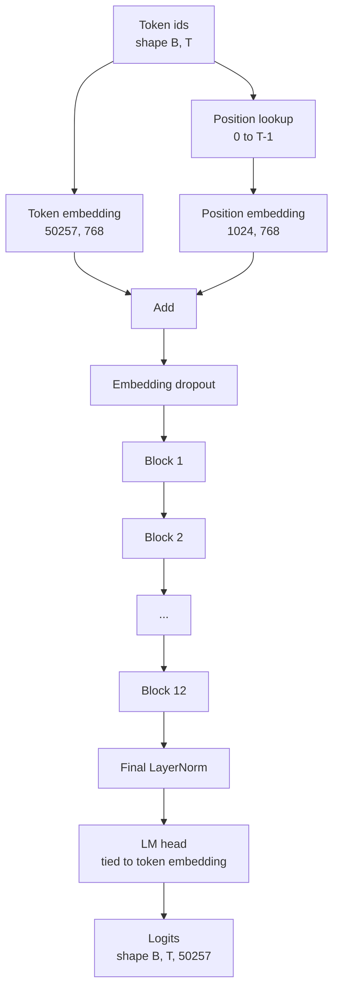
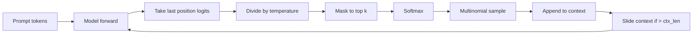

<!-- local-zh-machine-draft: English source is canonical; prose translated automatically, code/math preserved. -->

<a id="gpt-model-assembly"></a>

# 组装 GPT 模型

> 12个街区堆叠,a token embedding,一个学习位置 embedding,最后的 LayerNorm和一副有固定语言模型的脑袋。 parameter GPT 模型。 这个课程将这些作品集合到一个工作阶级, 计算 parameters 以确认该模型与引用 124M 形状匹配,并生成多符号文本 sampling, temperature和顶级。

**类型:** Build
**语言:** Python
**先修要求:** 第19阶段 30至34项经验教训
**时间:** ~90分钟

<a id="learning-objectives"></a>

## 学习目标

- 组装 transformer 将第34课改为完整 GPT 模型: token embedding,位置 embedding,N区块,最后 LayerNorm语言模型头
- 重现1.24亿 parameter 配置: vocab 50257,上下文1024, embedding 768,十二个头,十二层
- 绑起语言模型头 weights 至 token embedding 并解释为什么这节省了~3800万 parameters 以这个比例。
- 从 prompt 具有多符号 sampling, temperature 缩放, 和上K 短跑, 用滑动窗口保持上下文长度 。
- Measure parameter 计数和 forward pass 费用与124M目标相比。

<a id="the-problem"></a>

## 问题

一个 transformer 块没有单独做任何事情。 你需要转身 token 输入向量, 混入位置信息, 运行到堆栈中, 投影回溯到 vocabulary logits。忘记这四个步骤中的任何一步,模型要么不能前进,要么无法定位信息,要么无法说话。

模型的形状也很重要。 GPT-2小等于1.24亿 parameters ,数字不是魔法。Vocab 50257倍 embedding 768是 token 位置表。 位置表1024乘以768。 12个区块, 大约700万个 parameters 每人8400万 头部最后重新使用 token 表格按 weight 搭桥,把碎片全部装起来,你就能在1.24亿上着陆 parameter 计数与引用不符, 是一个信号, 您输入了错误的 。

<a id="the-concept"></a>

## 概念



Token 身份证明成为 token 向量。 位置 ID 成为位置向量。 两者被添加并发送到堆栈中。 最后 LayerNorm 是一个在街区外的碎片 生存了每一个现代变异。 LM 头重复 token embedding 矩阵,这是 weight 绑架意味着。

<a id="weight-tying"></a>

### Weight tying

该 token embedding 形状 `(vocab, d_model)`语言模型头需要从 `d_model` 返回到 `vocab`。这些是相互转换的。 parameter tensor,两次使用。_模型768,矩阵为3 800万 parameters.不支付,你支付两次。 gradient 信号是因为 embedding 并一起更新头部

<a id="position-embedding-is-learned-not-sinusoidal"></a>

### Position embedding 学着点,不是鼻梁骨

GPT- 2艘具有学习能力的船只 embedding位置表 parameter tensor 形状 `(1024, 768)`。模型在每一个前方都向上看0到T-1位置,并增加一个向上看的位置。 token embedding。这是职位方案中最简单的(见A/C.5/52/SR.1和Corr.1)。RoPE, 阿里比, T5 相对偏差是替代品),这是124M参考文献所使用的。

<a id="generation-temperature-top-k-multinomial"></a>

### Generation: temperature,最高k,多符号

世代是 autoregressive。每一步,模型都返回 logits 满满的 vocabulary 每一个位置。 你只选择最后的位置, 除以 temperature,可选择掩码除顶部 k logits 至负无限, softmax 以获得概率, 样本一 token 由由此而来的分布。



三个把手,三个不同的行为 Temperature 几乎是零崩溃,贪婪。 Temperature 一种与模型的自然分布相匹配。 顶部的K1是贪婪的。 顶部的40个过滤器是长尾的。 组合很重要; 下一期培训课使用生成作为质量反val信号 。

```figure
cc-gpt-assembly
```

<a id="build-it"></a>

## 动手实现

`code/main.py` implements:

- `class GPTConfig` 数据类, 默认值为 124M : `vocab_size=50257`, `context_length=1024`, `d_model=768`, `num_heads=12`, `num_layers=12`, `mlp_expansion=4`, `dropout=0.1`, `use_bias=True`, `weight_tying=True`.
- `class GPTModel` 与 token embedding,位置 embedding, embedding dropout十二岁 `TransformerBlock`S, 最终 LayerNorm, 和一个 `lm_head` 和 token embedding 等旗子被定下来
- 一个 `count_parameters` 返回唯一 parameter 计数( 如此) weight 绑定在伯爵的名下。
- 一个 `generate` 函数 temperature,上K,多符号,和滑动窗口上下文。
- 模型的演示,打印 parameter 计算在引用 124M 旁边,并生成一个固定的短顺序 prompt 显示管道的终点结束。

运行：

```bash
python3 code/main.py
```

输出: parameter 与 124M 引用一起计数, 生成 token 随机显示的id prompt,确认LM头和 token embedding 绑定时共享存储器 。

为了让演示速度加快,剧本还运行一个小配置( 缩写) (% 1 )`d_model=64`, `num_layers=2`结束到结尾并打印生成的 token 内嵌序列。 124M 配置是建构的, 但仅是其 parameter 数一数 forward pass 行使。

<a id="stack"></a>

## 堆栈

- `torch` 用于 tensor math, autograd和模块管道。
- `code/main.py` 重新执行与本地第34课相同的块状模式。

<a id="production-patterns-in-the-wild"></a>

## 野生生物的生产模式

三种模式在运行的模型和船舶的模型之间有区别。

**小规模地初步确定剩余预测。** 产出预测数 attention 和 MLP 的第二线性都直接输入到剩余添加中。 初始化标准偏差与其他线性一样的偏差给剩余流带来深度增长并推动最终 LayerNorm 缩放为 `1 / sqrt(2 * num_layers)` 剩余溪流保持正常的距离 贯穿12层

**缓存位置 ID tensor,不重新计算。** `torch.arange(T)` 向每个前方分配新的内存。 `__init__` 切除每个呼叫的第一个 T 条目, 跳过分配器的往返 。

**Tie weights 在 parameter 级别, 不只是复制 。** Setting `lm_head.weight = token_embedding.weight` 共享 tensor; 复制不。 optimizer 需要更新一个 parameter 以及该 autograd 图形需要一次累积。 如果您复制, 头会从 embedding 和 weight 绑着不给你买东西

<a id="use-it"></a>

## 实际应用

- 课程中的模型课与下一个课程的形状相同。
- 取代所学立场 embedding 与 RoPE 让你得到 LLaMA 家人没有碰过街区或头部
- 取代 GELU 与 SiLU 以及该 LayerNorm 与 RMSNorm 让你得到 rest 的 LLaMA 家庭变化。
- 生成函数与任何 logits 源代码, 不仅此模型。 您可以拉 logits 由预科生 GPT- 2 个文件,在第37课中,再用同一组循环。

<a id="exercises"></a>

## 练习

1. 解开LM头 token embedding 并重新计票 parameters。 验证三角洲为5 0257乘以7.68=3 800万。
2. 替换所学位置 embedding ,在施工时计算成正弦表。确认模型仍然向前和 parameter 计数减少786,432
3. 添加a `greedy=True` 向跳过的一代 sampling 并选择 argmax。 确认序列是决定性的 横贯运行。
4. 添加a `repetition_penalty` 区分任何登录的按钮 token 在 prompt 或由一个常数生成历史 softmax显示已固定的 prompt 中,值超过1,会减少输出中的重复计数。
5. Add `top_p` (nucleus) sampling 旁边 `top_k`。双线检查保存的概率和 tokens exceeds `top_p`.

<a id="key-terms"></a>

## 关键术语

| 术语 | 人们怎么说 | 它实际上意味着什么 |
|------|-----------------|------------------------|
| Weight tying | "Tied embeddings" | 头和 token embedding 共享相同 parameter tensor; 保存 vocab 次数 d_模型 parameters 并匹配 GPT- 2个参考 |
| Position embedding | 学习位置 | 单独的形状表格(字符长, d)_模式) token 矢量; 学习结束 |
| 滑动窗口上下文 | "背面盖" | 当 prompt 加上生成的 tokens 超过上下文长度, 放下最老的 tokens 使活动窗口适合 |
| Top-k sampling | "K 短跑" (K 短跑) | 留着K logits 以最高值遮掩 rest 至负无限, softmax 剩余部分的 |
| Temperature | "Sampling temperature" | Divide logits 之前的 T softmax; 磨痕小于1,T等于1,保持自然分布,T大于1平坦 |

<a id="further-reading"></a>

## 进一步阅读

- 阶段19课34 这个模型堆
- 第19阶段第36课 用于引导这个模型的 反向变异的循环训练
- 第19阶段,关于装货的37项课程 GPT-2 weights 进入这个精确的结构。
- 第7阶段课程07(GPT 下一个数学的因果语言模型 token prediction.
- 第10阶段第04课(培训前微型) GPT用于同一建筑的原始培训程序。
