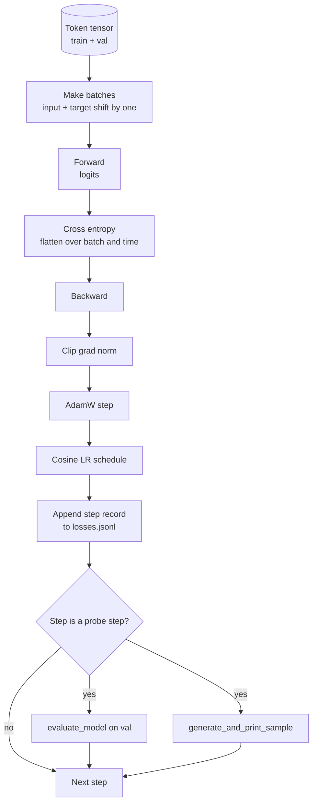

<!-- local-zh-machine-draft: English source is canonical; prose translated automatically, code/math preserved. -->

<a id="training-loop-and-evaluation"></a>

# 训练循环与 Evaluation

> 不测量的循环是一个谎言循环。 此课程构建了驱动 GPT 模型: AdamW 与 weight decay 分开, a warmup 加上余弦 learning rate schedule, 一个 `calc_loss_batch` 帮助者, a `evaluate_model` 传递数据 `generate_and_print_sample` 质量探测每K步,和 JSONL 损失记录可以绘制。 decoder LLM 你永远也不会建起来

**类型：** 构建
**语言:** Python
**先修要求:** 第19阶段 30至35项经验教训
**时间:** ~90分钟

<a id="learning-objectives"></a>

## 学习目标

- 建立一个使用正确输入和目标计算跨子体损失的训练循环 alignment 下一个 token prediction.
- Configure AdamW 与 weight decay 适用于 weight tensors 而不是为 LayerNorm 或偏见 tensors.
- 执行a learning rate schedule 线性 warmup 并腐烂余弦, 并阅读后产生的 LR 时间。
- 评估一个被搁置的分裂 `evaluate_model` 所以反val损失是可比较的
- 生成质量样本, 每一步使用 K `generate_and_print_sample` 以在损失曲线之前捕捉差异。
- 每一步损失为 JSONL 这样你就可以重新装货, 绘制, 并装运训练日志作为交付品。

<a id="the-problem"></a>

## 问题

打印损失但不失功的训练脚本。 它无法告诉您损失是否因正确原因在减少( 模型可以超过训练组, 永远不学习 ) 。 它无法告诉您差异是否开始( 损失可按一步猛增并恢复, 或者一步即崩溃 ) 。 它无法告诉你模型学到了什么( 损失是斜线; 生成的样本是段落)。 除非循环测量, 否则所有三个失败都会隐藏 。

课程循环以三种方式衡量。 每一步都损失训练分批。 每一步损失一个固定的 K 级。 prompt 训练日志在 JSONL 所以,文物是循环的证词。

<a id="the-concept"></a>

## 概念



这两件不为人知的物品就是损失 alignment 以及该 AdamW 腐烂分裂。

<a id="loss-alignment"></a>

### Loss alignment

模型预测下一个 token 输入批次 tokens `[t0, t1, t2, t3]`,目标批次必须是 `[t1, t2, t3, t4]`。在平面形状上计算交叉的星体 `(batch * seq, vocab)` 与平面目标对 `(batch * seq,)`。忘记了这一转变,然后你训练模型来预测自己,它会聚集到零损失,而不会学到什么有用的东西。

<a id="adamw-decay-split"></a>

### AdamW 衰变分割

Weight decay regularizes weight tensors 但没有 normalization 标尺或偏差。 LayerNorm 比例制将比例制缓慢驱动为零并断开 normalization。在偏差上放衰变在数学上无害,但是一种循环的浪费。标准分割是:矩阵形状 tensors (linear weights, embedding 变换表) 变坏, 任何看起来像比例或变化的都不行。

<a id="warmup-plus-cosine-schedule"></a>

### Warmup 加上余弦计划

Warmup 斜坡 learning rate 从零到目标 超过几百步,所以 optimizer 状态有时间弹出。 共弦衰落会下降 learning rate 回到零,再过剩下的步骤 所以最后阶段细调 weights 。 组合是打开时最常见的时间 weights LLM 因为它消除了前一千步和最后一千步中 大部分的微弱时刻

<a id="held-out-evaluation"></a>

### 已经停电了 evaluation

`evaluate_model` 运行验证分解后的固定批次数,积累损失,按批次数分隔,并返回。 gradient. 否 dropout。数字可以复制为运行,以同样的种子和相同的分解。报告在训练损失旁边的损失是您如何发现 overfitting.

<a id="qualitative-sampling-as-an-early-signal"></a>

### Qualitative sampling 做为早期信号

一种训练失败的模型 但产生的样本都一样 token 质量探测器比读取整个曲线的速度快,并且捕捉到卡路里漏掉的模型。

```figure
cap-training-loop
```

<a id="build-it"></a>

## 动手实现

`code/main.py` implements:

- `make_batches(token_ids, batch_size, context_length)` 切片长 token tensor 输入和目标对。
- `calc_loss_batch(model, inputs, targets)` 并返回 标度十字的 entropy。
- `evaluate_model(model, val_loader, max_batches)` 并返回平均损失。
- `generate_and_print_sample(model, prompt, max_new_tokens)` ,该选项在固定的 prompt 并打印结果。
- `build_param_groups(model, weight_decay)` 产生两组 AdamW parameter list.
- `cosine_with_warmup(step, warmup_steps, total_steps, max_lr, min_lr)` ,在给定的一步返回 LR。
- `train(...)` 运行循环的, 持续 `outputs/losses.jsonl`,并打印反射损失和每个样本 `eval_every` steps.
- 一位演示人训练了一个小模型 用于少量的合成数据,写道 JSONL 记录,并打印 反射损失和样本 在探针点。 CPU.

运行：

```bash
python3 code/main.py
```

输出:每一步损失线,每一步反射损失,每一步检测结果样本,最后 `outputs/losses.jsonl` 您可以用 `json.loads` 每一行。

<a id="stack"></a>

## 堆栈

- `torch` 用于 autograd, optimizer和模块。
- `main.py` 重新落实该课程 35 `GPTModel` 和当地支持模块。

<a id="production-patterns-in-the-wild"></a>

## 野生生物的生产模式

三种模式把教科书循环变成一种 你可以在一夜之间离开的东西

**Gradient 常规剪裁是不可谈判的。** 坏批量( 无效数据、 LR 刺、 数字边缘大小写) 产生巨大的 gradient 这会使训练时间缩短 `torch.nn.utils.clip_grad_norm_(params, max_norm=1.0)` 之后 `backward` 和之前的 `step` 保留 optimizer 在一个安全范围内。剪切值为免费 parameter; 一个是大多数设置都幸存的默认值。

**Resumable JSONL 伐木,不是泡菜状态** 每一职级损失记录为 `{"step": int, "train_loss": float, "lr": float}` 线条 JSONL 具有耐久性:任何碰撞留下可读的文物,您可以使用 30 行 Python,您可以通过读取最后一步恢复训练。被选中的状态将您与生成文件的模块布局相联系,因为这个布局在反因中是易碎的。

**以瓦从固定的切片中提取成批。** 验证 tokens 可以在脚本开始的时候切成批次,而不是在飞盘上。 复制取决于 evval 批次是否运行时相同; 否则, 要比较两个运行量的批次损失, 批次打乱和模型一样多 。

<a id="use-it"></a>

## 实际应用

- 这条课的循环就是 训练124M模型的骨架 token tensor a 用于 `datasets`- 式式的装载器和循环运行没有变化。
- 该 JSONL 日志是将训练变成证据的可交付文件。 下一个课程使用一个比较新训练过的 checkpoint 和一个预训过的。
- 质量样本探测器是所有卡路里损失无法替代的捕获物。

<a id="exercises"></a>

## 练习

1. Add `weight_decay_groups()` 能够确认比例和偏差的单位测试 parameters 地上无腐烂的形状,线性 embedding weights 地是腐烂的。
2. 替换合成随机 tokens 使用小文本文件中的字节, 演示列将使用可读文件。 校验生成的样本时使用文件中的字符 。
3. 添加a `min_lr` 下限为10% `max_lr` 重新绘制。
4. 保存 checkpoint 每个 `eval_every` 执行《公约》的 JSONL 日志。 添加 a `resume_from` 重新装入模型状态的旗帜 optimizer state.
5. 记录每步输送量( )tokens per second) 损失旁边,确认它保持稳定带。

<a id="key-terms"></a>

## 关键术语

| 术语 | 人们怎么说 | 它实际上意味着什么 |
|------|-----------------|------------------------|
| Loss alignment | "一头一头" | 输入 tokens 目标位置: 0.T-1 tokens 。 以平坦的形状计算十字的 entropy |
| 衰变分裂 | "两组" | AdamW 接收矩阵形状 tensors 与 weight decay 和规模或偏差 tensors 无 |
| Warmup | "Ramp" | 该 learning rate 由零升到目标 超过固定的几步 optimizer 状态可以弹出 |
| Eval 批量 | 散装货箱 | 固定的验证片段 token tensor,在脚本开头切片一次,使用相同的每个探测器 |
| 定性探测 | "样本打印" | 短一代的固定 prompt 打印每 K 步以捕获失败模式损失 。 |

<a id="further-reading"></a>

## 进一步阅读

- 阶段19课35 模型环驱动器。
- 第19阶段,关于装货的37项课程 weights 变成同一个模型
- 第10阶段第04课(培训前微型) GPT用于真实数据程序。
- 第10阶段课程10(evaluation) 用于跨星体丧失后的更广泛的反射表面。
