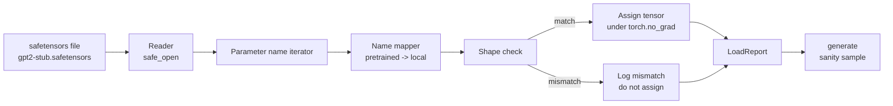

<!-- local-zh-machine-draft: English source is canonical; prose translated automatically, code/math preserved. -->

<a id="loading-pretrained-weights"></a>

# 加载预训练 Weights

> 培训1.24亿 parameter 从零开始的模式是一个预算决定;装入已公布 checkpoint 星期二,这课已经上过 GPT- 2 样式 weights 从安全梯子文件 进入精确的建筑 从课程35,走 parameter 姓名绘制的拼图, 并且理智能产生一个连续的来证明负荷有效。 没有网络, 没有第三方装载器, 没有不透明的魔法 。

**类型:** Build
**语言:** Python
**先修要求:** 第19阶段 30至36项经验教训
**时间:** ~90分钟

<a id="learning-objectives"></a>

## 学习目标

- 读取一个与 `safetensors` Python 图书馆和检查 tensor 名称和形状。
- 每一个预选的地图 parameter 名称 parameter 课35 GPT 模型.
- 处理两种不同名称公约的公布 GPT-2 weights 和此轨道中的模型 : `wte/wpe/h.N.attn.c_attn/c_proj` 和 `mlp.c_fc/c_proj` 对本地命名 `tok_embed/pos_embed/blocks.N.attn.qkv/out_proj` 和 `mlp.fc1/fc2`.
- 检测并拒绝形状不匹配, 之前有明显错误 weight 任务发生。
- 生成一个带装入的简短续编 weights 并确认 tokens 来源于已装入的分布,而不是随机初始化的分布。

<a id="the-problem"></a>

## 问题

Published weights 不被包装为您的架构。 它们包含使用过的初始执行名称。 预培训的文件 `transformer.h.0.attn.c_attn.weight` 形状 `(2304, 768)`; 您的模型期待 `blocks.0.attn.qkv.weight` 形状 `(2304, 768)` (在不同的布局常规中, 相同矩阵) 或您的模型使用 `nn.Linear` 中存储已转换的矩阵。 parameter 显示三个小不同的身份(名称、形状、字节布局),装载器必须对所有三个身份进行对齐。

装有盲目弹出右侧的装载器 tensor 在一个错误的地方,你得到一个模型,产生无稽之谈。 一个在形状不同时拒绝复制但没有记录的东西的装载器,你就会猜到 tensor 无法降落。 此课中的装载器是明确的: 每一个任务都登录, 每个形状都检查, `LoadReport` 总结点击、误差和形状不匹配,以便您能够读取发生的事情。

<a id="the-concept"></a>

## 概念



映射器的名称只是一个字符串之间的函数。 形状检查是一。 任务发生在内部 `torch.no_grad()` so autograd 无法跟踪负荷。 报告包含每个名称的结果 。

<a id="the-gpt-2-naming-convention"></a>

### 该 GPT- 2个命名公约

Published GPT-2 weights 生活在名字下,比如:

| 预选名称 | 形状 | 含义 |
|-----------------|-------|---------|
| `wte.weight` | (50257, 768) | Token embedding |
| `wpe.weight` | (1024, 768) | Position embedding |
| `h.N.ln_1.weight` | (768,) | LayerNorm N区1级 |
| `h.N.ln_1.bias` | (768,) | LayerNorm N区1班 |
| `h.N.attn.c_attn.weight` | (768, 2304) | 折叠的 QKV 线性 weight |
| `h.N.attn.c_attn.bias` | (2304,) | 折叠的 QKV 线性偏移 |
| `h.N.attn.c_proj.weight` | (768, 768) | Attention 产出预测 |
| `h.N.attn.c_proj.bias` | (768,) | Attention 输出投影偏差 |
| `h.N.ln_2.weight` | (768,) | LayerNorm 2个薪级 |
| `h.N.ln_2.bias` | (768,) | LayerNorm 2班轮班 |
| `h.N.mlp.c_fc.weight` | (768, 3072) | MLP 纤维化1 weight |
| `h.N.mlp.c_fc.bias` | (3072,) | MLP fc1 偏差 |
| `h.N.mlp.c_proj.weight` | (3072, 768) | 移动式平方公尺 weight |
| `h.N.mlp.c_proj.bias` | (768,) | MLP fc2 偏差 |
| `ln_f.weight` | (768,) | Final LayerNorm scale |
| `ln_f.bias` | (768,) | Final LayerNorm shift |

有两个惊喜要计划 `c_attn`, `c_proj`, `c_fc` 线性数据与相对于何值的矩阵相切换后存储 `nn.Linear.weight` 期待。 装载器在任务期间转换。 LM 头完全不在文件中; 模型依赖于 weight 绑定 `wte`,所以头部是用化名设定的 `wte` lands.

<a id="the-local-naming-convention"></a>

### 本地命名公约

本轨道上的模型使用描述性名称:

| 本地名称 | 含义 |
|------------|---------|
| `tok_embed.weight` | Token embedding |
| `pos_embed.weight` | Position embedding |
| `blocks.N.ln1.scale` | LayerNorm N区1级 |
| `blocks.N.ln1.shift` | LayerNorm 1轮轮 |
| `blocks.N.attn.qkv.weight` | 引信QKV |
| `blocks.N.attn.qkv.bias` | 错开的 QKV 偏差 |
| `blocks.N.attn.out_proj.weight` | Attention 产出预测 |
| `blocks.N.attn.out_proj.bias` | 产出预测偏差 |
| `blocks.N.ln2.scale` | LayerNorm 2个薪级 |
| `blocks.N.ln2.shift` | LayerNorm 2班轮班 |
| `blocks.N.mlp.fc1.weight` | MLP 纤维化1 |
| `blocks.N.mlp.fc1.bias` | MLP fc1 偏差 |
| `blocks.N.mlp.fc2.weight` | 移动式平方公尺 |
| `blocks.N.mlp.fc2.bias` | MLP fc2 偏差 |
| `final_ln.scale` | Final LayerNorm scale |
| `final_ln.shift` | Final LayerNorm shift |

绘图是一个固定的功能。 教学将它作为装货机反复转动的指令 。

<a id="the-stub-fixture"></a>

### 管子固定

Real GPT-2 weights 是 0.5 GB。演示不下载它们; 它在第一次运行时生成一个小的安全加速器固定装置, 且精确 GPT- 2 命名惯例和适合d区12个区块模式的形状_模型192而不是768。 固定装置有正确的结构来运行装载器中的所有代码路径。 交换真实文件的固定装置和装载器的固定装置, 不作修改 。

```figure
cc-weight-remap
```

<a id="build-it"></a>

## 动手实现

`code/main.py` implements:

- 课程的一小段复制件 35 `GPTModel` 所以这个课是自我约束的
- `make_pretrained_to_local(num_layers)` ,以扩展每个层的条目。
- `load_safetensors(model, path)` 转换形状,转换 conv1d 型号 weights,并指定在 `torch.no_grad()`返回a `LoadReport`.
- `make_stub_safetensors(path, cfg)` 生成一个固定文件, 并具有精确的预设命名常规 。
- 制作演示 `outputs/gpt2-stub.safetensors` 首先,建立一个新的模型,捕捉随机导体产生的连续体,加载根管,捕捉另一个连续体,同时打印,并核实两者不同(负载实际上改变了模型)。

运行：

```bash
python3 code/main.py
```

输出: 固定路径, 每个名称的负载日志, a `LoadReport` 汇总、 装入前的续延、 装入后的持续, 以及形状不匹配于单次故意损坏 tensor 注入固定装置,以便运行故障路径。

<a id="stack"></a>

## 堆栈

- `safetensors` 格式和 streaming reader.
- `torch` 模型和任务数学
- 否 `transformers`, 否 `huggingface_hub`不准打电话

<a id="production-patterns-in-the-wild"></a>

## 野生生物的生产模式

三个模式让装载器能幸存下来 weights 你没有创造。

**总是在任何任务之前验证文件 。** 打开文件, 列出每个 tensor 名称及其 dtype 和 形状, 运行完整的映射, 并使用形状检查, 并且只有在成功时才能开始分配 。 半载模型是静态故障机器 。

**记录每个任务,并注明源名和目的地名称。** 当事情看起来不对劲时 日志会告诉你 tensor 降落在哪里; 选择是读取十六进制。 `LoadReport` 课程轨中的数据类 `loaded`, `missing`, `unexpected`, 和 `shape_mismatch` 列表并打印结尾处的概要。

**路德的头是 weight 绑上别名,不是单独复制的** Setting `model.lm_head.weight = model.tok_embed.weight` 装入后 `tok_embed` 是卡通模式。 embedding 矩阵变成一个 `lm_head.weight` parameter 断开系链,悄悄地翻倍 parameter count.

<a id="use-it"></a>

## 实际应用

- 装载器用于使用预先训练的命名常规的任何安全增强器文件。 Real GPT- 2 文件( 小/ 中型 / 大 / xl) 工作, 代码不变; 只有模型配置不同 。
- 同样的模式延伸到 LLaMA, Mistral, Qwen weights 一旦更新了名称图,形状检查和报告保持相同。
- 装货后的健康生成是一个快速的大门:如果后装货样品看起来像预装货样品,则负荷并没有改变模型,这意味着无声地错过了每一个 tensor.

<a id="exercises"></a>

## 练习

1. 添加a `dtype` 向每个投放器的装载器提出参数 tensor 目标类型(`bfloat16`, `float16`, `float32`)任务期间。 `float32` 模型可以被下投到 `bfloat16` 并且仍然产生。
2. 添加一个 `expected_layers` 拒绝装入 a 的参数 checkpoint whose `h.N` 指数与模型不符 `num_layers`.
3. 将装载器插进课程35 代函数,并同时产生两个样本:一个来自随机的内嵌,一个来自装满的固定装置。
4. 添加导出路径: 使用预设的命名会议将当前模式状态写入新安全加速器文件。 装载器和确认报告没有形状错配 。
5. Extend `NAME_MAP` 处理 LLaMA 命名公约(无偏差, RMSNorm,并重新运行一个根根上的装载器 LLaMA 固定的你生成。

<a id="key-terms"></a>

## 关键术语

| 术语 | 人们怎么说 | 它实际上意味着什么 |
|------|-----------------|------------------------|
| 名称映射图 | "键重绘" | 预训后函数 tensor 名称改为本地 parameter 名称; 通常为一字句, 每层指数有一个条目, 以循环扩展 |
| 形状不匹配 | 烂形状 | 预训 tensor 其尺寸与本地的相悖 parameter;装载器拒绝指定,并记录对子 |
| Transpose-on-load | "Conv1d布局" (Conv1d布局) | Published GPT-2个商店 attention 和 MLP 在传输 nn. Linear 期望的。 装载器在任务期间的传输 |
| Weight 绑定别名 | 分享LM头 | 设置模型. lm_head.weight =模型.tok_embed.weight 所以头部和 embedding 共享存储; 首页因此不在文件中 |
| 装入报告 | "服务摘要" | 一个小数据类, 跟踪已装入、 丢失、 意外和形状_不匹配列表; 打印它就是如何判断负载是否成功 |

<a id="further-reading"></a>

## 进一步阅读

- 阶段19:关于接受 weights.
- 阶段19:36, 用于产生 checkpoint 同样的形状。
- 第十阶段课程11(quantization) 用于如何处理已装入的 weights 当记忆力很紧的时候
- 第十阶段课程13(建立完整的 LLM ),用于整个生命周期,包括载荷和 inference.
