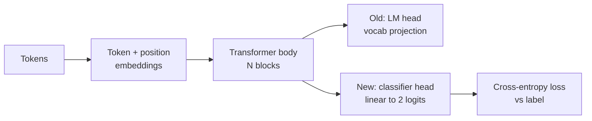
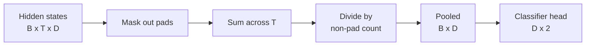
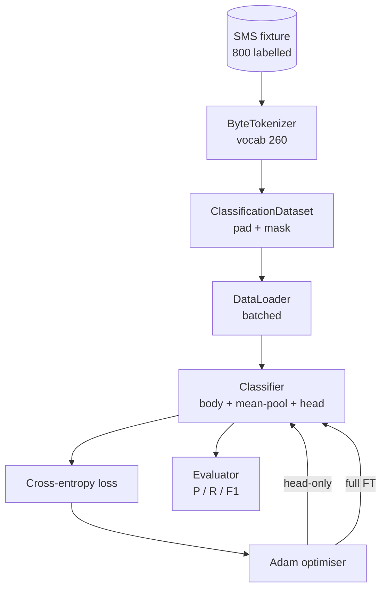

<!-- local-zh-machine-draft: English source is canonical; prose translated automatically, code/math preserved. -->

<a id="capstone-lesson-38-classifier-fine-tuning-by-head-swap"></a>

# 综合项目第 38 课：通过替换输出头进行分类器 Fine-Tuning

> B轨道的第一个综合项目。 self-attention 以 token头部。 当你想要垃圾邮件对火腿时, 头部是错误的, 但身体大部分是正确的。 这个课将头部扯下来, 将双层线性层粘到集合的表达面上, 并且用两种不同的方式训练分类器: 仅限最后一层, 并且完整 fine-tuning。 反省是精确的, 记得, 和F1 的悬崖分割。 你了解每个策略都买给你什么, 以及它的成本。

**类型：** 构建
**语言:** Python (torch, numpy)
**先修要求:** 第19阶段课程30-37(无法律文件) LLM track: tokenizer, embedding table, attention block, transformer 身体,训练前循环, 检查,产生, perplexity)
**时间：** ~90 分钟

<a id="learning-objectives"></a>

## 学习目标

- 将语言模范头换成分类头,而不重新点名。
- 实施两个训练制度:冻结机构(只头部)和全面 fine-tuning分享一个训练圈
- 建立一个有象征力的数据管道,用于垫子、面罩和池子 attention 输出.
- 计算精确率、 回溯、 F1 和原始的混乱矩阵 logits.
- 权衡的原因 parameter 数数,训练时间,和正室。

<a id="the-problem"></a>

## 问题

你训练过一点 transformer 输出头投影到最后的隐藏状态token vocabulary。现在您有800条短消息标注垃圾邮件或火腿,并且想要二进制分类器。有三个选项。

错误的选择是从零开始对800个示例进行新的分类。 预习模型的正文已经编码了有用的结构: 字名身份、 位置、 简单共生。 丢弃它会浪费构建它所需的计算 。

两种正确的选择是头换身体,头换身体,头换身体,身体可以训练。 头顶训练很快,记忆中几乎是免费的,很少用这个小数据过量。 fine-tuning 速度较慢,可以超合小数据,但当下游域从 pretraining corpus.

这个课能建立两个, 这样你就可以用相同的固定来比较它们。

<a id="the-concept"></a>

## 概念



模型是一个函数 `f_theta(tokens) -> hidden_states`。头是一个函数 `g_phi(hidden) -> logits`。换头意味着保持 `theta` 替换 `g_phi`身体的 parameters 是一个昂贵的部分。头部是一条线性层。

两个可以训练的 parameter 设置物质 :

- `theta` 尸体:数万个 weights 每 attention block.
- `phi` (头): `hidden_dim * num_classes` weights 加上偏见

只在脑部训练中计算 gradients against `phi` 以至他们 `theta`. PyTorch 设置时让您这样做 `requires_grad=False` 身上发现 parameters。那么,乐观者只看到头部和身体冻结。

满 fine-tuning 你让 gradients 整个堆放物都流回原处 weights 风险是灾难性的 忘记了小数据: pretraining 被冲出去 overfitting noise.

<a id="the-pooling-question"></a>

## 集合问题

分类器需要每个序列一个矢量,而不是每个矢量 token三个共同的选择:

- **平均游泳池**: 顺序中隐藏状态的平均值,按 attention mask.
- **CLS 池**:预设一个特殊 token 只能使用它的输出。 BERT does.
- **Last-token pool**:使用上次未粘贴 token。这就是 GPT- 分类师会的

这个课用的是把一个清晰的集合起来 attention- 表面加权。它是最简单的, 发出一个稳定的信号, 跨序列长度, 不需要 pretraining a CLS 缩写为“CLS”。 token.



<a id="the-data"></a>

## 数据

以决定方式生成了800条短消息, 平衡了400条垃圾邮件和400条火腿 `code/main.py`。生成器使用固定种子,选择模板和替代填充槽,并发出5至25个信息 tokens 长。 真正的数据集有噪音, 此固定点没有。 固定点是可复制 。

数据分割 80 /20 : 640 列车, 160 个测试。 分解是分层的, 测试组保持50/50的平衡。 持有已知平衡的套件可以精确和回想为诚实的数字 。

<a id="the-metrics"></a>

## 计量

二进制分类,第1类为正类(垃圾邮件)。 计数为:

- `TP`:预测垃圾邮件,是垃圾邮件。
- `FP`:预测垃圾邮件,是火腿。
- `FN`:预测的火腿,是垃圾邮件。
- `TN`:预言的火腿,是火腿。

三个标题指标:

- `precision = TP / (TP + FP)`。在标注垃圾邮件的信息中,什么是分数?
- `recall = TP / (TP + FN)`。在实际垃圾邮件中,什么是标语的分数?
- `F1 = 2 * P * R / (P + R)`两者的口琴含义

混杂矩阵将四个数字打印为 2x2 格。 演示将此写成两个训练制度的 stdout 。

```figure
cap-classifier-head-swap
```

<a id="architecture"></a>

## 建筑



身体是故意的很小 transformer: vocab 260, 隐藏的 64, 4 头, 2个街区, 最大序列 32 。 它小到足以训练两个政权在90秒内融合 CPU。它没有在课程中预先训练;相反, `pretrain_quick` 帮助者对同一固定线的文字进行五个世纪的LM训练, 使身体有一个非三重起点。 这让课程保持自足。

<a id="what-you-will-build"></a>

## 做你该做的

执行是一体 `main.py` 加一个测试模块(`code/tests/test_main.py`).

1. `ByteTokenizer`:地图到 ids 的字节,保留一个pad id。
2. `Block`: 一个 transformer 带多头的块 attention 和进食层,在中途。
3. `LMBody`: token + 职位 embeddings 加上一堆块。返回隐藏状态。
4. `MeanPool`:在序列轴上方的蒙面加权平均值。
5. `Classifier`:身体、游泳池、直线头。身体是跨体制的相同例子。
6. `freeze_body` 和 `unfreeze_body`: 切换 `requires_grad` 身上发现 parameters.
7. `train_classifier`:一个共享循环。接受模型和为其中任何对象配置的优化器 parameter 组是可训练的。
8. `evaluate`:运行测试集并返回 `Metrics(precision, recall, f1, confusion)`.
9. `run_demo`:先对身体进行简短的检查,然后培训和评价头部,然后完整地打印报告,然后从零处输出。

<a id="why-the-comparison-matters"></a>

## 为何比较很重要

仅使用头的系统通常能更快速、更优雅地训练。 在这种固定上,您通常会看到精度接近0.9,在经过20个阶段只使用头的训练后,会记得近0.85。 fine-tuning 需要大约三倍的时间 降落在几个点内 取决于随机种子

课程没有选择赢家。 它教你阅读数字和成本。 在800个例子和一个小身体上, 仅靠头来决定是正确的。 在80,000个例子和一个更大的身体上, 完整 fine-tuning 开始偿还。 从这个教训中你得到的合同是 API:相同 `train_classifier` 函数同时处理,切换为一通电话。

<a id="stretch-goals"></a>

## 伸展目标

- 添加第三个只解冻最后一个块的系统。 这有时被称为局部 fine-tuning。它的成本低于全额FT,并且学习的不仅仅是头顶。
- 添加学习速率调度器。 头部的焦距排程加上身体的较小的恒定速率是常见的生产装置。
- 将“集合”改为“学习” attention 池子:一个小 attention 上层有一个已学习的查询。 这通常比长顺序的集合要强。

测试结果会把合同钉住,数字由你来推
