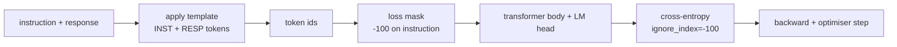
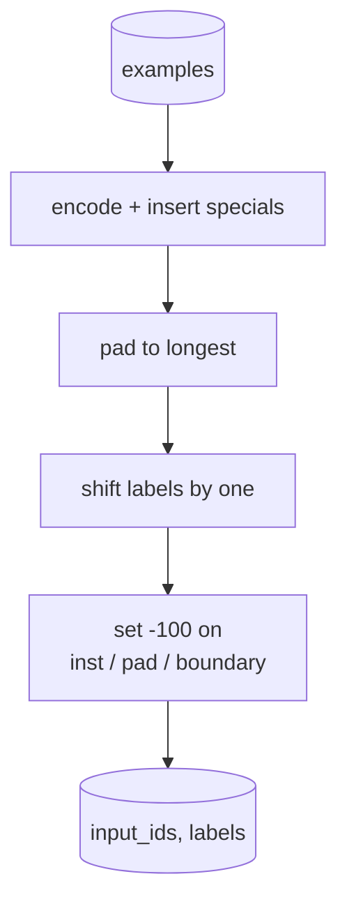
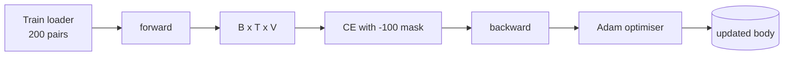

<!-- local-zh-machine-draft: English source is canonical; prose translated automatically, code/math preserved. -->

<a id="capstone-lesson-39-instruction-tuning-by-supervised-fine-tuning"></a>

# 综合项目第 39 课：通过监督式 Fine-Tuning 进行指令微调

> 预培训的基础模型可以扩展序列,但不能遵循指令。 fine-tuning 是一个最小的修改, 来修正它: 将模型中的匹配示例 添加到一个指令和想要的反应中, 并训练身体来预测响应 。 tokens。关键在于,您只想要损失来计算响应,而不是指令。这个课创建了阿尔帕卡式的 SFT 循环,使用自定义的校验函数,以遮罩指令 tokens 与 `ignore_index=-100`,用200对指令-反应对列列, 并使用精确匹配来评价悬停的分割。

**类型:** Build
**语言:** Python (torch, numpy)
**先修要求:** 第19阶段课程30-37(无法律文件) LLM track: tokenizer, embedding table, attention block, transformer 身体,训练前循环, 检查,产生, perplexity)
**时间:** ~90分钟

<a id="learning-objectives"></a>

## 学习目标

- 格式化对齐的指令-回复数据,形成单一的、有明确界限的因果序列 tokens.
- 构建一个掩码指令的校验函数 tokens so cross-entropy 仅算响应 tokens.
- 训练一个小的 transformer 下方的物体 SFT 目标,并观看 评估度量移动。
- 贪婪的 temperature- 被标为尊重反应启动界限的一代
- 计算生成的补全时的超前精确匹配 。

<a id="the-problem"></a>

## 问题

下一个训练的基地模型token 预测不知道什么是指令。 显示字符串 `"What is the capital of France?"` 它将继续提问或发明一个新句子。该模型有语言,但格式合同除外。

该 SFT 合同是一个字符串模板。 每个训练示例都变成一个单一序列, 有三个区域 :

```text
<INST> What is the capital of France? <RESP> The capital of France is Paris.
```

边界 tokens 特别 tokens 模型学会了一切 `<RESP>` 回答是分级。 基础模型的下一个 --token 目标仍然适用;它只是经过训练,每个例子都具有这种形状。

但有一个陷阱。如果你把整个序列喂给香草 cross-entropy 损失,您正在训练模型 以预测指令 tokens。指令已经给出。您想要零 gradient 固定在那些位置上 固定在面具上

<a id="the-concept"></a>

## 概念



`ignore_index` 是一个 feature 的 `torch.nn.functional.cross_entropy`。任何目标位置等于 `ignore_index` 零损失和零损失 gradient公约在 PyTorch 是 `-100`。核对函数构建 2 tensors 示例: `input_ids` (全序)和 `labels` (原件:英文) `input_ids` 由 `-100`).

模型在 forward pass; attention 能够处理指令。损失只算响应 tokens。这正是你想要的: 以指令为条件,预测响应。

<a id="the-data"></a>

## 数据

以决定方式生成了200对指令-反应 `main.py`。它们包括六种任务类型:

- 事实单发(十字首页)
- arithmetic
- 列表提取
- 一罪提要
- 代码( 打印、 排序)
- definition

每个任务都有模板式的指令和确定性响应。 这是有意简单的。 精确匹配是易碎的, 课程使用固定的, 正确的答案是一个特定的字符串 。 SFT 数据集需要模糊的度量;原则相同。

分解为160列火车,40次测试。测试组覆盖所有六种任务类型,因此可以报告每类精确匹配。

<a id="tokenisation-and-padding"></a>

## 缩写和拼写

代号是字节级,有三个保留的特殊内容:

- `INST_ID = 256`:表示教学区域的开始。
- `RESP_ID = 257`:标出指令与响应之间的界限。
- `PAD_ID = 258`:可变长度批量的铺设。

顺序是 `[INST] inst_bytes [RESP] resp_bytes [PAD]*`。核对函数:

1. 每一个例子都具有共鸣。
2. 将批量中的每个示例都贴上最长时间的序列。
3. Builds `labels` = `input_ids` 移动一个(因果LM目标), 并:
   - 教学区域被 `-100`.
   - 铺设区域被 `-100`.
   - 该 `RESP_ID` 边界位置本身被 `-100` (你没有训练模型来预测边界) token; 它预测了接下来的( ) 。



改变是标准的因果诡计: `i` 的 `input_ids` 预测位置 `i+1`那样 `labels[i] = input_ids[i+1]` 使用掩码,在向右方的地面移动后。

<a id="training"></a>

## 培训



循环是标准 PyTorch SFT loop. Adam, learning rate 大约3e-4至1e-3,10至20个世纪的固定点上没有排程器。模型小到足以训练如何在 CPU 两分钟内

每隔五分之一 epoch 循环运行一个小的 Eval 过关插件并打印精确匹配。 观看精确匹配从 0.0 到 0. 0 。 epoch 一张到类似0.85 epoch 15是教训的回报:你可以同时看到模型学习格式和答案。

<a id="generation"></a>

## 一代

逆向时, 模型获得指令前缀 `[INST] inst_bytes [RESP]` 并生成 tokens 至:

- 序列达到 `max_len`, 或
- 模式发出特别停止的偏移:两个连续句尾字节(`.`, `!`, `?`).

贪婪的解码器加上一个可选的 temperature 抽查员,精密匹配使用贪婪 temperature 将使得测量系统具有质性。真正的系统通常会取样,然后对它进行模糊的判断;输油管是第41项课程。

<a id="exact-match-evaluation"></a>

## Exact-Match Evaluation

精确匹配是最严格的文本测量。 预测响应字符串被常规化( 低写、 脱光空白、 折叠双空格) , 与引用响应相比, 也以同样方式正常化 。 度量为每个示例 1 或 0 。 总计是平均值 。

Real SFT 管道与 token- F1级(第41项)和法官模型。精确匹配仍然有用,因为它很明确;如果它写着0.7%,则70%的测试指令为字符生成了金字元反应字符。

```figure
cc-sft-loss-mask
```

<a id="what-you-will-build"></a>

## 做你该做的

执行是一体 `main.py` 加上测试

1. `InstructionTokenizer`:字节级别 encoder 。 编码一个指令前缀或完整对。
2. `make_dataset`:在六种任务类型中生成200对配有固定种子的。
3. `SFTDataset`: 返回 `(input_ids, labels)` 已经准备了面具
4. `sft_collate`:动态垫,构建批量 tensor,设置 `-100` 指示和垫位位置。
5. `TinyGPT`: transformer 身体加上绑着的或松绑的LM头
6. `train_sft`: 该 SFT 循环,每 -epoch 电动钩子
7. `generate`:从前缀中解码,贪婪或抽样,用停止的疲劳。
8. `exact_match`: 正常的字符串比较,返回在 `[0, 1]`.
9. `run_demo`: 建立数据,为20个世纪进行火车,评估,打印每类分类,成功后出零。

<a id="why-the-mask-matters"></a>

## 面具为什么重要

没有面具,损失会处理教学 tokens 模型可以预测指令。这是一个不同的目标,以两种方式产生一个更糟糕的模式。首先,模型能力被浪费,无法重建用户总是提供的投入。第二,响应损失较小 gradient 和,因为指令 tokens 答复数 tokens 大部分批次; 优化器有效 learning rate 所关心的, 其程度比预期的要低。 面具不是光滑的, 而是目标 。

<a id="stretch-goals"></a>

## 伸展目标

- 添加学习率 warmup 之后是腐烂 SFT 比较敏感 LR 大于 pretraining.
- 添加每 -token 记录损失并绘制培训的损失曲线。 注意早期时代由模板主导 tokens (`<RESP>`,共同的前缀)和后来的时代 由实际答案决定 tokens.
- 将电子估价扩展至 BLEU-1 或 chrF。 精确匹配低估了生成一个有相同答案的副句的模型 。
- 添加一个多转格式的聊天模板, 并培训包含后续内容的固定内容 。

执行后, 您可以使用格式合同、 掩码和循环。 目标从基模变为指令执行者是一个校验功能 。
