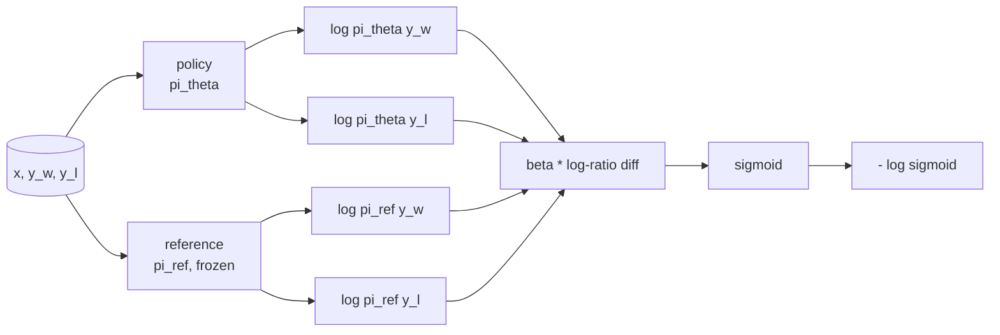
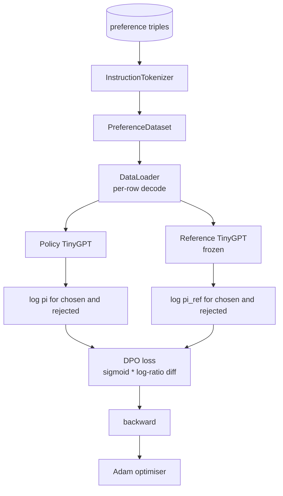

<!-- local-zh-machine-draft: English source is canonical; prose translated automatically, code/math preserved. -->

<a id="capstone-lesson-40-direct-preference-optimization-from-scratch"></a>

# 综合项目第 40 课：从零实现直接偏好优化

> Reward models 和 PPO 古典 RLHF stack. DPO 将一个倒塌的崩溃 堆积成一个单一的 监督的损失 直接符合对优先配对的保单。 DPO 损失的奖励差异身份, 发送工作参考模型加政策模型, 计算每 -token 日志概率, 并训练一个小 transformer 测试将损失的数学和 gradient 方向让你知道执行与文件相符

**类型：** 构建
**语言:** Python (torch, numpy)
**先修要求:** 第19阶段课程30-37(无法律文件) LLM track: tokenizer, embedding table, attention block, transformer 身体,训练前循环, 检查,产生, perplexity)
**时间:** ~90分钟

<a id="learning-objectives"></a>

## 学习目标

- 产生 DPO 损失额 sigmoid 以比对比差为单位,然后将其与隐含的报酬联系起来。
- 建立一个参考模式+政策模式,同时有一个冻结的参考和可培训的政策。
- 计算两个模型下序列级别日志概率, 掩码 prompt tokens.
- 培训政策 `(prompt, chosen, rejected)` 注意所选日志比被拒的日志上升。
- 测试损失数学的平方行为 gradient 以及参考的偏差。

<a id="the-problem"></a>

## 问题

你有一个 SFT 模式。 它遵循指令, 但输出不均匀; 有些完成是明确的, 有些完成是文字或错误的。 您还有一小套首选数据集: 对于相同的 prompt,一个人标记一个完成 选择,另一个拒绝。

古典 RLHF 回答是两阶段输油管 reward model 优化政策,防止奖赏 PPO。这个工作原理是昂贵的:两个模型在 PPOKL 控制着政策贴近参考, 当黑客被入侵时奖励 reward model 有点不妥

DPO 以单一的受监督损失取代两个阶段。 reward model 政策直接针对优惠对等进行,对优等待遇给予明确的KL处罚。 SFT 参考。 布拉德利- 特里偏好模式下的最佳解决方案相同, 代码要少得多。

<a id="the-concept"></a>

## 概念

从布拉德利 -泰瑞模型开始 prompt `x` 和两个完成 `y_w` (选任)和 `y_l` (拒绝), 人类喜欢的概率 `y_w` 是

```text
P(y_w > y_l | x) = sigmoid( r(x, y_w) - r(x, y_l) )
```

where `r` 是一种潜在的奖赏功能。 RLHF 第一次合身 `r` 选择,然后训练政策 `pi` 最大化 `r` 带有 KL 锚 :

```text
max_pi   E_{x, y~pi} [ r(x, y) ] - beta * KL(pi || pi_ref)
```

该 DPO 衍生出的意见是,最佳政策 `pi*` 目标下,在 `r`:

```text
pi*(y | x) = (1/Z(x)) * pi_ref(y | x) * exp( r(x, y) / beta )
```

重新排列 `r`:

```text
r(x, y) = beta * ( log pi*(y | x) - log pi_ref(y | x) ) + beta * log Z(x)
```

该 `log Z(x)` 词词对两个词都相同 `y_w` 和 `y_l` (取决于 `x`, 不 `y`),当您计算偏好差时,它会取消:

```text
r(x, y_w) - r(x, y_l) = beta * ( log pi_theta(y_w|x) - log pi_ref(y_w|x)
                                - log pi_theta(y_l|x) + log pi_ref(y_l|x) )
```

取代布拉德利 -泰瑞号 sigmoid 并使用负日志的可能性 相对于优惠对 :

```text
L_DPO(theta) = - E_{(x, y_w, y_l)} [
  log sigmoid( beta * ( log pi_theta(y_w|x) - log pi_ref(y_w|x)
                       - log pi_theta(y_l|x) + log pi_ref(y_l|x) ) )
]
```

这就是损失 sigmoid 以每个示例单标量计算, 从四个日志概率计算 。 reward model. 否 PPO。损失中无 KL 术语;KL 限制被烤入封闭式衍生。



<a id="the-sign-of-the-gradient"></a>

## 标志 Gradient

训练前要检查一下精神状况 gradient 与 `log pi_theta(y_w | x)`:

```text
d L_DPO / d log pi_theta(y_w | x) = - beta * (1 - sigmoid(z))
```

where `z` 与 sigmoid。这对所有人都是负面的 `z`,这意味着:提高所选完成的保单日志概率会减少损失。 gradient 与 `log pi_theta(y_l | x)` 表示正值: 增加被拒绝的日志概率会增加损失。 训练会将选中的日志推上和被拒绝的日志向下推。 引用会被冻结; 它不会移动 。

<a id="the-data"></a>

## 数据

十二种优惠,三重船课 `(prompt, chosen, rejected)`。选择的完成时间是简短和准确的。拒绝时间是单词、脱专题或错误。对等内容覆盖与课程39(资本、计算、列表)相同的任务。因此,从一个 SFT 基地有一个合理的起点。

固定装置故意很小。 DPO 数万对正在生产中,这里,关键是 丢失的数学和循环 最终运行在一个小数据集上 和选择的反倾日志测试差距明显扩大。

<a id="reference-invariance"></a>

## 参考误差

一个 DPO 执行时必须小心处理参考模型。 SFT 模型冻结在原位。 有三个属性必须持有 :

- 参考文献 parameters 从未收到 gradients.
- 参考日志概率在时代之间从未改变。
- 政策从相同的开始 weights 用作参考。 `theta` 是指引用和学习的更新;初始化政策为引用副本是定义明确的起始点。)

通过以下方式执行这些步骤:

- 引用页眉以 `torch.no_grad()` during forward passes.
- Setting `requires_grad=False` 在每个引用 parameter.
- 通过 `policy.load_state_dict(reference.state_dict())` 创建参考之后。

```figure
cap-dpo-preference
```

<a id="architecture"></a>

## 建筑



这个模型与39课所用的小GPT相同(decoder- 仅指因果,字节符号。参考和政策共享结构;政策 weights 参考文献在培训中流出,而参考文献保持不变。

<a id="what-you-will-build"></a>

## 做你该做的

执行是一体 `main.py` 加上测试

1. `InstructionTokenizer`: 字节符号 `INST` 和 `RESP` 特殊课,和39课一样
2. `TinyGPT`: decoder-仅 transformer。与39课一样的形状,因此,即使你跳过39课,该课也是自足的。
3. `make_preferences`:返回 12 `(prompt, chosen, rejected)` triples.
4. `sequence_log_prob`:根据模型,a prompt 前缀和完成后返回下一个-token 完成日志概率( 无) prompt- 投放款)。
5. `dpo_loss`: 以四个日志概率计算, `beta`,返回每个损失 tensor 以及伐木的隐微报酬。
6. `train_dpo`: 每-epoch 循环计算根据保单和参考选择和拒绝的日志预告,应用损失和步骤 Adam.
7. `evaluate_margins`:返回保单下任意一点的平均选择拒绝的日志概率差。
8. `run_demo`:从一个小型的暖气预科培训中建立参考和政策,复制件 weights,30步列车, 打印每步损失和差值, 成功后出零。

<a id="why-dpo-works"></a>

## Why DPO works

DPO 数学等同于 RLHF 以布拉德利-泰瑞优惠模式为标准,直到奖励的参数化。 `r(x, y) = beta * (log pi(y|x) - log pi_ref(y|x))` 可从优惠中识别,直至 `x`,它取消了差数。封闭式策略允许您跳过明确的 reward model。KL限制在结构上是强制执行的:任何偏离 `pi` 来自 `pi_ref` 使日志比大, sigmoid 饱和度,它使 gradient 当政策走得太远时, 参考就是您的安全网。

<a id="stretch-goals"></a>

## 伸展目标

- 在日志概率和中添加长度正则化:除以完成长度。 长度偏差为已知 DPO 失败模式,模型选择较短的完成时间,因为其日志概率在绝对值上较大。
- 添加IPO损失的变式:替换 sigmoid + 日志与 `(z - 1)^2`比较固定上的趋同。
- 添加标签间滑 parameter 将硬性选择拒绝的标签与制服0.5 之间的内插。
- 将参考文献改为更便宜的模型(knowledge distillation flavour).

执行给您提供了损失、 参考变量以及训练循环。 数学是课程。 代码使数学变得具体 。
