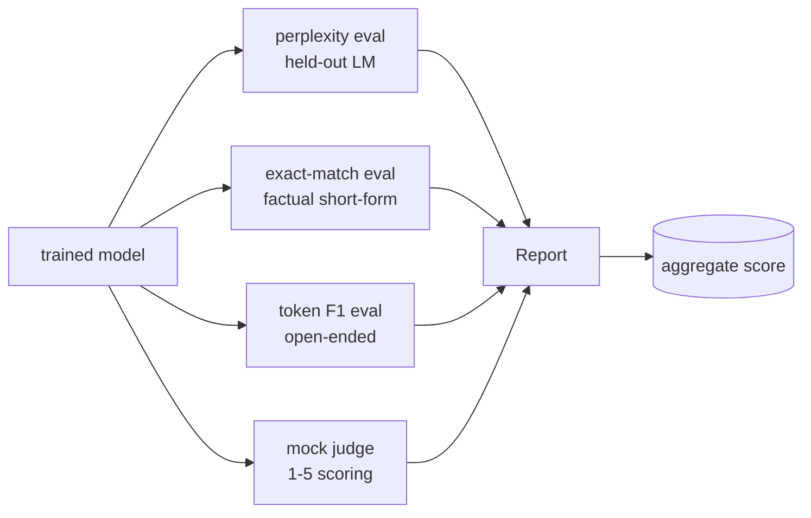
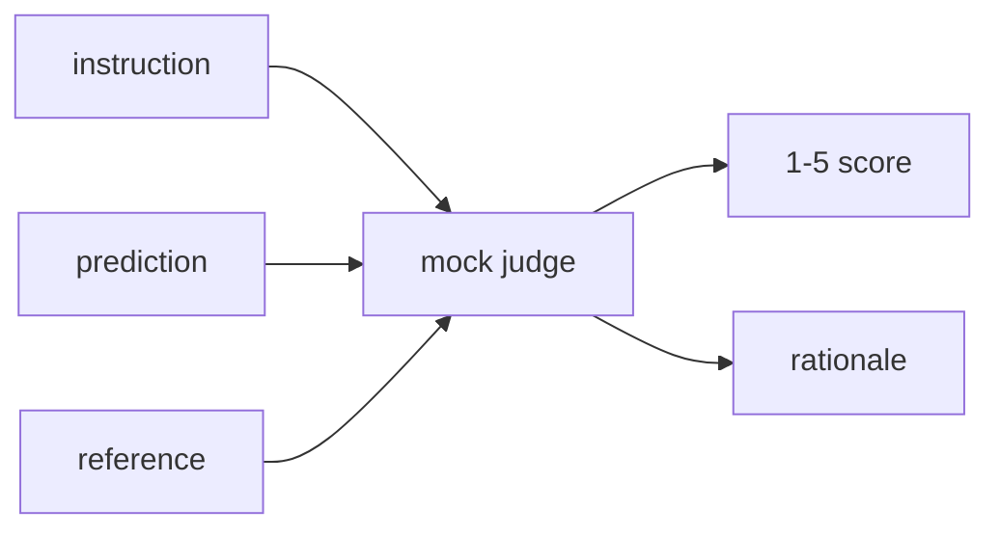
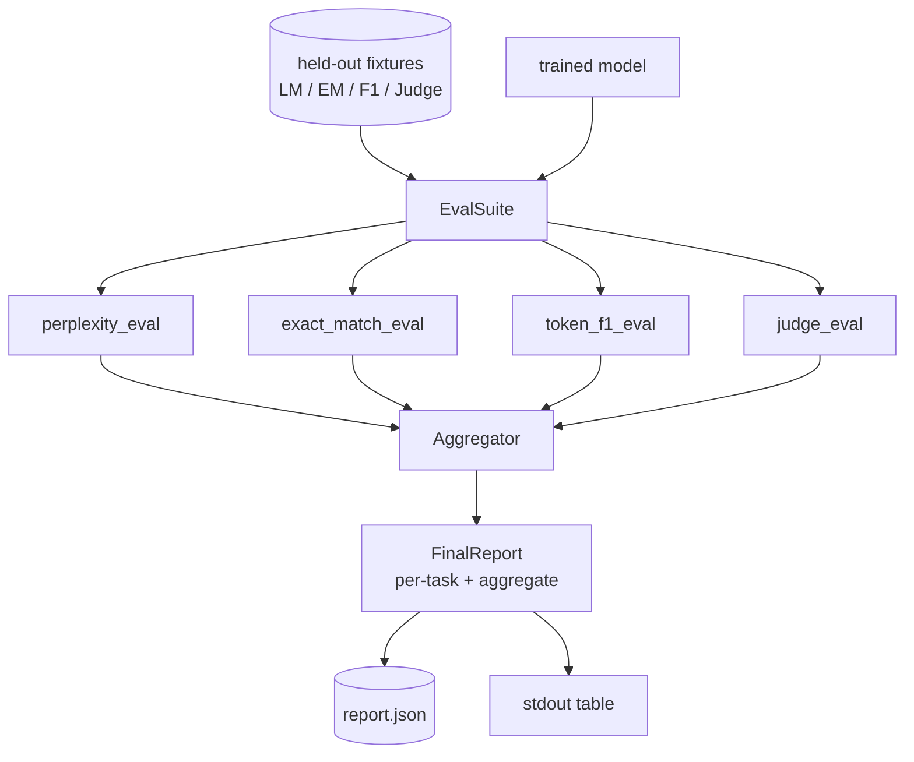

<!-- local-zh-machine-draft: English source is canonical; prose translated automatically, code/math preserved. -->

<a id="capstone-lesson-41-full-evaluation-pipeline"></a>

# 综合项目第 41 课：完整 Evaluation 流程

> 训练是用损失曲线来监视的部分。 Evaluation 是要设计的部分。 这个课程构建一个统一的 eval 管道, 使用任何经过训练的语言模式, 运行四个不同的 evals 在上面, 将结果汇总到每个任务报告里, 并发运一个本地模型 LLM四个评价包括每个航运模式需要的维度:语言建模(语言建模)。perplexity),短形正确度(精确匹配),开式相似性(token F1、质量评分(法官)。

**类型:** Build
**语言:** Python (torch, numpy)
**先修要求:** 第19阶段课程30-37(无法律文件) LLM track: tokenizer, embedding table, attention block, transformer 身体,训练前循环, 检查,产生, perplexity)
**时间:** ~90分钟

<a id="learning-objectives"></a>

## 学习目标

- 计算暂停 perplexity 戴面具的...token 在一个小的 transformer.
- 运行一个精确匹配的短窗式的 Eval prompts.
- Compute token- 预测和参考字符串之间的F1级,与正常化。
- 建立本地模型 LLM- 判断出1-5级的分数模型输出
- 将四次评估合并为一份按每个任务分列的单一加权报告。

<a id="the-problem"></a>

## 问题

单一的衡量标准从来不描述语言模式。 Perplexity 表示模型与语言分布的匹配程度,但并未说明它是否回答问题。 精确匹配显示模型是否生产金字串,但惩罚了正确的参数。 Token F1原谅了引言,但被与错误内容的词汇重叠所愚弄。 LLM- 判断性能能捕捉质量尺寸,但成本昂贵且随机应变。

您实际想要的管道有全部四个。 每个评价覆盖了其它缺失的维度。 每个都运行在不同的一组为该测量而设计的悬停数据上。 最后报告同时显示每个任务的数字和总和, 因此审查者可以看到模型的权衡。

这条课将输油管建成一个文件,最终结束。

<a id="the-concept"></a>

## 概念



每一次评价都是从 `(model, dataset) -> EvalResult`。结果包含测量值、检查的每个示例和总合的名称。管道中含有一个配置,其中显示运行的值和如何运行 weight them.

<a id="perplexity-properly-counted"></a>

## Perplexity,适当计算

Perplexity 是 `exp(mean negative log-likelihood per token)`执行有两个陷阱:

- 意思是必须超过实际 token 位置, 不超过批量 * 顺序。 tokens 必须从分母中排除,或 perplexity 将会看起来更好。
- 模型预测下一个 token那样 logits 处于岗位 `i` 预测 token 处于岗位 `i+1`。这里的错误是一成不变的:损失仍然在列车,但衡量标准变得毫无意义。

eval 计算每批总和 `-log p(token)` 超过非纸牌位置和每批 token 数,然后在结尾处进行分隔。这比平均的每批安全得多 perplexities (这下... )weights 短顺序),并符合教科书的定义。

<a id="exact-match-with-normalisation"></a>

## 精确匹配, 正常化

该 harness 将预测和参考值都正常化,然后比较:

- Lowercase.
- 环绕白空域的条纹 。
- 折叠内部空白运行到一个空格 。
- 丢弃尾端终端标点( P)`.`, `!`, `?`如果双方只是标点而有分歧的话。

正常化在实践上非常有益。 `"Paris"` 是正确的; 说 `"Paris."` 也是对的,说 `"  paris  "` 也是正确的。 测量标准仍然需要在正常化后以相同的字符串来回答。

<a id="token-f1-the-right-way"></a>

## Token F1, 正确的方式

Token F1是精确度的调和率 计算在包上tokens步骤:

1. 使预测和参考正常化(与精确匹配规则相同)。
2. 将每个相片分割成列表 tokens (空白符号化)
3. 计数多相交点 。
4. 精确率= `intersection_count / len(pred_tokens)`. 回顾= `intersection_count / len(ref_tokens)`F1 = 口音平均值。

如果预测和引用均为空, F1 是 1( 空匹配) 。 如果只有一个为空匹配, F1 是 0。 此模式符合 SQUAD evaluation 引用并生成横跨参数句的稳定的数字。

<a id="local-mock-llm-as-judge"></a>

## 本地模拟 LLM-as-Judge

真正的法官是... ...一个前沿模式 API。为了学习这个课程,法官必须脱线。模拟法官是一个决定性的得分者,它需要指令、模型预测和参考,并返回到 `{1, 2, 3, 4, 5}` 加上一行理由。评分规则明确:

- 如果正常预测等于正常参考值,则5。
- 4个如果 token 预测和参考之间的F1至少为0.8。
- 3 如果为 token F1在 `[0.5, 0.8)`.
- 2 如果 token F1在 `[0.2, 0.5)`.
- 另加一条。

这不是一个真正的法官,但它有正确的界面。 稍后通过改变一个功能来以真正的模式交换。 管道并不在意 。



<a id="aggregation"></a>

## Aggregation

总计是正常的年均值加权平均值。 `[0, 1]`:

- Perplexity: 正常化为 `1 / (1 + log(perplexity))`. 一个 perplexity 地图1至1,无限地图0。
- 精确匹配: 已经在 `[0, 1]`.
- Token F1: 已经进入 `[0, 1]`.
- 法官:除以5。

Weights 默认组合为 0.2 perplexity0.3 精确匹配,0.3 token F1,0.2法官 选择 weights 是一个产品决定; 课程会暴露点, 这样您就可以进行实验 。

```figure
cg-eval-quadrant
```

<a id="architecture"></a>

## 建筑



该 `EvalSuite` 是一个细小的管弦手。 `(model, tokenizer, dataset, config)` 返回 `EvalResult`. 该 `Aggregator` 收集结果并制作最后报告。 JSON 复制下游情报员能吃到的

<a id="what-you-will-build"></a>

## 做你该做的

执行是一体 `main.py` 加上测试

1. `TinyGPT`:相同 decoder- 课程38 -40只用这个结构,所以课就单独了
2. `InstructionTokenizer`:带有INST/RESP/PAD特写字节符号。
3. 四个固定装置:LM体、EM组、F1组和法官组,每个20个例子,确定性。
4. `perplexity_eval`: 返回 `EvalResult` 与 perplexity 数值和每-token 失去直方图
5. `exact_match_eval`:返回指EM和每个示例记录。
6. `token_f1_eval`:返回平均值 token F1和每个样本记录
7. `mock_judge` 和 `judge_eval`:每个例子的得分和理由,表示整个集的得分。
8. `Aggregator.normalise`: 人均正常化规则。
9. `Aggregator.aggregate`:加权平均值和组装报告。
10. `run_demo`: 训练一个小模型, 运行所有四个评估, 打印报告表格并写 JSON成功时退出零。

<a id="reading-the-report"></a>

## 阅读报告

报告分为三个层次。 顶部是总分。 下面是四个每个年数。 下面是每个诊断的分类。 运行失败的CI通常想要的是总分, 但是一个追求回归的审评员想要每例分类来查看模型输入错误的输入。

该 JSON 垃圾场使用稳定的键, 使 CI 仪表板可以绘制不同版本的趋势线。 漂亮的表格是给在训练后盯着终端的人的。

<a id="stretch-goals"></a>

## 伸展目标

- 添加a calibration 变压: 做模型 softmax 概率与它的准确性相符?
- 添加一个强度反响: 标记每个示例的扰动( typo, plasion, districtor) 并报告度量的扰动下降 。
- 以真正的模型取代模拟法官 HTTP 调用。函数签名不改变 。
- 添加每个任务 weight 学习: 取代固定 weights,适合 weights 相对于模型来说,是目标偏好顺序

执行给了你四个评估, 聚合器和报告。 evaluation 管道在顶部多层,模式保持不变:每个反射器一个功能,一个聚合器,一个报告。
