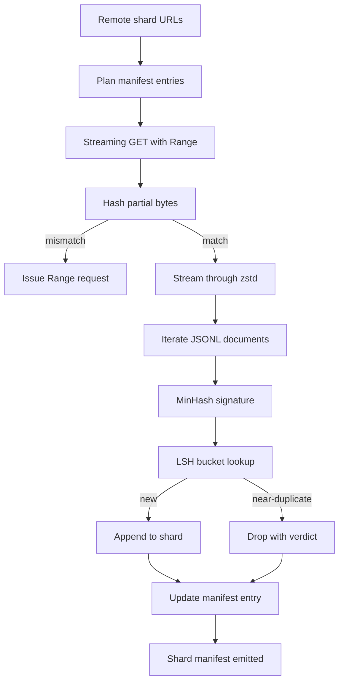

<!-- local-zh-machine-draft: English source is canonical; prose translated automatically, code/math preserved. -->

<a id="large-corpus-downloader"></a>

# 大规模语料下载器

> 语言模式培训早在第一部之前就开始了 forward pass。该文集必须放在磁盘上,降压,拆解,并可以处理,在网络下降4%之前已经解决了复述故事。 streaming 下载器,拉压缩碎片,用Z标准解压缩苍蝇,指纹通过MinHash加上对地点敏感的散列,并写出碎片表 rest 管道的可以信任。

**类型:** Build
**语言:** Python
**先修要求:** 第19阶段 30-37项经验教训
**时间:** ~90分钟

<a id="learning-objectives"></a>

## 学习目标

- 流式远程碎片 `urllib` 和减压 `zstandard` 而不在内存中缓冲整个文件 。
- 通过发行恢复部分下载 HTTP `Range` 请求,以经核实的字节抵减。
- 每份文件都写明哈什签名 并用液态氢化合物 几乎重复的碰撞来打包
- 以内容散列、字节大小、文件编号和分层裁决的形式,

<a id="the-problem"></a>

## 问题

第一次你训练200GB的网络 下降百分比为41, 脚本退出时 `urllib` 78. 以% 99 表示,您已经重写了循环三次。从第1分钟开始,您必须设计的两个失败是部分下载的恢复和重复文件删除。两者都有众所周知的解决方案;由于管道以一行开始,因此通常都会跳过这两个选项。 `requests.get` 长牙了

继续是 HTTP 问题。 服务器必须尊重 `Range`,客户必须跟踪已核实的磁盘记录中的偏移, 而经核实的偏移则要通过死亡过程来生存。 如果偏移和文件因一个字节而出现差异, 则恢复下载的垃圾会被损坏, 并且文稿只会在 tokenization.

调试是一个签名问题。 Exact- hash dedup 错过了近乎重复的内容: 同一篇文章显示有三条不同的锅炉脚, 同一个代码文件显示有不同的牌照头, 同一个博客文章显示有跟踪 parameter 在每个链接上。 MinHash 加上 LSH 以亚线性成本捕获这些。 成本是每份文件签名一次, 每签名一桶检查一次。

<a id="the-concept"></a>

## 概念



<a id="streaming-with-urllib"></a>

### Streaming 与 `urllib`

标准图书馆 `urllib.request.urlopen` 返回类似文件的对象。 `zstandard.ZstdDecompressor().stream_reader` 和字节从网络通过减压器流到文档的复制器中,而从未在记忆中实现压缩的碎片或减压的碎片。唯一的内存成本是线性缓冲、当前文档的 MinHash 签名和 LSH 索引。

<a id="resume-with-range"></a>

### 继续 `Range`

下载器每片写两个文件: `.partial.json` checkpoint. 该 checkpoint records `verified_bytes`, `expected_size`, `sha256_prefix` (计算第一张 `verified_bytes` 字节)和源 URL。启动时下载器读取 checkpoint,重新计算 `sha256_prefix` 盘片上的字节, 只有在重新计算散列匹配时才恢复。 如果散列错误, 部分将被丢弃, 下载从字节零重新开始 。 沉默不可能发生, 因为已核实的字节会被检查, 而不是假设 。

<a id="minhash-plus-lsh"></a>

### 最小哈什加LSH

MinHash 估计了固定空间中两组的积分相似性。 对于一个文档来说,该套是其文本的平面( 重叠 n 克) 。 签名是 `k` 最小散列值, 每一个独立的散列函数一个。 两个有 ACCard 相似性的文档 `s` 具有概率 `s` 商定签字的任何单一组成部分。

液态氢化合物然后将 `k` 组件转换为 `b` 带 `r` 每一行, `k = b * r`。两个文档在至少一个带中碰撞,概率 `1 - (1 - s^r)^b`,这是一个围绕 `s` 你调音 `(b, r)` 典型的体积确定值的起点是 `s = 0.8`,LSH研究文献与 `k = 128`, `b = 32`, `r = 4`.

<a id="shard-manifest-as-a-contract"></a>

### 散装货单作为合同

下载者唯一的耐久输出是 舱单。 舱单持有, 每块碎片, URL, 减压字节计数, 文件计数, 单行计数后的唯一文档计数, 最后碎片文件的 sha256 。 下游 tokenization 读取 URD , 而不是目录列表。 如果一个碎片丢失或 sha256 错误, 则该 EXD 指示下个阶段拒绝启动 。 列表是“ 数据被下载” 和“ 数据被下载并被核实” 之间的决定边 。

```figure
cap-corpus-downloader
```

<a id="build-it"></a>

## 动手实现

`code/main.py` implements:

- `ShardPlanner` - 阅读一份散乱的 URL 列表并生成计划中的列表条目。
- `StreamingDownloader` - 打开一个 `urllib` 带可选的流 `Range`,将文件写入临时文件,更新 `.partial.json` checkpoint 并验证简历上的 sha256 前缀。
- `ZstdDocIterator` - 将类似文件的流包在 `zstandard.ZstdDecompressor` 并产生每行一张文档。
- `MinHasher` - 产生 `k`- 使用大麻籽固定的组别字符串的组件签名。
- `LSHIndex` - 以波段标示水桶标志,报告碰撞。
- `Dedup` - 将 hashher 和索引组合到每个文档的标签 `keep` 或 `near_duplicate` 加上相匹配的碎片识别码
- `ManifestWriter` - 收集每个硬数据并写 `manifest.json`.

底部的演示在磁盘上 制造一个小合成体,并用 `zstandard`,下载它 通过 `file://` URL, 复制品, 并打印列表 。

运行：

```bash
python3 code/main.py
```

脚本从零处退出,并打印出一份列表摘要。

<a id="production-patterns"></a>

## 生产模式

四个模式将这个课程 推广到真正的公司

**Checkpoint 写之前。** 该 `.partial.json` 必须是 `fsync`- 在碎片附着之前。 否则, 失去能量会逆转顺序: 磁盘上的碎片字节, checkpoint 没有它们, 下次的续会相信它比它少了经核实的字节, 重复的后缀会损坏文件 。 Checkpoint 首先,然后写。这是相同的纪律 与写头日志。

**碎片LSH指数。** 整个文件体的 LSH 指数不适合于200GB 比例值的内存。 将 LSH 指数分成第一个波段, 在磁盘上存储分区, 并只查阅新签名的分区。 成本是每份文件多读一张盘; 好处是 LSH 指数不再是一个硬存储上限 。

**墓碑,不要删除。** 被丢弃的复制品记录在名单中 附有判决 `near_duplicate` 和他们相撞的文档的碎片代号。 把它们删除会失去重复文件与其保管者之间的联系。 Tombstoning 保存了审计线索, 让下游人改变对门槛的思维 。

**单件sha256,加上单件sha256** 显示器本身得到一个内容散列。 下流阶段在他们信任每个硬项之前验证显示的散列。 没有这个, 显示器就是静默攻击表面: 一个能够编辑单个文件的攻击者可以腐蚀整个管道 。

<a id="use-it"></a>

## 实际应用

生产模式:

- **继续所有线人的行动** 光学探测器运行时间短。下载器必须假设每次运行时都有一张新的磁盘,然后从缓存或远程恢复。 `--cache-dir` 是一个头等旗。
- **之前的死记 tokenization.** Tokenization 在同一文档上运行两次是同一损失曲线成本的两倍。 tokenization而不是下游的 下游的 下游的
- **显示为合并门 。** 训练课读到一个被钉住的沙256号 commit。新数据集版本需要新的列表 commit。代码和数据之间的联系是 git而不是民俗。

<a id="ship-it"></a>

## 交付成果

`outputs/skill-corpus-downloader.md` 将在一个真正的工程中描述哪个 URL 向下载器提供, checkpoint 设置目录,什么闪烁宽度 `(k, b, r)` 将脱落的用途增加三倍, 且显示器位于版本控制中。 此课将引擎发动 。

<a id="exercises"></a>

## 练习

1. 添加a `--shingle-width` 标记和测量 3, 5, 9. 宽度下断层判断的变化 。
2. 通过嗅探魔法字节在 Zstd 旁边添加 gzip 支持。 下载器不应要求调用者指定编码 。
3. 添加a `--resume-only` 如果拒绝,则拒绝开始新下载模式 checkpoint 发现。在CI中, 有用 防止一次运行不小心重新拉动 200GB 。
4. 将 LSH 索引移动到架子或 平方英尺文件, 并测量通过量与内模变量 。
5. 启动时添加 shah256 列表检查。 如果磁盘上的列表与列表散列不符, 下载器将无法关闭 `manifest.lock`.

<a id="key-terms"></a>

## 关键术语

| 术语 | 人们怎么说 | 它实际上意味着什么 |
|------|-----------------|------------------------|
| Shard | "一个文件" | 一块自成一体的肉身 带有自己的沙丘256,用作复古和沉积的单位 |
| 最小哈什签名 | "Fingerprint" | 一个 `k`- 一组部件的素描,其中每个部件是每组材料上至少一个独立的散列 |
| LSH 乐队 | "Bucket" | 一组 `r` 用作碰撞探测单桶钥匙的签字部件 |
| 经核实的字节 | 补发 | 磁盘上的字节,其 sha256 前缀符合 checkpoint; 唯一可以恢复的安全偏移 |
| Manifest | 指数 | 下载器制作的单一耐久记录,包括内容杂交 |

<a id="further-reading"></a>

## 进一步阅读

- [RFC 7233号](https://datatracker.ietf.org/doc/html/rfc7233) - HTTP 范围请求, 恢复协议
- [Z标准格式规格](https://datatracker.ietf.org/doc/html/rfc8478) - 使框架格式 streaming 降压安全
- [MinHash](https://en.wikipedia.org/wiki/MinHash) - 签名家族这个课程使用
- [切合本地的散列](https://en.wikipedia.org/wiki/Locality-sensitive_hashing) - 分层界限后面的带宽办法
- 阶段19 - 43 - HDF5 下载器输入的象征性文件
- 阶段19 - 44 - 轮廓列队列
- 阶段19 - 45 - 消耗时间表的AMP环
