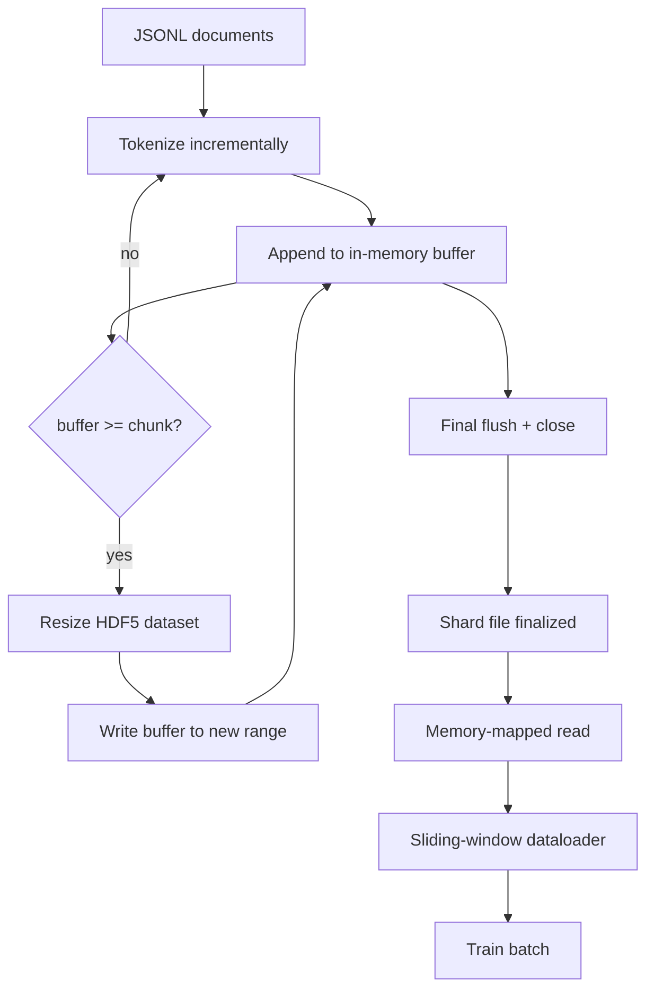

<!-- local-zh-machine-draft: English source is canonical; prose translated automatically, code/math preserved. -->

<a id="hdf5-tokenized-corpus"></a>

# HDF5 格式的分词语料

> 下载的体积必须降落在布局中 训练员可以以线速从流出 JSONL 磁盘上的16个数据加载器工人无法幸存。 HDF5 包含一个可变的、块状整数数据集。 此课程构建 streaming tokenization 进入可变的 HDF5 数据集, 截断在多个文件上的写法, 训练时读取的内存映射, 以及一个可生成固定长度序列并使用正确包装的滑动窗口数据装入器 。

**类型：** 构建
**语言:** Python
**先修要求:** 第19阶段 30-37项经验教训
**时间：** ~90 分钟

<a id="learning-objectives"></a>

## 学习目标

- 流体文档变成可变的 HDF5 整数数据集,带有确定性 chunking.
- 将写入的刻录在多个 HDF5 文件上, 这样失败就会被连接, 平行化是可能的 。
- Read tokens 返回 HDF5 的页面缓存后块版式, 数据装入器只在批量时间复制到批量缓冲 。
- 安装一个滑动窗口数据装入器,以明确包装规则的方式发射固定长度的训练序列。

<a id="the-problem"></a>

## 问题

现代语言模式训练课程 tokens 数十个工人每秒有几十万个样本 JSONL 磁盘上的错误在首个冷藏页面中死亡: JSON 解析器慢,文档的边框无法处理, 想要“ 抽样 4 217 884” 需要扫描文件。 即使压缩好的 Parquet 也不太合适, 因为教练不需要列; 它想要平面 token 流,O(1)随机访问。

HDF5 适合, 因为它提供了一个块状、 可变的、 整数的数据集, 其块在阅读时对页缓存友好。 训练员要求切片 `tokens[3,200,000 : 3,200,8192]` 和 HDF5 复制要求的超光板, 从页面缓存复制到新分配的 NumPy 。 成本是每个工人的开放文件控件和块大小的页卡足迹,与解码成本相比,这个成本微不足道 JSONL.

构建问题正在使写面诚实。 可调整的数据集很容易被滥用: 一次写入一个文档, 而 HDF5 文件已破碎到无法使用的程度 。 将所有文档都以一个大小写入, 整个过程死亡会丢失整个碎片 。 正确的学科是缓冲- 后期扩展, 缓冲大小与块大小相符, 以及一个将工作量分割成多个文件的碎片化的书写, 这样崩溃就会丢失最多一个碎片 。

<a id="the-concept"></a>

## 概念



<a id="resizable-hdf5-done-right"></a>

### 可恢复 HDF5 正确完成

该 token 创建数据集时 `maxshape=(None,)` 和固定的、 `chunks=(chunk_size,)`缓冲方式记录收益 tokens 中 NumPy 长度数组 `chunk_size`。当缓冲填充时,数据集会按 `chunk_size` 并写入缓冲值。 在硬度结束处, 剩余缓冲值被写入一个最终的部分范围。 除了最后一个部分, 每一个部分都是毗连和块相匹配的, 读者被告知在所录到的 `token_count` 的 HDF5 属性中。

<a id="sharded-write"></a>

### 散乱写

单一的 HDF5 文件是一个失败点。 管道平行写入碎片: 第19阶段第42课中的每个输入碎片都产生一个 HDF5 输出碎片 。 A `shards.json` 索引记录, 每个碎片, 文件路径, token 数,文档数,和 tokens训练员读到 `shards.json` 来计算全球偏差 并验证这个体

<a id="memory-mapped-read"></a>

### 读取内存映射

在培训时,每个工人都打开了HDF5档案中 `swmr=True` 模式并请求 `tokens[start:stop]`。HDF5的块版式使这个块在热时会以页缓冲支持阅读。工人从来不会实现整个文件:切片被复制到数据装入器的批量缓冲中,然后数据加载器将它复制到一个固定模版训练中 tensor 批量时间。 热路径每块转换一个系统; 其他的都是 RAM 访问 。

<a id="sliding-window-dataloader"></a>

### 滑动窗口数据装入器

数据装入器是唯一知道训练序列长度的阶段。 它在全球选择随机启动索引 token 流,读取 `window_size + 1` tokens返回 `(input, target) = (tokens[:-1], tokens[1:])`。文档的边框不强制执行:窗口可横跨两个文档,并有明确的 `boundary_token_id` 模型学习使用分隔符。 这是标准包装规则; 也是初学者忘记的规则, 最后的元素是8%的培训边界 tokens 自然文本的92%。

```figure
cc-hdf5-corpus
```

<a id="build-it"></a>

## 动手实现

`code/main.py` implements:

- `Tokenizer` - 字节级决定因素 tokenizer 够好演示了 接口是 `encode(text) -> list[int]` 和 `vocab_size`.
- `HDF5ShardWriter` - 打开可调整的整数数据集,缓冲 tokens 以块大小、 调整大小和写入固定大小的长进、 记录 `token_count` 和 `sha256` 关闭时作为 HDF5 属性。
- `ShardedTokenizationPipeline` - 循环输入文件, 将文件传送到作家, 并发布 `shards.json` index.
- `MmapTokenStore` - 打开硬文件, 用于内存绘图读取, 计算全局偏移, 暴露一个 `get_slice(start, stop)` API.
- `SlidingWindowDataloader` - 从全球流中随机选取窗口并产生产量 `(input_ids, target_ids)` NumPy arrays.

文件底部的演示将一个微小的模拟体建起, 象征成两个碎片, 通过记忆图打开它们, 运行10批数据装入器, 并打印每批的形状和校验和 。

运行：

```bash
python3 code/main.py
```

脚本从零处出来,打印批次校验和。

<a id="production-patterns"></a>

## 生产模式

四个模式将这个课程 推广到真正的训练中

**块大小等于典型的读数。** 教练读到 `window_size + 1` tokens 将 HDF5 块设为 `window_size` 并且读取页面缓存对齐。 误差块将吞吐量减半, 因为每个样本都触及两个块 。

**Token 在属性中计数,不在数据集中计数。** 数据集的尾端片段可能部分满, 因为块大小不分割文档边界。 保存真实的 `token_count` 是一个在数据集上的 HDF5 属性, 并让读者在此值中略去。 否则, 读者会跳过结尾, 跳转到零页 tokens 模型学会预测零。

**碎片 sha256 并同时验证** 每一块碎片都有自己的沙发256 token 字节。 训练员可以在训练开始前平行校验所有的碎片。 错误的 sha256 失败了 。 epoch 十六小时后三小时

**`swmr=True` 双方, `libver="latest"` 写作。** 单文字- 多版本- 读取模式要求作家打开 `libver="latest"`,创建所有数据,然后设置 `file.swmr_mode = True`。在那之后,作家必须打电话 `dataset.flush()` 之后,每次调整阅读员的大小 `swmr=True`) 查看一致的数据。跳过 `libver="latest"` 或启用 SWMR 后, 结构更改是“ 文件被锁定” 失败的常见源 。

<a id="use-it"></a>

## 实际应用

生产模式:

- **每个源碎片一个HDF5** 下载器(第42页)每发一个 URL 散装件; tokenization (此课) 释放出每个源的1 HDF5。 1:1 映射使恢复和部分失败的恢复变得微不足道 。
- **Boundary token id.** 边界 token 属于 tokenizer 伏卡,是唯一的 token 数据装载器的输入。 训练损失掩盖了边界 token 如果模型应该忽略它, 否则它会学会使用它作为序列分隔符。
- **`shards.json` 成为真相的源泉** 添加新碎片意味着写入 HDF5, 计算其 sha256 并附加条目。 训练员在启动时读过文件一次, 并且从不接触目录列表 。

<a id="ship-it"></a>

## 交付成果

`outputs/skill-hdf5-tokenized-corpus.md` 将,在一个真正的项目上,描述 tokenizer 输入管道,什么块大小 匹配教练的窗口,在哪里 `shards.json` 使用版本控制, 并如何将数据加载器工人分割成文件。 此课程会将引擎发运 。

<a id="exercises"></a>

## 练习

1. 添加a `--compression gzip` 向 HDF5 写作器显示标记, 并测量到 人口体的输送成本。 捍卫选中的默认值 。
2. 在滑动窗口数据载荷中添加确定型种子,并核查同一种子的两颗粒子的分批生产。
3. 添加a `--validate` 模式,读取每块碎片,重新计算 sha256 的 tokens,并对照 `shards.json`. . . . CI应该在训练开始前操作这个.
4. 比较数据加载器的输出量, 其大小等于、 等于或等于或等于或等于窗口大小的两倍。 请报告页缓存效果 。
5. 添加a `--max-document-tokens` 标记在写时截断非常长的文件。 捍卫对读取时决定的权衡 。

<a id="key-terms"></a>

## 关键术语

| 术语 | 人们怎么说 | 它实际上意味着什么 |
|------|-----------------|------------------------|
| 可调整的数据集 | "Append-only" | HDF5 数据集, 包含 `maxshape=(None,)` 长得像 `resize` 连通大步 |
| 被打乱的布局 | "HDF5如何储存它" | 内核可以内存映射和数据装入器可以连续阅读的固定大小磁盘页面 |
| `swmr` mode | "Read-while-write" | 使数据加载器工人安全共享文件的单文字- 多版本-  Reader 模式 |
| 硬化索引 | "shards.json" | 所有人的耐用指数 token 带偏移和内容杂乱的碎片 |
| 推拉窗 | "训练样本" | 固定长度的全球切片 token 训练员对齐的流体 及其一对一的目标 |

<a id="further-reading"></a>

## 进一步阅读

- [HDF5 chunking documentation](https://support.hdfgroup.org/documentation/hdf5/latest/hdf5_chunking.html) - 此课使用的块状、 可变数据集布局
- [h5py 用户指南](https://docs.h5py.org/en/stable/) - Python HDF5 的装订
- [NumPy 内存映射](https://numpy.org/doc/stable/reference/generated/numpy.memmap.html) - 原始HDF5的读面通过 h5py 暴露
- 阶段19 - 42 - 此课程输出代表的下载器
- 阶段19 - 44 - 消耗该数据装入器的余弦时间表
- 阶段19 - 45 - 结束训练步骤的AMP循环
