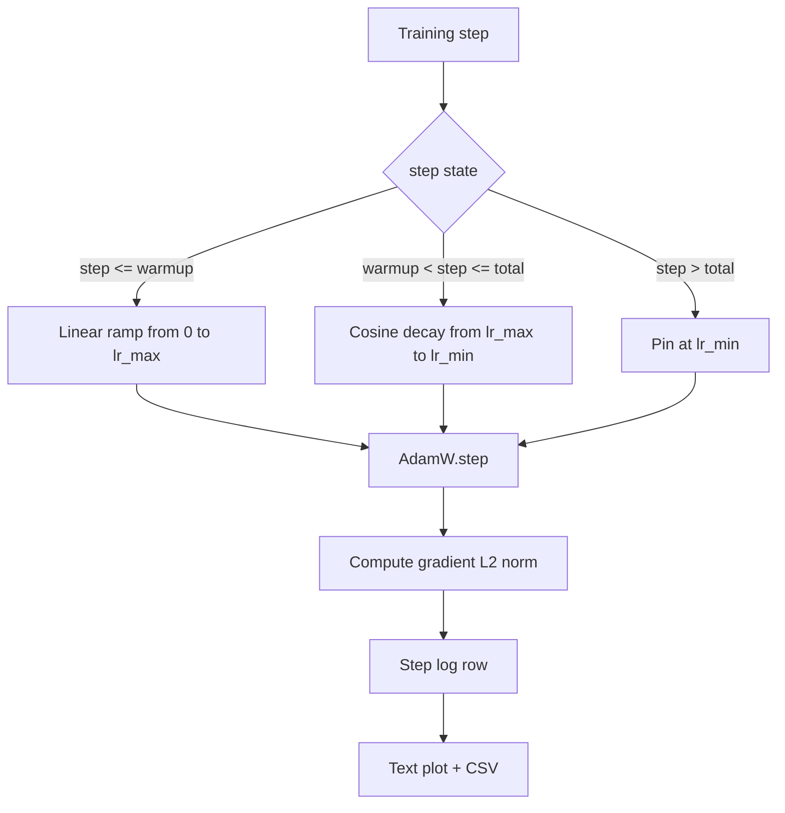

<!-- local-zh-machine-draft: English source is canonical; prose translated automatically, code/math preserved. -->

<a id="cosine-lr-with-linear-warmup"></a>

# 带线性 Warmup 的余弦学习率

> 学习进度表是继 loss function. AdamW 带有余弦腐烂和线性 warmup 是一个语言模型训练的现代默认值, 因为它让模型在最初的一千个更新中看到一个小的有效步骤大小, 斜坡可以向上到一个配置的峰值, 并且顺畅地返回到零。 此课将设置这个时间表, 将曲线绘制在训练步骤、 日志上 。 gradient 规范在计划旁边, 并证明计划荣誉 warmup,峰值,和腐蚀的边界。

**类型:** Build
**语言:** Python
**先修要求:** 第19阶段 30-37项经验教训
**时间:** ~90分钟

<a id="learning-objectives"></a>

## 学习目标

- 执行 AdamW optimizer 连接到带有线性线性线性线性学习速度表 warmup.
- 计算任何一步的行程准确值, 不移动点 。
- Log gradient L2 规范与 learning rate 如此一来,健康培训就成了现实。
- 将计划显示为文本图, 眼睛可以读取, 任何工具都可以使用 CSV 。

<a id="the-problem"></a>

## 问题

第一批训练更新最响亮 weights 仍然接近初始化。 optimizer运行的第二时间估计没有稳定。 gradient 标准是大而吵。 learning rate 模型要么彻底分裂 要么最终落到一个从未逃脱的损失高原 gradient clipping,这是第19阶段第45课的主题, 以及一个学习速度表,开始小和斜坡上升。

和... 缠绕...warmup 计划有三个区域。 从零到一步 `warmup_steps` 该 learning rate 线性比例从零到配置的峰值 `lr_max`。从步骤 `warmup_steps` 以步态 `total_steps` 该 learning rate 顺着余弦曲线的上半部,从 `lr_max` 以 `lr_min`. 之后 `total_steps` 该 learning rate 被钉在 `lr_min` 所以一个设计错误的教练 超速不会默默地退出计划

建筑问题在于,一个时间表很容易错开。 learning rate 也就是说,在模型开始的时候,1%太高或太低 overfitting,除非在边界处对时间表进行详尽测试,否则无法显示。

<a id="the-concept"></a>

## 概念



<a id="warmup-formula"></a>

### Warmup formula

用于 `step` 在 `[0, warmup_steps]` 与 `warmup_steps > 0`, 该 learning rate 是 `lr_max * step / warmup_steps`. 堕落者 `warmup_steps = 0` 案件被作为“否”处理 warmup": 时间表直接从 `lr_max` 于零级,并立即进入余弦衰变。 harnesses pass `warmup_steps = 0` 以检查仍然生成可用的曲线的调度表。

<a id="cosine-formula"></a>

### 余弦公式

用于 `step` 在 `(warmup_steps, total_steps]` 该 learning rate 是 `lr_min + 0.5 * (lr_max - lr_min) * (1 + cos(pi * progress))` where `progress = (step - warmup_steps) / max(1, total_steps - warmup_steps)`. 在 `step = warmup_steps` 余弦值为 `cos(0) = 1`,它给出 `lr_max`,匹配 warmup 完全正确,在 `step = total_steps` 余弦值为 `cos(pi) = -1`,它给出 `lr_min`,与衰变端点完全匹配。

两个端点的连续性不是意外。 之所以执行时间表,是因为在 `step`,而不是像三个不同的函数粘合在一起。粘结的日程表第一次会失去一个边界 `lr_max` 更改。

<a id="floor-after-total-steps"></a>

### 级数后的最低比率

用于 `step > total_steps` 该 learning rate 留在这 `lr_min`。合同是明确的:时间表没有错误,也没有推断;它把时间定在地板上,让教练记录警告。需要延长培训的教员改变了时间表 `total_steps`而不是循环

<a id="gradient-norm-logging-alongside-the-rate"></a>

### Gradient 标准记录与比率同步

计划是一半的卫生训练 gradient 标准是另一半。 训练循环记录每步都显示一次不同的训练 gradient 标准在损失之前就激增; 调整得当 warmup 使标准随率线性上升; 过分侵略性的峰值显示为在 warmup。磁盘上的数据集是 `step, lr, grad_l2_norm, loss`。CSV是唯一的持久记录。

```figure
cap-cosine-warmup
```

<a id="build-it"></a>

## 动手实现

`code/main.py` implements:

- `CosineWithWarmup` - 无国籍行为 `lr(step) -> float` 设置后,将使用此选项。
- `TrainState` - 包一个模型,一个 `AdamW` optimizer,然后将时间表变成一个步骤函数。
- `TrainState.step` - 运行一个 forward pass,一个 backward pass日志 gradient L2 规范,适用 `lr(step)` 至 optimizer.
- `plot_schedule_ascii` - 使时间表作为文字图,使眼睛能读取。
- `write_schedule_csv` - 每步排放一行 learning rate.

底部的演示 构建一个小 `nn.Linear` 模型, 固定输入批次上20步的列车, 并打印每步 learning rate, gradient 常规, 和损失。 时间表也作为文本图进行视觉智能检查 。

运行：

```bash
python3 code/main.py
```

脚本从零处退出,并打印了每步训练日志加上时间表图。

<a id="production-patterns"></a>

## 生产模式

四个模式把时间表提升到制作工艺品

**计划是放在一个配置中,而不是在代码中。** 教练读到 `warmup_steps`, `total_steps`, `lr_max`, `lr_min` 从 a 中 YAML 或 JSON 承诺的配置 git。该表可以复制,因为配置是内容处理的;该表可以审计,因为配置是PR diff的一部分。

**台阶计数器是单调的,与时代脱钩。** 有些框架混淆了步骤和 epoch 当数据集被分割或数据加载器重新启动时。 时间表读取 `global_step` 教练的 checkpoint继续按正确的进度运行,因为阶梯是持久的轴。

**运行目录中的调度图 。** 每一场训练都写道 `outputs/lr_schedule.png` 将( 或者在此课中) 文本图输入运行目录。 跳过目录的审评员可以检查计划是否正常, 而不重运行任何内容 。 这在 PR 时间 。

**日志行图已固定 。** `step, lr, grad_l2_norm, loss` 。下游笔记本或仪表板读取图案;重命名一个列而不折叠一个版本,使现有的每个仪表板失效。

<a id="use-it"></a>

## 实际应用

生产模式:

- **扫过山顶再扫其他东西** `lr_max` 是最敏感的按钮。 先用小模型扫描它; 最佳 `lr_max` 规模小于模型大小,所以小型模型扫描是强力的先期。
- **Warmup 是一个总步骤的一小部分,而不是一个绝对数。** 20亿步跑,2000 warmup 步骤几乎立即开始; 以相同数字进行20 000个步骤的运行, 以10%的速度热。 配置 warmup 以一个分数(典型:1-3%)计算,因此,时间表与培训期限相配。
- **`lr_min` 故意是非零的。** 楼层是10% `lr_max` 保留 optimizer 长尾学习 `lr_min = 0` 时间表产生一个训练曲线, 看上去在图中很好看, 和一个模型, 还没有真正完成训练。

<a id="ship-it"></a>

## 交付成果

`outputs/skill-cosine-warmup.md` 在一个真正的项目中,将描述哪个配置包含时间表,哪个培训者从什么角度来跳过全球计数台,以及什么是 `lr_max` 扫描生成了已部署的值。 这个课程将引擎发动 。

<a id="exercises"></a>

## 练习

1. 添加一个反方根变量, 并在200步的玩具训练中比较。 哪一条曲线产生较低的最终损失 ?
2. 添加a `--restart` 添加秒的旗帜 warmup 在 `total_steps / 2`。在玩具运行时,保护温暖的重新启动是否得到改善或受伤。
3. 添加单位测试, 显示调度是连续的: 每一步 `[0, total_steps]` 差异 `|lr(step+1) - lr(step)|` 受 `lr_max / warmup_steps`.
4. 将时间表连接到 `torch.optim.lr_scheduler.LambdaLR` 以框架代码组成。 课程使用简单的步函数; 折叠符会改变什么 ?
5. 添加a `--plot-png` 写出真实的图画的旗帜 `matplotlib`。维护课程文本图或巴布亚新几内亚是 CI 运行的默认值。

<a id="key-terms"></a>

## 关键术语

| 术语 | 人们怎么说 | 它实际上意味着什么 |
|------|-----------------|------------------------|
| Warmup | 慢点开始 | 线性斜坡从零到 `lr_max` 超过第一个 `warmup_steps` updates |
| 余弦衰变 | "轻轻的落地" | 上半部余弦曲线 `lr_max` 以 `lr_min` 剩余步骤的 |
| Floor | 训练后 | 固定 `lr_min` 将表针放在过去值 `total_steps` |
| Gradient norm | "毕业L2" | 欧几里德人所遵循的规范 gradient 向量, 记录每步 |
| 全球步骤 | “ 计划轴” | 单声道的台阶计数器, 能够生存并驱动时间表 |

<a id="further-reading"></a>

## 进一步阅读

- [洛希洛夫和赫特,SGDR: Stochastic Gradient Descent 热转盘(arXiv1608.083983)](https://arxiv.org/abs/1608.03983) - 索辛计划参考文件
- [洛希洛夫和赫特,脱钩 Weight Decay 正则化(arXiv 1711.05101)](https://arxiv.org/abs/1711.05101) - AdamW参考文件
- [PyTorch torch.optim.lr_scheduler](https://docs.pytorch.org/docs/stable/optim.html#how-to-adjust-learning-rate) - 步数函数如何与框架排程器构成
- 阶段19 - 42 - 这个节目表的下载器消耗量
- 阶段19 - 43 - 将时间表与
- 阶段19 - 45 - gradient clipping 和 AMP, 循环中的下一个层
