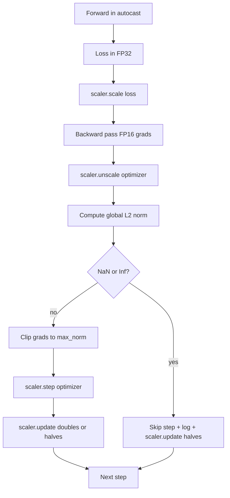

<!-- local-zh-machine-draft: English source is canonical; prose translated automatically, code/math preserved. -->

<a id="gradient-clipping-and-mixed-precision"></a>

# Gradient Clipping（梯度裁剪）与 Mixed Precision（混合精度）

> 该 optimizer 和上一个课程的时间安排 gradients 正常,通常不会,一整批坏货就能冲破 gradient 混合精度训练通过在损失方引入 FP16 溢出来放大。 这个教训建立了生产训练不能在没有下列条件的情况下运输的两个安全带: gradient clipping 配置成一个全局 L2 规范, 并使用自动显示和梯度测量器进行混合精度循环 NaN 和Inf,跳过步骤干净, 并记录了比例因素 法医。

**类型:** Build
**语言:** Python
**先修要求:** 第19阶段 30-37项经验教训
**时间:** ~90分钟

<a id="learning-objectives"></a>

## 学习目标

- 全面计算全球L2规范 parameter gradients 当它超过配置的阈值时, 并按位剪贴。
- 自动加一个梯度仪, 以自动转换训练步骤, 从而向前推进 FP16, backward passes 幸存下来
- Detect NaN 损失或损失中的信息 gradient,跳过 optimizer 步,并记录跳过。
- 向梯度测量仪报告每个步骤的缩放系数,这样一连串跳过就立即可见。

<a id="the-problem"></a>

## 问题

昨天的训练赛跑干净了 形成了一个垂直的输球曲线 排在第八步217 gradient 标准为4200,是上一个峰值的20倍。 optimizer 应用一个步骤, 重新设置该模型在前一小时所做的每件学习。 当一个全球 L2 剪辑在标准1.0 时, 同一批的片段会贡献出单位- 北纬更新; 损失将保持在趋势线上; 运行会持续到 。

混合精度训练通过计算 forward pass 和大多数 backward pass 成本是 FP16 的缩略范围。 gradient 将溢出的FP16 评为 Inf, 通过随后的层传播 NaN,它设置了每个 weight 以 NaN 下个 optimizer step. PyTorch将损失乘以大缩放系数 backward pass 并且分割 gradients 以相同系数进行 optimizer 级数。如果有的话 gradient 是 Inf 或 数字 NaN 在非比例时, 缩放器跳过阶梯, 并减半缩放系数; 如果前一N级的缩放器是干净的, 则缩放器是该系数的两倍。 在培训过程中, 该系数发现FP16 范围允许的最高值 。

构建问题正在正确连接两个。 非比例之前的剪贴符和阈值正在缩放 gradients; 在非比例尺之后的剪辑和关于“梯度尺”的操作顺序。正确的顺序是: `scaler.scale(loss).backward()`, 然后 `scaler.unscale_(optimizer)`, 然后 `clip_grad_norm_`, 然后 `scaler.step(optimizer)`, 然后 `scaler.update()`。任何其他顺序都会产生一个无声的循环。

<a id="the-concept"></a>

## 概念



<a id="global-l2-norm"></a>

### 全球L2规范

全球L2规范是欧洲人所遵循的规范 gradient 矢量, 不是每 -parameter norm. PyTorch 执行此功能 `torch.nn.utils.clip_grad_norm_(parameters, max_norm)`。函数返回切换前规范,这样课程就可以同时记录自然值和剪切值,这对“我们每一步都剪切”的诊断是必要的。

<a id="autocast-and-gradscaler"></a>

### 自动播放和渐变比例器

`torch.amp.autocast(device_type)` 是在FP16中有选择地运行符合资格的操作(大多数是马图尔级操作)的上下文管理器。 `torch.amp.GradScaler(device_type)` 是在倒计时和反计时之前权衡损失的助手。 gradients 开始于 optimizer 步数。 两者是一起设计的; 使用一个不使用另一个是一个配置错误, 测试应该抓住它 。

课上用 CPU 自动播放,因为这就是在 CI 运行; 同样模式的传输 逐字 CUDA 改变 `device_type="cpu"` 以 `device_type="cuda"`。 渐变 CPU 是根根根( 根根)CPU 自动播放已经在 BF16 中默认操作, 不需要损失缩放), 但课程包括调用网站, 所以线条与 GPU loop.

<a id="nan-and-inf-detection"></a>

### NaN 和Inf检测

检测发生在两个地方 首先,损失本身会与 `torch.isfinite` 后退; 信息或 NaN 损失不产生有用的结果 gradients ,不经输入而跳过 optimizer。第二,在 `scaler.unscale_(optimizer)` 课目扫描未缩放的 gradients 与 `has_non_finite_grad(...)` 并治疗任何 NaN 两者加在一起,包括前方和后方的故障模式。

<a id="scaling-factor-diagnostics"></a>

### 缩放因数诊断

缩放系数是梯度仪的内部状态。 课程的每一步读取 `scaler.get_scale()` 并记录在 learning rate 和 gradient 正常。健康运行显示两个功率的缩放系数在上升,直到它饱和到接近 `2^17` 或 `2^18`。错误的行为运行显示高值和低值之间的因素波动,这就是模型的信号 gradients 诊断结果不记录,是看不见的。

```figure
grad-clip-monitor
```

<a id="build-it"></a>

## 动手实现

`code/main.py` implements:

- `clip_global_l2_norm` - 包装纸 `torch.nn.utils.clip_grad_norm_` 返回切换前和切换后规范。
- `has_non_finite_grad` - 扫描的助手 gradients 用于 NaN 和Inf。 和Inf。
- `AmpTrainState` - 包一个模型,一个 `AdamW` optimizer,一个梯度标和一个自动显示设备。 `step(inputs, targets)` 运行全剪接, 缩放和跳过 -NaN pipeline.
- `StepLog` 和 `SkipLog` - 结构化的每步记录。
- 训练小的演示 `nn.Linear` 20个步骤的模型,将 Inf 注入 gradient 打印结果日志

运行：

```bash
python3 code/main.py
```

脚本退出零, 打印每行的单行日志并加标记 `STEP` 或 `SKIP`; 至少一行为 `SKIP`.

<a id="production-patterns"></a>

## 生产模式

四个模式将循环提升到生产训练步骤。

**跳过计数器作为警告,而不是日志行 。** 每场训练中跳过几步是健康的。 epoch 是一个非常困难的警告:模型在系统FP16中无法维持,循环无声失效。 课程追踪了1,000步滚动跳跳率,并且会在生产过程中将5%以上的速率上页。

**剪切阈值在配置中 。** `max_norm = 1.0` 是一个语言模型培训的现代默认值。先用一个小模型进行扫描;较大的阈值使模型从真正困难的批次中恢复过来;较小的阈值以新损失曲线为代价将最坏的情况捆绑在一起。 YAML 或 JSON 配置为课程44的进度表 。

**诺姆的日志会和时间表一起被送到CSV** CSV 列为 `step, lr, grad_l2_pre_clip, grad_l2_post_clip, loss, skipped, skip_reason, scaler_scale`。打开文件的审阅者会看到时间表, gradient 故事、 缩放系数和跳过结果( 原因) 都排成一行。 将列横切为文件是错配方 。

**`scaler.update()` 跑每一步,甚至跳过。** 缩放器在一整步中读取无损计数器, 增加其值, 并可能使系数翻倍。 缩放器在一整步中将系数减半, 并重新设置计数器 。 `update()` 跳过路径上的错误 产生“缩放系数从未改变”。

<a id="use-it"></a>

## 实际应用

生产模式:

- **自动播放设备匹配 optimizer device.** `torch.amp.autocast(device_type="cuda")` 用于 GPU training; `torch.amp.autocast(device_type="cpu")` 用于 CPU。混合设备产生一个静态型号错误,它表面上是一个看来不错但模型不学的损失曲线。
- **退后前检查一下** `torch.isfinite(loss).all()` 是一个 tensor 减少;费用微不足道,在 NaN 输是整个训练步骤,总是跑
- **`set_to_none=True` 在 `zero_grad`.** Sets gradients 以 `None` 而不是零,这让 optimizer 跳过计算不受影响 parameter 环境是自由输送改善,小小的虫表面减少。

<a id="ship-it"></a>

## 交付成果

`outputs/skill-clip-amp.md` 将会在一个真正的项目中描述训练步骤使用的剪切阈值和自动投放装置, 即每步 CSV 的版本控制, 以及生产跳速警告阈值。 此课将输入引擎 。

<a id="exercises"></a>

## 练习

1. 合成Inf注射用真正的损失峰值(将一组目标乘以1e8)来代替,并验证跳过路径触发器。
2. 添加a `--bf16` 模式 自动转换为 BF16 而不是 FP16。 BF16 的出处范围大于 FP16, 且很少需要损失缩放; 在同一演示中验证跳过率降至零 。
3. 添加单位测试 gradient- 剪贴纸在不剪切时返回预切和剪贴后规范。
4. 添加滚动窗口跳速计算和如果速度超过100个连续步骤的配置阈值而不能运行的 CLI 标记。
5. 连接写入 CSV 的圆圈( W)`step, lr, grad_l2_pre_clip, grad_l2_post_clip, loss, skipped, skip_reason, scaler_scale`),并通过冲洗每行的积分来确认文件的存续。

<a id="key-terms"></a>

## 关键术语

| 术语 | 人们怎么说 | 它实际上意味着什么 |
|------|-----------------|------------------------|
| 全球L2规范 | "剪切目标" | 被隔离者的欧几里德规范 gradient 贯穿所有可训练对象的矢量 parameters |
| autocast | "Mixed precision" | 选择FP16(或BF16)在一区域内执行符合资格的作业 `with` block |
| GradScaler | "失标的缩放器" | 帮助在后向和反向尺度之前将损失乘以倍数 gradients 开始于 optimizer step |
| Skip | 恶毒的一步 | 一个 optimizer 步数拒绝, 因为 gradient 或损失是非无限的;缩放器将系数减半 |
| 缩放因数 | "规模状态" | 梯度仪的当前乘数; 干净的伸展后加倍, 每跳过一次后再减半 |

<a id="further-reading"></a>

## 进一步阅读

- [Micikevicius等人, Mixed Precision 培训(ARXiv 171.03740)](https://arxiv.org/abs/1710.03740) - 原先的损失计算建议
- [Pascanu, Mikolov, Bengio, 关于培训经常性神经网络的困难(arXiv 1211.5063)](https://arxiv.org/abs/1211.5063) - 该 gradient- 缩略语参考文件
- [PyTorch torch.amp.GradScaler](https://docs.pytorch.org/docs/stable/amp.html) - 缩放器 API 此课程包
- [PyTorch torch.nn.utils.clip_grad_norm_](https://docs.pytorch.org/docs/stable/generated/torch.nn.utils.clip_grad_norm_.html) - 剪切原始的这课使用
- 阶段19 - 42 - 其材料为循环提供材料的下载器
- 阶段19 - 43 - 循环消耗的数据收集器
- 阶段 19 - 44 - 此循环的进度
