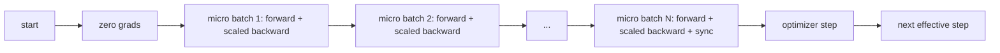
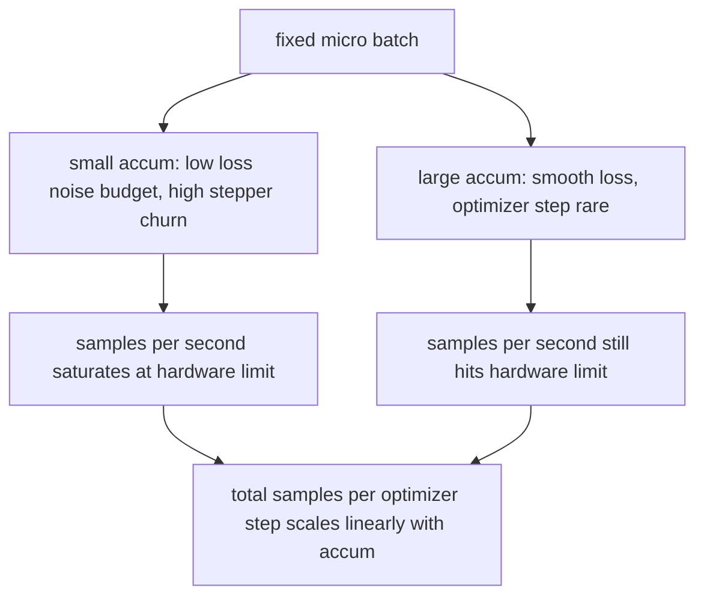

<!-- local-zh-machine-draft: English source is canonical; prose translated automatically, code/math preserved. -->

<a id="gradient-accumulation"></a>

# Gradient Accumulation

> 在一个有效批次中列车,您负担不起,一次一次一次一次一次一次一次。 optimizer 一步,让 gradients 堆积起来。

**类型：** 构建
**语言:** Python
**先修要求:** 第19阶段42至45项经验教训
**时间:** ~90分钟

<a id="learning-objectives"></a>

## 学习目标

- 生成有效的批量标识 : `effective_batch = micro_batch * accum_steps`.
- 实施每件微批损失的缩放, 以累积 gradient 匹配一个整批后退。
- Skip optimizer 同步到最后的微批次( 同步到最后一步) 。
- 对照有效的批量曲线读取一个输送量,并解释递减的回报。

<a id="the-problem"></a>

## 问题

您想要在 512 批量的有效训练中, 因为损失曲线比较平滑, optimizer 步骤在那个比例上更有意义。 桌面上的加速器在存储功能用完之前就持有32个示例。 将批次翻倍不是一个选项。 将模型减半不是一个选项。 2017年达到的字段从未停止使用的把戏是运行 16 backward passes,让 gradients 累积在 parameter 缓冲, 仅步 optimizer 当计数到达目标时

风险在于损失已经不再是大批量损失的相同数字。16个小型喷嘴的交叉体的天真总和是整批损失的16倍。 不缩放,则会变小。 gradient 方向是正确的,但 数量是错误的, optimizer 步骤是16倍太大。 修正是一个部门。 修复也很容易忘记。

<a id="the-concept"></a>

## 概念



合同是简短的:

- 每个微型批次的损失除以 `accum_steps` 之前 `backward()`. PyTorch sums gradients 进入 `param.grad` 默认情况下; 项将运行中的总和推回正确的比例。
- 该 optimizer 一步步火一次每批有效, 在最后的微批次向后。 一步步累积每个 parameter 该 rest 运行取决于。
- 该 optimizer状态( 时速缓冲, ) Adam ) / 进步一次, 而不是一次微批。 指数移动平均值会看到错误的频率, 并在时间轴中燃烧 。
- 在单一设备上,这是簿记。在多层组中,相同的模式将非最后微型插头包装在 `no_sync` 上下文中跳过 gradient 全部减量; 最后的微批减少全部累积 gradient 而不是支付网络费用N倍。

<a id="the-equivalence-proof-in-code"></a>

### 代码中的等同证据

```python
loss = criterion(model(x_full), y_full)
loss.backward()
opt.step()
```

等于

```python
for x, y in chunks(x_full, y_full, n):
    scaled = criterion(model(x), y) / n
    scaled.backward()
opt.step()
```

以浮动点和顺序。 gradient 循环末的缓冲线相同 tensor 单批后退会生成。 课程代码将显示, 1e-4 下的最大值差异在 `equivalence_check`.

<a id="where-the-cost-goes"></a>

### 费用去向

每个微批次要花费一个前向和一个后向。 随着时间的积累, 您可以交换内存。 输量曲线在 `outputs/accum-curve.json` 显示在固定微批次中有效批量生长时发生的情况:



没有免费午餐,加倍 `accum_steps` 将墙上的时间翻倍 optimizer 。什么变化是 gradient 估计:在同一墙上,您所花的钱更少 optimizer 台阶,但每个台阶平均比更多的样本。文献将大批量和小批量视为不同的优化问题;这里的教训是机械的,而不是统计的。

```figure
cc-grad-accumulation
```

<a id="build-it"></a>

## 动手实现

`code/main.py` 是一种可调用的文物,有三样东西

<a id="step-1-equivalence-check"></a>

### 步骤1:对等检查

`equivalence_check()` 以同样的种子制造两个网络副本。 一个看到一个16个样本批次 forward pass。另一个则看到四个四样块,损失除以四个。函数比较 gradient 缓冲 optimizer 步数和 parameters 之后,这一说法是: `max_abs_diff < 1e-4`.

<a id="step-2-sync-on-last-step-pattern"></a>

### 步骤2:最后一步同步模式

`train_one_optimizer_step` 走路小便池。除最后一只外,每个小桶都用 `no_sync_context(model)`。在一个单一进程中,上下文是无操作;在DP上,这里是 gradient 全部减号被跳过。 不管簿记是什么, A 都是一样的 。 `sync_counter` 记录我们离开诺斯多少次_同步范围; 对于 N 微型坑, 数是每有效步骤一个, 不是 N 。

<a id="step-3-the-throughput-curve"></a>

### 步骤3:输送曲线

`sweep_effective_batches` 运行一个带有固定微批次和累积步骤列表的相同模型。 对于每个设置, 日志 :

- `samples_per_sec`: 查看的样本总数除以墙上时间
- `median_step_ms`:每有效步骤50%
- `sync_calls`: 集体观点
- `avg_loss`: 横扫平面的平均值 optimizer steps

产出土地 `outputs/accum-curve.json` 并且可以从笔记本上重新使用。

运行：

```bash
python3 code/main.py
```

脚本打印等效 diff, 然后扫描表格, 然后 JSON 路径。退出代码零。

<a id="use-it"></a>

## 实际应用

在生产培训方面, gradient accumulation 住在一个把手后面 PyTorch模式是 `accumulation_steps = effective_batch // (micro_batch * world_size)`。在此不允许使用的框架环绕相同,但步骤是一样的:缩放损失,跳过非最后微小的同步,积累,一步。

野外的三个模式:

- 微缩...batch size 选择用于饱和设备内存。任何较小的废物加速器循环。任何更大的崩溃。
- 有效批次选自 learning rate schedule需要按比例分配大量有效批次 learning rates 和 warmup;这是2017年以来讨论的线性缩放规则。
- 累积计数是两个空位之间的桥梁,而您在运行时可以自由调音,而无需重写数据装载器。

<a id="ship-it"></a>

## 交付成果

`outputs/skill-gradient-accumulation.md` 捕捉配方, 以便对等点将其投入新的回购: 缩放比例 由 `accum_steps`跳过 optimizer 同步非最后微数, 步 optimizer 每批有效一次,按有效批量计 JSON 交易是可见的。

<a id="exercises"></a>

## 练习

1. 重新运行扫描 `--num-steps 100` 曲线在哪里平坦?
2. 添加错误的缩放变量( 无分隔) 并显示 parameter 第一步对准参考
3. 交换 SGD AdamW 并确认 optimizer 状态每有效步骤一次,而不是每小批一次。
4. 介绍一个真正的 `DistributedDataParallel` 包装和路径 `no_sync_context` 确认同步_每批有效电话减少N-1。
5. 修改等值检查以比较两个不同的微分数( 2 + 8 + 4 + 4) 并解释您需要放松的容忍度 。

<a id="key-terms"></a>

## 关键术语

| 术语 | 人们怎么说 | 它实际上意味着什么 |
|------|-----------------|------------------------|
| 微批量 | 批次你前进 | 片子适合一个记忆 forward pass |
| 累计步骤 | Backward passes 每步数 | 倒数加起来后 optimizer step |
| 有效批次 | 批量 | 微批量乘以积步数乘以数据平行的世界规模 |
| 损失缩放 | 除以 N | 每一个微型批次的单位如此总结 gradients 匹配整批 |
| 同步到最后 | 跳过 rest | 仅运行 gradient 窗口最后向后 |

<a id="further-reading"></a>

## 进一步阅读

- PyTorch 医生 `DistributedDataParallel.no_sync` 用于制作最后一步同步游戏的版本。
- Goyal等人,2017年,关于大型批量培训的线性规模,关心有效批量的理论理由。
- PyTorch 问题跟踪器 gradient accumulation 与 mixed precision unscaling.
- 阶段19 课程42至45 包括模型、数据装载器、 optimizer教练们也想着这个课
- 第19阶段47项课程 checkpoint 并恢复如此长的积累 存活在一堵墙的顶。
