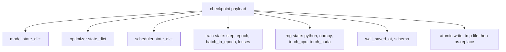
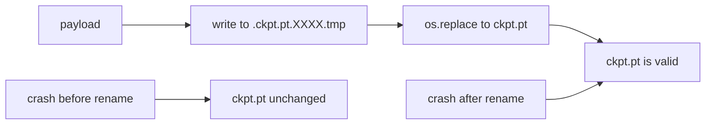
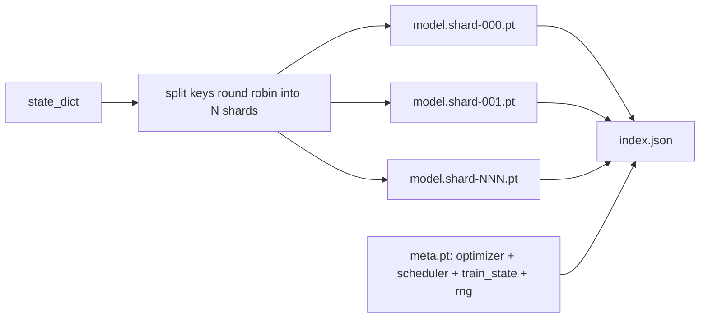

<!-- local-zh-machine-draft: English source is canonical; prose translated automatically, code/math preserved. -->

<a id="checkpoint-save-and-resume"></a>

# Checkpoint 保存与恢复

> 火车中断了 撞车 checkpoints 让他们继续吧,拯救模特儿 optimizer,时间表、损失历史、台阶计数器和RNG状态,从原子上来说,因此随时会发生杀戮,在磁盘上留下一个有效的文件。

**类型:** Build
**语言:** Python
**先修要求:** 第19阶段42至45项经验教训
**时间:** ~90分钟

<a id="learning-objectives"></a>

## 学习目标

- 将整个训练状态 装入一个可以重新装入新过程的载荷
- 执行原子保存, 使用写到音量, 然后重命名, 这样崩溃就不会留下半写的文件 。
- 恢复 RNG 状态 Python, NumPy, 和 PyTorch 以让后重现损失与不间断的基准相匹配。
- 建立一块碎片 checkpoint 不再适合一个文件的模型布局, 带有散列校验碎片和 JSON index.

<a id="the-problem"></a>

## 问题

你设置了18小时的训练任务。 挂钟上限是4小时。 集群在11点重新启动, 因为有人在你的工资级别以上批准升级内核。 checkpoints 重新来过,不复发,你也会失去 optimizer 说头11小时才学,所以即使模型 weights 幸存下来, AdamW 时间已经过去,下一步是 训练轨道已经走过了

正确的文物是一个文件, 保存所有需要继续的: 模型 parameters, optimizer 状态, 调度器状态, 地块损失历史, 当前步骤和 epoch 和分批运入的epoch 反面, 以及 RNG 状态, 随机性的所有源。 没有 RNG 表示恢复的损失曲线是不同的曲线。 相同的模型, 同样的数据, 不同的打乱, 不同的 dropout 面具,不同的号码在仪表板上。

Axron 保存是合同的另一半。 写入最终文件名意味着崩溃中写有损坏的文件; 复文读有垃圾。 写入同一目录中的临时文件, 然后重命名意味着崩溃中写没有触及以前的好文件。 重命名为 POSIX 文件系统中的原子 。

<a id="the-concept"></a>

## 概念



<a id="the-five-state-buckets"></a>

### 五州立水桶

| Bucket | 为何重要 |
|--------|----------------|
| 模型 | Weights 和缓冲剂;模型是什么。 |
| Optimizer | 动力和适应性时刻;没有这些,下一步是不同的优化问题。 |
| 调度程序 | 在哪里 learning rate 处于曲线上; 特别小心的余弦计划。 |
| 火车计数器 | Step, epoch分批处理epoch,加上损失历史 画表盘。 |
| 韩国新政府州 | 确定性作用 dropout,数据打乱,以及任何 sampling 硂 |

<a id="atomic-save"></a>

### 原子保存



有两个规则。 首先, 临时文件与目标的目录相同, 因此重命名会留在同一个文件系统中; 交叉设置重命名不是原子。 其次, 临时名称是每个尝试中独有的, 所以两个作者不会跳过 。

<a id="sharded-checkpoints"></a>

### Sharded checkpoints

当模型变大时,单文件有效载荷变得太大,无法快速装载,太大无法检查,当网络共享中读时,也太痛苦。 parameter 写一个小索引,把它们联系在一起。



索引记录了碎片数、 每一个碎片的 sha256 和元文件的 sha256。 当任何散列不匹配时, 装载器会大打折扣。 碎片可以降落在不同物理盘上; 元数据小, 读取先 。

<a id="resume-continues-mid-epoch"></a>

### 继续中 epoch

一张切合下个开始的简历 epoch 浪费时间从几分钟到一天。 `(epoch, batch_in_epoch)` 加上 RNG 状态。 装入后, 训练循环会快速推进随机数生成器, 过当前批次已消耗的批次 epoch 并自 `batch_in_epoch`。课程代码就是这样做的;其主张是,恢复后的损失轨迹与1e-4范围内不间断的基准线相符。

```figure
cc-atomic-checkpoint
```

<a id="build-it"></a>

## 动手实现

`code/main.py` 提供四个原始设备 和一个演示驱动器

<a id="step-1-capture-and-restore-rng-state"></a>

### 步骤1:捕捉和恢复尼泊尔全国过渡政府状态

`capture_rng_state` 返回一个 Python的 `random.getstate`, NumPy的 `np.random.get_state`, 和 PyTorch CPU 和 CUDA 兰尼特字节。 每件都以平原存储 Python 数字、图例和列表 (:NumPy关键数组通过 `tolist()`),这样,步骤3中的装载器就可以读回来,而不用随意选择对象。 `restore_rng_state` 倒转它。 CPU tensor 是五点八字节缓冲 PyTorch韩国新兵知道怎么消费

<a id="step-2-atomic-save"></a>

### 步骤2:原子保存

`atomic_save` 将有效载荷写入目标目录中的临时文件 `os.replace` 转换成最终的名字 `atomic_write_json` 碎片索引也这样做。

<a id="step-3-full-checkpoint-round-trip"></a>

### 步骤3:满 checkpoint 往返旅行

`save_checkpoint` 将模型包成 optimizer,排程器,火车状态,和RNG进入一个单行。 `load_checkpoint` 倒转并返回 a `TrainState`。Schema 字段是升级钩:未来格式会改变,会撞击版本字符串和装载器发送。

`load_checkpoint` calls `torch.load(..., weights_only=True)`. 一个 `.pt` 文件是一个泡菜, 并取消选中一个不可信文件 `weights_only=False` 运行文件名称的代码。 weights- 仅接受装载器 tensors 和原始容器,拒绝其他一切, 这就是为什么第一步 保持新民革联状态的平面列表。 `ValueError` 而不是使用 `assert`因为 `python -O` 使用点火2.6或更新器:在释放之前 `weights_only=True` 拥有已知的绕行(CVE-2025-32434),因此,这一课程的保障仅依赖于2.6的搁置。

<a id="step-4-sharded-variant"></a>

### 步骤4:碎裂变体

`save_sharded_checkpoint` 圆形罗宾 parameter 键横跨 N 片断, 以自己的原子保存方式写每片片断, 并用 optimizer 以及排程和列车状态,并写 JSON 硬化的沙发256的指数 `load_sharded_checkpoint` 合并前验证每条碎片,并拒绝任何在 checkpoint directory.

<a id="step-5-resume-demo"></a>

### 步骤5:恢复演示

`run_resume_demo` 训练一个小型模型 `total_steps`,保存 checkpoint 在 `interrupt_at`第二个过程恢复了 checkpoint ,然后运行剩余步骤。函数返回中断点后两个损失轨迹的最大绝对差。在恢复 RNG后,差数为零或浮点噪音。

运行：

```bash
python3 code/main.py
```

单页和折叠的演示都称最大尺寸低于1E-4。 `outputs/resume-demo.json`.

<a id="use-it"></a>

## 实际应用

生产训练船堆加装作为训练员的一部分。 optimizer + 排程器+ 计数器 + RNG, 以原子写成, 以步骤命名, 以便找到最新数据。 硬版式布局将大模型的平行加载读取; 索引 。json 是什么让这工作。

执行的四种模式:

- **装入 `weights_only=True`.** 一个 checkpoint 从共享驱动器或下载中提取的输入是不信任的。 weights- 只有装载器才能防止恶意文件在恢复的机器上运行代码。
- **气管是有效载荷的一条绳子** Migrations branch 没有它,你无法在不打破旧运行模式的情况下演变成格式。
- **每一块碎片都是Sha256** 静悄悄地下载是最糟糕的错误;装载器故障快,或者延误。
- **Keep checkpoint 诚实的说** 保存每个 N 步数和每个 钟点时段, 以较短的为单位。 否则, 撞车的长步会浪费整个工作窗口 。

<a id="ship-it"></a>

## 交付成果

`outputs/skill-checkpoint-save-resume.md` 是一个新的训练脚本的配方:有效载荷形状、原子写法、RNG捕获法、碎裂索引。 `save_checkpoint` 定期保存地点的电线 `load_checkpoint` 开始的时候,跑步会死

<a id="exercises"></a>

## 练习

1. 将圆柱碎片替换为 parameter 组( 以 `.weight` 与 `.bias`何时更适合每个布局?
2. 扩展保存循环以保留最后一个 K checkpoints 并且将旧的光碟剪掉。当磁盘小的时候,K是什么样的?
3. 添加a `--ckpt-every-seconds` 标记在墙上时段触发一个节奏, 而不是仅仅计步数。
4. 添加启动时运行的校验和校验路径, 扫描每个 checkpoint 并报告哪些腐败。
5. 执行a `migrate_v1_to_v2` 函数,在有效载荷中添加新字段并撞击 schema 字符串。让负载能够容忍两个版本。

<a id="key-terms"></a>

## 关键术语

| 术语 | 人们怎么说 | 它实际上意味着什么 |
|------|-----------------|------------------------|
| 原子保存 | 写作和祈祷 | 写入同一目录中的临时文件, 然后 os. replace in the target name |
| 州级法令 | “weights” | 模型 parameters 和缓冲器,由 parameter 名称 |
| Sharded checkpoint | "大模型文件" | 多个文件, 每片碎片一个, 加上一个元文件 JSON 带有 sha256s 的索引 |
| 韩国新政府州 | 兰多姆种子 | 被捕获状态 python random, numpy火炬 CPU火炬 CUDA;不只是种子 |
| Mid-epoch resume | "Restart" | 快速前进,从下一批继续 epoch |

<a id="further-reading"></a>

## 进一步阅读

- POSIX `rename` 原子学的语义称 `os.replace` 依赖
- PyTorch 文 件 清 单 `torch.save` 和 `torch.load`,包括 `map_location` 用于交叉装置修复和 `weights_only` 用于装入不信任的文件。
- 第19阶段第46项课程涉及 gradient accumulation 说这课 checkpoint 有效载荷在横穿。
- 第19阶段第48课涵盖了分布式包装纸,其状态指令格式符合这一计划。
- 莱努内核 `fsync` 原子重命名后耐久性保证的文档。
