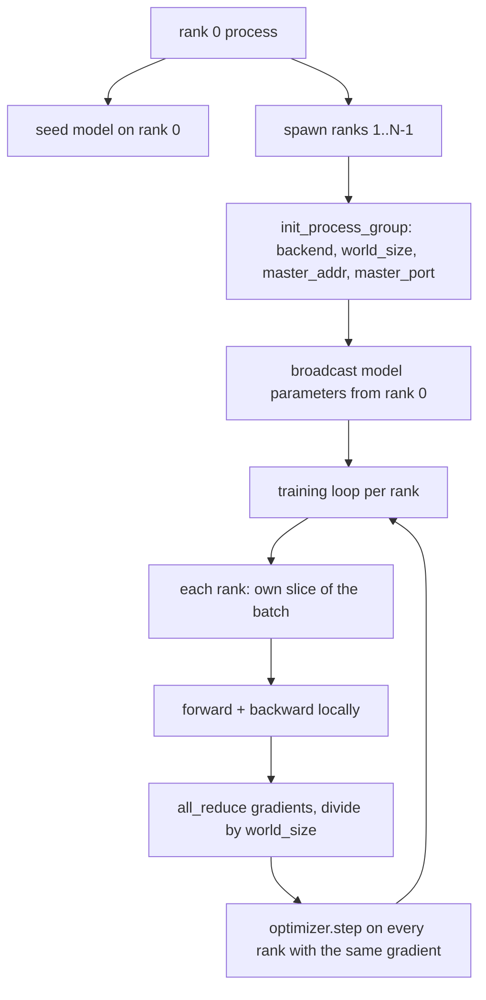
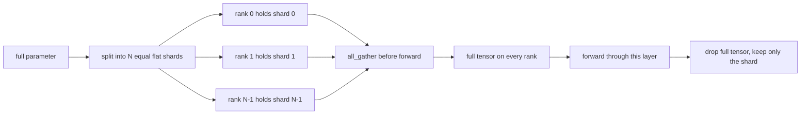

<!-- local-zh-machine-draft: English source is canonical; prose translated automatically, code/math preserved. -->

<a id="distributed-data-parallel-and-fsdp-from-scratch"></a>

# 从零实现分布式数据并行与 FSDP

> 多重级别培训是两个集体和一条规则。 parameters 启动时的平均 gradients 后退之后,不要让队伍对他们所上的步骤有分歧。

**类型：** 构建
**语言:** Python
**先修要求:** 第19阶段42至45项经验教训
**时间:** ~90分钟

<a id="learning-objectives"></a>

## 学习目标

- 召集一个进程小组 遍布N队 `gloo` 后端,没有特殊硬件。
- 执行一个最小的 DDP 包装, 用于广播 parameters 建筑和全部减产 gradients 后退,后退,后退,后退,后退,后退,后退,后退,后退,后退,后退,后退,后退,后退,后退,后退,后退,后退,后退,后退,后退,后退,后退,后退,后退,再往后退,然后退,然后退,然后退,然后退,再往后,再往后,再往后退,再往后退,再往后,再往后退,再往后退,再往后,再往后退,再往后退,再往后退,再往后,再往后退,再往后退,再往后退,再往后退,再往后退,再往后退,再往后退,再往后退。
- 证明每级的减价 gradients 匹配单进程 gradient 输入。
- 草图FSDP parameter 剥裂:每个军阶都有一个片子,全部 tensor 被收集 forward pass 之后就放弃了

<a id="the-problem"></a>

## 问题

模型适合一个设备。 数据集不合适。 优化预算表示您想要看到 N 次于每 walk knock 秒的示例。 第一个杠杆是平行的数据: 每个级别在不同的批量中运行相同的模型, 然后平均 gradients 开始于 optimizer 第二个杠杆是FSDP:模型也不适合一个设备, 所以每个级别都占到每个 parameter 并重建人造的完全的、 tensors 以层排列 forward pass.

痛苦的是记账 parameters 跑步时, 悄悄地腐蚀了。 如果平均 gradients 而不是丢失仪表板。 如果集体后端无法就一个地形达成一致, 运行就会永远挂在后面。 固定的办法是用手写一次集体文件, 并且永远不要相信一个无法复制的包装纸 。

课程继续 CPU. CUDA 假设的 `gloo` 带有每条 PyTorch 构建和接受 `torch.multiprocessing` 工人; 相同的代码开关 `nccl` 在一个多 -GPU 结点没有改变结构。

<a id="the-concept"></a>

## 概念



<a id="the-two-collectives-that-matter"></a>

### 这两大集团

| Collective | 它的作用 | 当 |
|------------|--------------|------|
| `broadcast` | 复制 tensor 从一个级别到所有其他级别 | Parameter 状态, 任何一对一同步 |
| `all_reduce` | 合计(或平均值,或最大)a tensor 各个军阶,每个军阶都得到结果 | Gradient 平均后退 |
| `all_gather` | 每个军阶提供a tensor每一个军阶都得到传承 | Logits 收藏, 金融开发部 parameter unshard |

开发部的合同是 `broadcast` 建筑和建筑 `all_reduce` 后退。 FSDP 草图添加 `all_gather` 之前的每个层 forward pass.

<a id="gradient-averaging-matches-single-process-gradient"></a>

### Gradient 平均匹配单进程 gradient

一组N级B级范例训练模型必须产生同样的效果 gradient 用于对一批N进行单一流程训练*B. 秘诀是按每级的哼哼 gradients 以 N 表示平均损失 gradient,这就是以平均减值为单位的反倍倍增 。 `max-abs-diff < 1e-3` 手动全部减速之间 gradient 和参考单进程 gradient.

<a id="fsdp-sketch"></a>

### 金融开发部草图



记忆赢是准确的: parameters 跌到1/N。成本是收集,每支付一次 forward pass。FSDP 的制作与上一层的计算重叠,因此,挂钟成本比天真的会计预测要小得多。 parameter 并声称重建 与原创的比重。

<a id="cpu-and-the-gloo-backend"></a>

### CPU 和胶布后端

CUDA 生产目标,但代码路径相同 CPU. `gloo` 是该 CPU 组合后端。它比 `nccl` 在 GPUs 以星级计,但以 API 课目进程组的初始化 `backend="gloo"` 和众生的后裔, `torch.multiprocessing` 而非 `torchrun`;两者最终都处于同一状态 `torch.distributed` 电话,在多位...GPU 节点,唯一的变化是 `backend="nccl"`设备 tensors, 和 `torchrun` 发射

```figure
cg-allreduce-ring
```

<a id="build-it"></a>

## 动手实现

`code/main.py` 是可调用的文物

<a id="step-1-bring-up-the-process-group"></a>

### 步骤1:建立进程小组

```python
os.environ["MASTER_ADDR"] = "127.0.0.1"
os.environ["MASTER_PORT"] = str(port)
dist.init_process_group(backend="gloo", rank=rank, world_size=world_size)
```

`MASTER_ADDR` 和 `MASTER_PORT` 即会合点: 每一个级别都拨打同一宿主的同一个端口。 课程通过捆绑和关闭的把戏选择一个自由端口, 以避免在几个运行的机器共享时发生碰撞 。

<a id="step-2-broadcast-at-construction"></a>

### 第2步:在建筑中广播

`MinimalDDP.__init__` 每天走路 parameter 和缓冲电话 `dist.broadcast(tensor, src=0)`。0级的值变成金字塔。没有这个,每个级的首字母都是用自己的种子,而排名则与第一步不同。

<a id="step-3-all-reduce-gradients-after-backward"></a>

### 步骤3:全减 gradients 后退后

```python
def all_reduce_grads_(module, world_size):
    for p in module.parameters():
        if p.grad is None:
            p.grad = torch.zeros_like(p.data)
        dist.all_reduce(p.grad.data, op=dist.ReduceOp.SUM)
        p.grad.data.div_(world_size)
```

每一个军阶最后都是一样的平均 gradient. 该 optimizer 职档是每个级别输入的函数, 这就是为什么 parameters 保持同步运行横跨。

<a id="step-4-prove-the-equivalence"></a>

### 步骤4:证明等同性

`manual_all_reduce_matches_single_process` 建立相同的排名0模式,并比较全面减员后的情况 gradient 反对《公约》 gradient 单一个进程将计算连接输入。 最大( abs) 时值为 1 e-8 左右 。

<a id="step-5-fsdp-round-trip"></a>

### 第5步:金融开发部往返旅行

`fsdp_round_trip_sketch` 平坦每个 parameter,将 `world_size`,切片,全套和未划线。每个等级的重建等于原来的。这是不硬的一步;反之,是把集合的一块切除。 tensor.

运行：

```bash
python3 code/main.py
```

默认世界大小为 2 。 CPU 产卵过程,通过 `gloo`输出为零。 `outputs/ddp-demo.json` captures parameter 每一军阶的总额, gradient 全部减员后的标准、 金融服务发展方案的圆程结果以及 手动- vs 参考 gradient diff.

<a id="use-it"></a>

## 实际应用

生产训练堆叠 被称为相同的原始。 PyTorch的 `DistributedDataParallel` 加: 后退 gradient 将所有减量与后排、桶装和若干小减量相重叠的钩子 gradients 变成一个集体, `no_sync` 使用了上下文第46课。

PyTorch金融开发部补充说: parameter 查看每个层, 所以每层都有一个毗连缓冲, 下层的不硬部分与当前层的计算重叠, 并且可选 CPU 卸货为碎片。

形状保持不变: 启动时播放, 后退, 碎片 parameters 等他们不再适合

<a id="ship-it"></a>

## 交付成果

`outputs/skill-distributed-fsdp-ddp.md` 带有新培训脚本的配方: 将进程组与 `gloo` 用于 CPU 和 `nccl` 用于 GPU,将模型包在DDPShell中,在建筑上播放,并减少后退,任选碎片 parameters 与全部_收集 FSDP 草图中的图案 。

<a id="exercises"></a>

## 练习

1. 运行方式 `--world-size 4` 并证实参数分布 停留在1E -3下 整个运行。
2. 将手册平均替换为 `dist.all_reduce(op=dist.ReduceOp.AVG)` 和时间差。
3. 在 DDP 包装中添加后钩子, 使全部减号与 rest 以显示后方的墙壁;
4. 执行FSDP的重创步骤: forward pass,替换整页 tensor 与本地碎片再次。 确认每级内存滴落 。
5. 切换后端到 `nccl` 以一个 CUDA 框中。注意哪些环境变量变化,哪些保持不变。

<a id="key-terms"></a>

## 关键术语

| 术语 | 人们怎么说 | 它实际上意味着什么 |
|------|-----------------|------------------------|
| 后端 | "胶水或核电解码" | 执行集体行动图书馆;Gloo是 CPU, nccl 是 GPU |
| 世界规模 | 全部军衔 | 团体内的程序数目;该团体是单位集体在 |
| 排名 | "工人身份证" | 组内的进程标识符, 已索引化为零 |
| 全部归约 | "补习生" | 总计a tensor 各个军阶,每个军阶的结局都是一样的 |
| Unshard | 将参数加起来 | 重建整个 tensor 由每层切片通过_gather |

<a id="further-reading"></a>

## 进一步阅读

- PyTorch `torch.distributed` 用于该课所依赖的集体语义的文档。
- 该 `gloo` 库的集体列表, 形状与 CUDA-backed `nccl` primitives.
- 阶段19:46课 gradient accumulation 将 DDP 全部减入 `no_sync`.
- 阶段19:47课 checkpoint 维持 DDP 和 FSDP 运行的布局 。
- PyTorch 财务发展服务方案关于编制 parameter 在这儿画的碎片
