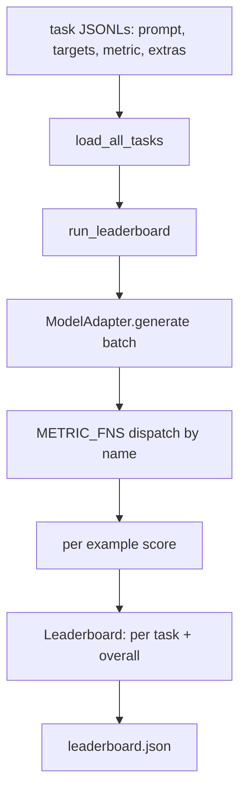
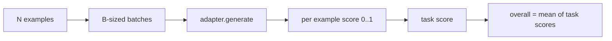

<!-- local-zh-machine-draft: English source is canonical; prose translated automatically, code/math preserved. -->

<a id="language-model-evaluation-harness"></a>

# 语言模型 Evaluation Harness

> 在一个无法定义的任务上表现良好的模型 是一个意外地表现良好的模型。 harness 是一个任务定义, 测量, 运行器, 和领先板, 在一个简短的, 可互换形状。

**类型：** 构建
**语言:** Python
**先修要求:** 第19阶段42至45项经验教训
**时间:** ~90分钟

<a id="learning-objectives"></a>

## 学习目标

- 将任务定义为 JSONL 文件为 `prompt`, `targets`, `metric`,并且可选 `extras` 举个例子
- 实施五项衡量标准: exact match, rouge-l F1, 可执行检查, 多重选择, 和子字符串包含 。
- 构建一个可按任务分批示例的运行器, 并发送到可互换的模型适配器 。
- 开始一个头板 JSON 加上每个任务分数, 延迟, 和总平均值可以复制。

<a id="the-problem"></a>

## 问题

新的语言模型每周都会登陆。市场营销称它很好。诚实的问题是:好什么?诚实的答案是你自己写的首页,因为销售商的头板是他们调用的。

没有 harness 在你的回购中,您通过感觉比较了两个模型。 harness 以固定的分数来比较, JSON 输出可 diff。 harness 也就是昨天运行和今天运行之间的合同 没有它,回归船就会返回

陷阱已经太合适了 harness 改为一个模型。修正是相同的陷阱,反之: harness 其小到可以在15分钟内读懂, 任务小到可以将数据运入回购, 测量标准是从零开始写成, 这样同事就可以审计它们, 而适应器是唯一适合模型的代码生命。 交换适配器, 头板移动; 换换任务, 头板移动。 其它东西都不应该移动 。

<a id="the-concept"></a>

## 概念



<a id="task-spec"></a>

### 任务规格

每个例子都是一个 JSONL line:

```json
{"id": "arith-00", "prompt": "compute: 2 + 2", "targets": ["4"], "metric": "exact_match"}
```

需要打分的量子 `extras` 携带侧载荷:

```json
{
  "id": "code-00",
  "prompt": "python: write a function f that doubles its input",
  "targets": ["ok"],
  "metric": "code_exec",
  "extras": {"io_pairs": [[1, 2], [3, 6]]}
}
```

任务就是 `.jsonl` 文件在 `outputs/tasks/`。文件名称是任务名称。文件的所有示例都使用一个标准。

<a id="the-five-fixture-tasks"></a>

### 五个固定任务

| 任务 | 公制 | 测试什么 |
|------|--------|---------------|
| arithmetic | exact_match | Token- 确定性答案的等级正确性 |
| summary | rouge_l | 最长期的常见子序列 F1 相对于一行参考摘要 |
| code-exec | code_exec | 可执行测试: 预测函数必须满足输入输出对数列表 |
| multiple-choice | multiple_choice | 预测的第一字母必须匹配允许的字母 |
| generation | substring_contains | 自由格式文本必须包含至少一个目标子字符串 |

<a id="the-metric-contract"></a>

### 标准合同

每种指标都是由 `(prediction, targets, extras) -> float in [0.0, 1.0]`. 该 harness 平均每个示例分数以获得任务分数,然后平均任务分数以获得总体。

- `exact_match`:小写, 折叠空白, 平等 。
- `substring_contains`:相同 normalization,子字符串测试。
- `multiple_choice`:第一个字符大写。
- `rouge_l`: LCS 长度除以预测和参考长度、精确度和回溯度的F1。
- `code_exec`:在限制命名空间执行预测,调用 `f(x)` 每一个输入输出对, 计数匹配。

代码_Exec 公尺运行了在被剥除的内嵌命名空间中的预测。 该课程的测试证实 `import os` 爆炸是因为 `os` 不在命名空间;您无法从代码预测中到达文件系统。

<a id="the-model-adapter"></a>

### 模型适配器

```python
class ModelAdapter(Protocol):
    def generate(self, prompts: Sequence[str]) -> List[str]: ...
    @property
    def name(self) -> str: ...
```

适配器是接缝,是课船 `ToyAdapter`,一个确定型匹配器,返回每个 prompt 。 真正的适配器会调用模型并返回其输出。 harness 无所谓

<a id="the-runner"></a>

### 跑步者

`run_task` batches `batch_size` prompts 一次发送到公制函数。 `run_leaderboard` 完成所有任务和平均 `write_leaderboard` emits JSON 使用一个系统字符串,使未来格式的改变不会静悄悄地打破仪表板。



```figure
eval-harness-matrix
```

<a id="build-it"></a>

## 动手实现

`code/main.py` 是可调用的文物

<a id="step-1-seed-fixture-tasks"></a>

### 步骤1:种子固定任务

`seed_fixture_tasks(target_dir)` 写五 `.jsonl` 文件。 第一个运行 `main.py` 当目录为空时种子它们 。

<a id="step-2-load-tasks"></a>

### 第2步:装载任务

`load_all_tasks(task_dir)` 读取每 `.jsonl` 返回任务名称中的编辑器 `Example` 注释行 `#` 和空白行被跳过,以便贡献者可以对文件进行注释。

<a id="step-3-implement-metrics"></a>

### 步骤3:执行衡量标准

每套测量仪都有一个小功能, 包括一个单元测试。 normalization部分重叠,代码执行, 不安全代码拒绝。

<a id="step-4-write-the-runner"></a>

### 步骤4:写出运行者

`run_task` 转售批次并生产 `TaskResult` 计分,计数正确,总计数,和潜伏。 `run_leaderboard` 散步所有任务并产生 `Leaderboard` 与总平均数。

<a id="step-5-emit-json"></a>

### 步骤5:发射 JSON

`write_leaderboard` 连环化板。 `--include-per-example` 标记会丢弃每例记录, 这样您就可以在计分移动时对上一个运行进行 diff 预测 。

运行：

```bash
python3 code/main.py
```

脚本在第一次运行时播种定着的种子, 用玩具适配器评分( 它使每个固定装置都正确) 并写 `outputs/leaderboard.json`。总分为1.0,与玩具适配器相匹配;在 `test_main.py` 显示相同 harness 当适配器无法回答时, 产生 0.0 。

<a id="use-it"></a>

## 实际应用

要插入一个真正的模型,请写入一个适配器。形状 :

```python
class HttpAdapter:
    name = "vendor.v1"

    def __init__(self, endpoint, api_key):
        self.endpoint = endpoint
        self.api_key = api_key

    def generate(self, prompts):
        out = []
        for prompt in prompts:
            response = http_post(self.endpoint, prompt, self.api_key)
            out.append(response["text"])
        return out
```

Swap `ToyAdapter` 用于 `HttpAdapter` 位于 `main()`. 该 harness任务 标准 和头板都一样

运输时要执行的三个模式 harness 在一个真正的项目中:

- **插入任务文件 。** 头板json 带有散列式任务内容, 或含有 JSONLs 并列; 否则, 任务文件发生时, 分数会移动, 您无法告诉哪个 。
- **迪夫预测,不只是分数** 该 `--include-per-example` 旗子让你看看模型在分数下降的那天说了什么
- **盖上 batch size.** 真正的适应器 rate limits。一个小 batch size 保留 harness 供应商之间兼容

<a id="ship-it"></a>

## 交付成果

`outputs/skill-lm-eval-harness.md` 带有配方: JSONL 任务规格, 5 度数, 可互换适配器, 批量运行器, 首板 JSON 带有 schema 字符串。 任务文件在 `outputs/tasks/` 是固定装置; 复制成一个真正的工程作为启动器。

<a id="exercises"></a>

## 练习

1. 添加第六项任务,加上从零开始写成的定制度量(像 BLEU 一样的重叠、 像 BLEURT 那样的参考评分、 任何有明确合同的评分)。
2. Extend `code_exec` 来捕捉Stdout 并接受一个预期 stdout 列表作为目标 。
3. 添加一个头板 diff 命令: 给定两个 `leaderboard.json` 文件, 打印哪个任务被移动了, 以及多少 。
4. 以例显示的挂载时间。 将调试器呼叫换成超时; 向外显示一个单独的 `timeouts` 列在头板上。
5. 头版上有一个 sha256的 Pin 任务内容, 这样未来的读者就可以确认他们 取得了相同的任务。

<a id="key-terms"></a>

## 关键术语

| 术语 | 人们怎么说 | 它实际上意味着什么 |
|------|-----------------|------------------------|
| 任务规格 | 电子格式 | JSONL 文件为 prompt、目标、计量、可选额外示例 |
| 公制 | "你如何得分" | 函数从( 准备、 目标、 额外) 向 [0, 1] |
| 适配器 | "模特客户" | 生成对象(prompts) - > 列表[str] 方法; 唯一的模式特定代码 |
| 排行榜 | 记分牌 | JSON 加上每个任务分数、总计数、延迟和总体平均数 |
| 代码执行指标 | 跑过去检查一下 | 在限制名称空间执行预测,与输入输出对比 |

<a id="further-reading"></a>

## 进一步阅读

- 原型的 lm --evaluation-harness 用于生产参考, 大得多但形状相同。
- 拥抱脸孔的轻率 来替代执行同一合同
- 第19阶段第46项课程涉及 gradient accumulation 训练堆放中使用的模式 harness scores.
- 第19阶段:47项课程涉及 checkpoint 格式,您得分对准; 输入 checkpoint 头板上的大麻
- 第19阶段第48课涉及在测试中生成模型的分布式培训堆。
