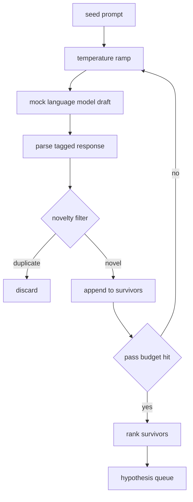

<!-- local-zh-machine-draft: English source is canonical; prose translated automatically, code/math preserved. -->

<a id="hypothesis-generator"></a>

# 研究假设生成器

> 一项研究 agent 两次问同样的问题都是在浪费 tokens诀窍是迫使每条船都降落到新地方

**类型：** 构建
**语言:** Python
**先修要求:** 阶段19 A轨道课程20-29
**时间:** ~90分钟

<a id="learning-objectives"></a>

## 学习目标
- 驱赶种子的采样器 prompt 并将其输出转换成输入的假设记录。
- 擦擦取样器 temperature 每一条路都经过 所以下一条路的草图会从最后一条进一步移开
- 过滤小的复制 embedding 模型和余弦距离阈值。
- 给幸存者打分 分数分数能融合新奇、特殊性和测试性
- 保持每一步的确定性,所以同样的种子 总是产生相同的队列。

<a id="why-generate-then-filter"></a>

## 为什么生成, 然后过滤

计划者一次问一个模型, 就会得到一个假设。 这对一个工作的例子来说是好的。 对于一个研究循环来说, 它的形状是错误的。 该循环想要一个排成排的排子, 并且要有一个深度, 所以当第一个假设失败时, 运行者可以准备好下一个而不用支付另一个完整的 sampling pass.

有两个想法可以一起制作队列。 temperature 斜坡:每次通过取样器, temperature 注意, 因此鼓励稍后的草稿游荡。 第二个是新颖的过滤: 在每张草稿之后, 生成器会测量 embedding 远离所有前幸存者 拒绝任何在集群内的东西

课程中包含一个返回脚本的模拟语言模型 token 固定的序列 prompts。假象足以完成整个路径:种子 prompt 在, temperature 斜坡应用,候选人解析,新颖的过滤器运行,排队排出。

<a id="the-hypothesis-shape"></a>

## 假说形状

```text
Hypothesis
  id             : int           (monotonic within a run)
  text           : str           (the claim)
  variables      : list[str]     (what changes between conditions)
  metric         : str           (what the runner will measure)
  baseline_ref   : str | None    (which paper or run the comparison cites)
  draft_pass     : int           (which sampler pass produced this)
  temperature    : float         (the sampler setting at draft time)
  novelty_score  : float         (distance from prior survivors, 0..1)
  rank_score     : float         (weighted sum used for ordering)
```

`variables` 和 `metric` 并不是免费文本。 解析器从一个标记的反应中拉出它们。 课程52 的选手在建立实验配置时直接读取这些字段 。

`baseline_ref` 选项是可选的,但建议。 课程53的评价员需要有一个基准来比较。 如果假设省略了一个基准,评价员则要回到前一个参数,使用相同的标准。

```figure
cg-novelty-ramp
```

<a id="architecture"></a>

## 建筑



循环是直线前进的,有趣的部分是每个盒子都有硬合同。

<a id="temperature-ramp"></a>

## Temperature ramp

开始于 `t_min`,结束于 `t_max`,步数 `(t_max - t_min) / (n_passes - 1)`。每个通行证都呼叫当前取样员 temperature生产 `n_passes` 平整间距值 `GeneratorConfig.schedule()`模拟模型荣誉 temperature 键入的一小组脚本响应 `(prompt, temp_bucket)`。桶是开着的间隔,所以小的改变 temperature 采样器将是一个真正的模型, `temperature=t` 过世了

默认时间是 6 个 `0.2` 以 `1.2`。6 足够填充队列,而不支付新颖过滤器将拒绝的样本。以下 `0.2` 模型鹦鹉把种子还给上面 `1.2` 反应往往会脱离话题 使分析者失望

<a id="novelty-filter"></a>

## 新颖过滤器

在每个草稿解析后,生成方嵌入文本,并与所有被接受的假设进行比较。 embedding 是一个小的散列单词包 tokens,正态到单位长度。两个单位矢量之间的余弦距离是 `1 - dot(a, b)`。如果草稿与任何先前幸存者的最低距离高于此,则草稿通过 `novelty_threshold`默认值 `0.25`.

杂草 embedding 并不奢侈。 它具有决定性,没有依赖性,足以抓住显而易见的事例:两个版本分享了大部分名词。 生产部署会以小句式模式交换。 界面保持不变。

<a id="rank-score"></a>

## 排名分数

```text
rank_score = w_novelty * novelty_score
           + w_specificity * specificity_score
           + w_testability * testability_score
```

三个分数 `novelty_score` 最小值为 embedding 距离前幸存者。 `specificity_score` 是在假设中以目标数除以的具体变量的计算。 `testability_score` 假设同时指明了衡量标准和基准,则为半,如果只有衡量标准,则为零。

默认 weights 是 `0.4`, `0.3`, `0.3`. 该 weights 住在发电机里 这样下游的课就能转移它们 而不放弃代码

<a id="mock-language-model"></a>

## 模拟语言模式

```python
class MockLLM:
    def sample(self, prompt: str, temperature: float, seed: int) -> str:
        ...
```

取样器具有确定性 `(prompt, temperature, seed)` 3个。 模拟保存了脚本响应表 `(prompt_signature, temperature_bucket)`。如果表格中没有密钥条目,取样员返回一个无法进行解析的后退路径。一个测试可以进行后退路径。

种子混入反应中 所以是一样的 `(prompt, temperature)` 种子是不同的。 在测试中,我们把种子定在可以复制结果的位置上。在实际使用的情况下,种子会来自一个系统钟或一个计数器。

<a id="output-queue"></a>

## 输出队列

输出为列表 `Hypothesis` 记录排序 `rank_score` 下调。 课程52的选手击倒了头部,运行实验,而课程53的评价员写回了判决。 如果判决说假设是错误的,则选手击倒下一个。

队列是有限的。 当它为空时, 管弦手可以扩大种子 prompt 并且再运行发电机 或者停下来报告预算耗竭

<a id="how-to-read-the-code"></a>

## 如何阅读代码

`code/main.py` defines `Hypothesis`, `MockLLM`, `HypothesisGenerator`和确定性演示。 `run(seed_prompt)` 返回排序队列的方法;从 `GeneratorConfig.n_passes` 而不是作为争论通过。 embedding 是一个散列袋 tokens。新颖过滤器是一个函数。排名分数是一个函数。没有什么取决于 `numpy`; 该 embedding 数学是纯标准,所以课程是可移植的。

`code/tests/test_generator.py` 覆盖线性路径、重复拒绝路径、解析器失败路径、 temperature 斜坡边框, 和排行顺序 。

<a id="where-this-slots-in"></a>

## 插座放在哪里

五十课产生队列。五十一课取队列的头部,进行文献搜索以确认或反驳它。五十二课取同一头部并进行实际实验。五十三课读出两个输出并写下一个判决。四课组成一个研究循环,其中没有人类;一个人可以进入任何边界。
