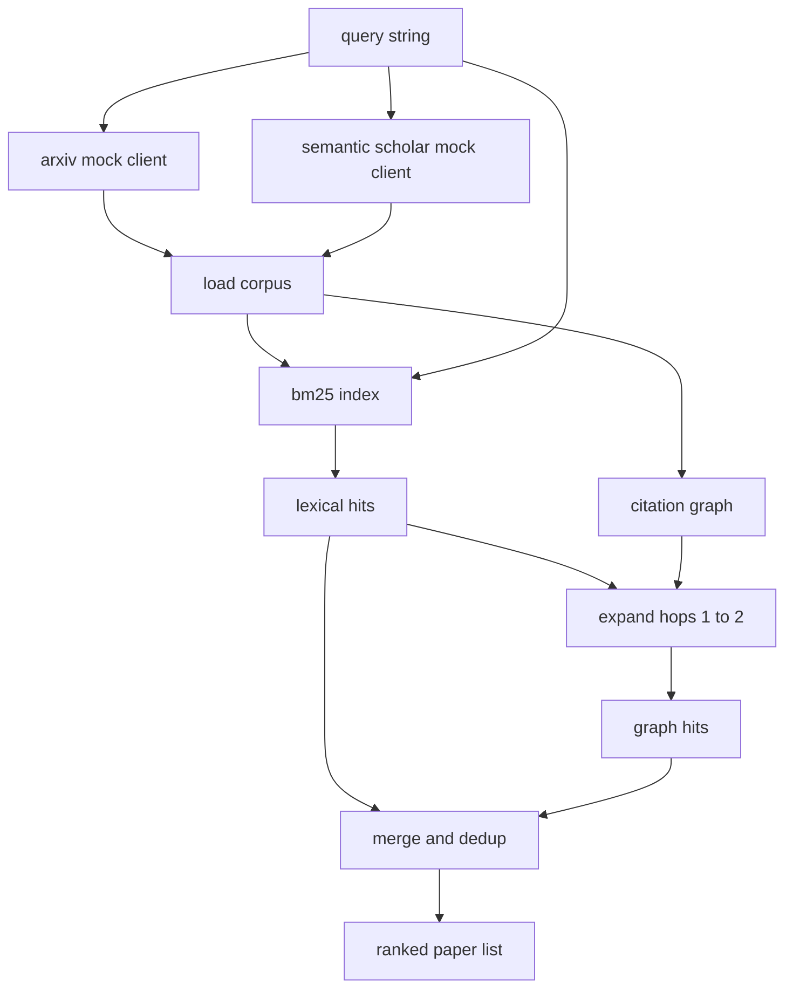

<!-- local-zh-machine-draft: English source is canonical; prose translated automatically, code/math preserved. -->

<a id="literature-retrieval"></a>

# 文献检索

> 假设是廉价的。知道有人是否已经证明了这一点,这是昂贵的部分。在运行者旋转前建立检索层来回答这个问题。 sandbox.

**类型:** Build
**语言:** Python
**先修要求:** 阶段19 A轨道课程20-29
**时间:** ~90分钟

<a id="learning-objectives"></a>

## 学习目标
- 制作一个小纸记录, 显示下游的环。
- 构建 BM25 仅使用标准数据结构的索引,而不是摘要。
- 以引用图显示表层文件, 词汇搜索失败 。
- 重复点击通过稳定的纸面标识通过词汇和图解。
- 模拟外部换行 APIs 在一个客户背后 所以上游呼叫站点在实际终点着陆时 保持原样

<a id="why-two-retrieval-passes"></a>

## 为什么两次检索都通过

共享摘要返回文件的关键词搜索 vocabulary 。 它覆盖了大部分表面。 它忽略了两个案例。 第一个是当基础纸使用不同时 vocabulary;例如“sparse”查询 attention"错过了一篇题为"封锁选择 transformer 第二是当相关文件是后续文件 引用已知的锚; 找到锚并向前走比强行使用抽象池子更有效。

这两道课都是靠这个 BM25 引用图将种子向前和后扩展一两个跳。 联盟由纸张编号来解码, 并被小分组合排列 。

<a id="the-paper-shape"></a>

## 纸张形状

```text
Paper
  id          : str           (stable identifier, "p001" for the mock corpus)
  title       : str
  abstract    : str
  year        : int
  authors     : list[str]
  references  : list[str]     (paper ids this paper cites)
  citations   : list[str]     (paper ids that cite this paper)
  source      : str           (which mock api supplied it, "arxiv" or "s2")
```

引用和引用字段构成定向引用图。 APIs 返回重叠但不相同的字段, 所以弹着器会将它们连接到 `id`.

```figure
cg-citation-hops
```

<a id="architecture"></a>

## 建筑



检索客户端拥有通行证和合并。 打电话者将查询交给它, 然后获得一个排位列表, 每个条目都随附每个纸张评分字段( ) 。`bm25_score`, `graph_distance`, `recency_score`, `final_score`) 这解释了排名。

<a id="bm25-from-scratch"></a>

## BM25 从零开始

执行标准为 Okapi BM25 默认 parameters `k1=1.5`, `b=0.75`。索引有两个词典: `term -> doc_frequency` 和 `term -> list of (doc_id, term_count)`文档长度 token 计算摘要。在索引构建时间计算平均文档长度一次。 `idf * tf_norm` where `tf_norm` 是标准 BM25 长度已正常化的用词频率。

代言人是 `lower` 然后将数据分割为非字母数字。 它没有被冲断 。 一个生产系统会以小干器交换。 界面会保持不变 。

```text
idf(t)      = log((N - df + 0.5) / (df + 0.5) + 1.0)
tf_norm(t)  = (f * (k1 + 1)) / (f + k1 * (1 - b + b * dl / avgdl))
score(d, q) = sum over t in q of idf(t) * tf_norm(t)
```

<a id="citation-graph-traversal"></a>

## 引用图

图形从柱状中建立一次。 前边缘从纸张到引用。 后边缘从纸张到引用。 横跨是由顶部种子的宽度 BM25 击中,被击倒在两个跳。

两跳是故意的天花板,一跳太浅了, agent 通常想要直接的祖先或后代。 三跳会将连接的图形的结果大小炸掉, 并倾向于从主题上移开。 课程会显示跳限制为配置 knob , 这样下游循环就可以收紧它 。

<a id="dedup-and-ranking"></a>

## 编目和排名

两张通行证返回重叠的组合。在纸张 ID 上,合并键。对每张纸来说,最后的评分是加权的混合。

```text
final_score = w_bm25 * bm25_score_norm
            + w_graph * graph_score
            + w_recency * recency_score
```

`bm25_score_norm` 是该 BM25 得分除以最大值 BM25 组合后得分( 字段以零比一为单位) 。 `graph_score` 直接点击词汇 `0.6` 来跳一跳 `0.3` 双跳,否则是零跳 `recency_score` 是一个从零到最大年的线性斜坡。

默认 weights 是 `0.5`, `0.3`, `0.2`. 该 weights 是一个不固定的话题, 可能会调低静态, 而快速移动的话题会引发它 。

<a id="mock-corpus"></a>

## 模拟材料

由《圣经》第一百篇论文 `build_corpus()`每份文件都有手写标题和五个专题之一的抽象内容: attention 蒸馏、检索增强、低级适配器、数据集蒸馏以及 evaluation harnesses。引用和引用被绑上,这样每个专题就形成一个连接的子图,并带有几个跨主题的边。

这两部戏 API 客户(`ArxivMockClient`, `SemanticScholarMockClient`)从同一文体中读取,但揭示不同的领域。 Arxiv 返回标题、抽象的年份、作者。语义学者添加引用和引用。在 id 上检索客户端联盟; 交叉客户字段的分歧处理被推迟到后续课程中去。

<a id="what-lessons-52-and-53-read"></a>

## 所读的52和53个课

教课52的选手读道 `paper.id`, `paper.title`,以及作为实验背景的抽象文字的前三句。 `paper.year` 和 `paper.references` 将基准属性于特定文件。

检索客户端返回 a `RetrievalResult` 和每个查询的大小列表和测量标准: 点击数、平均分、顶分、总挂线时间。 运行者将这些记录在下游 observability 传票可以绘制一段时间内的质量 。

<a id="how-to-read-the-code"></a>

## 如何阅读代码

`code/main.py` defines `Paper`, `ArxivMockClient`, `SemanticScholarMockClient`, `BM25Index`, `CitationGraph`, `RetrievalClient`,以及确定性演示。模拟客户和文稿都在同一文件中,因此该课程可以随身携带。 BM25 执行是一个类别, 60行。 图表横跨是一个方法 。

`code/tests/test_retrieval.py` 包含词汇路径、图形路径、合并、分解和空查询。

<a id="where-this-slots-in"></a>

## 插座放在哪里

五十课产生一个假设。 五十一课搜索文献, 看看是否已经解决了这一假设。 五十二课运行实验, 如果不是的话。 五十三课既读取结果,又读写判断的实验度量。 检索客户端是四个阶段中最便宜的, 并且是在管弦乐队中先运行的 。
