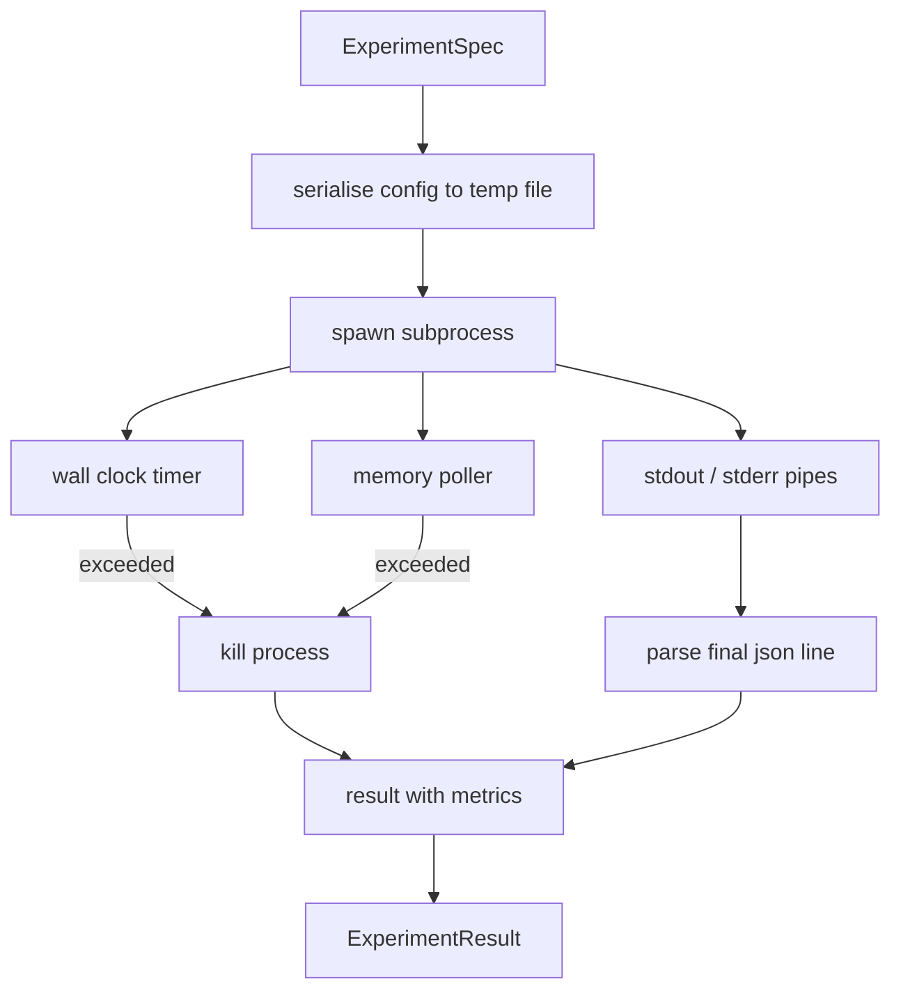

<!-- local-zh-machine-draft: English source is canonical; prose translated automatically, code/math preserved. -->

<a id="experiment-runner"></a>

# 实验执行器

> 循环与测量结果一样诚实。 构建一个要标出一个尺寸的运行者, 将其用一个沙箱子程序执行, 并释放出一个 json 评估员可以信任的衡量标准。

**类型:** Build
**语言:** Python
**先修要求:** 阶段19 A轨道课程20-29
**时间:** ~90分钟

<a id="learning-objectives"></a>

## 学习目标
- 将实验编码为输入的参数, 运行者可以连成子进程 。
- 启动一个硬墙钟超时和软内存上限的子进程, 并同时作为终端条件表面 。
- 捕获标准、标准、结构化测量数据,将之变成单一的结果记录。
- 建立一个烧蚀表, 一次在固定基点标点上扫描一个配置的按钮 。
- 保留给种子的每个结果确定性, 这样评估员就能看到相同的数字。

<a id="why-a-subprocess"></a>

## 为什么是子进程

研究环运行不可信的代码。 假设来自一个取样器, 实验脚本来自同一路径; 将两个过程作为安全的在轨处理要求发生一个会击落管弦的崩溃。 子进程是语言船舶最简单的隔离程序: 一个单独的进程、 一个独立的地址空间、 一个母侧的信号控点 。

这里的运行者不执行完整的沙箱。 没有组、 没有 secomp 过滤器、 没有命名空间重新绘制。 它有一张墙钟超时、 一个用于记忆增长的投票圈, 以及一条在任一限制上终止进程的断路 。 这是运行时间合同 。 sandbox 课上的内容让合同变得很小,可以一坐就读

<a id="the-experimentspec-shape"></a>

## 实验形状

```text
ExperimentSpec
  spec_id        : str            (stable id, "exp_001")
  hypothesis_id  : int            (link back to the queue from lesson 50)
  script_path    : str            (path to the python script to run)
  config         : dict           (passed to the script as one json arg)
  seed           : int            (deterministic seed for the experiment)
  wall_timeout_s : float          (hard timeout, killed on exceed)
  memory_cap_mb  : int            (soft cap, polled; killed on exceed)
  metric_keys    : list[str]      (which fields the evaluator will read)
```

脚本保存在磁盘上; 运行者将配置写入脚本读取的临时文件路径。 脚本预计将打印一个 json 键盘是 `metric_keys`。其他的都被捕获了,但被测量仪忽略了。

```figure
cg-runner-limits
```

<a id="architecture"></a>

## 建筑



选手是使用一种主要方法的单类。 授标者是一个小线条, 每次计票间隔一次就会唤醒它, 读取子进程 `psutil` 等值于可使用的 proc 文件系统, 当平台不曝光时返回到不操作 。

<a id="why-a-soft-memory-cap"></a>

## 为什么是软记忆帽

硬记忆帽需要 `resource.setrlimit` 并且只对 POSIX 进行操作。 课程中包含一种便携式方法: 从平台上测试常住设置大小, 如果子进程超过上限, 则会杀死该子进程。 上限是软的, 因为民意测验者没有零间隔; 一个过程可以跳出两个投票点之间的上限, 然后返回。 运行者记录了所观察到的最大 RSS , 这样评价员就可以看到运行距离的极限有多近 。

在没有进程检查支持的系统中, 授粉者记录一次性警告并禁用本身。 挂钟超时仍然适用。 课程测试覆盖了两个路径 。

<a id="capturing-stdout-and-stderr"></a>

## 捕捉斯图德和斯德勒

跑者读取完成时排出的两根管道。 Stdout 是扫描线, 最后一条线是 json 需要的 `metric_keys` 被作为测量标准。 json 线条被保留在结果中 `intermediate_metrics`;评价人员可以使用这些来进行学习曲线。

将 Stderr 逐字记录在结果中。 运行者从不使用非零退出代码, 而是记录结果中的代码。 任何非零退出都会被标为 `"crash"` 即使脚本打印了测量, 评估员也会将部分运行视为默认的失败 。

<a id="ablation-table"></a>

## 缩写表

```python
def ablate(base: ExperimentSpec, knob: str, values: list[Any]) -> list[ExperimentSpec]:
    ...
```

根据基准参数和 knob 名称, 助手返回每个值的大小 `config[knob]` 被推翻。 每个图例都得到一个衍生的 `spec_id` (`f"{base.spec_id}_{knob}_{value}"`赛跑者乘船 `AblationRunner` 并返回一个 `AblationTable` 以 knob 值键入。

为什么每次有一个按钮。 全部元素扫描会以指数方式爆炸, 并且产生评价者无法解释的结果。 一个键一次生成一个干净的轴, 评估者可以绘制。 此课支持多个键进行扫描, 仅作为由调用者组成的重复的单键串行 。

<a id="determinism"></a>

## Determinism

每个图案都携带种子。 种子的种子通过配置dict( 配置dict) 向剧本前进 。`config["__seed"] = spec.seed`模拟实验脚本 `code/experiments/` 尊重种子,并产生相同的连续测量。 课程53的评价员取决于这一点;没有决定性因素,“ 倒退” 可能是另一种随机初始化。

<a id="the-mock-experiment-script"></a>

## 模拟实验脚本

教义中有一个实验脚本: `code/experiments/sparsity_experiment.py`。这是一个真正的脚本,读取其配置文件,模拟一个小的训练运行,使用 numpy 随机通过,并打印 a json 缩略语 剧本 `sleep_s` 测试超时和 `allocate_mb` 测试记忆授粉器的把手

模拟没有训练任何真实的东西。 这是一个数字计算, 模拟训练循环的形状: 损失曲线, 最后 perplexity,一个墙时间。课点是跑步者,而不是模拟。真正的实验脚本会输入模型。

<a id="result-shape"></a>

## 结果形状

```text
ExperimentResult
  spec_id              : str
  hypothesis_id        : int
  exit_code            : int
  terminal             : "ok" | "timeout" | "oom" | "crash"
  wall_time_s          : float
  peak_rss_mb          : float | None
  metrics              : dict
  intermediate_metrics : list[dict]
  stdout_tail          : str
  stderr_tail          : str
```

评审员说: `metrics` 和 `terminal` 首先,如果终端是其它 `"ok"` 实验算作失败运行,评价员的判断是自动的。否则,测量标准会通过意义测试。

<a id="how-to-read-the-code"></a>

## 如何阅读代码

`code/main.py` defines `ExperimentSpec`, `ExperimentResult`, `ExperimentRunner`, `AblationRunner`,以及确定性演示。子进程管理是一类。记忆解析器是一个小线条。熔化辅助器是一个函数。

`code/experiments/sparsity_experiment.py` 是测试中使用的模拟实验。 它从 argv 读取其配置文件路径, 并写一个 json 完成后采用计量线。

`code/tests/test_runner.py` 覆盖成功路径、超时路径、崩溃路径、通缩表和确定性检查横跨两个运行。

<a id="where-this-slots-in"></a>

## 插座放在哪里

五十课产生假设。五十一课过滤了文献中已经解决的任何问题。五十二课运行实验剩余部分。五十三课读了结果,进行了意义测试,并写了管弦乐店对假设id的判决。
