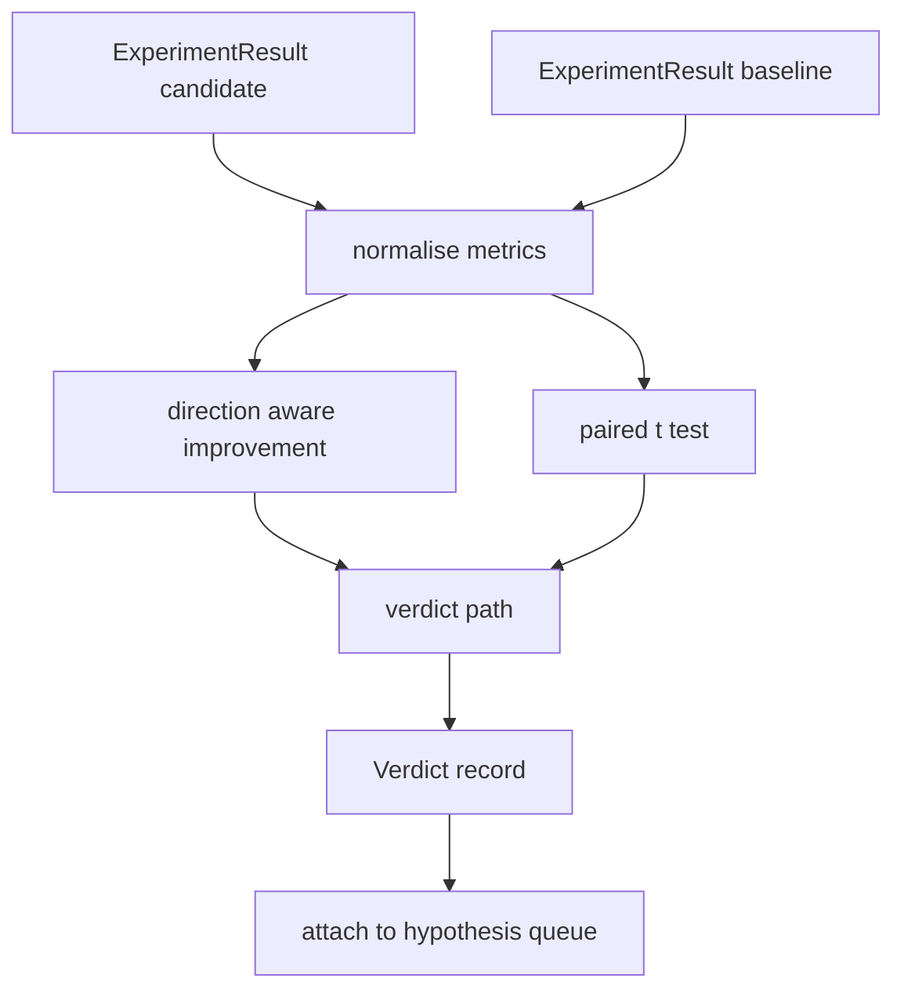

<!-- local-zh-machine-draft: English source is canonical; prose translated automatically, code/math preserved. -->

<a id="result-evaluator"></a>

# 结果评估器

> 运行者生成数字。 评估员决定这些数字是进步还是倒退, 还是噪音。 构建将测量结果转换成一行结论的判断路径 。

**类型:** Build
**语言:** Python
**先修要求:** 阶段19 A轨道课程20-29
**时间:** ~90分钟

<a id="learning-objectives"></a>

## 学习目标
- 对照基线对候选人进行比较,使用方向意识改进和固定门槛值。
- 运行一个对齐的 t 测试, 从零开始, 每种子量度并读取 p 值 。
- 使日志尺度标准化,以便下游报告能够与线性尺度混合。
- 听一个假设判断 乐团主讲人可以从50课开始 加入队列
- 保持每一步纯洁 所以同样的输入 总是产生相同的判断。

<a id="why-a-paired-test"></a>

## 为什么做对的测试

运行者的一个数字没有表示更改是否真实。 同一种子的配置给人不同的结果 perplexity。变化可能是噪音。对齐的比较是:同样的种子与相同的数据,与候选者运行一次,与基线运行一次。每种种子都有不同之处。这些差异的平均值是效果。这些差异的标准错误是噪音底数。

课程从头开始测试。 `scipy.stats`。数学小到可以在一个屏幕上读取。

```text
diffs    = [a_i - b_i for i in seeds]
mean     = sum(diffs) / n
variance = sum((d - mean) ** 2 for d in diffs) / (n - 1)
t_stat   = mean / sqrt(variance / n)
df       = n - 1
p_value  = two_sided_p(t_stat, df)
```

双面 p 值使用正常化的不完全贝塔函数。 课中包含一个小的操作, 使用 Lentz 继续的分数。 整个过程是 Stdlib 数学 六十 行 。

<a id="direction-aware-improvement"></a>

## 提高认识方向

有些指标在上升时会有所改进,有些则在下降时会有所改进。 perplexity) 。 `direction` 字段中每个测量值。

```text
if direction == "higher_is_better":
    improvement = (candidate - baseline) / abs(baseline)
elif direction == "lower_is_better":
    improvement = (baseline - candidate) / abs(baseline)
```

进步已经签署。 提高一个负的改善是更好的衡量标准,这意味着候选人更糟糕。 裁决路径读取了标志和规模。

固定门槛值(`improvement_threshold=0.02`,2%)决定该变化是否足够大,可以调用。以下是判断为“噪音”,而不管 p 值如何;循环对用户无法测量的改变不感兴趣。

```figure
cg-paired-verdict
```

<a id="architecture"></a>

## 建筑



评审员进行三次独立计算,并加入到判决路径中。 每一次计算都是纯函数, 没有共享状态 。

<a id="log-normalisation"></a>

## 日志正统化

Perplexity 损失指数。 损失0. 1 下降是更大的 perplexity比较 perplexity 直接横跨两个配置是好的,但将它与线性度量相混合在单一报告中需要正常化。

课程将任何衡量标准都规范 `scale` 字段为 `"log"` 使用自然日志后再计算改进。然后在日志空间中应用阈值。 A perplexity 由32下降到28是 `log(28) - log(32) = -0.133` 低点是更好的衡量标准,远远高于2%的临界值。

```text
if scale == "log":
    a = log(candidate)
    b = log(baseline)
else:
    a = candidate
    b = baseline
```

计量 `scale="linear"` 跳过变换。 相同的代码路径同时处理 。

<a id="per-seed-paired-test"></a>

## 每个种子配对测试

课程52的选手每运行一个最终的测量仪。 对于配对测试,评价员需要为候选者每种子一个测量仪,为基准每个种子一个测量仪。 管弦手在两种配置下都进行同样的实验, 覆盖种子列表, 并掌握两个评估员的名单 。 `ExperimentResult` records.

评估员用种子对准它们(种子在 `result.metrics["seed"]`如果种子在两个列表中不匹配,评价员会提出 `PairingError`指挥器应该重新运行

<a id="the-verdict-shape"></a>

## 判决形状

```text
Verdict
  hypothesis_id          : int
  metric                 : str
  direction              : "higher_is_better" | "lower_is_better"
  scale                  : "linear" | "log"
  candidate_mean         : float
  baseline_mean          : float
  improvement            : float       (signed, fraction; see direction rules)
  p_value                : float | None  (None if n < 2)
  significance_threshold : float
  improvement_threshold  : float
  verdict                : "improved" | "regressed" | "noise" | "failed"
  rationale              : str
```

判决路径是一个小的决定表:

```text
1. If any candidate result has terminal != "ok": verdict = "failed"
2. else if |improvement| < improvement_threshold:  verdict = "noise"
3. else if p_value is None or p_value > significance: verdict = "noise"
4. else if improvement > 0:                          verdict = "improved"
5. else:                                             verdict = "regressed"
```

理由是人类可以读的一句话 管弦手可以记录在假设ID上

<a id="how-to-read-the-code"></a>

## 如何阅读代码

`code/main.py` defines `MetricSpec`, `Verdict`, `Evaluator`,统计和不完整的贝塔助手,以及确定性演示。t测试在纯标准数学中进行; numpy 仅用于阅读度量列表,并计算手段和差异。

`code/tests/test_evaluator.py` 包含改进路径、 回归路径、 噪音路径( 小改进)、 噪音路径( 低 n)、 失败的终端路径、 日志正统路径、 相对于已知引用值的 t 测试, 以及配对错误 。

<a id="where-this-slots-in"></a>

## 插座放在哪里

五十课制作了假设队列。五十一课过滤了文学上的所有内容。五十二课在候选和基线配置下对种子进行实验。五十三课读了这些作品并写了判决。 弦乐把四节合起来:

```text
for hypothesis in queue:
    literature = retrieval.search(hypothesis.text)
    if literature_settles(hypothesis, literature):
        attach(hypothesis, verdict="settled")
        continue
    candidates = runner.run_all(specs_for(hypothesis))
    baselines  = runner.run_all(baseline_specs_for(hypothesis))
    metric_spec = MetricSpec("perplexity", direction=LOWER, scale=LOG)
    verdict = evaluator.evaluate(hypothesis.id, metric_spec, candidates, baselines)
    attach(hypothesis, verdict)
```

乐团不是这个课的导师,四个课组成它,没有数据类以外的胶水,每个课都定义。
