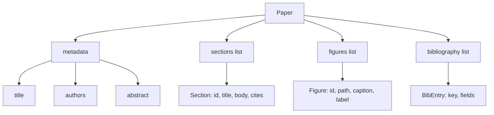
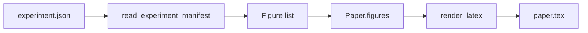
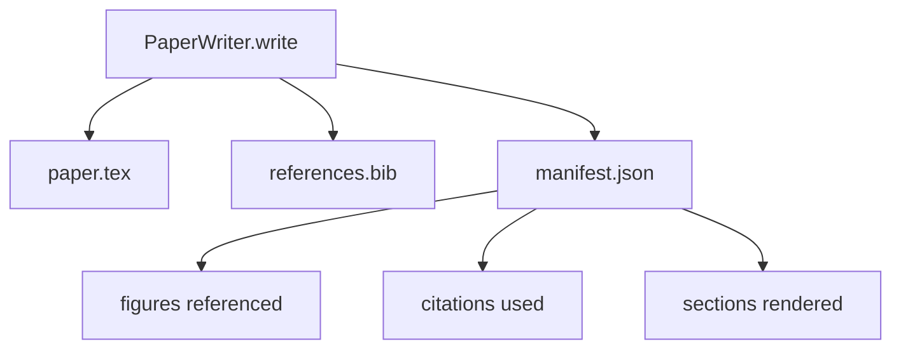

<!-- local-zh-machine-draft: English source is canonical; prose translated automatically, code/math preserved. -->

<a id="paper-writer"></a>

# 论文写作器

> LaTeX 骨架是研究人员和打字员之间的一项合同。 如果合同被打破, 文档不会编译, 失败会很大。 先建好骨架, 然后填满它 。

**类型：** 构建
**语言:** Python
**先修要求:** 第19阶段课程 50-53
**时间:** ~90分钟

<a id="learning-objectives"></a>

## 学习目标

- 将研究论文当作结构化的文物, 带有已知的部分图, 而不是自由格式文档 。
- 生成一个 LaTeX 骨架, 并声明其抽象、 区域、 图槽和书目键 。
- 通过确定性空档机制,将实验输出(路径和标题)的数字输入骨架。
- 使用结构化大纲, 以假造的 简讯生成器填充每个区域 。 harness 没有模型,是可以测试的。
- 单人 `paper.tex` 加一个 `references.bib` 加上一个清单,列出每个引用的数字和使用的引用。

```figure
ch-paper-skeleton
```

<a id="why-a-skeleton-first"></a>

## 为什么先用骨架

草稿开头是编稿积累结构性债务。导言增加了三段,这三段应该属于相关工作。在定义之前,可以引用一个数字。书目最后为同一页提供了三个密钥。当作者注意到时,改写成本高于写作成本。

骨架反转。 结构被作为数据在前面声明。 区域是带有名称和顺序的空格。 数字是带有 id 和 标题的空格。 书目键会与它们点的条目一起在顶部声明。 Prose 一次生成到这些空格中 。 harness 可以在撰写任何文稿之前确认每个数字都有空档,每个引用都有条目,每一节都出现在目录中。

和以前在计划上课时一样 tool calls, 和 traces结构是合同。

<a id="the-paper-shape"></a>

## 纸张形状



每一块地都是平坦的 Python 数据。 生成器是纯函数, 由 `Paper` 至 LaTeX 字符串。 harness 可以在写入前查看纸张: 计数部分, 列出缺失的图表文件, 检查每个 `\cite{key}` 匹配 `BibEntry`.

<a id="the-render-contract"></a>

## 订立合同

铸造者保证三个属性 首先,骨骼上的每个数字槽都释放出一个 `\begin{figure}` 窗体的稳定的标签 `fig:<id>`第二,每一节都发布 `\section{}` 带有窗体的稳定标签 `sec:<id>` 第三,文献目录发布 `\bibliography` 块 `references.bib` 包含在纸张上所申报的条目,不少于不少于此。

违反任何这些是错误,而不是警告。 骨架是合同; 沉默下降数字是合同中断。

<a id="figure-injection-from-experiments"></a>

## 实验中的注入图

早期的实验结果 JSON 单子。每张单子上都有一张有路径和短标题的工艺品清单。 `Figure` records.



输入是确定性的。 图id 是从实验名称加上单声道计数中产生的。 标题来自列表。 路径相对于纸张输出目录已经正常化, 所以 LaTeX 即使在实验输出位于磁盘上其它位置时也会编译 。

<a id="the-mocked-prose-generator"></a>

## 假的传言生成器

课上不叫模型 `MockProseGenerator` 读取大纲形状, 并发出明细的发音。 大纲形状是每个区域的一个短字符串。 生成器将该字符串扩展为两个短段落, 其部分标题被编织。 生成的 prose name- drop 数字和引用符在大纲宣布时准确无误 。

这足以测试作者的每一个行为。真正的执行可以将生成器换成一个模型。 harness 围绕它不会改变。这就是宣布传言生成者为可呼调的值:测试替代了确定性,生产替代了模型, rest 管道的长度相同。

<a id="the-manifest-output"></a>

## 输出的表单

作者将三个文件放入输出目录 。



下游评估员或 critic 循环读取。 它不解析 LaTeX; 它读取列表。 下一课, 即 critic 循环, 将此列表作为输入并生成反馈列表。 这就是为什么该列表是合同的一部分, 而 LaTeX 则不是 。

<a id="validation-gates"></a>

## 验证门

作者在撰写任何文件之前都运行四个门。

1. 每一张图象在报纸上都是独一无二的
2. 每一区 `cites` 字段引用文件上所声明的文献目录键。
3. 抽象是非空的。
4. 标题不是空的。

出错的门升起 `PaperValidationError` 有个确切的理由 harness 显示失败模式的原因。 没有部分写入: 要么全部三个文件都被释放, 要么没有。

<a id="how-to-read-the-code"></a>

## 如何阅读代码

`code/main.py` defines `Paper`, `Section`, `Figure`, `BibEntry`, `PaperValidationError`, `MockProseGenerator`, `PaperWriter`, 和一个 `render_latex` 函数。 `write` 方法需要一个输出目录并发布 `paper.tex`, `references.bib`, 和 `manifest.json`. 该 `read_experiment_manifest` 帮助者将实验清单转换为 `Figure` records.

`code/tests/test_paper_writer.py` 盖子:骨骼没有区块, 满载两节和两个数字, 缺失引力门, 重形号门, 显示内容, 以及LaTeX字符串合同( 每个区都发出 `\section{}`,每个数字都发出 `\begin{figure}`).

<a id="going-further"></a>

## 继续

需要两个执行的扩展。 首先,多格式化:相同 `Paper` 形状编译为 Markdown 博客文章和 HTML 用于预览。 `Paper`。第二,引用浓缩:作者从引用键中获取 BibTeX 条目,并给本地的 DOIs 缓存。两者都增加了价值,两者都可以添加而无需触动骨架合同。

骨架是赌注。部分、数字和引用被宣布为数据, 编成插槽, 显示在LaTeX旁边排放。 所有其他改进都在上面。
