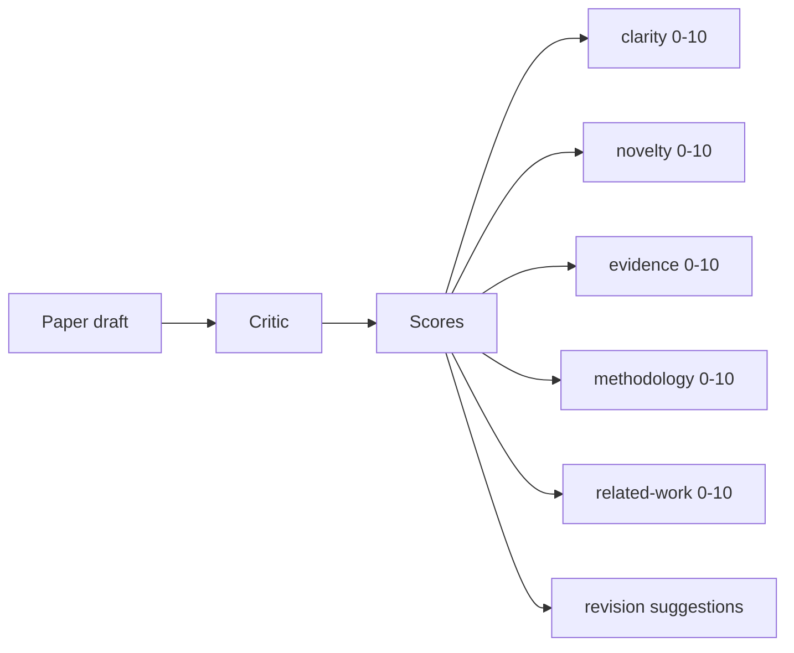
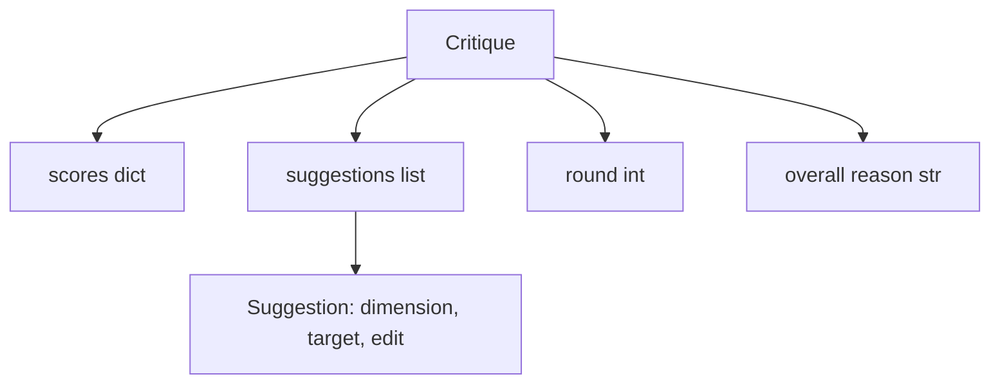
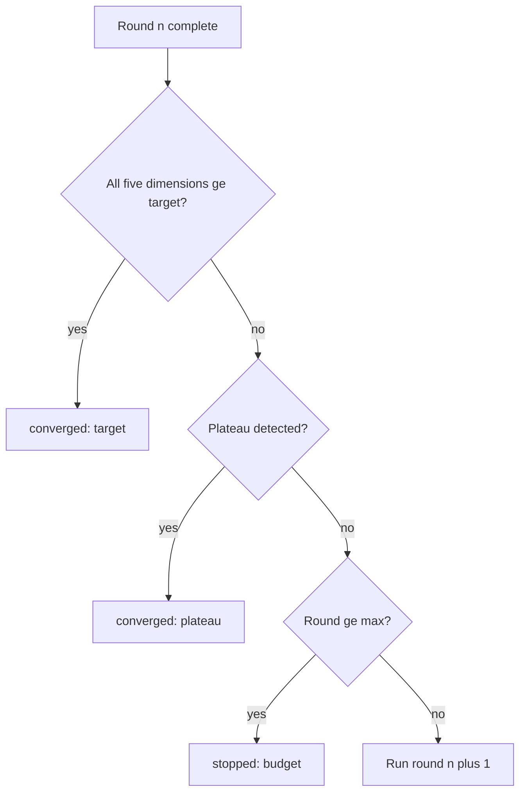
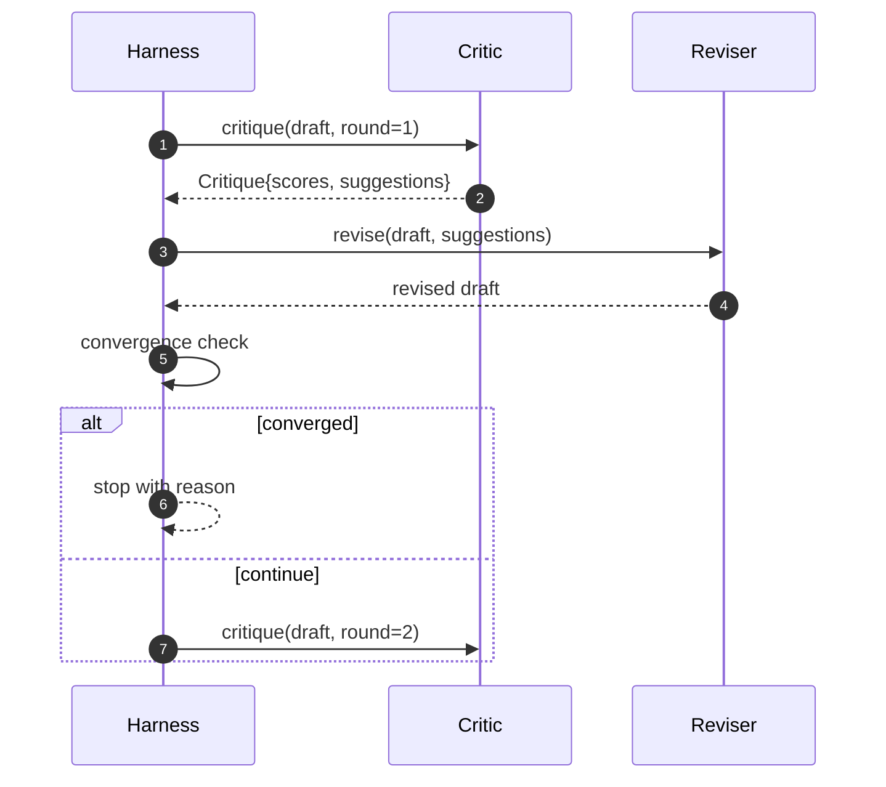

<!-- local-zh-machine-draft: English source is canonical; prose translated automatically, code/math preserved. -->

<a id="critic-loop"></a>

# Critic 评审循环

> 一个 critic 返回"看起来不错" 第一次断裂。 A critic 总是返回"需要工作"是打破的。 critic 是一个汇集, 你必须设计趋同。

**类型:** Build
**语言:** Python
**先修要求:** 第19阶段课程 50-53
**时间:** ~90分钟

<a id="learning-objectives"></a>

## 学习目标

- 分五个固定层面的论文草稿:清晰、新颖、证据、方法、相关工作。
- 将每轮的评语应用为结构化的修改,而不是自由改写。
- 通过比较各轮的得分,发现趋同情况;停止在高原、目标达到或预算耗尽。
- 最高功率预算的上限弹壳,所以不相容 critic 也不会永远跑下去
- 逐个弹出 trace 这样仪表板或下个阶段 就能让得分轨道。

```figure
ch-critic-converge
```

<a id="why-five-fixed-dimensions"></a>

## 为什么五个固定维度

自由形式 critic 是一个返回建议段落的模型。下一轮的修订将该段落视为环境背景。重写是否针对批评是无法核实的,因为批评从未有结构。

五个维度给 harness 合同



分数是矢量 harness 检查每个维度的轮。 修改后会提高清晰度, 但罐体证据是证据的回归, 并检查趋同情况。 仅使用模型的测试结果可以显示这一点 。 critic 无法提供这种保证。

<a id="the-critique-shape"></a>

## 刻度形状



每一项建议都包含它改进的层面,它所针对的部分,以及一个 `edit` 指令审校可以应用。审校也可以调用。课程中包含一个确定性审校,该校对将编辑指令解释为附加到部分操作。模型驱动的审校会将同一个字段解释为 prompt合同不变。

<a id="convergence-rules-in-order"></a>

## 统一规则,顺序

该 critic 循环在三种情况中任何一个发生火灾时终止。



最严格的目标是:五个层面(清晰、新颖、证据、方法、相关)中的每一个层面。_工作)必须打 `>= target_score` (默认 `8.0`) 在循环返回成功之前。光是使用一个微弱的维度,光有高平均值是不够的。高原检测比对当前回合的平均值。如果改进低于此值,则 `plateau_epsilon` (默认 `0.1`)连续两轮,循环退出 `plateau`。预算是轮数的硬上限(默认) `5`和退出 `budget`.

顺序很重要。 目标胜过高原, 胜过预算。 如果第三回合击中目标, 同样的迭代也会触发高原, 结果就是 `target`, 不 `plateau`.

<a id="why-plateau-detection-runs-over-two-rounds"></a>

## 为什么高原探测超过两发

单圈高原就是噪音 critic 返回一个略微不同的评分,即使是在固定的草稿上,因为确定性评分仍然取决于应用了哪些建议以及按什么顺序。要求连续两个高原圆圈过滤出这种噪音。如果是这些评分,则该评分将显示在“确定性”的标签中。 harness 草案确实停止了改善。

<a id="the-deterministic-critic-in-this-lesson"></a>

## 决定性的 critic 中,该课

课程不叫模型,而是运来的 critic 是一个可调用信号,根据三个信号计分草稿:平均部分体积长度(清晰度)、数字数和引用数(证据),以及 `originality_tag` 字段。审校知道如何将每个分数上扬。

```text
clarity      grows when the average section body length increases
novelty      grows when originality_tag is set to "high"
evidence     grows when a section's figure_refs is non-empty
methodology  grows when a section titled "Method" exists with body
related-work grows when a section titled "Related Work" exists with body
```

审校将每项建议解释为目标附件。 harness 能够观察到得分上升。测试使用此属性来维护循环,缩小差距。

<a id="the-full-loop-contract"></a>

## 整个环形合同



该 harness 拥有圆柜台, trace和趋同检查。 critic 审校拥有Diff,三个都无法触及其他人的状态

<a id="the-trace-output"></a>

## 该 Trace 输出

每一轮都出一发 trace 和组合结果。 trace 后一课,即迭代排程,读取 trace 是否决定 branch 值得保留下来

<a id="budgets-that-protect-against-bad-critics"></a>

## 防止坏预算 critics

一个 critic 产生永远无法改进评分的建议 就会把循环锁定到最高通电上限 trace 显示: 五轮,分数平整,判决 `budget`用户将“a”改为“a” critic 错误, 不是草稿错误。 其它选择, 只显示最后的草稿, 隐藏诊断 。 Trace- 第一次设计就浮现出来

<a id="how-to-read-the-code"></a>

## 如何阅读代码

`code/main.py` defines `Critique`, `Suggestion`, `Critic` protocol, `Reviser` protocol, `CriticLoop`, 和一个 `make_deterministic_critic_pair` 工厂,它返回确定论 critic 和一个匹配的审校。 `Paper` 形状包含,所以课程就单独存在。

`code/tests/test_critic_loop.py` 包括:第一回合后单调改进,目标组合调整草稿,两轮平板后检测高原,不提出建议时预算耗竭,审校建议应用,以及 trace shape.

<a id="going-further"></a>

## 继续

需要两个执行的扩展。 首先,维度 weights:研讨会文件 weights 高于方法的新颖; 日记 weights 反之, 趋同检查变成加权平均值。 其次, 配对 critics: 1个 critic 分数, 秒 critic 都在修改者看到之前对建议做出裁定。 `Critique` shape.

赌注是分数矢量。 一旦评分结构化, 每一个其他的改进, 趋同规则, 仪表板, 配对 critic,在不改变循环的情况下,会掉进空洞。
