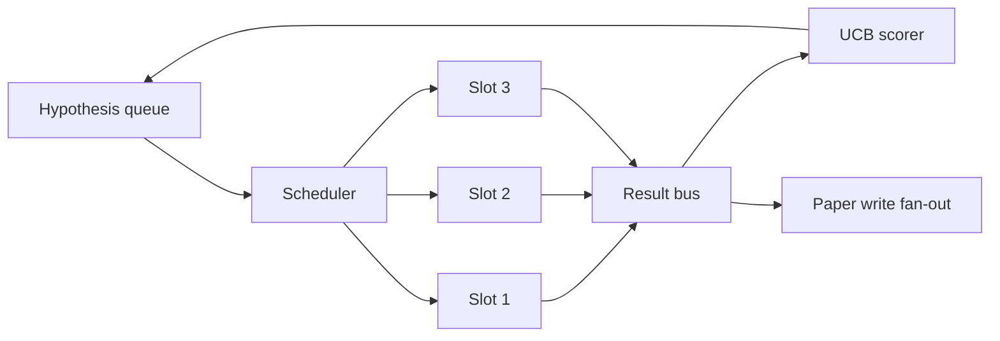
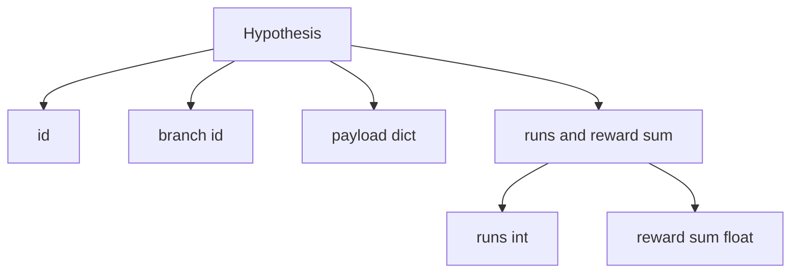
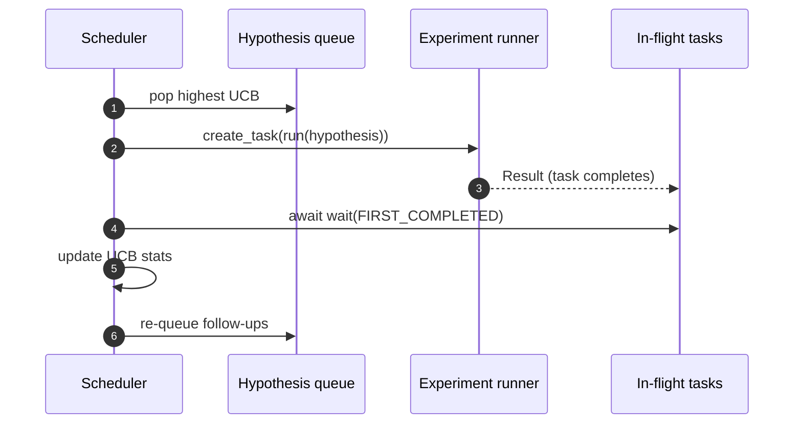

<!-- local-zh-machine-draft: English source is canonical; prose translated automatically, code/math preserved. -->

<a id="iteration-scheduler"></a>

# 迭代调度器

> 没有排程器的研究循环是带有妄想的队列。 排程器决定了停止探索的是什么, 而这个决定就是整个游戏 。

**类型：** 构建
**语言:** Python
**先修要求:** 第19阶段课程 50-53
**时间:** ~90分钟

<a id="learning-objectives"></a>

## 学习目标

- 将研究工作流程建为假想队列输入平行实验槽,其结果会再次被吸引。
- 与 Asyncio 同步运行多个实验, 这样调度器就可以让所有空位都忙碌起来 。
- 计分每个假设 branch 使用 UCB 使调度器可以精减低当量 branches 但不放弃探索
- 将完成的结果放入纸版舞台和排队舞台, 从而成为高产的 branch 产生后续假设。
- 表面a/ 每一地平面 trace 与 branch 分数, 空档占用, 和裁剪决定。

```figure
ch-ucb-scheduler
```

<a id="why-a-scheduler-not-a-worklist"></a>

## 为什么是排队员,不是工作名单

平板工作列表按提交顺序运行工作。 当每份工作都是独立的时, 这一点就很好。 研究不是独立的: 从实验中得出的三项结果改变了试验的优先级 4 和 5 。 一个读取结果的排程器, 并按单位进行重新排序, 则会得到更多有用的工作 。

有趣的设计选择是评分规则。 贪婪的得分者总是挑选当前领先者,从不探索。 统一得分者从来不会利用。 UCB(超信任约束)是中间道路:在为当前领先者保留能力的同时利用领先者。 branches 已经少了尝试。

<a id="the-system-shape"></a>

## 系统形状



队列保留假设。 排程器在空格时选择最高 UCB 假设。 每个槽会以不同步的方式运行实验。 已完成的实验会将其结果放入大巴。 该总线更新了 UCB 数据 。 branch 和粉丝出去 到纸写舞台 当 branch产量超过一个阈值。

<a id="the-hypothesis-shape"></a>

## 假说形状



`branch` 是一个用于 UCB 统计的关键。 branch (该 branch 是一个研究方向;假设是其中的一个试验。 `runs` 即已完成实验的数 branch, `reward_sum` 累积奖赏。 UCB 读取两者。

<a id="ucb-scoring"></a>

## UCB 评分

课程中使用的UCB公式是经典的UCB1。

```text
ucb(branch) = mean_reward(branch) + c * sqrt( ln(total_runs) / runs(branch) )
```

`total_runs` 表示所有已完成的实验的数 branches. `c` 是勘探 weight; 课程默认为 `sqrt(2)`. 一个 branch 零运行时获得 `+inf` 如此未审 branches 总是排在首位 branch 高收入的优等奖项一直很高 branches 补上; a branch 却被其他不那么成功的选择所掩盖

修剪门和拾取器分开 branch 未来计划收益平均值低于绝对底线时的 `0.2`)至少经过 `prune_after_runs` 测试( 默认) `3`),这样可以保持队列的界限。

<a id="parallel-slots-with-asyncio"></a>

## 与 Asyncio 平行的空档

调度器驱动实验 `asyncio.create_task`。每个任务运行实验运行者(a) `async def` 返回 a/ `Result`。主环等待在飞行中的任务集 `asyncio.wait(..., return_when=asyncio.FIRST_COMPLETED)` 并发布每个完成的评分更新。



三个空位同时运行。 主循环从不阻断单个实验。 调度器一空位就继续启动新任务, 直到队列都空空且没有任务在飞行中 。

<a id="fan-out-paper-triggers"></a>

## 扇形外向: 纸张触发器

什么时候 branch悬赏十字架 `paper_threshold` (默认 `0.7`),而且 branch 还没有出报纸,排程器粉丝a `paper.trigger` 。下流的“54”课的纸面作者会接收到这个内容。在这个课中,触发器被记录为列表,以便测试能够维护它。

<a id="fan-out-follow-up-hypotheses"></a>

## 范国:后续假设

当高产结果土地时,调度器可以调用用户提供的 `expander` 提出一个或多个关于同一问题的后续假设 branch。扩展器是一个纯函数,来自 `Result` 以 `list[Hypothesis]`。该课程将一个决定性的扩展者,为任何超过纸质门槛的收益产生两项后续结果。

<a id="budgets"></a>

## Budgets

有两个预算保护调度器不受逃跑循环的影响。

```text
max_experiments    : total count of experiments run across all branches
max_seconds        : wall-clock cap (asyncio time)
```

等两个火都熄灭了,排程器就停止安排新任务,等待飞行中的任务,然后返回最后的任务 trace. 该 trace 包括 a `stop_reason`.

<a id="the-trace-and-final-report"></a>

## 该 Trace 和最后报告

每项时间安排决定(选择、发送、结果、流放、扇子外出)都发布一个事件。branch 数据,总运行,总墙上的时间, 和纸张触发器。 下一个课程,即端到端演示,读本报告来驱动纸张作者。

<a id="how-to-read-the-code"></a>

## 如何阅读代码

`code/main.py` defines `Hypothesis`, `Result`, `BranchStats`, `IterationScheduler`, 和一个 `make_deterministic_runner` 工厂返回一个有可预见的奖赏的 Asyncio 实验选手。 跑者睡觉来固定 `delay_ms` (默认 `5ms`)所以,可以观察到同值货币。

`code/tests/test_scheduler.py` 范围:未测试的UCB选取 branches 首先,平行的空档占用,在跨越门槛时触发纸张; branch 低当量试验后修剪、粉丝式后续假设和预算退出(实验计数和墙钟)。

<a id="going-further"></a>

## 继续

需要三个实际执行的扩展。 首先,每个会场都持续使用无线网络统计数据:当前统计数据将保存在记忆中;真正的调度器将 checkpoint 重新启用它们就可以保留已经花费的勘探预算。 其次,多目标评分:每个结果都释放向量,而UCB变成帕雷托式的采摘器。 第三,背景土匪:假设中的选取条件。 features 类似假设的(长度、复杂性)与勘探相同。

排程器是研究不仅仅是工作列表的地方。 一旦UCB被连接,并且槽位平行运行, 上面就会有其他的改进。
