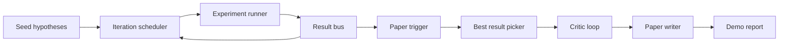
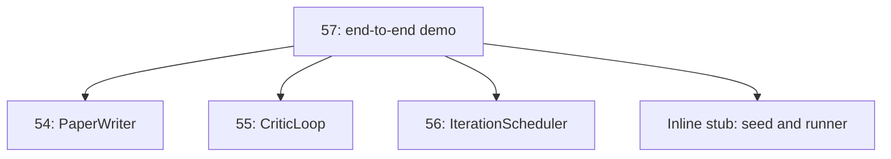
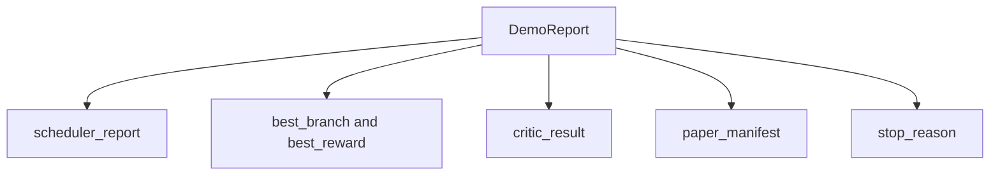

<!-- local-zh-machine-draft: English source is canonical; prose translated automatically, code/math preserved. -->

<a id="end-to-end-research-demo"></a>

# 端到端研究演示

> 演示是您先前所写每份合同的撰写地。 如果其中任何一个泄漏,演示就是它获得的教训。

**类型：** 构建
**语言:** Python
**先修要求:** 第19阶段课程 50-53
**时间:** ~90分钟

<a id="learning-objectives"></a>

## 学习目标

- 自动研究循环结束时的电线:假想种子、实验跑者、排程器、 critic 循环,纸作家。
- 将前四道D课的原始元素 编成平原 Python 进口,而不是框架。
- 运行循环到自终结端 并发布单一的演示报告 列出每个阶段的输出。
- 保持演示确定性,让测试套件能够维持最终形状。
- 当任何阶段的合同中断时, 表面显示一个清晰的失败模式, 所以下一个阶段不会运行为输入中断 。

```figure
ch-research-pipeline
```

<a id="what-composes-here"></a>

## 是什么在这里构成



五个阶段。 种子是三个假设的列表。 调度器在它们之间进行六个实验, 有三个平行的空档。 公交车报告一个或几个纸张触发器。 选取者选择了最佳结果 。 critic 循环复制以该结果为根据的草稿。 纸张作者发布最终的 LaTeX, BibTeX 和显示 。

<a id="why-import-not-copy"></a>

## 为什么导入, 不是复制

以往的每艘课船a `main.py` 带有公共数据级和函数。通过调整演示导入 `sys.path` 输入每个课程的父目录。 这不是框架线; 它与先前课程中已经使用的测试文件相同 。



内线根根代表了五十至五十三课:一个小的种子假说生成器和一个同步的奖赏功能。 用户可以通过调整两个进口品,将内线根从这些课程中换成真正的原始人。

<a id="determinism-guarantees"></a>

## 确定论的保障

试运行者是种子 numpy. 该 critic 环形校正按固定顺序走过固定尺寸。 纸张作家的写作器生成器是第54课中被嘲笑的。 排程器的UCB取款器在迭代顺序上断开连接, 不是随机选择 。

试样显示同样的种子, 显示同样的报告。 测试通过两次试样和比较舱单来证实这种属性 。

<a id="the-demo-report-shape"></a>

## 演示报告形状



每个字段都从上游阶段逐字出现。演示不会改变任何输出, 它会组成它们。 这就是演示的测试 。

<a id="failure-mode-handling"></a>

## 失败模式处理

每个阶段要么成功,要么引起输入错误。

```text
Scheduler ........ returns SchedulerReport with stop_reason
                   in {queue_empty, max_experiments, deadline}
Best-result pick . raises NoTriggerError if no paper trigger fired
Critic loop ...... returns LoopResult with status converged or stopped
Paper writer ..... raises PaperValidationError on contract break
```

任何阶段的故障都会在演示中短路, 并输入例外。 测试将此项合同标注 : `test_no_triggers_raises_typed_error` 和 `test_best_picker_raises_when_no_triggers` 要求拾取者加注 `NoTriggerError` / `BestResultError` 时 间 branch 开了个扳机 作家也从未被引用过

<a id="the-best-result-picker"></a>

## 最佳选手

排程器每发一次纸触发器 branch选择 branch 以最高平均回报 在所有触发器。 branch id , 演示是确定性的。 选取器是一个小的纯函数; 测试将其钉在固定的调度器报告上 。

<a id="wiring-the-critic-loop"></a>

## 电线 critic loop

该 critic 循环的55课操作 `MiniPaper`。演示建立 `MiniPaper` 选的 branch 将抽象的文字与 branch id, 种子化两节(导言和结果)和设置 `originality_tag` 来自 branch平均报酬(如果 `>= 0.8`中,如果 `>= 0.6`低))

修改者然后将草稿转接到趋同。 输出会进入纸张作者的行列 。

<a id="wiring-the-paper-writer"></a>

## 给写纸的画上线

书写者在课程54全数运作 `Paper` 图形和文献目录。演示将对齐 `MiniPaper` 通过 `mini_to_full_paper`,该图中附有选定 branch 以及一个小的合成书目 建于引用键的联盟 critic 推荐。每例引用中添加的演示文稿也加入到书目列表中,所以验证通行证。

<a id="how-to-read-the-code"></a>

## 如何阅读代码

`code/main.py` defines `BestResultError`, `NoTriggerError`, `DemoReport`, `pick_best_branch`, `build_mini_paper`, `mini_to_full_paper`, 和 `run_demo`。顶部调整的导入 `sys.path` 一次拉,再拉 `PaperWriter`, `CriticLoop`, 和 `IterationScheduler` 他们的教训。

`code/tests/test_e2e.py` 覆盖: 演示运行结束, 并发布一份报告, 包含所有五个已覆盖的字段, 确定性横跨两个运行, NoTriggerError 时没有 branch 超过阈值, 纸张估价错误 当作者的合同中断时, 纸张清单包含所选的 branch数字,而调度器停止的原因 是预期值之一。

<a id="going-further"></a>

## 继续

三个延长值在演示为绿色时就值得连接。 首先,持续状态:每个阶段的结果都写成一个小的 JSON 存储, 这样重新启动可以恢复而不重运行廉价的阶段。 其次, 仪表板: 程序 trace 调度器和 critic 循环转换为单一时间轴。 第三,真正的模型呼叫: 将假的假的版本生成器和确定性转换 critic 用于模型驱动的;电线不变。

演示的任务是证明构成是建筑。 五个课程, 四个进口, 一个报告。 下次你再加一个阶段, 电线会增加一行。
