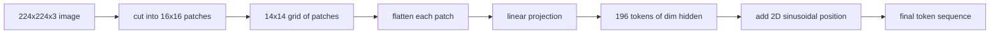

<!-- local-zh-machine-draft: English source is canonical; prose translated automatically, code/math preserved. -->

<a id="vision-encoder-patches"></a>

# 视觉 Encoder 的图像 Patches

> 读像素的视觉模型需要 tokenizer 给像素 Patch embedding 是这样吗? tokenizer。将图像切成方格,平整每个方块,投射到一个线性层,然后添加一个 2D 位置信号,这样 transformer 了解每个方块在原始图像中的位置。

**类型：** 构建
**语言:** Python
**先修要求:** 第19阶段课程30-37(B轨基础)
**时间：** ~90 分钟

<a id="learning-objectives"></a>

## 学习目标

- 将图像化为固定长度序列 patch embeddings.
- 执行a `Conv2d`-based patch 投影与时线性计算相匹配
- 构建一个确定性 2D 的正弦值位置 embedding so token 顺序编码空间位置。
- Verify patch count, embedding 形状,以及 `Conv2d`/合成固定物的等同值。

<a id="the-problem"></a>

## 问题

一个 transformer 吃掉矢量序列。图像是三道网格。将每个像素读取为 token 爆炸序列长度: 224x224 RGB 图像为 150,528 tokens,12个层次 transformer 负担不起 attention。读取图像时,一个巨大的平坦矢量会丢弃位置, attention 无法从该图层中恢复。 encoder 前端是将像素网格压缩到几百 tokens 每一个都总结一个平方区域。

Patch embedding 以一个线性投影来解决这个问题。 A 224x224 图像切成 16x16 patches 产生14x14的网格,共196个 patches. 每个 patch 平坦的,从 `(3, 16, 16) = 768` 像素值进入一个矢量,然后直线层将它映射到模型的隐藏维度。 transformer 见196 tokens 维度 `hidden` (通常为768)加上CLS token。这是一个序列 rest 网络可以咀嚼。

<a id="the-concept"></a>

## 概念



<a id="why-patches-not-pixels"></a>

### Why patches,而不是像素

Attention 以序列长度为二次形。A 196-token 序列费用 `196 * 196 = 38,416` attention 每层每头的分数; 150,528 -token 序列费用 `150,528 * 150,528 = 22.6 billion`. Patches 买590,000美元 attention 计算, 16x16区域带有足够高水平的视觉任务信号。 成本是损失一个区域内精细的空间细节 。 patch,这就是为什么下游多式联运堆叠通常运行第二高分辨率 branch 精细的本地化很重要

<a id="why-a-linear-projection-is-enough"></a>

### 为什么线性投射就足够了

每个 patch 被作为独立的矢量处理。投影学习一个基础:边缘探测器、颜色过滤器、简单的纹理。单线性层小(`768 * 768 = 589,824` parameters 用于 ViT更深层的变种源 ViT),但平直线投影是标准,而且最现代的开放-weight encoders 船的形状完全如此

<a id="the-conv2d-trick"></a>

### 该 `Conv2d` trick

一个 `Conv2d(in_channels=3, out_channels=hidden, kernel_size=patch_size, stride=patch_size)` 没有粘贴的数值结果与显示时线性相同,因为每个输出位置点产品 patch 在一个过滤器上像素。 patch 投影,大多数生产代码库 以这种方式发售它,因为它的速度更快 GPU 并使用一个更少的重塑。

<a id="position-embeddings"></a>

### Position embeddings

Tokens 投影中无顺序。 2D 类象 embedding 给每个 token 加密的固定信号 `(row, col)` 位置。 embedding 维度将行位置编码为罪/ cos, 并使用多个频率; 另一半编码为列位置。 编码是确定性的, 这样您就可以不经再培训就交换分辨率, 它可以进行内部插划, 以将模型在训练时从未见过的网格进行输入 。

| 组件 | 形状 | Parameters |
|-----------|-------|------------|
| Patch 预测数(`Conv2d`) | `(hidden, 3, patch, patch)` | `3 * P * P * hidden + hidden` |
| Position embedding (fixed) | `(num_patches, hidden)` | 0(计算,未学习) |
| CLS token (learned) | `(1, hidden)` | `hidden` |

用于 ViT- 基准/16,224分方位:590 592 parameters 中,768个 token,对正弦值位置为零。下一个课(59)堆叠一个12层 transformer 玡繷

<a id="equivalence-as-a-sanity-check"></a>

### 等效的理智检查

该 patch 步骤有两种拼法: `Conv2d` 投影和直线显示。 它们必须产生相同的输出 weights。如果它们不这样做,那么显示的数学是错误的, rest 的 encoder 以沙为基地。本课中的测试 将等同效果。

```figure
ch-patch-tokenizer
```

<a id="build-it"></a>

## 动手实现

`code/main.py` implements:

- `PatchEmbed`, 一个 `nn.Module` wrapping `Conv2d` 用于 patch projection.
- `sinusoidal_2d(grid_h, grid_w, dim)`,一个无国籍人功能,构建 2D 位置表。
- `VisionFrontEnd`,该组成 patch embedding,CLS 预设,职位增加为 forward pass.
- 一个 `synthesize_image(seed)` 用于构建确定性 224x224x3 固定线的助手 `numpy.random`.
- 显示一个通过前端运行一个固定图像并打印输出形状的 CLS token 标准,和一行位置 embedding.

运行：

```bash
python3 code/main.py
```

输出: 224x224 固定符被标记成形状序列 `(1, 197, 768)`。第一个 token 是 CLS; 下个 196 patch tokens位置 embedding 规范在行内是统一的,即类比符号。

<a id="use-it"></a>

## 实际应用

一样 patch 最前端出现在每一个现代 vision-language model: 中央应急循环系统 ViT-L/14,SigLIP,DINOV2, 和 Qwen-VL家庭, 和实习生堆叠都从 `Conv2d` patch 投影加位置信号。 家庭在下游的差别( CLS 与 no- CLS 集合, 注册) tokens,不同 patch 14 和 16 , 通过内插位置动态解析。 这个课的前端是每个模型的基底。

<a id="tests"></a>

## Tests

`code/test_main.py` covers:

- patch 计数匹配 `(image_size / patch_size) ** 2`
- 输出形状匹配 `(batch, num_patches + 1, hidden)`
- 该 `Conv2d` 投影等于手动在小固定上展开线性
- 等离子位置表对称确定
- CLS token 横跨批次暗淡且无泄漏的广播

运行它们 :

```bash
python3 -m unittest code/test_main.py
```

<a id="exercises"></a>

## 练习

1. 将正弦形位置替换为已学的 `nn.Parameter` 比较第一个...epoch 在一个小的合成分类任务中损失。 学习位置以固定分辨率获胜; 类比型在训练后改变分辨率时获胜。

2. 交换 `Conv2d` 明确 `nn.Unfold` plus `nn.Linear` 并声明输出与浮控容度相符。 相同的数学, 两种拼写方法 。

3. 添加对非平方的支持 patch 大小(例如,宽面输入为32x16),并核实位置表处理非平方格。

4. 配置 patch 步进 batch sizes 第一条、第八条、第六十四条 patch 投影很少是瓶颈; attention 下游层为主。

5. 将前端训练成冷冻 feature 4级合成形状数据集(圆形、方形、三角形、恒星)上的提取器。 token 输出应线性分隔。

<a id="key-terms"></a>

## 关键术语

| 术语 | 这意味着什么 |
|------|---------------|
| Patch | 图像的方形次区域, 通常是 14x14 或 16x16 |
| Patch embedding | 一条平坦的线性投影 patch 隐藏暗处 |
| 序列长度 | 数目 tokens 之后 patch tokenization,通常加上 CLS |
| 结肠位置 | 固定的罪/ cos 信号, 编码为 2D 网格坐标 |
| CLS token | 学习矢量预设为集合头 |

<a id="further-reading"></a>

## 进一步阅读

- 图像值 16x16 字( W)ViT原案文,2021年 patch- 装饰
- Attention 需要的就是对此处调整为 2D 的 类固醇位置公式的全套(2017年)。
- 登记用的DINOV2 纸张 tokens,可添加一个扩展项作为练习6。
