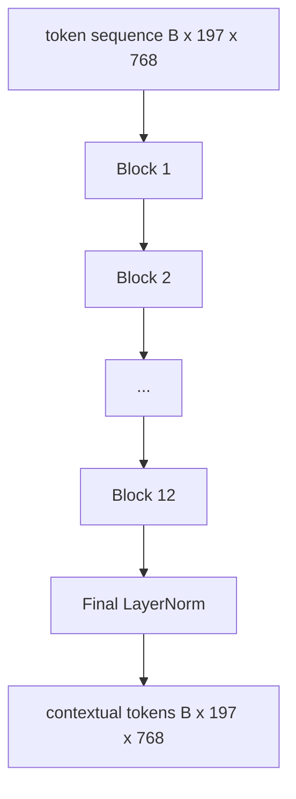
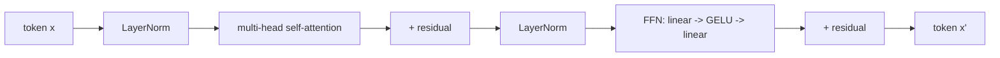

<!-- local-zh-machine-draft: English source is canonical; prose translated automatically, code/math preserved. -->

<a id="vision-transformer-encoder"></a>

# Vision Transformer Encoder

> Patches 12层前LN transformer 12岁以上 attention 头转动 patch tokens 相继序列 tokens,与 CLS 相匹配 token 集成全景 features 最终隐藏状态。 这个课是每个现代的引擎室 vision-language model.

**类型：** 构建
**语言:** Python
**先修要求:** 第19阶段课程30-37(B轨基础)
**时间：** ~90 分钟

<a id="learning-objectives"></a>

## 学习目标

- 实施LN前 transformer 带多头的块 self-attention 和进食的下层。
- 堆放12个街区, 12个头组成 a ViT-Base encoder.
- 电线 patch 从58课到 encoder 运行 forward pass.
- 验证 CLS token 每一页的汇总信息 patch.

<a id="the-problem"></a>

## 问题

该 patch embedding 产生序列 197 tokens,每个矢量都是没有意识的 patch。一张猫需要的图片 patch 来知道 patches 含有胡须,其中含有背景,并含有眼睛。 transformer 建立这种认识的机制, attention 一次的层。 没有它, patch 前端是聪明的 tokenizer 毫无理解

标准食谱是深12个街区,宽12个头,前...LayerNorm placement, GELU 激活, 并进料向前扩展 4x。 这个配方是 CLIP 的脊椎 ViT-L,SigLIP,DINOV2,还有 Qwen-VL家庭, InternVL, 和所有其他开放的...weight vision encoder 配方稳定到可以读到任何这些文件, 并假定这种块状形状, 除非它们明确表示相反。

<a id="the-concept"></a>

## 概念





<a id="pre-ln-vs-post-ln"></a>

### 预发式/ LN 相对于后发式

Original Transformer placed LayerNorm 剩余部分之后。LayerNorm ”这个版本的现代版本 vision-language model 因为它没有学习节奏的热力把戏, 因为它会用刺穿来训练。 forward pass, 以及该 gradient 12+深度的流体是昼夜的

<a id="multi-head-self-attention"></a>

### Multi-head self-attention

每一个头目都预测 token 向量到它自己的 `(query, key, value)` 以维度为三 `head_dim = hidden / num_heads`. 与 `hidden = 768` 和 `heads = 12`,每个头都有 `dim = 64`。12个头平行参加,然后他们的输出会回到768维度,然后通过输出投影。多头的点是,一个头可以学习“猫眼的学习”,另一个头可以学习“背景的学习” gradient" 不受干扰。

<a id="why-the-4x-feed-forward-expansion"></a>

### 为什么四轮驱动进料前向扩张

新生力量去 `hidden -> 4 * hidden -> hidden` 与 GELU 4是经验论因素,在语言和语言之间一直存在。 vision transformers 自2017年以来,基底规模较小(2x),固定数据预算的基底规模较大(8x)。 模型存储了大部分已了解的事实,而大中间位置则位于模型储存中。

| 组件 | Parameters 在 ViT- 基准比例 |
|-----------|------------------------------|
| 每个区块的qkv 投影 | `3 * 768 * 768 = 1.77M` |
| 每个区块输出投影 | `768 * 768 = 590K` |
| 每个街区FFN(4x扩张) | `2 * 768 * 4 * 768 = 4.72M` |
| LayerNorm 每个区块 | `4 * 768 = 3K` |
| 每个区共计 | 约7.1M |
| 12个区块 | 约85米 |
| 加上前端 | 总计约86M |

ViT- 基地是86M - 285)\fsp1}parameter encoder。按2026年标准计算,这个比例很小(SigLIP-So400M是400M,而THE是4000M)。 Qwen-VL ViT 宽度和深度相同。

<a id="causal-mask-or-not"></a>

### 面具还是假面罩?

Vision Transformers 是 encoder- 仅是双向的: token `i` 可能处理 token `j` 任何一对,没有面具 decoder-side cross-attention 61课会用因果面具,但会放在视觉里 encoder, attention 完全连接。

<a id="what-the-cls-token-learns"></a>

### 是什么CLS(CLS) token 学习

CLS 系统 token 开始于学习 parameter, 没有 patch 信息,并通过 attention 横跨每个区块。 在最后一层, CLS 行是整个图像的矢量摘要; 下游头将此单个矢量投射到类中 logits,对比性 embeddings, 或 cross-attention 文本的密钥 decoder.

```figure
ch-cls-funnel
```

<a id="build-it"></a>

## 动手实现

`code/main.py` implements:

- `MultiHeadSelfAttention`, 与 `qkv` 和产出预测,按比例计量的点产品 attention 数学,和形状的断言。
- `FeedForward`,4x扩展 GELU MLP.
- `Block`,一个预立的 LN 块 attention 和有残渣的进料的子层。
- `ViT`,一个12个街区的堆叠 LayerNorm.
- `VisionEncoder`,哪条线 `VisionFrontEnd` 从58课到 `ViT` 堆叠并暴露 `forward()` 返回上下文序列和集合的 CLS 矢量 。
- 运行合成的 224x224 固定图像的演示 encoder 和打印输入形状,输出形状, parameter 计算,并在其他各层使用 CLS 规范。

运行：

```bash
python3 code/main.py
```

输出: 固定值编码为 `(1, 197, 768)` tensor。CLS 规范随着层层的形成向上移动,然后稳定在最后 LayerNorm. 共计 parameters 约86M报告。

<a id="use-it"></a>

## 实际应用

该 encoder 这里定义的是,宽度和深度, 与每张开的船体相同的块堆 --weight 2025-2026年的VLM。 差异存在于:

- **宽度和深度。** ViT- 长是 `hidden=1024, depth=24, heads=16`; SigLIP  So 400M 是 `hidden=1152, depth=27, heads=16`同样的街区。
- **游泳头** CLS 集合( 本课) 与平均集合( SigLIP) 和 attention 集资(后来的VLMs)。
- **位置处理。** 固定的正弦类( 减号58) 对学得 1D 和 ALIBI 和 2D RoPE。块数学没有变化。
- **Register tokens.** DINOV2 前置4 tokens。一行代码。

这个块堆叠是基底。 下一个课程( 60- 63) 将放在上面 。

<a id="tests"></a>

## Tests

`code/test_main.py` covers:

- 单个块保存形状,且不易输入 batch size
- attention 键轴上的分数和一个softmax sanity)
- 剩余路径被绑定( 零输入仍然通过 CLS 产生非零输出) token)
- 堆叠的四层 forward pass 产生正确的形状
- gradients 流向 patch CLS 输出的投影

运行它们 :

```bash
python3 -m unittest code/test_main.py
```

<a id="exercises"></a>

## 练习

1. 添加注册 tokens 重运行( 4个学习矢量在 CLS 后预设) 。 比较 attention 通过 entropy 绘制平滑的地图 softmax 上一层的分布。

2. 液态后交换液态前和一剂后训练 epoch 在一个合成形状分类器上,观察一下哪辆火车没有加热的,会刺伤。

3. 将因果掩码作为 `attn_mask` 参数,以便同一块块可以作为 decoder 复方块。 掩码形状是 `(seq, seq)`,低三角形。

4. 配置文件 a forward pass 在 batch sizes 1,8,64岁 `torch.profiler`。 MLP 层控制着墙壁时间,而不是 attention.

5. 替换一个 attention 头部的QKV预测 低级 LoRA 适配器,冻结 rest,并核实 gradient 只有在你期望的地方才会流

<a id="key-terms"></a>

## 关键术语

| 术语 | 这意味着什么 |
|------|---------------|
| 预LN | LayerNorm 在每个子层之前而不是之后应用 |
| Self-attention | 每个 token 双向 token 在同一顺序中 |
| Multi-head | 隐藏的暗淡被分割 `H` independent attention heads |
| FFN扩展 | 进料前层宽到 `4 * hidden` 签订合同前 |
| CLS 共享 | 使用第一个 token图像摘要的最后隐藏状态 |

<a id="further-reading"></a>

## 进一步阅读

- 图像值 16x16 字( W)ViT2021年,日内瓦 encoder recipe.
- 登记编号DINOV2(2023) tokens 和自我监督 pretraining objective.
- 平均组合变量SigLIP (2023) sigmoid 62课中使用的反比损失。
