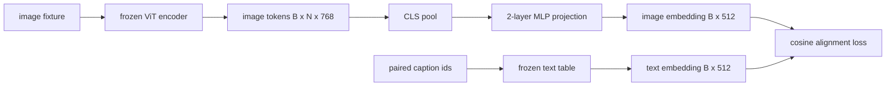

<!-- local-zh-machine-draft: English source is canonical; prose translated automatically, code/math preserved. -->

<a id="projection-layer-for-modality-alignment"></a>

# 用于 Modality Alignment 的投影层

> 愿景 encoder produces image tokens文本 decoder 消耗文本 tokens。两个项目居住在不同的矢量空间中。一个小型的双层 MLP 项目 image tokens 输入文本 embedding 空间和连弦 alignment 与对齐标题相比,损失将两个空格拉入一致。 vision-language model 也是最重要的转移对象

**类型：** 构建
**语言:** Python
**先修要求:** 第19阶段课程30-37(B轨基础)
**时间:** ~90分钟

<a id="learning-objectives"></a>

## 学习目标

- 绘制映像的双层 MLP 投影 features 输入文本 embedding space.
- 构造一个模拟文本 embedding 表格(无预设) tokenizer),没有真正的实体)。
- 计算余弦 alignment 预测之间损失 image tokens 和对齐的圆柱 embedding.
- 单用冷冻的视觉来训练投影 encoder 和一个冷冻的文本表格。

<a id="the-problem"></a>

## 问题

你有一个幻象 encoder (第58-59号单) tokens 维度 `vision_hidden = 768`。您有一条文字 decoder 想要在顶部 embedding dimension `text_hidden = 512` (任何其他数字都是有道理的) decoder 需要文本形状 tokens. 该 image tokens 不是文字形状:它们生活在一个基础中 encoder 仅视线期间学习 pretraining,没有关系 decoder文字矢量。

双层 MLP 投影(线性, GELU,线性)弥合缺口。它足够小 `768 * 1024 + 1024 * 512 = 1.3M` parameters在一个单人车上训练 GPU,它是唯一的一块 在 alignment 阶段。 encoder 保持冻结。 embedding 表格保持冻结。 只有投影动作。 这是2023年发运的配方 LLAVA, BLIP-2 重新定义为Q- Foremer, 而且每个打开的-weight 之后,自愿劳工制度以某种形式获得通过。

<a id="the-concept"></a>

## 概念



<a id="pooling-before-projection"></a>

### 投影前合用

愿景 encoder 出 席 197 tokens文本侧有一个标题级别 embedding。要对齐它们,每个样本需要一个图像级矢量。 CLS 集合是最简单的:第一个 token 来自 encoder 并投放它。 平均集合在全部 197 tokens 是一个选项, SigLIP 使用。 任何一种方式, 都会将 197 矢量排到一个 。

<a id="why-two-layers-and-not-one"></a>

### 为什么是两层,而不是一层

单线性投影可以旋转和调整规模,但如果两个空格有曲线错配,则无法固定基数。 GELU 在两个线性层之间,投影有一个非线性弯曲,这在经验上足以对齐 CLIP 风格 features 改为语言模式 embeddings更深的预测(LLAVA-NEXT使用GLU; Qwen-VL用过一堆 attention 双层 MLP是金银基底线 也是BLIP-2号的Q-Former投影船头顶部的顶部

| 图层 | 形状 | Parameters |
|-------|-------|------------|
| fc1 | `(vision_hidden, projection_hidden)` | `768 * 1024 + 1024` |
| activation | GELU | 0 |
| fc2 | `(projection_hidden, text_hidden)` | `1024 * 512 + 512` |

约1.3M parameters a 用于 `768 -> 1024 -> 512` head.

<a id="cosine-alignment-loss"></a>

### Cosine alignment loss

排列并不意味着 `image_emb == text_emb`。对齐意味着 `image_emb` 点数与 `text_emb` 连带体损失是 `1 - cos_sim(image, text)`,从0(完美对齐)到2(对面)不等。培训将它推向每对零。62课概括为对比性批量(InfoncE),每个图像必须比批次中任何其他标题更接近其标题;本课使用单纸版,这样动态就可见。

<a id="frozen-encoder-is-the-trick"></a>

### Frozen encoder 才是骗局

愿景 encoder 拥有86M parameters。文本表格中还有几百万个文字。从模拟体中培训他们都是非启动程序。冻结两者意味着投影的1.3M parameters 它们是唯一改变的东西, 合成对子上几百步就足够把损失推向下。这正是每个以适应器为基础的VLM的操作形状: 重部件保持冷冻, 轻桥列车。

```figure
ch-projection-bridge
```

<a id="build-it"></a>

## 动手实现

`code/main.py` implements:

- `MLPProjector(in_dim, hidden_dim, out_dim)`双层线性 MLP 和 GELU activation.
- `MockTextEmbedding(vocab_size, dim)`,一个冻 embedding 桌子上有种子的确定性
- `make_pair(seed, vocab_size)`,该选项合成一个配对(图像、标题)样本。标题是简短的代号序列;标题 embedding 平均资源 token embeddings.
- `cosine_alignment_loss(image_emb, text_emb)`,每个 `1 - cos_sim` objective.
- 利用一个训练循环,对32个合成配对(循环)的200个步骤进行预测,并设定愿景 encoder 和文本表格冻结, 并打印损失 每25个步骤。

运行：

```bash
python3 code/main.py
```

产出:培训报告从最初损失的1.07左右下降到200个步骤内的0.80左右,表明单靠预测就能拉动 image tokens 向文字空间。 cosine similarity 每对也印刷。

<a id="use-it"></a>

## 实际应用

同样的模式出现在每一个开放的...weight VLM:

- **激光器1.5** Two-layer GELU CPIP的多频波预测ViT-我隐藏在 LLaMA embedding 暗淡的视觉 encoder,冻结 LLM,只训练投影(然后解冻) LLM 第二阶段)。
- **BLIP-2.** Q- 前置32个已学习的查询 tokens through cross-attention against image tokens,然后项目 LLM embedding 暗淡。 Q- 前置的结尾处的投影头是此课的 MLP 的类比 。
- **MiniGPT-4.** BLIP-2Q-以前输出到维库纳的单线性投影 embedding dim.
- **Qwen-VL.** Cross-attention 具有多个层的适配器, 但最后的一块再次投射到 LM embedding dim.

形状不同,但角色相同: 池 image tokens,项目到文本 embedding 暗淡,单干。

<a id="tests"></a>

## Tests

`code/test_main.py` covers:

- 投影器输出形状与配置的形状匹配 `out_dim`
- 冻结文本 embedding 表格为零 `requires_grad` parameters
- 相同矢量的余弦损失为零,反平行矢量为2
- projector gradient 一次之后的流动 backward pass
- 训练循环减少0级至200级之间的损失

运行它们 :

```bash
python3 -m unittest code/test_main.py
```

<a id="exercises"></a>

## 练习

1. 将CLS集合改为平均集合在196号 patch tokens 并比较200步后的最后损失。 平均集合通常能更快地进行合成数据培训; CLS对自然图像的样本效率更高。

2. 添加一个学习的标语 temperature 余弦损失(`cos / tau`观察当 `tau` 过于小( )gradient 或过大(损失高原)

3. 将双层 MLP 换成单线层, 并量化损失差距。 非线性在自然图像上更重要 features 合成的也少了

4. 在投影机上加上一个小L2罚款 weights 看着它如何与连弦互动 alignment (连弦是规模变化的,所以惩罚大多会缩小未使用的方向)

5. 持久性投影仪 weights,然后重新装入并运行 inference 没有愿景 encoder backward pass 以核实部署时只需要投影仪。

<a id="key-terms"></a>

## 关键术语

| 术语 | 这意味着什么 |
|------|---------------|
| Modality alignment | 制作图像和文字的行为 embeddings 在一个共享空间中比较 |
| 投影头 | 将一个空间映射到另一个空间的小模块, 通常是一个 2 层 MLP |
| Cosine similarity | 点数产品除以L2规范的产品 |
| Frozen encoder | 愿景(或文本)模式具有全部 parameters 与 `requires_grad=False` |
| 模拟材料 | 使用的合成对, 使培训没有数据组下载依赖性 |

<a id="further-reading"></a>

## 进一步阅读

- 两阶段列车的LALVA纸(项目,然后解冻LM)。
- Q-Former BLIP-2 论文,作为可学习的预测替代。
- Qwen- VL 技术报告 cross-attention 更深的投影头
