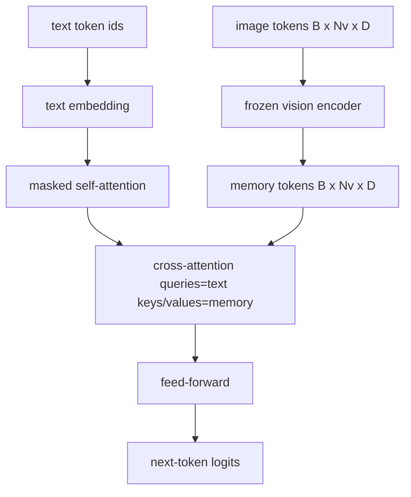
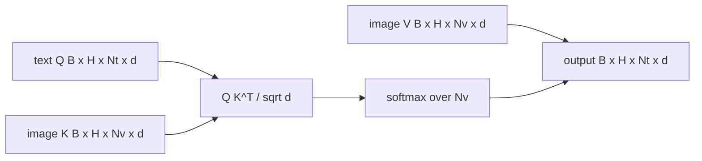

<!-- local-zh-machine-draft: English source is canonical; prose translated automatically, code/math preserved. -->

<a id="cross-attention-fusion"></a>

# Cross-Attention 融合

> 投影层将一个图像矢量与一个标题矢量匹配。 decoder 需要每个文本 token 处理 patch token,这样模型就能将每个词都放在一个区域。 Cross-attention 就是这样 grounding 发生。 文本查询; 视觉键和值回答。 此课构建了 cross-attention 区块,因果文字 self-attention面具的形状能维持两种合法

**类型：** 构建
**语言:** Python
**先修要求:** 第19阶段课程30-37(B轨基础)
**时间:** ~90分钟

<a id="learning-objectives"></a>

## 学习目标

- 执行多头项目 cross-attention 查询流为文本,而键/值流为视觉。
- 撰写 decoder 块:因果 self-attention + cross-attention + feed-forward. 组合键,以图向前。
- 将面具形状正确化: 因果遮罩 self-attention,没有面具 cross-attention.
- 运行a forward pass 与批量文本 tokens 和固定的、 image tokens.

<a id="the-problem"></a>

## 问题

Concatenating image tokens 和文本 tokens 组合为一个序列early fusion来,去,去,去,去,去,去,去,去,去,去,去,去,去,去,去,去,去,去,去,去,去,去,去,去,去,去,去,去,去,去,去,去,去,去,去,去,去,去,去,去,去,去,去,去,去,去,去,去,去,去,去,去,去,去,去,去,去,去,去,去,去,去,去,去,去,去,去,去,去,去,去,去,去,去,去,去,去,去,去,去,去,去,去,去,去,去,去,去,去,去,去,去 Cross-attention 是一个late fusion火烈鸟的路径 和每个火烈鸟形状 decoder ),在 late fusion,文本 decoder 仅运行于文本 tokens 并伸入图像流 cross-attention 在每个层。

Late fusion 有两个优点。 首先,文本流保持干净, 模型保存只文本的能力。 其次, 图像流每图象一次计算, 并重新用于每个解码步骤, 因此即使长标题也可生成便宜。 成本是额外的一个 attention 每个街区的子层。

<a id="the-concept"></a>

## 概念





<a id="mask-shapes"></a>

### 遮罩形状

两个人 attentions 内 decoder 块需要不同的遮罩 :

| Attention | 查询长度 | 密钥长度 | Mask | 为什么 |
|-----------|--------------|------------|------|-----|
| Self-attention | `Nt` (text) | `Nt` (text) | 原因: 低三角形 `(Nt, Nt)` | Text tokens 自动回归时可能不往前看 |
| Cross-attention | `Nt` (text) | `Nv` (vision) | 没有面具 | 整个图像在每一个文本位置都可见 |

课程包括一个形状验证函数,因此将其表面混合为 `ValueError` 而不是一个无声断裂的损失曲线。

<a id="why-no-mask-on-cross-attention"></a>

### 为何不戴面具 cross-attention

生成任何文本之前, 图像会被完全观察 。 Token `t` 标题中可处理的 patch 图像; 图像上没有时间顺序 patches。在插入多个图像和文本段时,一些Flammingo变体会添加一个每个样本的遮罩模式,但对于单个图像加上一个标题, cross-attention 什么都看得到,我看见你

<a id="keyvalue-caching"></a>

### 密钥/ 值缓存

解码开始时,图像键和值会计算一次,并保存在缓存中。 token 使用缓存而不进行反校。这就是标题快速到 inference:重 ViT 运行一次; cross-attention 重新使用每个步骤的密钥和值。 课程会显示缓存并测试缓存命中路径 。

<a id="block-composition"></a>

### 块组成

一个 decoder 块运行: LN 前 - > self-attention - > 剩余 - > LN前 - > cross-attention - > 剩余 - > LN前 - > feed-forward - > 剩余。 LayerNorm火烈鸟纸上加了一道有学识的门 cross-attention 以便模型可以选择退出图像路径, 培训时间稳定成本; 明灯基线( 在此使用) 没有门 。

```python
class DecoderBlock:
  def forward(self, text_tokens, image_tokens, text_mask, cross_mask):
      text_tokens = text_tokens + self.self_attn(self.ln1(text_tokens),
                                                 mask=text_mask)
      text_tokens = text_tokens + self.cross_attn(self.ln2(text_tokens),
                                                  image_tokens,
                                                  mask=cross_mask)
      text_tokens = text_tokens + self.ffn(self.ln3(text_tokens))
      return text_tokens
```

```figure
ch-crossattn-fan
```

<a id="build-it"></a>

## 动手实现

`code/main.py` implements:

- `CrossAttention(hidden, heads)`,多头 cross-attention 分开 `q` 和 `kv` projections.
- `CausalSelfAttention(hidden, heads)`,面具 self-attention 从标准 decoder.
- `DecoderBlock`,组成三个子层 与LN前的残留物。
- `VisionLanguageDecoder`,四层 decoder 由假象所赐 encoder 输出和一个小文字 embedding table.
- `causal_mask(length)` 返回a `(length, length)` 下三角布尔 tensor.
- 用于输入长度为10的两批文字序列的演示文稿,其图像内存为197长,并打印输出形状,即 self-attention 掩码形状, cross-attention 输出标准 。

运行：

```bash
python3 code/main.py
```

输出: decoder 生产 a `(2, 10, text_vocab)` logits tensor。面罩形状 `(10, 10)`。 KV-cache 重复使用检查确认相同 logits 隐藏路径和未隐藏路径之间。

<a id="use-it"></a>

## 实际应用

Cross-attention 有两个生产家庭出现:

- **火烈鸟和IDEFICS。** 插入一个 cross-attention 下层每个 K 语言模型块, 并有一个冻结的 LM 。 视觉语言适配器是 cross-attention 砖加门
- **BLIP-2.** Q- 以前的用途 cross-attention 。 从一组固定的 32 查询 tokens 进入图像 features,然后将查询投放到LM embedding space.

课程中的块形图直接映射到两个方向。 面具纪律( 以自我为主, 以十字架为主) 是一样的 。

<a id="tests"></a>

## Tests

`code/test_main.py` covers:

- 因果关系掩码为低三角形, 符合预期布林形状
- cross-attention 输出形状 `(B, Nt, hidden)` 不论密钥长度
- KV 缓存路径匹配不切实际的浮控容忍度
- 形状文本和图像流之间的不匹配会提高清晰度 `ValueError`
- a 满数 decoder forward pass 产生正确的批次和序列形状

运行它们 :

```bash
python3 -m unittest code/test_main.py
```

<a id="exercises"></a>

## 练习

1. 给这间有学识的塔纳门 cross-attention 剩余( 火烈鸟游戏) 并验证训练从接近零的初始门开始。 大门在0时开始; 模型在混合图像流之前会恢复只使用文本的行为 。

2. 实施间断休假 attention 相同之处 decoder 需要多个图像加上多个文本段。 cross-attention 防止文本第2段进入图像1的遮罩。

3. 配置 cross-attention 与 self-attention 平面图 `Nt=64, Nv=576` (一个24x24格子,高分辨率)。 cross-attention 成本为 `Nt * Nv` 并且以高图像分辨率为主

4. 添加查询边 dropout 在 cross-attention 显示时的地图和标题多样性(缩略图样本差异与 dropout ) 中)。

5. 交换 cross-attention 用于 Q- 格式的图层 attention 区域,其中固定 32 -token 查询池覆盖图像 features 每一层一次

<a id="key-terms"></a>

## 关键术语

| 术语 | 这意味着什么 |
|------|---------------|
| Late fusion | 文字和视觉留在不同的流中; cross-attention 在每个街区都把它们连接起来 |
| Cross-attention | Q来自一条溪,K和V来自另一条溪 |
| 因果面具 | 防止在自动回归时向前看的低三角布罩 |
| KV cache | 图像密钥和数值存储一次, 并被重新用于每个解码步骤 |
| Memory tokens | 冻僵了 image tokens 中文本不需修改 decoder 切入到 |

<a id="further-reading"></a>

## 进一步阅读

- 火烈鸟(2022年)用于装有门的罐头延迟聚变设计 cross-attention.
- Q-Former公司BLIP-2(2023),即 cross-attention 块装扮成学习过的查询池。
- 开放-weight 复制火烈鸟配方
