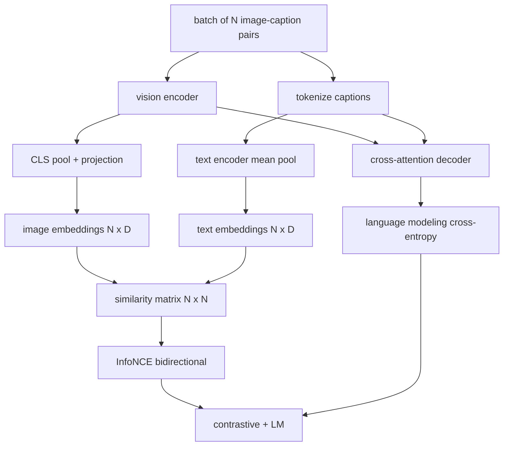

<!-- local-zh-machine-draft: English source is canonical; prose translated automatically, code/math preserved. -->

<a id="vision-language-pretraining"></a>

# 视觉与语言联合 Pretraining

> 该 encoder、预测,以及 decoder 将它们连接在一起。两个目标驱动着学习:一个对比图像-文字丢失(InfoNCE),在联合体中将匹配的对子拉在一起 embedding 和语言模型损失, 询问 decoder 来给每个图像提供字幕。合并后,他们教网络既要找到合适的字幕图像,又要为图像撰写字幕。

**类型：** 构建
**语言:** Python
**先修要求:** 第19阶段课程30-37(B轨基础)
**时间：** ~90 分钟

<a id="learning-objectives"></a>

## 学习目标

- 将信息化的丢失与图像描述相匹配。
- 将对比性损失与 autoregressive 语言模型损失。
- 合成一个200帕的模拟图像截图程序 而不下载真实数据
- 运行一个50步演示循环 观察两个损失的减少

<a id="the-problem"></a>

## 问题

一个 vision-language model 需要两种技能。 它必须排位 : 给一个标题, 找到许多图像中正确的图像 。 它必须生成 : 给一个图像, 写入一个标题 。 Pretraining 单靠一种技能的模型就给了你半个系统。 CLIP 钉定了排名, 但无法给标题 。 GPT-4V可以标题,但使用单独的检索头进行排位。 pretraining 都一发不可收拾

信息与NCE处理一半排名。对于一批N对,模型将N对匹配的对视为正数,而N对则视为正数。 `N^2 - N` 配对为负, 然后运行 cross-entropy B. 损失的发生 `(N, N)` 相似矩阵。 LM 损失处理的代数的一半: 标准下个token 两种损失都是不同的,可以分享 encoder,投影器,以及 decoder weights.

<a id="the-concept"></a>

## 概念



<a id="infonce-in-one-paragraph"></a>

### 信息与教育

堆放 N 图像 embeddings 作为行和 N 文本 embeddings 以行的形式。 L2- 常规化两者。计算 `N x N` matrix `S = I T^T / tau` where `tau` 是一个学识 temperature。对角条目是匹配的对;对角条目是负的。应用 cross-entropy 目标 `argmax` 向下对角运行: 行 `i` 应在栏中列出最高条目 `i`。在列上对齐地执行相同的调整。总计是两个的平均值。这是CLIP在八行中的损失。

<a id="temperature-matters"></a>

### Temperature matters

该 temperature `tau` 控制如何顶峰 softmax . 过小(例如: `tau = 0.01`) 以及该 gradient 训练很吵,太大了 softmax 平板和 gradient 失踪。 `tau` 以 A 为单位 parameter;在这里演示也是一样的。

<a id="language-modeling-loss"></a>

### 语言建模损失

该 decoder 消耗图像内存 tokens 通过 cross-attention 并预测下一条文字 token 损失是标准 cross-entropy 位置被遮蔽了

<a id="combining-the-losses"></a>

### 合并损失

`total = contrastive + lm_weight * lm` where `lm_weight` 是一个卡路里(通常是1.0),两个损失份额 gradients 进入 encoder 和预测;仅 decoder 接收 LM 损失 gradient。这是多种任务配方, CoCa、BLIP和SigLIP型模型都使用,并有各种加权。

| 组件 | 表面损失 | Affects |
|-----------|--------------|---------|
| 信息NCE | 联合空间对等排序 | Encoder +投影+文字标题 |
| LM | Token 以图像为条件的预测 | Encoder + 预测+ decoder |
| Combined | Multi-task | 整堆垃圾 |

<a id="why-50-steps-is-enough-for-a-demo"></a>

### 为何五十步就够演示了

模拟版是一个合成的200帕的合成集,配有随机图像和随机字幕代号。 batch size 16, 这两项损失都明显下降, 即使绝对值仍然高于真实数据模型所能达到的数值。 gradient 管道工程结束,加上LM损失不会破坏对比目标。

```figure
ch-infonce-diagonal
```

<a id="build-it"></a>

## 动手实现

`code/main.py` implements:

- `MultimodalModel`,将一个小 ViT encoder, MLP 投影器, 一个小的文本边 encoder (平均资源库超过嵌入的代号) cross-attention decoder 61课的课
- `info_nce_loss(image_emb, text_emb, temperature)`,双向的 CLIP 式对比性损失。
- `lm_loss(logits, target_ids, padding_id)`下一个蒙面...token cross-entropy.
- `make_mock_corpus(seed, n_pairs)`,返回200个确定性(图像、标题)_双胞胎
- 训练循环运行 50 步 batch size 16, Adam optimizer和学过的日志...temperature parameter。每5个步骤就印出两个损失。

运行：

```bash
python3 code/main.py
```

输出: 与大约 `ln(16) = 2.77` 向2.4; 从随机的单向基线 `ln(512) ≈ 6.24` 两者的下降都证明 gradient 电线正确。 真正的模型列列车 数百万步; 动态是相同的 。

<a id="use-it"></a>

## 实际应用

与运往下列地点的损失配方相同:

- **CPIP(2021年)。** 图像文本只具有对比性, 单独冻结...encoder 字幕探测器
- **可可(2022年)。** 图像文本对比性加上图像缩略图在一种模型中损失。 精确的模式是这个课程的构建 。
- **BLIP(2022年)和BLIP-2。** 反差加上LM加上图像文本匹配头部,三处损失加在一起
- **SigLIP(2023年)。** 切换信息NCE sigmoid 双胞胎损失; 相同的对比作用, 不同的功能形式。
- **法兰西家族** 第一阶段的两阶段培训 alignment 第二阶段将LM损失加上解冻LM. 60号课程到第一阶段;该课程到第二阶段。

<a id="tests"></a>

## Tests

`code/test_main.py` covers:

- 信息/ NCE 损失对称于图像/文本行
- 当相似矩阵是一对齐的, 且正数较大时, InfoNCE 损失返回 0
- LM 丢失正确的遮罩套接位置
- 模型 forward pass 产生两个损失,无错误
- 5步训练循环减少了合并损失

运行它们 :

```bash
python3 -m unittest code/test_main.py
```

<a id="exercises"></a>

## 练习

1. 将信息NCE 替换为 SigLIP 风格 sigmoid 并比较在模拟体上的趋同

2. 添加一个硬负式采矿步骤: 其它每批, 从上一批中选择最硬的对外对子并附加它。 训练并检查对比性损失是否下降更快 。

3. 在共享顶端添加匹配二进制头的图像文本 embedding 复制BLIP的三头台设置。

4. 将模拟版替换为从一个以图像散列为条件的 Markov 链中提取的字幕代号序列。 字幕损失应该进一步下降, 因为有实际可学习的信号 。

5. 训练同样的模型 `lm_weight = 0` 和再次与 `lm_weight = 1`对比对比性损失;LM损失不应使排序目标倒退。

<a id="key-terms"></a>

## 关键术语

| 术语 | 这意味着什么 |
|------|---------------|
| 信息NCE | 噪音对比估计: cross-entropy 类似矩阵 |
| Temperature | 控制对比度如何顶峰的卡路里 softmax 是 |
| 硬负 | 模型发现一个离对角的对子, 混淆不清, 有用于 sampling |
| LM损失 | 标准下一位token cross-entropy 标题侧 |
| Joint embedding space | 图像和文字矢量在投影后所生活的共享空间 |

<a id="further-reading"></a>

## 进一步阅读

- 原始对比配方的 CLIP 文件 。
- 一种模型的对比式加字幕的 CoCa 纸。
- 用于 sigmoid 双损变量,为什么它能比它更精确
