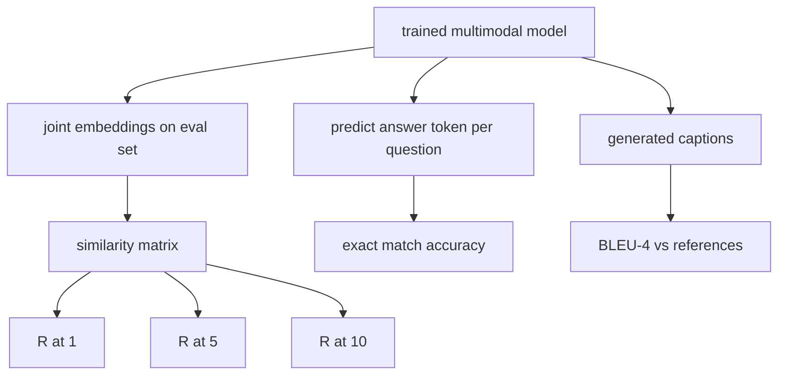

<!-- local-zh-machine-draft: English source is canonical; prose translated automatically, code/math preserved. -->

<a id="multimodal-evaluation"></a>

# 多模态 Evaluation

> 训练是循环的一半,另一半是测量。这堂课可以得出三点 evaluation 原始表面: 图像缩略图检索报告为 R@ 1, R@ 5, R@ 10; 视觉问题回答报告为 exact match 精确度; 图像字幕以 BLEU-4 格式报告。 每条测量线都是模型输出的函数, 以及一个合成的反val套件, 以秒运行 。

**类型:** Build
**语言:** Python
**先修要求:** 第19阶段课程58-62(追踪E基金会: encoder, transformer预测, cross-attention fusion, pretraining)
**时间:** ~90分钟

<a id="learning-objectives"></a>

## 学习目标

- Compute Recall@K 图像和标题之间的相似矩阵 embeddings.
- 从映射(图像、问题)对对的模型到固定答案计算精确匹配 VQA 的准确性 vocabulary.
- 从生成和引用中计算 BLEU-4 token 序列中没有任何外部库。
- 对照62课上经过训练的模型 建造的合成套房 来运行所有三次的模拟

<a id="the-problem"></a>

## 问题

诱惑是宣布 multimodal model 训练损失水平完成后, 训练损失标准适合训练分布; 它不测量模型是否将配对排在搁置的批次中、 回答问题或写入一个人类会接受的字幕。 三个 eval 表面是标准 :

- **检索(R@1,R@5,R@10)。** 构建联合 embedding 查询标题; 将所有图像排在 Eval 池中, 以余弦排序; 报告匹配图像位于前1、 前5、 前10 位的图像位置是否以相同方式运行。
- **视觉问题回答 (exact match).** 模型的输出(图像、问题) token. Exact match 是否为每样一位数: 预测答案等于引用答案吗? 平均 eval set.
- **说明(BLU-4)。** 生成一个标题。根据引用说明计算1克到4克精确度的几何平均值,并处以简略性罚款。多引用是标准格式(一个图像,几个参考说明)。

每个测量标准都是一个微小的函数。 课程将它们都用代码构建, 这样数学就变得混凝土, 表面也处于你的控制之下。 真正的基准套件( MS- COCO, VQA v2, GQA, OK- VQA) 插入相同的函数形状 。

<a id="the-concept"></a>

## 概念



<a id="recallk-from-a-similarity-matrix"></a>

### Recall@K 来源于相似矩阵

构建 `(N, N)` cosine similarity 图像和标题之间的矩阵 embeddings。每行,用降序相似性排序列。 Recall@K 是对角列索引位于 K 顶部位置内的行的分数。 Recall@K 在转换后的矩阵上计算(图象),两个数字都报告。对于 N=100 eval, R@1 = 0.6 表示100个标题中的60个是他们作为顶级匹配而检索的正确图像。

<a id="vqa-exact-match"></a>

### VQA exact match

每一个图像(图像、问题、答案)、编码、嵌入问题、通过 decoder,并读出下一个 token预测 token ID 与引用代号比较;如果正确,则对准。 eval set. 真实的VQA数据集,每条问题有多个人附加说明的答复,并使用软准确性公式(10个注解者中至少有3个同意,按比例排列如下);该课程使用单回答 exact match 来澄清一下

<a id="bleu-4"></a>

### BLEU-4

```text
BLEU-4 = BP * exp(mean(log p1, log p2, log p3, log p4))
```

Where `p_n` 是指修改后的 n 克精确度(在任何引用中出现的生成 n 克的缩略数,除以生成的 n 克的总和),以及 `BP` 简称是:

```text
BP = 1                if generated length > reference length
   = exp(1 - r/g)     otherwise, where r is reference length and g is generated
```

小型样品需要滑动,有些 `p_n` 执行时使用陈氏和樱桃“方法1”(在任何零计数的分子和分母中加1),这是低计数制度最安全的默认。

<a id="synthetic-eval-suite"></a>

### 合成电子套房

以与62课使用的模型模型模式 和悬崖种子为主的50个样本的模拟套件。

- `pairs`:50(图像、字幕)_双对检索。
- `vqa`:50(图像,问题)_IDs, 回答_3个
- `caps`:50(图像, [reference_caption_身份证,...]) 条目,每张图像最多引用3个。

套房是从种子中决定的, 从训练材料中保留下来, 所以测量标准是在模型从未看到的数据上计算的。 JSON 将之作为一项活动留置(见下文)。

| 公制 | 范围 | 随机基线(N=50) |
|--------|-------|------------------------|
| R@1 | 0比1 个 | 0.02 (1 / N) |
| R@5 | 0比1 个 | 0.10 |
| R@10 | 0比1 个 | 0.20 |
| VQA EM 电子 | 0比1 个 | 1 / vocab |
| BLEU-4 | 0比1 个 | 小但非零 |

在关于合成数据的50步训练中,预计测量值不会高;预计测量值将高于随机基线,即演示检查。

```figure
ch-recall-window
```

<a id="build-it"></a>

## 动手实现

`code/main.py` implements:

- `recall_at_k(sim_matrix, k)`,返回一个浮点 `[0, 1]` 双向
- `vqa_exact_match(predictions, references)`,返回平均值结束 `int` equality.
- `bleu4(generated, references, smoothing=True)`,并配有多参考支持。
- `build_eval_suite(seed, n_samples, vocab_size, max_len)`,返回三个决定性的Eval列表。
- `evaluate(model, suite)`,它运行所有三个度数并返回 a `dict` 数字。
- 装满新初始化的演示 multimodal model 并再做一次评估, 打印前/后度量。

运行：

```bash
python3 code/main.py
```

产出: 之前/之后的度量表显示从近乎随机的状态向模型所学信号的回升、 VQA 的随机改进以及 BLEU-4 的改进(合成结构足以进行4克精密升降)。

<a id="use-it"></a>

## 实际应用

每一度量图直接达到生产基准:

- **Retrieval.** MS-COCO 5K val, Flickr30K, 图像网络 zero-shot 相同相似矩阵中的所有 R@K 问题。用真实文件替换合成的变异,功能签名不变。
- **VQA.** VQA v2, GQA, OK- VQA 使用相同的相配形状( 软方位, 而不是 VQA v2 的单答 EM )。
- **BLEU-4.** MS-CO 字幕, NoCaps, Flickr30K 字幕使用 BLEU-4 加上 CPEER 和 METEOR。 添加 CDER 是另一个功能 。

真正的基准,交换 `build_eval_suite` 数学是基准不可知性。

<a id="tests"></a>

## Tests

`code/test_main.py` covers:

- recall@k 返回 1.0 的完美身份相似矩阵,并返回 0.0 的翻转矩阵, k < N
- recall@k respects `k <= N` 上下捆绑
- 生成时, Bleu4 返回 1. 0 等于引用之一
- 列队4 在断开时返回 0.0 vocabulary
- vqa exact match 等于相等对数的分数
- build_eval_套件返回预期的对数、 vqa 项和标题条目

运行它们 :

```bash
python3 -m unittest code/test_main.py
```

<a id="exercises"></a>

## 练习

1. 将 CDE 添加到标题衡量标准中。 CPEDR 使用 TF- IDF 加权 n 克, 奖励信息化 tokens.

2. 执行软准确性 VQA: 问题中多重人类答案, 准确性是 `min(human_count / 3, 1)` 如果匹配的话。 复制 VQA v2 。

3. 添加a NaN- 安全变体 `bleu4` 处理空生成的序列,不发生崩溃。

4. 计算R@K的对等等级。 MRR对正确项目位于K顶部以外之处十分敏感; R@K对是否位于K顶部敏感。

5. 5点对模型进行反射 checkpoints 校对:Soup

<a id="key-terms"></a>

## 关键术语

| 术语 | 这意味着什么 |
|------|---------------|
| R@K | 查询分数, 正确的匹配最高 K 结果中的覆盖值 |
| Exact match | 最简单的 VQA 评分: 预测答案等于引用 |
| BLEU-4 | 精确度为1至4克的几何平均值,并处以简便罚款 |
| Multi-reference | 字幕测量标准接受每个图像的多个引用标题 |
| Held-out | 该 eval set 是从训练材料中的种子脱节的样本中提取的 |

<a id="further-reading"></a>

## 进一步阅读

- VQA v2 软精确公式和数据集统计纸。
- 用于TF-IDF加权n克字幕的 CDEDER 纸张。
- 平滑变体的BLEU原型(Papineni等人,2002年)。
- 用于执行 Canonical 参考的 MS- CO 字幕缩略语脚本 。
