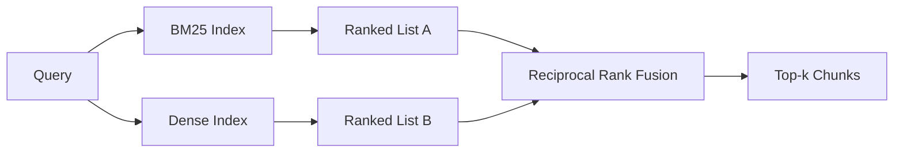

<!-- local-zh-machine-draft: English source is canonical; prose translated automatically, code/math preserved. -->

<a id="hybrid-retrieval-with-bm25-and-dense-embeddings"></a>

# 结合 BM25 与稠密 Embeddings 的 Hybrid Retrieval

> 反向查询分布时, 词汇和语义检索失败 。 Hybrid retrieval 与 reciprocal rank fusion 投票结果不代表内插,

**类型：** 构建
**语言:** Python
**先修要求:** 阶段11 课程04(embeddings), 06 (RAG; 阶段19轨道B基金会(20-29项); 阶段19课程64(chunking strategies)
**时间:** ~90分钟

<a id="learning-objectives"></a>

## 学习目标
- Implement BM25 从罗伯逊和斯帕克琼斯的配方开始, 带有实地加权,文件长度 normalization,以及可捕捉的 k1和b。
- 建立一个密不可分的回收器 在确定模型之上 embedding 所以循环就断线了
- Implement reciprocal rank fusion 解释为什么它会主导得分加权内插。
- 调制RRF k 常数和每 -modality weights 并阅读了权衡 对一个小固定体。

<a id="the-problem"></a>

## 问题

字典搜索在查询带有字面标识符时获胜,文稿包含逐字记录。 `AbortMultipartOnFail` 返回右侧 Go 函数 BM25 以微秒。同一查询,嵌入,位于三个相似的组的边界,而一个密取器先排错文件。

当查询被转述出该文的字面文字时, 密集搜索会获胜 tokens。用户询问“我们如何处理取消的上传”时,不会输入“中止”或“多部分”等字。 BM25 返回“加载大文件”上的文档块,因为该页面包含上传的单词。 Dense retrieval 查找其摘要提及取消的中止函数。

两者间的选择不是一个静态的。查询分布是变量。 RAG 系统从同一个端点处理两个类, 所以检索必须同时处理这两个类。 这就是 hybrid retrieval。合并步骤必须是对的。

<a id="the-concept"></a>

## 概念



<a id="bm25-in-one-paragraph"></a>

### BM25 在一个段落中

BM25 以包含长度的饱和期频率系数乘以反向文档频率系数,通过对调、对查询术语的修改来评分查询文档配对。normalization 纠正,两个把手 `k1` 控制用词频率 saturation;默认值1.5是已公布的建议,没有基准,您不应移动它。 `b` 控制文档长度的重要性; 默认的 0. 75 表示较长的文档会受到处罚, 但不会线性 。

以色列国防军的公式使用了经平滑的罗伯逊和斯帕克·琼斯的定义,即 `log((N - df + 0.5) / (df + 0.5) + 1)`。在超过一半的体积中出现一个术语时,日志中的加一使以色列国防军保持了肯定性,这在小型公司中很重要,因为从技术上讲,在公司中,断语是罕见的。

场边的重量让你知道 BM25 符号名称上的匹配值大于在正文中的匹配值。 执行是该词在索引过程中的乘数, 而不是在评分时。 这样数学就保持了相同, 并避免了每个字段的单独得分 。

<a id="dense-retrieval-in-one-paragraph"></a>

### Dense retrieval 在一个段落中

将每个块嵌入一个固定的矢量,并有一个 embedding 模式。在查询时,嵌入查询,以相似性将每个块的大小排列为正弦,然后返回上K。模型是决定质量的变量。检索算法本身是两行:点产品和排序。

这个课用的是确定性的散列法 embedding 这样你就可以阅读聚合数学, 而不使用网络电话。 hash 和 token共弦级是连续的,这是测试套件需要的。

<a id="reciprocal-rank-fusion-the-published-formula"></a>

### Reciprocal rank fusion,即已公布的公式

两份排名名单,对任一名单中的每一候选人,加起来是其对应级别捐款。 `1 / (k + rank)` 以 k 等于 60 的默认值排序。 这是整个算法 。

公布的常数 k = 60 不是任意的。 k = 60 , 等级-1 的缴款为 1/ 61, 等级- 10 的缴款为 1/ 70. , 捐款逐渐衰减, 候选人仍然投票。 小k 则以最高结果为准。 大k 平整了 贡献曲线 。

有两个可以执行的按钮 `k` 常数。 每对一...modality weights 让你能推 BM25 或当您有先前的证据时密度更高。 weight 是最简单的原则性执行;它保持了降级形状,并且没有比额表。

<a id="why-fusion-beats-score-weighted-interpolation"></a>

### 为什么核聚变比分加权内插法要强

BM25 得分是没有约束性的 并且取决于物质 Cosine similarities 以-1至1.线性组合连接 `alpha * bm25 + (1 - alpha) * cosine` 需要每家公司的 Alpha 调试和每次换行。 基于级的聚变并不相同。 两级对齐 modalities所公布的RRF基线比2010年以来在每一个公共TREC轨道上的得分内插法都要强。

这是你听到的Vespa和Weavite文件里RankFusion对RRF的同样论点。他们得出了相同的结论:保持排名,除非有确凿的证据可以推断得分。

```figure
rrf-fusion
```

<a id="build-it"></a>

## 动手实现

`code/main.py` implements:

- `tokenize(text)` - 快速正弦 tokenizer.
- `BM25Index` - 外地加权,与 `add` 和 `search` 和可捕金枪鱼的k1,b。
- `mock_embed`, `DenseIndex` - 同样的决定性因素 embedding 也就是64课的课 所以块是相似的
- `rrf(rankings, k, weights)` - 出版的核聚变与多 -modality weights.
- `HybridRetriever` - 组合 BM25 并且很浓密
- 演示 `main()` 并打印每个序列的顺序 modality 加上引信清单

运行：

```bash
python3 code/main.py
```

边看演示输出。 字面标识查询在 BM25 一级,密集级,4级,RRF级,1级,引文 BM25 6级,密集1级,RRF1级,模糊的查询地 BM25 3级,密集3级,RRF1级,聚变不是断绝关系器,而是每个查询等级的赢家。

<a id="tuning-the-knobs"></a>

## 调试键

| Knob | 默认 | 移动它到上方 | 移动它下来的时候 |
|------|---------|----------------|------------------|
| BM25 k1 | 1.5 | 文档中重复的术语, 您想要频率更多重要 | 文件是短的, 重复是噪音 |
| BM25 b | 0.75 | 长文档确实每个字少说 | 文件长度与专题无关 |
| RRF k 资源 | 60 | 深入的候选人应该继续投票 | 顶层一号应该占上风 |
| BM25 weight | 1.0 | 您的文稿包含字面标识符, 查询与之匹配 | 您的查询是用户解析的 |
| Dense weight | 1.0 | 查询已被解说 | 查询为字面 |

以重放68课的反射来调制 harness 而不是直觉

<a id="failure-modes-the-demo-will-hide"></a>

## 演示会隐藏失败模式

**Out-of-vocabulary tokens.** BM25以色列国防军是从体中计算的,因此只有查询中的术语才提供零。 embeddings 以同一术语致幻。在体外识别器上,密度为 modality 返回看起来似是而非的邻居。 BM25 返回无,等级贡献会退出,但只有在文档中取消重复时,而不是按块。

**Stop-token domination.** BM25 与“The”一词相反,它产生一个统一的等级 相对于这个体。 tokens 或接受高IDF术语自然占优势。

**横贯相同内容 modalities.** 如果你的体积小到足以 上一号 BM25 也是密度最高的一号, RRF 也给了您相同的第一号, 与邻居相同。 这是正确的行为, 不是失败, 但它使聚变看起来看不见。 在您的 evval 中添加对对对的对质查询来验证聚变实际上有效 。

<a id="use-it"></a>

## 实际应用

生产模式:

- Index BM25 正在处理中;瓶颈是术语频率字典,而不是矢量。
- 在一个单独的仓库中索引密度矢量( 在此课中使用一个平面列表; 在生产时您会使用 HNSW).
- 平行运行两个查询; 聚合是相对于联盟的固定时间合并 。
- 坚持 modality 每一枚被回收的弹着 都击中了下游 reranker 可以看到哪个 modality 投票支持

<a id="ship-it"></a>

## 交付成果

66课从这课上 扣上保险丝 然后用十字架重新排队encoder。68课精确地评价整个管道、召回、移动式辐射计和NDCG。

<a id="exercises"></a>

## 练习

1. Replace `mock_embed` 使用来自您的提供者的真模型。 重新运行演示并报告在参数查询中只显示密度的排序变化 。
2. 增加第三个 modality:块摘要单独索引,并合并为第三排名列表。测量收益。
3. 搜索RRF k 10,30,60,100,200。 recall@k 曲线从课程68中报告曲线在您的体上达到峰值的 k 值。
4. 正确执行 BM25F( 每场长度) normalization 而不是乘数技巧), 并在一个符号匹配最重要的内容的文体上进行比较。

<a id="key-terms"></a>

## 关键术语

| 术语 | 人们怎么说 | 它实际上意味着什么 |
|------|-----------------|------------------------|
| BM25 | "致命的搜索" | 概率排序, 以 idf x 饱和 tf x 长度 normalization |
| RRF | 核聚变 | 排名列表之间1/(k+级)的总数;k=60默认值 |
| k1 | "TF saturation" | 控制重复词句停止增加得分的速度 |
| b | 重刑 | 0 表示忽略文档长度, 1 表示完整 normalization |
| 实地加权 | 符号推进 | Repeat tokens 用于促进此字段匹配的索引 |
| 基于级与分数的聚合 | "为什么RRF比线性强" | 等级可比较 modalities; 分数不是 |

<a id="further-reading"></a>

## 进一步阅读

- 科马克,克拉克,布特彻Reciprocal Rank Fusion 优于Condorcet和个人等级学习方法,2009年SIGIR
- 罗伯逊,沃克,博利尤,盖特福德,佩恩,"奥卡皮在TRE -3"(原版) BM25 paper)
- [Vespa: Hybrid Retrieval 与 BM25 和 Embeddings](https://docs.vespa.ai/en/tutorials/hybrid-search.html)
- [断层: 混合搜索](https://weaviate.io/developers/weaviate/search/hybrid)
- 阶段11 课程06 - RAG fundamentals
- 第19阶段,第64课 - 输出在此索引的块体
- 第19阶段课程66 - 交叉encoder reranker 上面的电线
