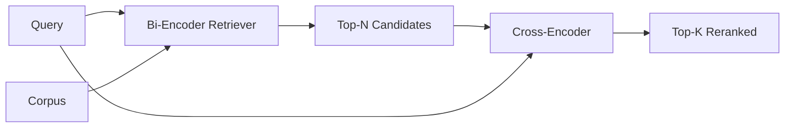

<!-- local-zh-machine-draft: English source is canonical; prose translated automatically, code/math preserved. -->

<a id="cross-encoder-reranker"></a>

# 基于 Cross-Encoder 的 Reranker

> 双 -encoder 独立嵌入查询和文档。encoder 把它们混为一谈,同时读取这两个encoder 是最聪明的读者 也是最慢的读者encoder顶级的,它自己付钱。

**类型：** 构建
**语言:** Python
**先修要求:** 第11阶段课程06(RAG),第11阶段第07课(高级) RAG; 轨道B基金会19阶段(教训20-29); 课程65(hybrid retrieval 供养这个阶段)
**时间：** ~90 分钟

<a id="learning-objectives"></a>

## 学习目标
- 区别一个双 -encoder 十字架上的检索器...encoder reranker 以他们的输入形状, parameter 数,每个餐具的费用。
- 执行一个小交叉encoder 从头开始 transformer 块,它会消耗一个包装(询问、文档)序列并释放一个相关量的弧。
- 双级回收和重置管道: 以廉价的回收器回收上N, 将 N 重新排序为顶K 与十字架-encoder,返回K。
- 测量一个小固定体的延迟度质量权衡,并选择给定的延迟度预算的右下角。

<a id="the-problem"></a>

## 问题

双 -encoder 将查询和文档映射到同一个矢量空间, 按余弦排列 。 这两个编码从不互相看到 。 该模型必须将文档的所有有用内容压缩到一个单一的矢量中, 无法看到查询 。 这是快速的 - 一个 embedding 每一个文档在索引时间,每个查询时间一个,这是排在星体尺度上的唯一方法。

成本是精确的。 两份文件的总主题差不多相同。 embeddings 即使其中一人回答询问,而另一人不回答。encoder 无法分辨

十字架... 十字架...encoder 将查询和文档一起读取,以此解决这个问题。 `[query] [SEP] [document]` 以单行顺序运行, 满载 attention 横跨连结,产生一个相关性标语。 token 文档中可处理 token 。该模型以全局来决定得分。

成本是输送,在...encoder 嵌入一次,问永远,交叉...encoder 每对( 询问, 文件) 运行一次。 对于1000万个文件, 也就是1000万个文件 forward passes 每个查询。 请求预算无法运行 。

溶液正在形成,用双...encoder 来获取顶部- N。 使用十字架 --encoder 将 N 重新排到顶部。 N 很小( 50 到 200) , 交叉encoder质量电梯集中在重要的地方。总延迟时间在申请预算内。总质量是交叉的 --encoder质量, 被双 -encoder记得N

<a id="the-concept"></a>

## 概念



<a id="the-cross-encoders-input-shape"></a>

### 十字架... 十字架...encoder输入形状

标准包装是 `[CLS] query_tokens [SEP] document_tokens [SEP]`。CLS-位置输出输入一个线性头,以输出相关标量。有些执行使用平均集合而不是 CLS;差别很小。关键是模型产生一对数字。

22M - 22M - 22M - 22M - 22M -parameter cross-encoder (发表日期:2004年1月1日) `ms-marco-MiniLM-L-6-v2` weight 类)是典型的生产点。小模型的品质损失比它们保存潜伏时间更快。更大的模型(例如,小模型) `bge-reranker-v2-m3` 568米时 parameters)保留给离线排行或K小处的第一页排行。

<a id="why-this-lesson-trains-a-tiny-one"></a>

### 为什么这课会训练一个小的

真正的十字架... ...encoder 是一个细微的 encoder transformer。在生产过程中,您装入a checkpoint 来运行。在这个课程中,目标是展示模型的形状和 潜值质量曲线的形状,而不是训练一个最先进的排级员。所以我们建造了一个小的 `nn.Module` 以一个 transformer 块, 多头 attention 和一个回归头。 它由种子初始化决定, 因此演示可以复制, 没有 weights 磁盘上。

玩具模型从固定体中学习正确的形状:相关查询文件对的预测分数高于不相干对。端对端管道将双-级重新排档,encoder输出和重排的顶端与黄金标签相关。

<a id="latency-vs-quality"></a>

### 延迟与质量

两阶段输油管有一个可捕捉的鱼:N. Sweep N. 5至100在悬置查询器上,你得到曲线。

| 氮 | 重回第2阶段@ 1 | Cross-encoder forward passes 每个查询 | 延迟 |
|---|--------------------|---------------------------------------|---------|
| 5 | 0.62 | 5 | 低 |
| 20 | 0.81 | 20 | 中等 |
| 50 | 0.86 | 50 | 高 |
| 100 | 0.86 | 100 | 很高,很高的,我... ... |

上面的数字是形状的表示, 不是从这个固定点上测量。 形状是真实的。 总是有大约20到50个候选人的膝盖, 在那里, 重新排列提高饱和度。 在膝盖过后你一分钱都付不起。

从逆向曲线加上潜伏预算中选择 N。encoder 无法唤醒回忆encoder记得N,所以低N盖质量, 而不仅仅是潜伏。

```figure
rerank-funnel
```

<a id="build-it"></a>

## 动手实现

`code/main.py` implements:

- `CrossEncoder` - 一点点 `torch.nn.Module`: token embedding,一个 transformer 带多头的块 attention 和饲料前, 卑鄙的集合头 产生一个卡勒。
- `tokenize_pair(query, document)` - 将两个字符串打包成一个单代号序列,带有标明边界、确定性和标准性等类型的代号。
- `train_tiny(pairs)` - 一份由监督人员监督的培训,列在一个手贴标签(询问、文件、相关性)的三重名单上,因此模型在固定位置上得出合理的分数。
- `rerank(query, candidates, top_k)` - 制作界面。
- `pipeline(query, retriever, top_n, top_k)` - 两阶段的流
- 演示 `main()` 并同时打印出两个列表 并报告每个阶段的潜伏情况

运行：

```bash
python3 code/main.py
```

输出显示双 -encoder头号,N,十字架...encoder和时间摘要。encoder 需要更长的时间,但并不在完整数据中。 两阶段的总金额在请求预算内,同时选择答案是:encoder 排名第二或第三

<a id="failure-modes-the-demo-will-hide"></a>

## 演示会隐藏失败模式

**Cross-encoder 并不是对称的。** `rerank(q, d)` 和 `rerank(d, q)` 不同的分数。 总是先填入查询。 如果您不小心换掉, 请记住崩溃 。

**N太低了,无法暴露错误。** 如果你设置了N=K, 十字架...encoder 无法重排序; 它只能重排。 电梯看起来是零。 选择 N 至少为 K 三倍 。

**训练数据渗入了评估** 如果手贴训练配对包括了评估查询, 重新排序看起来就很神奇。 严格地分开列车和评估, 即使是固定的。

**Production weights 密度很高** 22M - 22M - 22M - 22M - 22M -parameter cross-encoder 是在浮点32时为 88MB。 在承诺 sub- 100 ms p95 前, 请先规划模型服务器的内存 。

**接头很重要** 真正的十字架... ...encoder 将N候选人分成一组。 `_batch_encode`,以构建批量代号及类型代号 tensors 与 `torch.tensor(...)` 运行一个 forward pass。在 N 之前跳过批量和延迟度倍增。

<a id="use-it"></a>

## 实际应用

生产模式:

- 双 - 双encoder交叉点encoder和 N 一起修改任何一项,都会使评估无效。
- 缓存 reranker输出为( 查询, 文档)_i) hash. 同样的对稳定体的查询, 重新排序为同一顺序; 缓存点击会为你购买一个免费的延迟时间。
- 记录一等十字架encoder 。 上一分低于特定体位阈值的查询是场外撞击; 向 LLM 说"我毫无信心"

<a id="ship-it"></a>

## 交付成果

68课评估了两阶段输油管的终点 reranker 混血儿的回收器后面 和答案生成器前面的第65课 reranker 是端对端系统的第二阶段。

<a id="exercises"></a>

## 练习

1. 将 N 从 5 扫到 50 , 并绘制重排输出的回溯@ 1。 找到这个固定的膝盖 。
2. 训练十字架...encoder 以10个时代而不是1个时代来测量正对和负对之间的分差 epoch.
3. 将平均共享替换为 CLS-token 将这个固定点的趋同比较 。
4. 加上第二个交叉点...encoder 头上预测二进制“是文档中的答案”标签。使用两个头 inference;一个排到排到第一级,一个排到最低点。
5. 替换确定性模拟双encoder 与第65课的一和 连锁两个阶段。 测量上K相对于双K的变化encoder alone.

<a id="key-terms"></a>

## 关键术语

| 术语 | 人们怎么说 | 它实际上意味着什么 |
|------|-----------------|------------------------|
| Bi-encoder | "维特·雷克特·莱克特" | 独立编码查询和博士; 余弦排序 |
| Cross-encoder | "Reranker" | 合并编码( 查询, doc); 输出一个相关标量 |
| 两阶段输油管 | 重新定位 | 廉价取回器返回 N, 贵重 reranker 保留 K |
| N(可计量的预算) | 重新定位游泳池 | 候选人人数encoder 每个查询的分数 |
| 平均合用头 | "最后隐藏的海洋" | 平均 encoder将最后一层输出变成一个矢量 |

<a id="further-reading"></a>

## 进一步阅读

- 诺盖拉,周,"帕塞吉重新排名 BERT",2019年 - 银河十字架...encoder 升降纸
- 莱默斯,格列维奇,"圣安登斯...BERT:句子 Embeddings 使用暹罗语 BERT-网络,2019年 -双encoders 横跨encoders
- [句子转换者交叉Encoders documentation](https://www.sbert.net/examples/applications/cross-encoder/README.html)
- [BGE Reranker v2 model card](https://huggingface.co/BAAI/bge-reranker-v2-m3)
- 第19阶段,第65课 - 混合提取器喂食这个重新排序的阶段
- 第19阶段,68课 - 测量这次重排的升降的反弹
