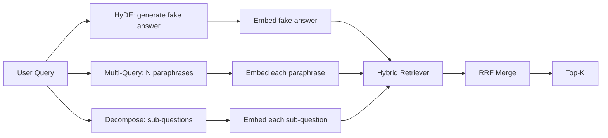

<!-- local-zh-machine-draft: English source is canonical; prose translated automatically, code/math preserved. -->

<a id="query-rewriting-hyde-multi-query-and-decomposition"></a>

# 查询改写：HyDE、多查询与查询分解

> 用户类型不是您检索器想要的查询。 在检索前重写间隔, 这样索引可以看到更接近答案的外观 。

**类型：** 构建
**语言:** Python
**先修要求:** 阶段11 课程04(embeddings), 06 (RAG;第19阶段B基础(20-29项);第19阶段经验教训64和65
**时间：** ~90 分钟

<a id="learning-objectives"></a>

## 学习目标
- 执行假想文档 Embeddings (HyDE):生成一个假的答案, 嵌入它, 获取到该矢量而不是查询矢量 。
- 执行多查询扩展: 将一个查询重写为 N 参数, 与每个参数重新获取, 合并到联盟 reciprocal rank fusion.
- 执行查询分解:将复杂的问题分为子问题,每个子问题检索,合并。
- 比较三个编稿人头 在一个固定的,解释 当每一个策略获胜。
- 编织一个假的 LLM 产生确定性、 固定性输出, 这样重写循环就断线了 。

<a id="the-problem"></a>

## 问题

用户类型“ 上传失败和预算取消时, 我们团队会做什么?” 。 文稿中包含一个文件, 上面写着“ Abort MultipartOnFail 中止在飞行中的 S3 多部分上传并减少每桶的重量 ” retry budget 上传失败时”。查询和文档不共享名词句。 BM25 小姐,双...encoder 将文档的第三或第四级排序,因为查询矢量位于 embedding 空间,它更喜欢关于取消任务的文档,而不是关于中止上传的文档。如果位于北端,则从第66课中重新排序两阶段可以挽救答案,但如果它甚至达不到北端, reranker 永远看不到

修正是重写查询, 然后再碰取器。 2023 年的纸“ 预览” Zero-Shot Dense Retrieval 引入 HYDE: 询问 LLM 写入解答查询的文件,嵌入假设文档,并使用 embedding 的向量。假设文档位于 embedding 空间,因为它是写在 文体的声音中。 查询矢量没有 。

与 HYDE 配对的双表层技术。 多查询扩展( Microsoft 的 GraphRAG 术语) 生成了查询的N 参数, 然后与每个查询并检索, 然后合并。 分解( 在2024年斯坦福 DSPy 工作中被作为“ 子组分解” ) 将“ 我们团队在上传失败时做什么, 而预算也消失了” 分成两个问题 : “ 当上传失败时会发生什么” 和 “ 当上传失败时会发生什么 ” retry budget 两次检索,一次合并结果, 两种答案都可达到。

这堂课能让所有三个人 都与同样的固定体相适应

<a id="the-concept"></a>

## 概念



<a id="hyde-in-detail"></a>

### 详细 HYDE

HYDE 将用户的查询矢量替换为 LLM- 撰写假想文档矢量。 prompt 简称 :

```
You are a domain expert. Write a one-paragraph passage that answers the question
below. Use the same vocabulary and phrasing the documentation in this domain would
use. Do not refuse. Do not say you do not know.

Question: {user_query}

Passage:
```

该 LLM答案是错误的,因为 LLM 检索者并不关心事实的正确性,只是 token 分布。 假设段落包含“ 破坏”、“ 多部分”、“ 桶”、“ 预算” , 因为这是一个关于这个主题的文件段落会说的。 嵌入了该通道。 矢量在真实通道附近降落 。

制作时,假设文件最多只能有两三句。较长的假设收集更多的噪音。较短的假设会失去HYDE的词汇信号。

<a id="multi-query-expansion-in-detail"></a>

### 多询问扩展细节

生成用户查询的 N 参数句。 最简单的 prompt:

```
Rewrite the following question in {N} different ways. Each rewrite must preserve
the original intent. Number them 1 to {N}. Do not add explanations.
```

获取每个参数的顶点 。 将 N 排名列表与 RRF 合并( 与课程 65 中的算法相同 ) 。 低劣、 平行、 确定性 。

当用户的语法是许多同样有效的提问方式之一,而任何重写者都会更强烈地要求它时,多询问就会获胜。 在所有重写都同样糟糕的时候,失败是因为原写方式同样糟糕。

<a id="decomposition-in-detail"></a>

### 详细分解

单次检索无法满足多面问题。 LLM 将问题分为子问题,系统每个子问题都检索。 prompt:

```
The following question may require information from multiple distinct topics.
Decompose it into a list of sub-questions. Each sub-question must be answerable
independently. If the question is already atomic, return it unchanged.

Question: {user_query}
```

获取每个子问题。 合并。 分解是包含连线、 多格比较或两个无关主题的问题的正确工具。 原子问题错误的工具; 解构者的工作是返回单个问题而不是编造假子问题 。

<a id="why-all-three-exist"></a>

### 为什么所有三个都存在

这三个是互补的,HYDE连接了查询体 token 多查询覆盖参数差异。 分解包含多主题查询。 一个生产系统运行所有三个选项, 并选择每个查询的战略( 69 的端对端系统显示选择器 ) 。

<a id="the-mock-llm"></a>

## 嘲笑 LLM

课不通,假的 LLM 是一个小的查询表,键入用户查询,加上一个未看到的查询的后退。

- 每个固定查询:一个书面假设段落、三个句子和分解。
- 对于未知的查询: 确定性转换: 取取查询的内容单词, 通过同义地图扩展它们, 然后返回结果 。

模型的形状是最重要的, 而不是数据。 在制作时, 您将模型转换成真正的模型调用。 检索器不会改变 。

```figure
cd-hyde-vector
```

<a id="build-it"></a>

## 动手实现

`code/main.py` implements:

- `MockLLM` - 上文提到的决定性的定点。
- `HyDERewriter` - 打电话 LLM 将重写输出返回为 `RewriteResult` 使用假设文本和查询,检索器应该使用。
- `MultiQueryRewriter` - 打电话 LLM 将 N 引言,返回查询列表。
- `DecomposeRewriter` - 打电话 LLM 来分解,返回子问题。
- `retrieve_with_rewriter` - 重新写和检索, 运行重写, 连接结果。
- 一台演示,用固定和打印的 三个重写器操作, 战略首先返回金答录。

回收器形状从课程65( 混合) 中被重新使用 BM25 组合是相同的RRF。唯一的新形状是小的重写界面。

运行：

```bash
python3 code/main.py
```

输出为按部就班的排序和最后摘要。 HYDE 赢得了语法匹配查询。 多拼写取在参数变换查询中获胜。 分解在多主题查询中获胜。 退步( 没有重写) 至少会损失其中之一 。

<a id="failure-modes-the-demo-will-hide"></a>

## 演示会隐藏失败模式

**HYDE 系统特定体的识别特征错误。** 模型发明了一个函数名称。 BM25 右侧的医生崩溃得分 因为发明的名字现在很高weight token 将假设的长度和 weight BM25 低点的聚变。

**多个拼写重写 全部集合 。** 弱型号生成三个近似相同的参数。 N 检索返回相同的顶部。 RRF 合并并不比一次检索好。 给重写添加明确的多样化指令 prompt 并用杰克德探测到重复

**分解过量的分解** 解组合器将原子问题转换成列表。 检索时都返回同一文档, 但级别降低。 合并比原始更糟糕。 在扇形外出前先用“ 这些子问题是否足够明确” 来检测它 。

**长处倍增** 水利能源公司费用一 LLM 电话,多询问费用一 LLM 调用以生成 N 重写, 然后 N 检索。 分解成本 1 LLM 调用分解, 然后取回 M。 检索平行运行; the LLM 电话是地板。

<a id="use-it"></a>

## 实际应用

生产模式:

- 逐个询问选择策略:原子短问会多询问,复杂的多询问会分解,术语重询问会得到 HYDE 。
- 通过查询 hash 缓存重写输出。 许多查询重复 。
- 将所有三个结果平行运行,并将三个结果与RRF连接。 LLM 电话和一次聚变;质量是所有三项战略的覆盖面的结合。

<a id="ship-it"></a>

## 交付成果

69课,这段重写阶段 在65课和 reranker 课程68评价了重写的电梯 增加了检索回溯。

<a id="exercises"></a>

## 练习

1. Implement RAG- 法斯翁(一种2024的多问变体),其中重写方言有意加以改动,然后改顺序(第66段)选择最后清单。
2. 增加第四个战略:后退推动(询问 LLM 比较固定。
3. 训练解构器通过添加“ 是问题原子” 头来识别原子查询。 测量前后过度使用率 。
4. 替换模型 LLM 测量你的书架上的潜伏状态
5. 添加每个重写的置信分数。 将重写值降低到阈值之下。 测量对回调的影响 。

<a id="key-terms"></a>

## 关键术语

| 术语 | 人们怎么说 | 它实际上意味着什么 |
|------|-----------------|------------------------|
| HyDE | "伪造文件检索" | LLM 写入答案; 嵌入并检索到该答案, 而不是查询 |
| Multi-query | 拼写扩展 | 查询的重写; 检索 N 次, 由 RRF 合并 |
| Decomposition | 补丁分开 | 多专题查询分为分问题,分别检索 |
| 原子查询 | "Single-topic" | 无法解构不制造假子问题 |
| Step-back | "抽取查询" | 问一个更一般的问题,检索,然后缩小 |

<a id="further-reading"></a>

## 进一步阅读

- 高,马,林,卡兰,"准备 Zero-Shot Dense Retrieval 2023年无相关性标签(HyDE)
- 微软研究,“回收的多查询扩展”
- 斯坦福DSPy,“多功能QA的子集分”
- [LlamaIndex 查询转换文档](https://docs.llamaindex.ai/en/stable/optimizing/advanced_retrieval/query_transformations/)
- 第11阶段课程07-高级 RAG patterns
- 第19阶段课程65 - 检索器, 重写此种子
- 第19阶段,第68项----衡量重写电梯的估价
