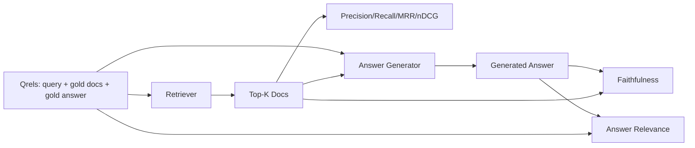

<!-- local-zh-machine-draft: English source is canonical; prose translated automatically, code/math preserved. -->

<a id="rag-evaluation-precision-recall-mrr-ndcg-faithfulness-answer-relevance"></a>

# RAG Evaluation：精确率、召回率、MRR、nDCG、忠实度与回答相关性

> 如果您无法同时分级您的检索和答案, 您就不能同时发送系统。 两者不是相同的测量标准 prompt 不同的轴都失败了

**类型：** 构建
**语言:** Python
**先修要求:** 阶段11课程06(RAG), 10 (evaluation;第19阶段B基金会(20-29项);第19阶段经验教训64、65、66、67
**时间：** ~90 分钟

<a id="learning-objectives"></a>

## 学习目标
- 计算从金格数中提取的四度测量数: 精确度@ k, recall@k,MRR(平均对等级别)和nDCG@k。
- 计算两个回答等级的衡量标准:忠诚(根据检索到的背景提出的每一项要求)和回答的相关性(答案是针对问题)。
- 构建一个折叠的 qrels 文件( 拼贴、 金 doc ids、 金答词) , 使 evval 读作结尾 。
- 读取测量值以诊断管道失灵之处:检索、排位、生成或 grounding.

<a id="the-problem"></a>

## 问题

一个 RAG 系统至少有四个移动部件:块块、检索器、 reranker任何一种都可能导致错误的答案。没有每个阶段的测量,你就会失明。

用户报告错误答案。 是因为块块切开答案的宽度吗 ? 是因为检索器没有包含上方的块吗 ? reranker 将右块推过位置 ? 是因为生成器忽略了块, 并编造了东西吗 ? 您无法单独从答案中辨别 。 您需要 :

- 检索器的分级标准
- 排到分数的顺序
- 忠实地评分发电机是否停留在回收的环境之内。
- 回答是否涉及等级问题。

此课将所有 6 个建在固定 qrels 文件之上。 evval 是离线和确定性; 在制作中您要交换模型 LLM- 真正的法官

<a id="the-concept"></a>

## 概念



<a id="precisionk"></a>

### 精度@k

在最上面的文档中, 检索器返回了, 金集中的分数是什么? 如果金有三张文档, 顶层的三张返回两张, 错误的一张, 精确度@ 3 是 2 / 3. 当一个不相干回收块的成本高时使用精确度( 生成器废版) tokens 或块毒 答案)。

<a id="recallk"></a>

### Recall@k

在黄金文档中, 最大 K 中的分数是什么? 如果金有三张文档, 且前 5 张包含全部三个文件, 请记住@ 5 是 1. 0。 使用提醒值时, 未找到答案的成本会很高( 您宁愿看到一个额外的错误块, 而不是完全错过答案块 ) 。

生产中 RAG 通常的衡量标准是 recall@k。代际可以很容易地减少无关的块;它无法从从未见过的块中发明答案。

<a id="mrr-mean-reciprocal-rank"></a>

### MRR（平均倒数排名）

对于每个查询, 请在排名列表中找到第一个相关文档的位置。 对应的级别是 1 / 位。 在查询集中的平均位置。 MRR 是检索器在顶部给出最佳答案的单数摘要 。

MRR weights 一级黄金博士的查询提供1.0。二级提供0.5。第十级提供0.1。衡量标准由名单中最高级者决定。

<a id="ndcgk"></a>

### nDCG@k

普通化贴现累积收益。 完整的公式为每个检索的文档分配收益( 通常相关文档为 1, 相关文档为 0) , 按位置、 总计和理想 DG 差数的日志的折价值( 如果排列得当的话, 则您将拥有 DCG )。 范围 0 到 1 。

NDCG符合分级相关性:黄金可以说“A号医生为3,B号医生为2,C号医生为1”。 recall@k 将所有文件平整为二进制。 当每份查询都包含多个部分相关的文件时, 请使用 nDCG 。

<a id="faithfulness"></a>

### 忠诚

答复中的每项索赔,请检查索赔是否得到检索的背景的佐证。 LLM-as-judge prompt 标准是通过的索赔的分数。

信条性会捕捉到生成器发明内容的生成失败模式。 即使检索器返回了右块, 幻觉的生成器也会被打破。 信条性也被称为禁闭、 支持、 归属 。

课程通过一位确定性模拟法官来落实忠诚,该法官负责检查每项索赔是否都属于 tokens 将回收的上下文与阈值相重叠。在生产中,您可以转换为真正的模型调用。测量的形状是一样的。

<a id="answer-relevance"></a>

### 回答相关性

答案是否真的针对了问题? 忠诚问道“ 答案基于上下文吗? ” 。 回答相关性问道“ 答案基于问题吗? ” 。 忠诚但非主题的回答在忠诚和相关性上得分很高,低。 简短的、专题的回答忽略了上下文,在相关性上得分高,而忠诚度低。

标准实施也使用 LLM- 判决: 回答问题, 问答案是否解决问题。 token- 超额加法官

<a id="the-fixture-qrels"></a>

## 固定的 qrels

```python
{
  "qid": "q1",
  "query": "what is the abort threshold for multipart uploads",
  "gold_doc_ids": ["d1", "d3"],
  "gold_answer_substring": "three failed parts",
  "graded_relevance": {"d1": 3, "d3": 2},
}
```

每个查询都包含:
- 查询字符串,
- 一套金文档代号(精确度/回溯/转录),
- a 级相关性(用于国家发展合作集团),
- 金答子字符串( 以参考元数据形式在每平方公尺上进行选择; 此课的忠诚性是通过根据检索的背景而不是此子字符串来判断提取的主张来计算的 )

制作过程中,你贴上这些标签。这个课上装了个手工制造的固定装置,所以反弹器就用完了。

```figure
ci-rag-metric-ladder
```

<a id="build-it"></a>

## 动手实现

`code/main.py` implements:

- `precision_at_k(retrieved, gold, k)` - 字面定义
- `recall_at_k(retrieved, gold, k)` - 字面定义
- `mean_reciprocal_rank(retrieved_list_of_lists, gold_list)` - 问问题时的刻意
- `ndcg_at_k(retrieved, graded_relevance, k)` - DCG/IDCG,二进制或分级增益。
- `extract_claims(answer)` - 将答案分成句状索赔
- `faithfulness(claims, context_texts, judge)` - 被裁定为有支持的主张的一小部分。
- `answer_relevance(question, answer, judge)` - 判断答案是否解决问题。
- `MockJudge` - 决定性 token- 法官过重,所以反弹器就断线了
- `evaluate_pipeline(pipeline_fn, qrels, ks)` - 管弦乐队负责所有测量仪
- 一种可运行三种管道变体的演示(Chunker基准, hybrid retrieval,混合+重排)对准qrels 打印一个度量表。

运行：

```bash
python3 code/main.py
```

输出显示精度@ k, recall@k,MRR, nDCG@k, 忠诚度,以及每个变量在单一度量表中的回答相关性。 hybrid retrieval 行在回溯时跳过块状基线; 重新排序行跳过混为一变的 MRR 。

<a id="reading-the-metrics-to-diagnose-failures"></a>

## 阅读诊断失败的衡量标准

| 症状 | 可能的原因 | 怎样修补 |
|---------|-------------|-------------|
| 低 recall@k, 精度低@ k | 弹夹切开答案,否则检索器找不到 | 弹出器边界( 缩放器64) 或检索器 modality (第65项) |
| Decent recall@k低 MRR 键 | 右侧块在顶部, 但没有位置 1 | Reranker (第66项) |
| 高核辐射率,低忠诚度 | 生成器在正确环境下发明内容 | Generation prompt; 强制-刻度或反作用力 |
| 高度忠诚,低相关性 | 答案是禁断的, 但脱离主题 | 查询重写(第67条)或代号 prompt |
| 四高,用户还在抱怨 | Eval set 不具代表性 | 使用真实用户查询扩展 qrels |

<a id="failure-modes-the-demo-will-hide"></a>

## 演示会隐藏失败模式

**LLM- 以法官的偏见** 模型判断自己的产出比它们更加忠诚。 法官使用不同于生成器的模型,或者用手级样本来判断。

**克里尔斯腐烂。** 金子回答随着体质的变化而漂移。 2024年1月的黄金文件在 q1 中已经不再是2024 年10月的正确答案, 因为团队重新命名了此功能。 计划季度的qrels 检查 。

**忠诚的微观检查 错过宏观索赔。** 句号的忠诚性可以通过,而总体答案的结构却误导了人们。在自动测量标准之上添加一个抽样质量审查。

**Recall@k 防伪器故障** 平均回调90%可以隐藏一个查询类总是漏掉。 通过查询类( literal、 spollard、 多主题) 切除 qrels 并报告每个切片 。

<a id="use-it"></a>

## 实际应用

生产模式:

- 运行每个检索器或发电机的变换的反响。 请使用 recall@k 回归像测试失败。
- 坚持标准 trace 查询。当用户投诉时,请查看匹配的 qrels 条目,看看是否被捕获 。
- 调高底线:一组20个烟雾查询,在CI中运行;一组200个反射,在夜间运行;一组2000个深层的每周运行。

<a id="ship-it"></a>

## 交付成果

69课 整个管道都连接起来 reranker,并运行这个评估 相对于端对端系统。

<a id="exercises"></a>

## 练习

1. 添加第五个检索度量: hit-rate@k。 比较它 recall@k解释它们的不同之处。
2. 执行分级忠诚:0(未支持)、1(部分支持)、2(完全支持)。
3. 用真正的模型来代替模拟法官。 测量模型和真实法官之间在固定上的分歧。
4. 添加查询类切片 (“ literal”、“ 参数” 、 “ 多位元 ” ) 。 报告每切切片的量度 。
5. 添加一个“ 回答长度” 度量, 并将其与忠诚联系起来。 绘制曲线 。

<a id="key-terms"></a>

## 关键术语

| 术语 | 人们怎么说 | 它实际上意味着什么 |
|------|-----------------|------------------------|
| 精度@k | "重击率超过回收量" | 金色的K型小数 |
| Recall@k | "比金子高的速率" | 黄金在顶部的分数 |
| MRR | "第一击位置" | 第一相关文件的平均值 1/ 级 |
| nDCG@k | 高档排名质量 | 由理想的 DG 分隔的顶部 DG |
| 忠诚 | "Groundedness" | 得到检索到的上下文支持的答题分数 |
| 回答相关性 | "它解决了问题吗?" | 答案是否与问题的意图相符 |
| Qrels | "黄金标签" | 标签的查询集及其金色文档和答案 |

<a id="further-reading"></a>

## 进一步阅读

- 巴克利,沃尔西,"评价 Evaluation 衡量稳定性,SIGIR 2000-关于排名指标的金字塔文件
- 贾维林,凯卡莱宁,"以累积收益为基础 Evaluation 国家建筑和工程研究所的论文
- [Ragas: 自动 Evaluation 的 RAG Pipelines](https://docs.ragas.io)
- [Anthropic,引入上下文检索](https://www.anthropic.com/engineering/contextual-retrieval) - 分数检索, 1减去回溯@ 20
- 第11阶段课程10 - evaluation 框架基础
- 第19阶段课程 64-67----在此评估的组成部分
- 第19阶段课程69 -- -- 期末至期末的这一评价等级
