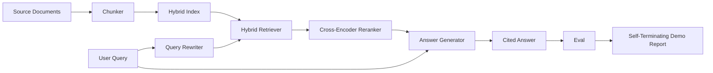

<!-- local-zh-machine-draft: English source is canonical; prose translated automatically, code/math preserved. -->

<a id="end-to-end-rag-system"></a>

# 端到端 RAG 系统

> 六个组件的课,一个管道,一个反弹环,一个自我终结演示,这是你所携带的系统。

**类型:** Build
**语言:** Python
**先修要求:** 阶段11课程06(RAG), 10 (evaluation;第19阶段B基金会(指标20-29);第19阶段课程64、65、66、67、68
**时间:** ~90分钟

<a id="learning-objectives"></a>

## 学习目标
- 拼写块,混合检索器,查询重写,交叉encoder reranker,并回复发电机 成单一端到端管道。
- 使用一个按块锚表示其主张的回答生成器, 并进行低信任度拒绝回击。
- 利用68号评估课来对装配的管道进行测试 证明经过演练的建筑能独立地 以每个测量标准 来赢得对同一部件的胜利
- 建立一个自封的 CLI 演示, 以吸收固定的柱状, 运行一个固定的查询集, 并用摘要报告从零退出 。

<a id="the-problem"></a>

## 问题

单独地六个部件无法证明任何。 块块可以在回溯@ 5 上赢得对子体的回溯, 并在系统回溯@ 5 上丢失, 因为检索器不能排位块块所释放的东西。 The body can win on recall@ 5 against the system's recall@ 5 because the recreter cannot richer shorts the buller issions. reranker 可以在合成候选池上提升磁共振encoder 候选人,因为双 -encoder重置预算时的回想太低。 查询重写器可以在单次查询中宣传黄金文档, 并打破下一选项 LLM 假的又回到了堕落的假设

整合测试是整个管道的终点, 与同一条固定的qrels, 以相同的测量标准, 由一个管弦文件将所有东西连接在一起。 这就是这个教训所构建的。 如果集成管道上的测量标准比每个阶段的孤立演示中的测量标准要强, 您已经证明了系统 。

<a id="the-concept"></a>

## 概念



<a id="wiring-choices"></a>

### 线性选择

管道是一个小图。 每个阶段都有明确的签名。

| 舞台 | 输入 | 输出 |
|-------|-------|--------|
| Chunker | 文档文本 | 块记录列表 |
| Retriever | 查询字符串 | 上N块记录 |
| 重写( 可选) | 查询字符串 | 重写列表+假设 |
| Reranker | 查询,候选人 | 具有交叉分数的K型顶部块记录 |
| 发电机 | 查询, 顶级 K 块记录 | 带引用的回答字符串 |

每一个签名稳定时,其构成是直截了当的。 `Pipeline` 班级持有五个阶段和a级 `query` 以顺序运行它们的方法。 每个阶段都可以互换: 通过不同的块、 检索器、 重写, reranker,或发电机和管道仍然运行。

<a id="answer-generator-with-citations"></a>

### 带引用的回复生成器

生成器是最后的阶段,也是最容易打破的。

1. 重排了上K的块
2. 选择最多两个文本包含最高内容的块-token 与查询重叠。
3. 回答是每个选择的堂堂一命 每一句后 `[doc_id:chunk_index]` anchor.
4. 如果没有块重叠超过垃圾阈值, 就会发出“ 我不知道” 而不引用 。

制作中,你把假货换成真货 LLM 打电话时 prompt template:

```
You are answering a question using only the snippets below.
Cite every claim with the anchor in parentheses.
If the snippets do not answer the question, say "I do not know".

Question: {query}

Snippets:
{enumerated chunks with anchors}

Answer:
```

拒绝低信任之路是十字架的原因encoder 记录了第1级的分数。 如果它处于质限以下, 生成器会拒绝。 这是针对幻觉回答的安全阀门 。

<a id="the-self-terminating-demo"></a>

### 自我终结演示

演示将全部运行到结尾。 它打印了每个阶段的查询分解, 将四个固定方块的反射线进行, 打印了一个度量表, 如果所有课程68 度数都符合演示中设定的阈值, 则退出状态为零 。 如果任何测量值低于阈值, 演示退出时将显示非零状态, 并发出一条标注失败的度量信息 。

这是CI的烟雾测试模式。 管道运行离线, 快速, 确定性。 阈值刻刻在固定上, 所以在六个课中的任何一课都出现回归, 无法演示 。

```figure
rag-pipeline-flow
```

<a id="build-it"></a>

## 动手实现

`code/main.py` implements:

- `Chunk` - 记录贯穿所有阶段(将课程64的形状与块相扩展)_索引和源码文档_id).
- `Chunker` - 从课程64中选择战略(默认递归拆分)。
- `HybridIndex` - 捆绑 BM25 + 密集+ REF,从第65课中得出。
- `Rewriter` (可选) - 选择 HYDE 、 多拼图、 从课程67分解 , 按查询长度和连接存在 。
- `Reranker` - 训练好的十字架...encoder 由66课, 使用一个较小的固定训练组 使它以秒趋同。
- `Generator` - 具有决定性的模拟生成器 引用和拒绝低信任。
- `Pipeline` - 组成五个阶段 `query(question)` 返回的方法 `Result(answer, top_k, latency_ms_per_stage)`.
- `run_demo()` - 摄入物质,运行三个固定查询,运行评估,打印结果,按门槛设定退出代码。

运行：

```bash
python3 code/main.py
```

输出为一个打印查询 trace,整个反射表和最后的出入/故障状态。返回固定上的退出代码 0。

<a id="failure-modes-the-demo-will-hide"></a>

## 演示会隐藏失败模式

**奇异的边界漂移** 如果您在 Eval qrels 标签通道和演示之间交换块状策略, 金 doc id 不再排队。 将块状策略锁定在qrels 文件。 演示包含一个标有块状的页眉 。

**Reranker 训练设备渗入了评估** 课程66中的14个训练3个选项包括类似于 Eval 查询的查询。 在制作时,严格保留 Eval 查询。 演示的 Eval 查询有意与重新排序的训练脱节 。

**模拟生成器隐藏 hallucination risk.** 模拟无法产生幻觉, 因为它只从回收的块中释放文字。 课程指出这一点, 并指明了生产转换到真实模型的路径 。

**否 streaming.** 管道在每个阶段的结尾都返回完整答案。 生产系统将输送发电机的输出 。 Streaming 已经超出范围; 答案级的测量方法无论哪种方式都对最终字符串起作用。

**挂断了** 模拟 LLM 电话是固定时间 LLM 请求范围中计划一个潜伏预算;课程的每个阶段时间仅衡量 CPU work.

<a id="use-it"></a>

## 实际应用

生产模式:

- 将管道文件装在一个带子下, 并配有明确的舞台界面。 避免在重线上散布电线 。
- 在每次组合之前运行重现, 以切换一个阶段。 如果重现下降, 合并不会降落 。
- 坚持标准 trace 每个 CI 运行, 这样您就可以将回归属性归结为一个阶段交换 。
- 添加一组20个问题(回归集的子集),在30秒内运行;完整回归集在夜间运行。

<a id="ship-it"></a>

## 交付成果

此课中的管道文件是 rest 后期课程将增加吸收自动化、递增重指数、遥测和顶层服务。 检索、重新排序、重写和 Eval 一半在这里完成。

<a id="exercises"></a>

## 练习

1. 在重写中添加一个每个查询策略选择器:从课程67(长度、连线、行距比)中选取 HYDE、多查询或分解。
2. 添加一个真实的 LLM 调用导体在信封旗后, 默认为模拟, 测量延时三角形 。
3. 展出演示 `--corpus path` 重新运行 校对和门槛检查 。
4. 添加a `--strategy` 标记到块块。 测量每个战略对端对端的回溯的贡献 。
5. 添加a streaming 生成器接口并将其输入到 eval 中。 确认在最终字符串上而不是在流的前缀上计算忠诚度 。

<a id="key-terms"></a>

## 关键术语

| 术语 | 人们怎么说 | 它实际上意味着什么 |
|------|-----------------|------------------------|
| 管道 | "RAG pipeline" | 由摄入到引用答复的阶段构成 |
| 引用锚 | "来源链接" | 医生_ID, 块_每项索赔的参考文献 |
| Refuse-on-low-confidence | "我不知道" | 发电机在 reranker 上一分位居门槛值以下 |
| 烟雾集 | CI 评估 | 每一次公关检查都运行的最小 qrels 子集 |
| 阶段界面 | "功能签名" | 每一管道阶段的稳定输入和输出类型 |

<a id="further-reading"></a>

## 进一步阅读

- [Anthropic,建筑搜索和检索](https://www.anthropic.com/news/contextual-retrieval)
- [Pinterest, MCP 内部搜索](https://medium.com/pinterest-engineering) - 参考生产结构
- [Ragas: 自动 Evaluation 的 RAG Pipelines](https://docs.ragas.io)
- 阶段11 课程06 - RAG fundamentals
- 第19阶段的教训 64-68----此处构成的组成部分
