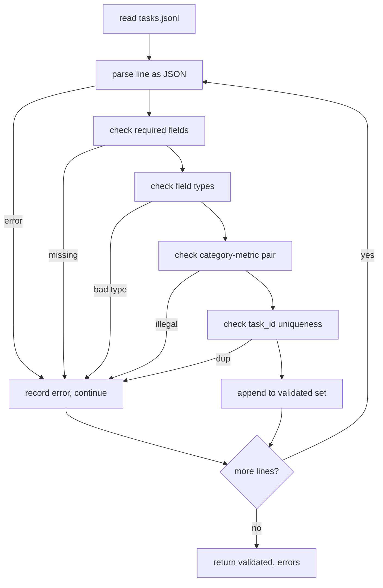

<!-- local-zh-machine-draft: English source is canonical; prose translated automatically, code/math preserved. -->

<a id="task-spec-format"></a>

# 任务规范格式

> 一次评估 harness 只能像合同一样好 任务履行。 JSONL 形状和度量 vocabulary 在您写入单次评分函数之前。

**类型：** 构建
**语言:** Python
**先修要求:** 阶段19 轨道B基金会
**时间:** ~90分钟

<a id="learning-objectives"></a>

## 学习目标

- 定义 JSONL 任务记录图,包括计算、多选取、代码执行、分类和以一个形状的文本摘要。
- 关上门 vocabulary 使下游课程(71-73)能够发送到一个单一的字段。
- Specify few-shot 示例和后处理规则作为任务的一部分,而不是运行者,所以相同 prompt 产生相同的目标 跨越模型。
- 执行严格的验证程序,在记录到达运行者之前拒绝记录。
- 装有十件固定装置的船 branch 检验结果显示 验证者有东西要嚼

```figure
ci-task-spec-gate
```

<a id="why-a-frozen-spec"></a>

## 为什么是冷冻的

研究代码库的积存速度将比累积测试快。 六个月后, 每个笔记本都有自己的 JSON 形状,每个度量都两次执行, 没有比对的参数。 修复是无聊的。 选择一个方案。 写一个验证符。 拒绝所有其他的。 这就是这个课程的作用 。

形状从大弹壳、 HELM 和 lm - Eval 风格中借用了想法 harnesses,但字段名称属于我们。每个字段都有单一的拥有者。运行者读取任务。测量值读取目标。后进程步骤使一代人正常化。没有字段是可变中管线。

<a id="the-record-shape"></a>

## 记录形状

任务就是 JSON 对象在单行。 harness reads `tasks.jsonl` 并独立验证每条线。 错误的线会中止记录, 而不是运行 。

```json
{
  "task_id": "arith_001",
  "category": "arithmetic",
  "prompt": "Compute the result. Question: 17 + 24\nAnswer:",
  "targets": ["41"],
  "metric_name": "exact_match",
  "few_shot_examples": [
    {"prompt": "Question: 2 + 2\nAnswer:", "completion": "4"}
  ],
  "post_process": "strip_whitespace",
  "metadata": {"difficulty": "easy"}
}
```

所需字段为 `task_id`, `category`, `prompt`, `targets`, `metric_name`, `post_process`. `few_shot_examples` 和 `metadata` 。未知的顶层字段失败验证 。

<a id="field-rules"></a>

## 外地规则

`task_id` 是一个无空白的字符串。验证符在文件上执行独特性。

`category` 是 中 `arithmetic`, `mcq`, `code_exec`, `classification`, `summary`。该类别限制哪种衡量和后处理对是合法。 `code_exec` 任务必须使用 `metric_name = code_exec` 和一个 `mcq` 任务必须使用 `metric_name = exact_match` 与单字母目标对着

`prompt` 是一个非空字符串。 验证符禁止尾随空白, 并拒绝已经包含 few-shot 中键 prompt body. Few-shot 使跑者发生,而不是作者。

`targets` 是一个非空字符串列表。 for `exact_match`,任何元素匹配的计数。 `f1` 和 `rouge_l`最高分的靶子获胜 `mcq`,该列表完全保留一个元素。

`metric_name` 是 中 `exact_match`, `f1`, `bleu_4`, `rouge_l`, `accuracy`, `code_exec`. 该 vocabulary 关闭。新的标准需要一个新的课程和一个新的条目。

`few_shot_examples` 是列表 `{prompt, completion}` 。 验证符将列表限制在 8 个条目以保持 prompts bounded.

`post_process` 是 中 `none`, `strip_whitespace`, `lower`, `extract_letter`, `extract_code_block`, `extract_first_line`。每项规则都有单一的确定性行为。有效者禁止将规则结合起来。

<a id="validator-behaviour"></a>

## 验证行为



验证符返回两个列表: 与违规行、 被违反的规则和字段有关的有效记录和错误记录。 如果错误列表不是空的, 则运行者拒绝启动 。 `--allow-bad-tasks` 旗帜已设。

<a id="few-shot-rendering"></a>

## Few-shot rendering

跑者会搭配 few-shot 示例 prompt 使用空白行分隔符。 每一个模型都使用相同的代码路径, 因此唯一的差异源是模型本身。 作者只写过一次示例, 而不是每个提供者写一次 。

```python
def render(task):
    parts = []
    for ex in task.get("few_shot_examples", []):
        parts.append(ex["prompt"] + " " + ex["completion"])
    parts.append(task["prompt"])
    return "\n\n".join(parts)
```

<a id="post-process-rules"></a>

## 程序后规则

后进程步骤是代代相传的,在衡量标准之前,是决定性的和无国籍的。

- `none` 返回字符串不变。
- `strip_whitespace` 带带和尾随的白空间。
- `lower` 小写字符串。
- `extract_letter` 返回匹配的第一个字符 `[A-E]`用于MCQ。
- `extract_code_block` 返回第一个三重栅栏块的体,用于代码执行。
- `extract_first_line` 返回用于摘要分类的第一个非空白行。

需要在此列表之外制定规则的任务属于新课程。

<a id="what-this-lesson-does-not-do"></a>

## 课程没有效果的

它没有得分,它不叫模型,它不运行代码。它们来自71、72和75课,这课冻结了它们全部履行的合同。

10任务固定符包含两个计算项目、两个MCQ项目、两个代码执行项目、两个分类项目和两个汇总项目。所有10个参数的验证符都通过一个单独的固定符( ) 。`tasks_bad.jsonl`) 运行每个规则,验证符返回错误完全相同。

<a id="how-to-read-the-code"></a>

## 如何阅读代码

`main.py` defines `TaskSpec`, `validate_task`, `validate_file`,并有一个 CLI 入口。固定装载器是 `load_fixtures`。转换和后处理助手在验证之后居住,因此,第75课的选手将进口一个模块。

Read `main.py` 上到下。 然后读取 `code/tests/test_spec.py`。测试将所有验证规则以及每一个进程后的行为都钉在了中间。 `main.py` 验证捆绑的固定点并打印摘要。

<a id="going-further"></a>

## 继续

真正的 Eval 套件会增加公式增长列的类别。 清醒的动作是拒绝添加一个类别, 而不会同时添加一个衡量标准、 一个后处理规则, 以及至少一个固定任务。 将这个设置当作数据库迁移。 每个更改都会被审查、 版本和测试。 此课中的验证符是门 。
