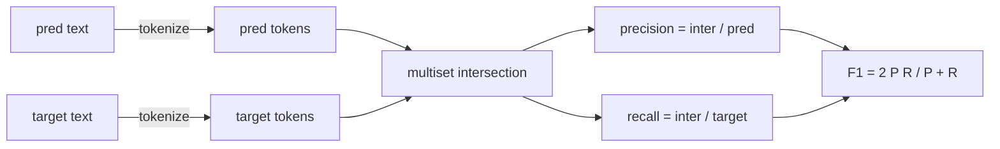
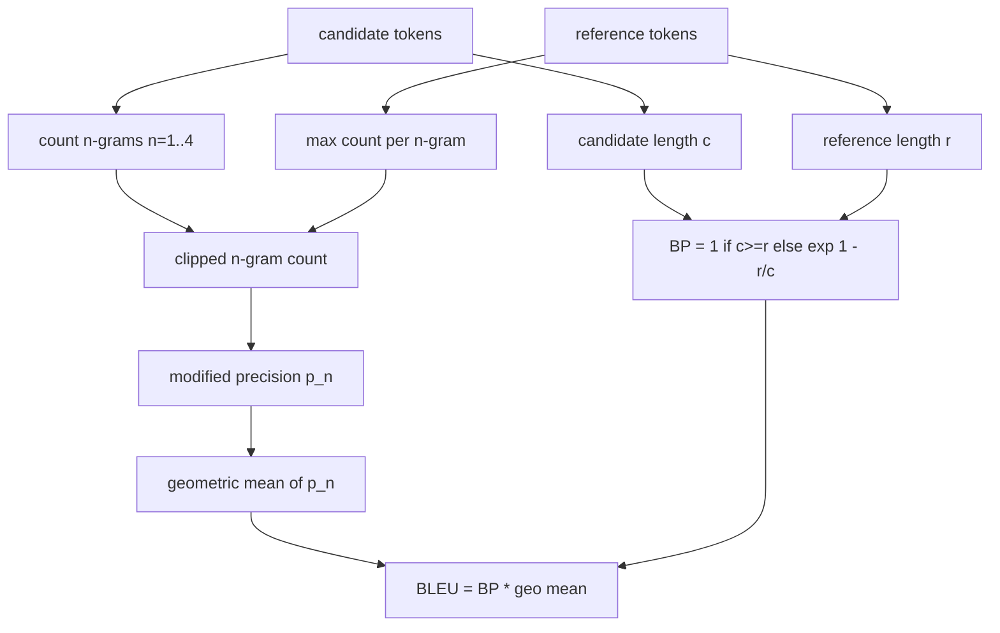

<!-- local-zh-machine-draft: English source is canonical; prose translated automatically, code/math preserved. -->

<a id="classical-metrics"></a>

# 经典评估指标

> BLEU, ROUGE-L,F1,准确匹配,准确度。五度测量仍然占大多数 LLM 执行每个原则,这样你就能知道数字意味着什么。

**类型:** Build
**语言:** Python
**先修要求:** 阶段19 轨道B基础,课程70
**时间:** ~90分钟

<a id="learning-objectives"></a>

## 学习目标

- Implement token- 准确匹配,F1, 和精确 与明确的象征性规则。
- 从地面上执行BLEU-4:修改的正克精确度, n 等于 1至 4 的几何平均值, 短程罚款。
- Implement ROUGE-L使用最长的常见后继, F比塔结合精确度和回溯。
- 发送公尺_70课的命名字段,让跑者保持测量性。
- 以参考矢量作为行为依据,取自工作实例,而不是第三方图书馆。

```figure
cd-bleu-overlap
```

<a id="why-reimplement"></a>

## 为何要重新执行

你会读那些BLEU28.3和另一个报告BLEU0.283的文件。 ROUGE-L分数在两个图书馆之间相差10个百分点,因为一个短写到小写,另一个则没有。 最快避免混淆的方法就是自己写出衡量标准,然后指出 tokenizer 平滑时间由决定,然后是平滑时间。 之后,对纸面之间的数字进行比较就成了阅读标准设置的问题,而不是争论图书馆。

调制版加 numpy 已经足够了,BLEU在数数,还有夹子 ROUGE-L是动态程序。F1是设置的交叉点 tokens选择 tokenizer 并承诺要这样做。

<a id="tokenisation"></a>

## Tokenisation

该 tokenizer 是 `re.findall(r"\w+", text.lower())`。小写、字母数字运行、标点。本课中的每个尺度都使用这个精确的 tokenizer。运行者没有选择权。如果您交换 tokenizers,你运行不同的基准。

```python
TOKEN_RE = re.compile(r"\w+", re.UNICODE)
def tokenize(text):
    return TOKEN_RE.findall(text.lower())
```

这是有意的简化。 生产设置将关注 CJK、 缩缩和代码标识符。 关键是该课程的要点是 tokenizer 是一个合同,而不是一个把手。

<a id="exact-match"></a>

## Exact match

```python
def exact_match(pred, targets):
    return float(any(pred.strip() == t.strip() for t in targets))
```

它返回每个任务1.0或0.0。 数据集上的合计值是平均值。 这是计算、 MCQ 和简短分类任务的计算马 。

<a id="token-level-f1"></a>

## Token- F1级

设置 token 用于预测和目标的多个集。精确度是多集交叉点,由多集预测部分分开。回溯是同一交叉点,由目标的多个集点分开。F1是调和平均值。执行时处理空预和空目标边缘。



对于多目标任务,我们采用最佳F1,这与文献中广泛报道的SQUAD型的行为相符。

<a id="bleu-4"></a>

## BLEU-4

BLEU是金字塔机器翻译的测量标准, 并且仍然在总结工作中显示出来。 我们使用的配方是按标准短写罚款和添加剂1平滑的BLEU-4, 使得一个缺失的4克不会将分数推到零。

对于每个候选参考配对,我们计算修改的 n克精确度为 1, 2, 3, 4. 任何引用中, 修改过的精确度剪短, 以该 n克的最大数表示候选人的n克精确度, 这样候选人无法重复一个短语来加速。 四个精确度的几何平均值由简洁性罚款包扎 。



平滑规则是Lin和Och称为方法1:在记录之前,在每个 n 克精确度的分子和分母中添加一个。这避免了使用此方法。 `log 0` 当引用没有匹配的 4 克, 并且保持接近未移动值 对于长期候选人。

<a id="rouge-l"></a>

## ROUGE-L

ROUGE-L比较候选人最长的共同后遗症和参考 token 序列。 LCS 捕捉单词顺序而不强制连续性, 这就是为什么它是默认的汇总度量。 我们用标准动态程序表计算 LCS 长度, 然后以 `lcs / reference length`,精确为 `lcs / candidate length`,并与F-beta结合,对称 F1 的Beta 等值为 F1 。

```python
def lcs_length(a, b):
    n, m = len(a), len(b)
    dp = numpy.zeros((n + 1, m + 1), dtype=int)
    for i in range(n):
        for j in range(m):
            if a[i] == b[j]:
                dp[i+1, j+1] = dp[i, j] + 1
            else:
                dp[i+1, j+1] = max(dp[i+1, j], dp[i, j+1])
    return int(dp[n, m])
```

该 numpy 表格使执行过程可以看得清;纯 Python 列表也会有效。 ROUGE-L 支付O(n) 任务成本。 对于通常的速率长度, 低于毫秒 。

<a id="accuracy"></a>

## 准确度

对于多目标分类任务,精确度会降低到与单一的正常目标相匹配。我们将其作为单独的函数进行曝光,以便调度员能够发送 `metric_name` 而不通过字符串比较 在运行者内部。

<a id="dispatch-contract"></a>

## 调度合同

唯一的入口是 `score(metric_name, prediction, targets)`。它返回一个浮点 `[0, 1]`。运行者没有 branch 。 它会将调用挂起并写出结果。 这是第 75 课的表层, 将会粘贴到 第 70 课的任务范围 。

```python
def score(metric_name, pred, targets):
    if metric_name == "exact_match":
        return exact_match(pred, targets)
    if metric_name == "f1":
        return max(f1_score(pred, t) for t in targets)
    if metric_name == "bleu_4":
        return max(bleu4(pred, t) for t in targets)
    if metric_name == "rouge_l":
        return max(rouge_l(pred, t) for t in targets)
    if metric_name == "accuracy":
        return accuracy(pred, targets)
    raise ValueError(f"unknown metric_name: {metric_name}")
```

`code_exec` 72课里处理,并排到调度员那里。

<a id="what-this-lesson-does-not-do"></a>

## 课程没有效果的

它不叫模型。 它不会使代际正常化, 超过后进程规则已经从第70课中所做的。 它不计算信任间隔。 它不做 BLEURT 或 BERTScore (那些需要模型并生活在不同教训中的人) 。 关键在于底线: 5 度, 1 度 tokenizer,一个调度台。

<a id="how-to-read-the-code"></a>

## 如何阅读代码

`main.py` 将每个度量为一个自由函数加上调度器。参考矢量生活在 `_reference_examples` 区块在文件底部。演示根据八个示例运行调度器,并打印每分数。 `code/tests/test_metrics.py` 输入引用矢量和每个边缘的加压(空预测、空引用、无共享) tokens, exact match,重复的短语剪切)。

Read `main.py` 。函数按复杂程度排列。_匹配和准确度是每条一行。 F1是六行。 BLEU和 ROUGE-L是重物,它们包括了有关平滑规则和LCS复发的详细评论。

<a id="going-further"></a>

## 继续

经典的测量标准是必要的, 不够。 它们奖励表面重叠和错失意义。 修正是一旦你相信经典的底线, 将基于模型的测量标准( lebraurT, BERTScore, GEval) 放在顶部 。 这是后期的教训 。 现在, 让他们做五个工作, 给他们做个测试, 并且你有一个可以审计的、 快速的和可复制的公制堆 。
