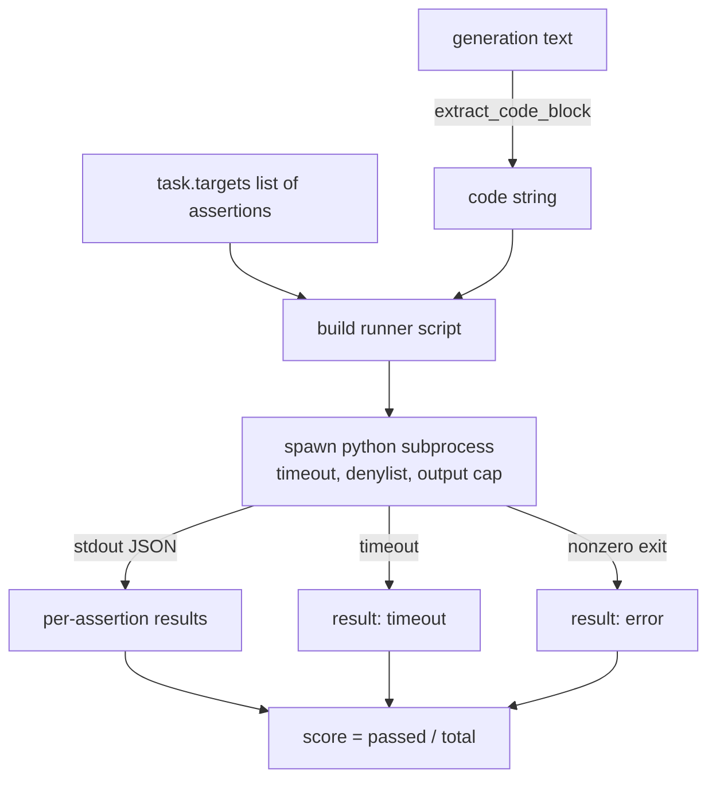
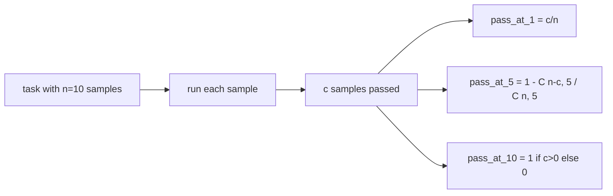

<!-- local-zh-machine-draft: English source is canonical; prose translated automatically, code/math preserved. -->

<a id="code-exec-metric"></a>

# 代码执行评估指标

> 生成的代码在通过测试时是正确的。 harness 需要提取代码,运行它而不折断主机, 并诚实地计出过速率。 这个课程构建了这个表面 。

**类型:** Build
**语言:** Python
**先修要求:** 阶段19 轨道B基础,课程70和71
**时间:** ~90分钟

<a id="learning-objectives"></a>

## 学习目标

- 从自由形式生成的代码块中提取出来, 其方式与后处理规则匹配, 从第70课中提取 。
- 在单列子程序中执行候选代码, 带有墙上时钟超时、 输出上限和导入拒绝列表 。
- 将任务评为对候选人的标注字符串的分数。
- 计算从一个模型中抽取多代人的工作的空格。
- Treat sandbox 崩溃、 语法错误、 头等舱故障模式的超时, 以及运行者可以登录的有不同退出代码 。

```figure
sandbox-runner
```

<a id="why-an-isolated-subprocess"></a>

## 为什么是一个孤立的子进程

Inline `exec` 是一个安全和稳定的危险。 `while True: pass` 永久地阻断反演算符。 A 生成 `import shutil; shutil.rmtree('/')` 完全像听起来一样灾难性。 Python 每位候选人的翻译,通过标准时的代码, 将声明结果写到标准值, 如果程序超支, 并杀死进程。 主机的 Eval 进程会继续运行 。

真正的电子交易,如人类交易、MBP、大计算机平台和LiveCode Bench, 都使用子程序 sandbox。 Docker 。 我们停止子进程是有原因的: 它是便携式的, 是标准级的, 它会捕捉到教育评估中重要的失败模式。 制作部署增加了 seconp、 网络隔离和只读文件系统。 下一个关于在这个轨道外生活更加艰难的课程 。

<a id="the-shape-of-a-code-exec-task"></a>

## 代码执行任务形状

一个 `code_exec` 任务包含声明字符串 `targets`。 跑者从一代人中提取一个栅栏代码块, 建立一个测试 harness 绕着它,运行结果。



分数是分数 `[0, 1]`。任务中有三个参数,其中两个通过得分0.667。不管失败,运行者返回相同的形状:子进程崩溃被映射成一个正常的错误代码,而不是 Python 追踪回路,一直流到 harness.

<a id="the-denylist"></a>

## 拒绝名单

拒绝列表基于导入。 在运行候选代码之前, 运行者脚本将危险模块的导入重写到一个可提高 `ImportError("denied")`。清单故意保守: `os.system`, `subprocess`, `socket`, `requests`, `urllib`, `urllib.request`, `urllib.error`, `urllib.parse`, `ctypes`, `shutil`, `http.client`, `asyncio.subprocess`.

我们不会假装这是防弹的 确定对抗代码可以逃脱任何过程 sandbox 在 Python。拒绝列表是一个后站。墙时超时和输出上限是负载控制。

```python
DENIED = {
    "os.system": True,
    "subprocess": True,
    "socket": True,
    "shutil": True,
    "requests": True,
    "urllib": True,
    "ctypes": True,
}
```

候选人先排好队 `import sys` 和一只猴子的守护者patches `os.system` 要加注。完整模板在 `main.py`.

<a id="wall-clock-timeout"></a>

## 长时超时

每个子进程都有三面墙时钟的默认预算。 运行者使用 `subprocess.run(..., timeout=t)`。如果超时火灾,则跑者会捕捉到 `TimeoutExpired`,杀死过程,记录 `timeout` 退出任务的原因。 任务分数为零。 运行者继续前进 。

超时是可以通过 `task.metadata.timeout_s`。长程单元测试可以要求更多;课程70的验证符将数值限制在30秒内,以保持套件的固定。

<a id="output-cap"></a>

## 输出上限

子进程可以淹没 stdout, 耗尽主机内存。 运行中的总横跨 256 KB 后, 运行的流会跳到缓冲处, 并杀死孩子 。 结果被记录为 `exit_code = error` 带有细节字符串 `"output overflow"`。这在实践中表现出来 当一代人不小心写出一个无限循环, 打印。

<a id="pass-at-k"></a>

## Pass-at-k

万岁是人类的天文数字 和朋友们使用的无偏倚的天文数 `n` 每项任务的独立样本 `c` 其通过, 概率 一个样本大小 `k` 来自 `n` 包含至少一个传递的解决方案 :

```
pass_at_k(n, c, k) = 1 - C(n - c, k) / C(n, k)
```

当 `n - c < k` 数字未定义,值为 `1`。执行程序直接处理边缘案件。我们披露 `pass_at_k(n, c, k)` 供第74课中领头板层使用。



<a id="exit-codes"></a>

## 退出代码

运行者返回每任务五个结果中的一个 :

- `pass` 每当每个说法都过去的时候,
- `assertion_fail` 当代码运行时, 但至少有一个声明失败 。
- `syntax_error` 当代码没有导入或有语法错误时。
- `timeout` 墙上的钟表过期时
- `error` 包括拒绝列表点击和输出溢出(有详细内容的流过表面) `"output overflow"`).

分数还是一个分数。 退出代码是元数据。 下游课程可以决定是否将超时算作零, 还是将数据算作缺失 。

<a id="what-this-lesson-does-not-do"></a>

## 课程没有效果的

也不给你一个真正的 sandbox。它不会从打开的网页运行不信任的代码。它不会处理文件 I/O 或网络呼叫等有声的任务。需要容器或微VM 的人。这个课程的重点是合同:一个孤立的子进程、拒绝列表、超时、输出上限、一个干净的退出代码 vocabulary和通过-k数学。

<a id="how-to-read-the-code"></a>

## 如何阅读代码

`main.py` defines `extract_code`, `run_candidate`, `score_code_exec`, 和 `pass_at_k`。子进程运行脚本作为字符串构建,然后以 `-c` 来个新鲜的 Python 翻译。 `code/tests/test_exec.py` 使用四个退出代码加上从人类经济学中提取的工作实例。

Read `main.py` 向上到下。 运行器模板是包含装入的片段。 将您在预测 JSON 信封上写回给父进程。

<a id="going-further"></a>

## 继续

子进程形状一旦起作用,下一个关切是可移动性。 Python 版本在 Windows 上对 SIGKILL 使用不同方式。 最干净的修补方法是将运行者放入 Docker 图像。 之后的下一步是用真实的单位测试文件替换声明字符串, 这样 evval 就可以匹配 CI 的生产 。 停止在那个时候调用声明字符串测试; 它们是玩具测试, 并且有玩具故障模式 。
