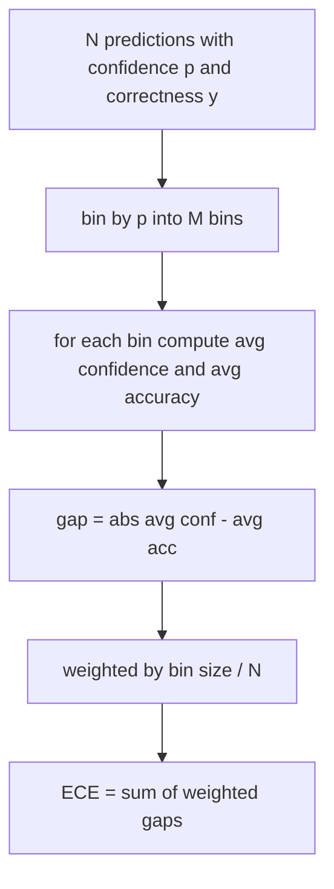
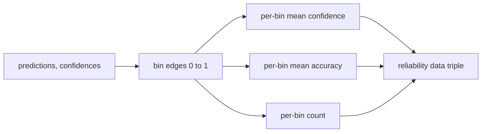

<!-- local-zh-machine-draft: English source is canonical; prose translated automatically, code/math preserved. -->

<a id="perplexity-and-calibration"></a>

# Perplexity 与 Calibration（困惑度与校准）

> 如果你的模型说90%的自信 以一千个答案,并获得600个正确的, 它不是很好校准。 Calibration 一半是值得信赖的 评估。 perplexity来说明模型是否认为 悬置的文字是可信的

**类型：** 构建
**语言:** Python
**先修要求:** 阶段19 轨道B基础,课程70和71
**时间:** ~90分钟

<a id="learning-objectives"></a>

## 学习目标

- Compute token-level perplexity 被封存的《公约》 token 模型适配器提供的负日志概率。
- 计算预期值 calibration 分类器或多选择电子数值的错误(ECE),来自被捆绑预测概率。
- 计算比值(相对于正确性指标的正方形错误),并解释何时做欧洲经委会没有做的事情。
- 建立绘制信任-反准确曲线所需的可靠性图表数据。
- 三个都接上电线 harness 使跑者能够附加 `perplexity`, `ece`, 和 `brier` 编号为模式报告。

```figure
cd-reliability-diagram
```

<a id="what-perplexity-tells-you"></a>

## What perplexity 告诉你

Perplexity 表示平均负对数 token低一点更好 perplexity 表示模型给每个实际的概率分配 。 token. 一个 perplexity 的 vocabulary 大小意味着模型是统一的, 学不到任何东西。 真正的数字在两个中间: 强大的 2026 基数在 WikitText- 103 上大约 8 到 12 。 同一文本上的错误模型在 50 + 。

该 harness 并不计算日志概率本身。这些来自模型适配器。 harness 总计: 它需要一份每 -token 日志概率, 列表 token 返回程序 perplexity.

```python
def perplexity(neg_log_probs, token_counts):
    total_nll = sum(neg_log_probs)
    total_tokens = sum(token_counts)
    return math.exp(total_nll / total_tokens)
```

执行程序处理0 -token 边缘案例,并声称负日志概率是非负的。 常见错误是忘记否定: 返回的适配器 `log p` 而非 `-log p` 生产 a perplexity 功能会将它作为违反合同的场景

<a id="what-ece-measures"></a>

## 欧洲经委会的措施

Expected calibration 错误将预测按其信任度分组为固定的文件夹数,然后测量每个文件夹的置信度和准确度之间的平均差距,并按文件夹大小进行加权。



标准配方使用10个等宽的容器 `[0, 1]`。执行支持任何正整数。我们披露 `bins` parameter 以便选手可以在出版公约(10)和比较公约(15)之间作出选择。

ECE 偏向于 bin 计数和样本大小。 有了10 bin 和 100 个预测, 你无法区分 0.02 个欧洲经委会 和随机噪音 。 执行返回了与 ECE 一起的有人口组成的文件夹数量, 以便运行者可以拒绝在太少的样本中报告一个数字 。

<a id="what-brier-score-does-that-ece-does-not"></a>

## 布赖尔的分数 欧洲经委会没有

欧洲经委会只关心平均差距。 在一个过于自信的模型中,一半的垃圾箱和另一半的不自信可能低廉的欧洲经委会,而当地校准差强人意。 布赖尔分数对每个预测的真实结果衡量了正方形错误,因此它直接惩罚了扩散。

对于二进制结果, Brier 是 `mean((p_i - y_i)^2)`。它分解成可靠性、分辨率和不确定性。我们计算得分和分解。运行者报告卡路里,但记录仪表板的分解。

```python
def brier(p, y):
    return float(np.mean((p - y) ** 2))
```

<a id="reliability-diagram-data"></a>

## 可靠性图数据

可靠性图图根据每个垃圾桶的经验性准确性预测了信心。 对角是完美的 calibration。函数返回三个矩阵:每宾平均置信度、每宾平均准确度和每宾计算。绘图代码在下游使用;此课停止在数据形状上。



返回的图普是绘制图层或计算自定义的欧洲经委会变体(适应性的欧洲经委会、扫过欧洲经委会等)所需要的。 numpy 矩阵,因此下游代码不必转换。

<a id="confidence-sources"></a>

## 信任来源

该 harness 不相信来自 softmax。它接受 `[0, 1]` 一次预测。 对于多重选择任务, 自然信心是 `softmax over option log-likelihoods`。对于自由文本,自然信心是模型的自我报告概率或平均日志相似性的指数。电子逆向拍卖只是消耗数字。它来自适配者的工作。

<a id="edge-cases"></a>

## 边缘情况

- 所有预测都是错误的:欧洲经委会是平均信心,Brier很高, perplexity 不论模型对文本的看法如何。
- 所有预测都非常可靠:欧洲经委会接近零,布里尔接近零。
- p=0.5时完全不确定的预测:ECE为0.5减去准确度,Brier为0.25减去一个修正术语。
- 空输入: 欧洲经委会, Brier 和可靠性回报 `0.0` (或零填充数组)。 Perplexity 返回 `NaN` 零点...token 例。这些路径都没有发出警告; 运行者检查值并决定是报告还是跳过 。

这些病例被烤进了测试中。一个真正的模型不会击中它们,但一个错误的适应器或一个小样本会击中它们,而运行者不应该崩溃。

<a id="dispatch"></a>

## Dispatch

Calibration 不是一个像F1这样的每个任务指标。它是每模型报告。 `(confidence, correct)` 在整个评价中对等计算出一次ECE、Brier和可靠性数据。 Perplexity 以搁置的文本体计算,与任务逐项评分分开。

接口为:

```python
report = CalibrationReport.from_predictions(confidences, correct)
report.ece          # float
report.brier        # float
report.reliability  # tuple of three numpy arrays
report.populated_bins  # int
```

`PerplexityResult.from_token_nll(neg_log_probs, token_counts)` 返回“ perplexity 平均负日志类型 token.

<a id="what-this-lesson-does-not-do"></a>

## 课程没有效果的

它不称为模式,它没有执行 softmax。它不估计产出的可信度 tokens;这是适应器的工作。它不起作用 temperature 缩放或 Platt 缩放; 这些是后热修补, 其内容不同。 此课的要点是使三个数字( ) 。perplexity欧经委,布赖尔)可信赖和可复制。

<a id="how-to-read-the-code"></a>

## 如何阅读代码

`main.py` defines `perplexity`, `expected_calibration_error`, `brier_score`, `reliability_diagram`, 以及该 `CalibrationReport` / `PerplexityResult` 数据类。演示运行在已知地面真相的合成预测上:一个校准良好的模型,一个过于自信的模式,和一个不自信的模式。 `code/tests/test_calibration.py` 输入每个边缘的大小写加上合成预测器的参考值。

Read `main.py` 。命令向矢量递增,每个函数的数学和合同都有短的分数。

<a id="going-further"></a>

## 继续

Calibration 是一个在发布 eval 中最被忽视的轴。 大多数首选板都报告一个单一的准确数字, 并称它为完成 。 一个在 Brier 上赢得准确性和丢失的模型比一个在准确性上分数少几个百分点但可靠地报告其不确定性的模型更糟糕。 一旦您掌握了该模型, 则会得到更好的生产部署 。 calibration 管道就位, 加 temperature 扩大一个悬崖的验证片,重新计算ECE,并观察差距缩小。 这是一个单独的教训,但地板在这里使用。
