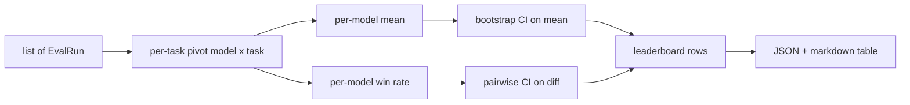
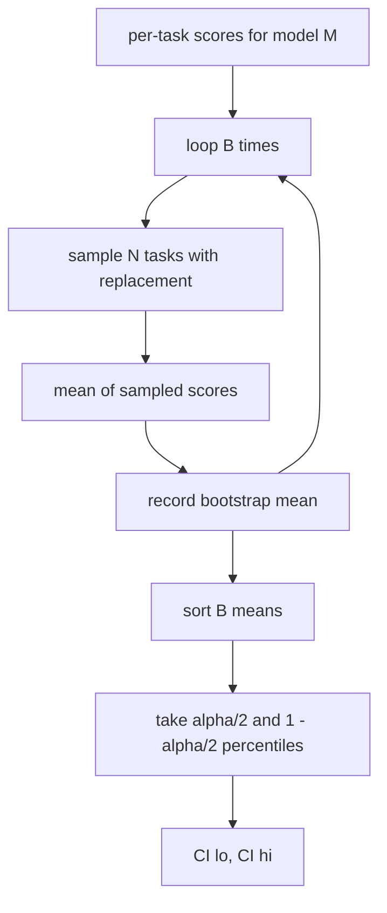

<!-- local-zh-machine-draft: English source is canonical; prose translated automatically, code/math preserved. -->

<a id="leaderboard-aggregation"></a>

# 排行榜汇总

> 每个任务分数很容易。 不同任务之间的每位模型排名比较困难。 一千个选项首页上的统计意义是每个人跳过的部分。 此课不会跳过它 。

**类型：** 构建
**语言:** Python
**先修要求:** 阶段19 轨道B基础,课程70、71、73
**时间:** ~90分钟

<a id="learning-objectives"></a>

## 学习目标

- 跨多个模型和多任务的总的每个任务分数,形成一个整齐的每条模型行。
- 使各种分数正常化,以便通过率和BLEU值不会过度影响总和。
- 以中庸和双赢率排列模型,并解释每个模型的总结正确。
- 计算每模型平均分数和对比差异的靴带置信度间隔。
- 输出头板为 JSON 报告和作为 markdown 将选手放在第75课中,可以粘贴到 CI 的评论中。

```figure
ci-leaderboard-ci
```

<a id="the-shape-of-input"></a>

## 输入形状

聚合器消耗了列表 `EvalRun` records:

```python
@dataclass
class EvalRun:
    model_id: str
    task_id: str
    metric_name: str
    score: float          # in [0, 1]
    category: str
```

75课的选手每出一分 `(model, task)` 组合器不关心分数是如何产生的。 它期望已经实现正常化: 每个分数都在 `[0, 1]`.

<a id="the-output"></a>

## 产出

3张桌子出来:



头板行包含: `model_id`, `mean_score`, `mean_ci_lo`, `mean_ci_hi`, `win_rate`, `tasks_completed`,并且是一个可选 `categories` 每一类平均地图 。

<a id="normalisation"></a>

## Normalisation

如果一个任务得分 `[0, 1]` 和另一个英寸 `[0, 100]`,第二个无声地主宰着这个平均值。 `[0, 1]` 并且拒绝运行。修复在上游:衡量标准应该已经返回了一小部分。 71到73年的教训是执行合同。

<a id="mean-and-win-rate"></a>

## 平均和双赢率

这两项排名计划服务于不同的目标。

平均分数是每个模型的每个任务平均分数。它是头条数字头版报告,对外线和任务不平衡十分敏感。

双赢率计算模型在相同任务上比其他模式多高。 对于每个任务,得分最高( 几分) 的模型都取胜。 双赢率等于得分数, 由模式得分数来分。 它对外层和比例差异不那么敏感,但会丢失信息。

```python
def win_rate(model_id, runs_by_task, all_models):
    wins, total = 0, 0
    for task_id, runs in runs_by_task.items():
        scores = {r.model_id: r.score for r in runs if r.model_id in all_models}
        if model_id not in scores:
            continue
        total += 1
        best = max(scores.values())
        if scores[model_id] >= best:
            wins += 1
    return wins / total if total else 0.0
```

该 harness 两者都报告。 课程中选手按默认值平均排在75级; markdown 双赢率列就在那里,以防用户喜欢。

<a id="bootstrap-confidence-intervals"></a>

## 启动套接度

每个模型意味着以对任务进行抽样的靴子估计的置信间隔。 我们用替换重现任务代号, 计算重标集的平均值, 重复 `B` 时间,并在级别上取取百分位间隔 `alpha`.



比较时,我们把每个任务的差异绑起来 `score_A - score_B`,取出百分位间隔并报告。用户会读取是否排除零。如果它这样做,则在水平阿尔法上差异很大。如果不这样做,则首页将模型作为捆绑处理。

低级帮手(`bootstrap_mean_ci`, `bootstrap_pairwise_diff`默认为 `B=1000`; 公共集合(`aggregate`, `pairwise_diffs`默认为 `b=500` 测试和演示要保持快速。 默认的字母为 0.05。 课程使靴子更纯净 numpy, 否 scipy.

<a id="categories"></a>

## Categories

如果 `EvalRun.category` 设置,聚合器还报告每类平均值。这是每个首页上的栏目,上面写着 `math`, `reasoning`, `code`, `safety`。它让运行者发现一个模型是否总体良好,但代码薄弱,即标题指隐藏的信息。

<a id="markdown-rendering"></a>

## Markdown rendering

头板是 markdown table:

```text
| Rank | Model | Mean | 95% CI | Win rate | Tasks |
|------|-------|------|--------|----------|-------|
| 1    | gpt   | 0.78 | 0.74-0.82 | 0.62 | 50 |
| 2    | claude| 0.75 | 0.71-0.79 | 0.34 | 50 |
| 3    | random| 0.10 | 0.07-0.13 | 0.04 | 50 |
```

表格按平均分数排序。 光学计算法为小数点后两点。 长型代号短于20个字符。

<a id="what-this-lesson-does-not-do"></a>

## 课程没有效果的

它不运行模型,不称为衡量层,也不执行适应性欧洲经委会或其他 calibration 变量; 这些是第73课, 它不执行任务加权。 这里每个任务都计算相同 。 weight 任务;我们让勾打开 `weight` 字段,但忽略在汇总器中。如果需要的话,在后续课程中添加加权。

<a id="how-to-read-the-code"></a>

## 如何阅读代码

`main.py` defines `EvalRun`, `LeaderboardRow`, `aggregate`, `bootstrap_mean_ci`, `bootstrap_pairwise_diff`, 和 `render_markdown`。演示组构建了一个由三种模型和十二种任务、集成材料组成的合成套件,并打印了头板和配对的 diff 表格。 `code/tests/test_leaderboard.py` 夹住靴子, markdown 产生,双速率边缘 和空输入行为。

Read `main.py` 数据形状( EvalRun, LeadboardRow) 首选, 下个聚合器, 第三个靴子套件, 最后一个创建。 每个函数都有焦点合同 。

<a id="going-further"></a>

## 继续

自然的下一步是配对任务的重要性,而不是不平坦的靴子。 如果模型A和B都执行相同的一百项任务, 适当的测试就是我们执行的任务逐项任务差异配对的靴子。 除此之外, 您想要一个尊重任务家庭( 数学问题不是相互独立的; 算术错误模式会影响到其中的十个家庭) 的等级式的靴子。 这是后续措施。 此课的目的是让地板正确, 这样在 Eval 上报告一个可以捍卫的数字 。
