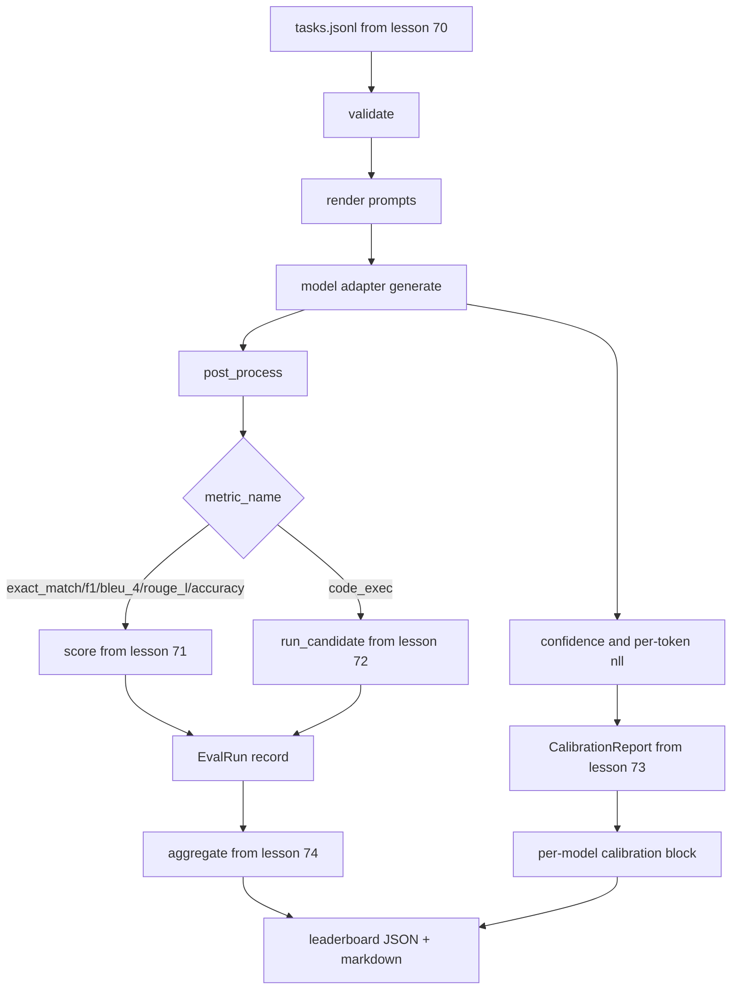

<!-- local-zh-machine-draft: English source is canonical; prose translated automatically, code/math preserved. -->

<a id="end-to-end-eval-runner"></a>

# 端到端评估执行器

> 5个水管课程,一个用来粘合它们。 选手阅读了70课的任务说明, 调用一个模型, 分数与71和72课, 并附着 calibration 73课的报导 并发布领先板 从74课的自我终结。

**类型：** 构建
**语言:** Python
**先修要求:** 阶段19 轨道B基金会,70至74
**时间:** ~90分钟

<a id="learning-objectives"></a>

## 学习目标

- 定义 `ModelAdapter` 任何模型的界面( 模拟, 本地, 本地, 本地) API)可以用小方法表面满足。
- 运行反射器在固定点上 JSONL 在一个工人库中平行执行任务的文件 。
- 构建公制层( 精确度)_匹配,F1,BLEU-4, ROUGE-L,代码_与 calibration 在一个通道中。
- 每一模型的 Emit `EvalRun` 记录并直接喂它们进 头板集合器。
- 输出 JSON 报告和a markdown 表格; 自动终止,在清洁运行时输出零,在验证或运行时故障时不为零。

```figure
eval-grid
```

<a id="the-pipeline"></a>

## 管道



运行者是整合点。 每一个课程 70 到 74 都有一个 运行者所组成的模块。 运行者并不重复这些模块的任何逻辑: 它会导入它们 。

<a id="the-adapter-interface"></a>

## 适配器接口

适配器是运行者与任何模型之间的接合点。 界面有意小。

```python
class ModelAdapter:
    model_id: str

    def generate(self, prompt: str, task: TaskSpec) -> Generation: ...
```

`Generation` 数据类为:

- `text`:模型的自由形式输出
- `confidence`: 浮动 `[0, 1]` 代表模型自我报告答案的概率
- `token_nll`: 相对于生成的负日志类型,可选择的总和 tokens
- `token_count`:生成的可选数 tokens

选手的摩克适配器提供三种味道: `RuleBasedAdapter` (确定性,接近完美) `NoisyAdapter` (自信,往往错误) `BiasedAdapter` 演示会用70个课的固定课来进行所有三个课

<a id="parallel-execution"></a>

## 平行执行

跑步者使用 `concurrent.futures.ThreadPoolExecutor` 以每个模式平行运行任务。 工人计数默认值为小于 8 和任务计数。 线索就足够了, 因为真正的模型调用的瓶颈是网络 I/ O。 代码执行路径在任务中生成自己的子进程, 而执行者只安排等待时间 。

选手们会暴露出 `run_eval(adapters, tasks, parallel=False)` 以便测试可以确定执行命令。

<a id="the-single-pass-scoring-loop"></a>

## 单行评分环

每项任务:

1. 调试 prompt (few-shot 前缀加 prompt body).
2. 打电话给适配器,时间拨打
3. 后处理任务规则下的生成 。
4. 调到公制层
5. 构建 `EvalRun` 记录得分和公制元数据。
6. 附加 `(confidence, correct)` 组合 calibration buffer.

该 `correct` 信号是 `score >= 1.0` 准确_匹配式测量(`exact_match`, `accuracy`, `code_exec`) 和 `score >= 0.5` 的分级标准。 `_correct_from_score` 并且跑者不会暴露 公众的超人。

<a id="aggregation"></a>

## Aggregation

每一次任务都取得了结果 跑者就呼唤 `aggregate` 和 `pairwise_diffs` 课程74和 `CalibrationReport.from_predictions` 由第73课中选取的输出为单 JSON envelope:

```json
{
  "leaderboard": [...],
  "pairwise": [...],
  "calibration": {
    "model_id_a": {"ece": 0.04, "brier": 0.10, "populated_bins": 8, ...},
    ...
  },
  "summary": {
    "tasks": 10,
    "models": 3,
    "wall_seconds": 1.2
  }
}
```

跑者也写了 markdown 表格,以便用户将结果粘贴到公关审查中。

<a id="self-terminating-demo"></a>

## 自闭演示

演示在70课的十项固定任务上运行三个模拟适配器, 墙壁时间应处于10秒以下。 退出代码在一次干净运行时为零 。

清洁经营的标准是:

- 每项任务均在70课中得到验证。
- 每项任务均在71和72项经验教训下得分。
- 该 calibration 报告在课程73下汇总,无错误。
- 头版将基于规则的适配器排在任意适配器之上。

如果其中任何一个断开, 运行者退出非零, 且在 JSON envelope.

<a id="what-this-lesson-does-not-do"></a>

## 课程没有效果的

它不叫真正的模式,它不执行 API 密钥流或速率限制处理。它不执行 streaming 或部分生成; 适配器每呼叫返回一代。 它不进行回溯或缓冲。 这些关注点都生活在适配层; 运行者是测量不可知性和提供者不可知性 。

<a id="how-to-read-the-code"></a>

## 如何阅读代码

`main.py` 是一个整合。它从其他五个课程模块中导入一个小模块 `_load_sibling` 帮助通过相对路径解决它们。数据类 `Generation`, `EvalReport`, 和 `ModelAdapter` 本地定义。模拟适配器位于文件底部。

Read `main.py` 上到下。 精密的导入, 然后查看 `run_eval`, 然后 `_score_one`,然后是适配器。最后的演示是切入点。

测试 `code/tests/test_runner.py` 输入适配器界面,单环,平行-Vs序列等同, calibration 缓冲,以及 JSON 信封形状。

<a id="going-further"></a>

## 继续

运行者是地板。 生产反val系统添加: 由 `(task_id, model_id, model_version)`成本分类账 跟踪美元和 tokens 一次运行, 重试层后退 rate limits, 一个 sampling 空对空任务的政策,以及 streaming 长套件的输出格式。 每一个都是一个单一的选项, 覆盖运行者而不改变测量或汇总层。 此分隔是合同的点 。

使用假名后, 添加一个真正的供应商的适配器。 选一个免费的, 写三十行胶水, 观看头板灯亮起来 。 然后添加第二个供应商, 让这个用户 harness 做这个工作
