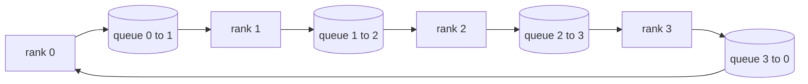

<!-- local-zh-machine-draft: English source is canonical; prose translated automatically, code/math preserved. -->

<a id="collective-ops-from-scratch"></a>

# 从零实现集合通信操作

> 四个共同开展分散培训的集体行动,是减少、广播、集中和减少_分散。 每一个原始的训练框架都提供这些。 把它们建在 `multiprocessing.Queue` 网格,对照参考执行核实, rest 铁轨变成管道

**类型：** 构建
**语言:** Python
**先修要求:** 第19阶段C轨道课程42-49
**时间:** ~90分钟

<a id="learning-objectives"></a>

## 学习目标

- 使用环的分两次递减( 减少散射, 然后全部加固) 并证明每单元的每级通讯量为2( N-1)/ N 字节 。
- 建立广播, 集中并减少_点对点的上方散布发送 `multiprocessing.Queue`.
- 核对每个原始的 `torch.distributed` 相同输入的 gloo 引用 。
- 保护环与树的对比选择 在集群形状, 潜伏层和带宽上限。

<a id="the-problem"></a>

## 问题

幼稚地排队 给N的次 tensor 以 root 和 播音为单位, 向后 。 带宽比例为 O( N) / 级, 根会成为瓶颈, 墙上时钟的地板是最慢的链接时间为 N 。 环会将平面的平面切成 2 (N-1) 大小的 T/ N, 所以每端字节会跌至 2T( N-1)/ N 大小不取决于组群大小。 树会以小 N 和高纬度链接为胜, 因为深度是 log2( N) 跳而不是 2( N-1) 。 选择组合形状的错误表层和最慢的表层 。 GPU 需要时间

每一个分布式训练框架 你将读取这条轨道 取决于这四个原始的。 PyTorch DDP 同步 gradients 以每减一个 parameter 减低ZeRO碎片的优化状态_散射和广播更新 parameters 将全速转换为全速递减_分散。 管道平行需要通过不同阶段组的启动程序广播。 如果您无法执行四个集体, 您无法解释为什么训练会拖延时间, 为什么 gradient 错配出现在第3级 或者为什么管道泡沫会加倍 当你交换结构时

<a id="the-concept"></a>

## 概念



<a id="ring-allreduce-in-two-passes"></a>

### 双关关扣

拆开 tensor 输入 N 等块, 索引为 0. N-1。 每个排位拥有等于其排位的块指数 。 第 1 号, 递减散式, 运行 N-1 级。 在 步骤 中, r 级将块( r - s) mod N 发送到排位 (r + 1) mod N 并接收从排位( r - s - 1) mod N 的块( r - 1) mod N , 将接收的块累积到本地副本中 。 在 N 1 级 后, 排名 r 将块 r. pass 2 全部归列, 运行另一个 N-1 级, 并旋转环周围的完成块, 直到每个排位都持有全部的整块 。

| Primitive | 位元数 | 步骤 | 何时使用 |
|-----------|---------------|-------|-------------|
| 环形减速 | 2T(N-1)/N | 2(N-1) | 大型T型脂肪管同质聚体 |
| 树形反射 | T log2( N) 键 | 2 log2( N) : | 小T或高延时链接 |
| Broadcast | T | log2(N) 树 | Parameter 内置, scalar 配置 |
| Allgather | T(N-1)/N | N-1 | 向前,ZeRO不硬 |
| Reduce_scatter | T(N-1)/N | N-1 | ZeRO gradient sharding |

<a id="queue-mesh-as-a-stand-in-for-nccl"></a>

### 将网格作为全国公民和公民教育委员会的一个备用

NCCL 运行超过 PCIe 和 NVLink , 并使用硬件卸载的减量 。 CPU 你没有那个 `multiprocessing.Queue` 每个环边都提供您订购的点对点交付, 由单一的制片人和单一的消费者。 减少发生在用户空间, 所以您要支付 Python 直线,但线条模式与 NCCL 环的反射线相同。 队列版本正确性和群集行为的原因如下。

<a id="verify-against-gloo"></a>

### 对照 Gloo 校验

每个原始土地 都经过单位测试 对比其输出量 `torch.distributed` 以 Gloo 后端在同一页上初始化 tensor 测试失败。 如果您的环形的减速与球形相去甚远, 则测试失败。 对照引用执行进行验证是不可谈判的; 没有它, 原始的看起来是正确的, 直到真正的训练运行的一万步。

```figure
ci-ring-allreduce
```

<a id="build-it"></a>

## 动手实现

`code/main.py` implements:

- `Mesh` 电线类 `multiprocessing.Queue` 进入环形和曝光 `send(dst, tensor)` 和 `recv(src)` 每一军阶。
- `ring_allreduce(mesh, rank, world_size, tensor)` 运行双通算法。
- `broadcast(mesh, rank, world_size, tensor, src)` 在一个对数树上。
- `allgather(mesh, rank, world_size, tensor)` 使用 N-1 旋转 。
- `reduce_scatter(mesh, rank, world_size, tensor)` 以作为前半部分的减量。
- `_gloo_reference(op, world_size, tensor)` 运行相同的输入 `torch.distributed` 和"小便"比较

运行：

```bash
python3 code/main.py
```

输出: 比较队列- 网格和格鲁输出的单位校验表, 之后是证明 2T(N-1)/ N 比例的每层字节计数器 。

<a id="production-patterns-in-the-wild"></a>

## 野生生物的生产模式

三种模式使原始生物更坚固 足以运载

**Bucket gradients 减肥前** 来杯1Bparameter 模型有数万个 gradient tensors。 tensor 支付潜伏层N倍。 DDP桶 gradients 将 ~ 25 MB 块, 并发布每桶一个增量; 较小 tensors 顶部的吊床不打桶,就占了台阶

**计算时重叠通信 。** 向后计算 gradients 以倒序排列的层次。 末层的瞬间 gradient 准备,启动它的减速, 而下一层继续计算。 PyTorch DDP 使用装有桶装钩子的电线。 当网络松懈时,重叠会把可见通信时间减半。

**选择戒指或树 信息大小,而不是宗教。** NCCL 上传一个用于选择 ~ 1 MB 以上信息环和下面树的地形探测器。 交叉是带宽反延度: 1 MB 以上, 带宽术语 2T( N-1)/ N 占优势且赢得环; 1 MB 以下, log2( N) 跳数获胜。 硬编码一个表层在错误信息大小上花费了过量的成本 。

<a id="use-it"></a>

## 实际应用

生产模式:

- **PyTorch DDP.** Calls `dist.all_reduce` 装在桶上 gradients 后退。桶大小为可金枪鱼;默认值为100Gbit Ethernet 25 MB 。
- **深血斑马** 减少问题_散落到碎块 gradients 并齐心合力重建 parameters 最原始的就是ZeRO的呼声
- **FSDP.** 向前以 全部 开始解开层, 计算, 然后减少_分散和丢弃不坚硬的,同样的原始,不同的计划

<a id="ship-it"></a>

## 交付成果

在77-81课中使用排队原始文字。 课程77 线将引向 DDP 。 课程78 线将减少_发射到ZeRO, 79条线被传送到管道启动中, 81条课程将所有4条都传送到端到端演示中。

<a id="exercises"></a>

## 练习

1. 添加树的反向切换变量, 按信件大小在环树之间切换。 测量交叉处 。
2. 添加a `recv_timeout_ms` 所以一个停滞的军衔 代表了一个错误 而不是永远挂。
3. Replace `multiprocessing.Queue` 与 TCP 四个原始人的插座 同样的测试 真正的电线
4. 添加带宽仪表钩, 使每端字节对帐日志 JSONL.
5. 比较圆钟时钟的环对树四排 tensors 以经验方式保护交叉

<a id="key-terms"></a>

## 关键术语

| 术语 | 人们怎么说 | 它实际上意味着什么 |
|------|----------------|------------------------|
| Allreduce | 跨队 | 调用后,每个军阶都保持同样的低级 tensor |
| Ring | "快速的地形学" | 周期内两次的N-1小块T/N流 |
| Tree | 日志表学 | 减少沿二进制树; 深度为对数2( N) 跳 |
| Allgather | 连结的碎片 | 每一军阶的末端 与其他军阶的碎片 |
| Reduce_scatter | 抛开总和 | 每一军阶以一块之和结束 |
| Bucket | 轻点 tensors" | 小型负重降为一个大 |

<a id="further-reading"></a>

## 进一步阅读

- [PyTorch 分配:全国公民和公民理事会集体](https://pytorch.org/docs/stable/distributed.html#collective-functions)
- [霍罗沃德环 减压纸](https://arxiv.org/abs/1802.05799)
- [NCCL 地形和算法选择](https://docs.nvidia.com/deeplearning/nccl/user-guide/docs/index.html)
- [帕塔拉苏克和元, 斑纹最佳减速算法](https://www.cs.fsu.edu/~xyuan/paper/09jpdc.pdf)
- 第十阶段 05课 - 分发培训概况
- 阶段19 77课 - DDP在这些原始产品上安装了电线
