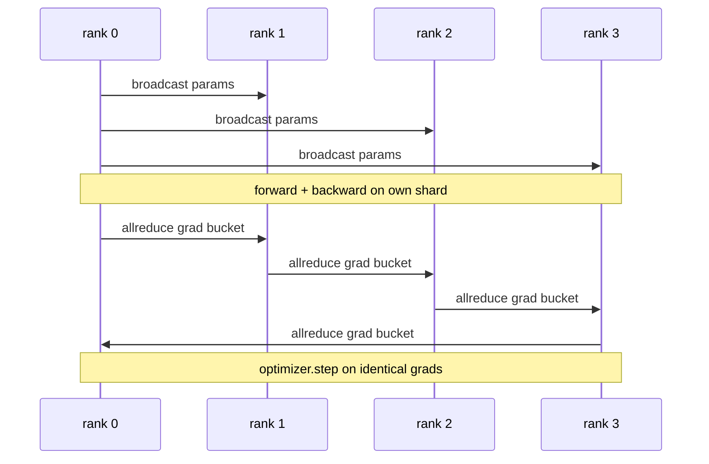

<!-- local-zh-machine-draft: English source is canonical; prose translated automatically, code/math preserved. -->

<a id="data-parallel-ddp-from-scratch"></a>

# 从零实现数据并行 DDP

> 分布式 DataParallel 是所有减速的钩子。 包住模型, 播放初始版本 parameters 从0级开始, 所以每个级别开始相同, 在每一个级别上安装一个后方钩子 parameter 发行的 gradient, 以及该 rest 是 gradient descent整个图案是200条线

**类型：** 构建
**语言:** Python
**先修要求:** 第19阶段C轨道课程42-49
**时间:** ~90分钟

<a id="learning-objectives"></a>

## 学习目标

- 电线a `DistributedDataParallel`- 最初播放的形状包装 parameters 和全部减量 gradients 后退,后退,后退,后退,后退,后退,后退,后退,后退,后退,后退,后退,后退,后退,后退,后退,后退,后退,后退,后退,后退,后退,后退,后退,后退,再往后退,然后退,然后退,然后退,然后退,再往后,再往后,再往后退,再往后退,再往后,再往后退,再往后退,再往后,再往后退,再往后退,再往后退,再往后,再往后退,再往后退,再往后退,再往后退,再往后退,再往后退,再往后退,再往后退。
- 特卫一 N CPU 列数为 `torch.multiprocessing.spawn` 由文件连接的Gloo后端
- Prove gradient- 通过按顺序对同一数据进行同一模型的培训并按部就班地显示,从而同步正确性 parameter equivalence.
- 保护水桶的使用(gradient 合并和重叠(后向时的合并),因为两种变化使一个工作DDP变成一个生产DDP。

<a id="the-problem"></a>

## 问题

10亿parameter 12GB活化模型不适合一个消费者 GPU。即使适合,培训也需要几周时间。数据平行将批量分成N级,每个排位计算出其碎片的前后,在每个阶梯上,每个排位的顺序都进行计算。 gradients 将总和,使所有 N 副本保持相同。 gradient 乐观派的脚步

不使用 gradient 同步,N复制品相左 步骤2。 模型不再是“一个在更多数据上受过训练的模型”,而是N不同的模型, 碰巧分享了初始数据 weights. 与 gradient 同步完成得不妙( 每减一个) parameter网络是瓶颈,没有重叠,没有桶) GPUs DDP的手工艺正在制造 gradient 与计算相比,同步几乎是免费的。 PyTorch 开发部通过打桶来实现这一目标 gradients,与下一层的后向相重叠的减幅,并在 NVLink 上使用 NCCL。 CPU 学着同样的教训

<a id="the-concept"></a>

## 概念



<a id="the-three-operations-ddp-needs"></a>

### 三个业务

| 舞台 | Collective | 为什么 |
|-------|-----------|-----|
| Init | 从0级广播 | 每一级都是从相同的开始 parameters |
| 后退一点 | 每一年级的降级 | 意思 gradient 乐观主义者的脚步 |
| Sometimes | 广播缓冲 | Batchnorm 运行状态保持同步 |

<a id="why-mean-and-not-sum"></a>

### 为什么是刻薄的,而不是总

降幅- SUM 除以世界_大小给出平均值 gradient。这个恶毒对世界是无所不有的_大小: a learning rate 听一个排,四排,因为每个步 gradient 大小不变。 没有区分, 将您强制调整 learning rate 每次您更改组群大小时, DDP 都会包扎 SUM 和分隔; 在课程中做同样的事情 。

<a id="why-bucket-gradients"></a>

### 为什么是桶 gradients

一个 transformer 拥有数千个 parameter tensors。 tensor 支付Gloo latene 地板上几千倍。 DDP 组 gradients 将所有东西都集中到一个桶里。

<a id="why-pin-the-seed"></a>

### 为何要给种子钉上钉子

每一个军阶必须调用 `torch.manual_seed(seed + rank)` 用来打乱,但是 `torch.manual_seed(seed)` 用于 parameter 单种共享种子意味着每级都看到相同的批次顺序(平行的不合格数据);单子的单种种子代表初始 parameters 由浮冰和 gradient 同步不再使复制内容相同。 获取种子模式或测试 parameter 等值在第一步失败了

```figure
ci-ddp-grad-sync
```

<a id="build-it"></a>

## 动手实现

`code/main.py` implements:

- `MiniMLP`3层的MLP小到可以几秒钟内集合, 足够大到暴露电线。
- `DistributedDataParallel(model, world_size)`:在构建时播放参数,返回一个 `sync_grads` 累积的分数_size.
- `worker(rank, world_size, ...)`: 完整训练循环 `torch.distributed` 倒着走,往后,同步,往前,往前
- `_reference_single_process_loop(...)`:在同一个数据上按顺序对一个级别进行相同的模型,测试用于字节等距 parameter 每一步后都相等。

运行：

```bash
python3 code/main.py
```

产出:每步培训表,比较单过程损失和 parameter DDP 的四级校验和。 两条路径产生相同的损耗曲线以浮动 epsilon, 证明 gradient 同步是正确的 。

<a id="production-patterns-in-the-wild"></a>

## 野生生物的生产模式

三个模式使DDP硬化 足够装船。

**查找未使用 parameters.** 一些前进路径跳过 parameters 有条件( 提前退出, 专家混合路由器) 。 parameters 没有 gradient等他们和减少僵局 `find_unused_parameters=True` 告诉DDP看看哪个参数 gradients 成本是每步一张图,请不要动,除非你向前走 branches.

**静态图优化 。** 当前进的步伐稳定时, `static_graph=True` 允许 DDP 预算桶表。 优化在比例上很重要: 预先计算每步可节省几毫秒, 使每步每步能超过10 000步。

**Gradient accumulation 需要照顾** Accumulating gradients 未经同步的 K 微插头是10x 输出赢。 DDP 曝光 `no_sync()` 以一个上下文管理器来暂停后回的减速。 忘记了管理器, 您却毫无用处地将 K 次调低; 排量会下降到地板上 。

<a id="use-it"></a>

## 实际应用

生产模式:

- **PyTorch DDP.** 教会的执行。 `torch.nn.parallel.DistributedDataParallel(model)` 钢丝打桶、重叠和无_同步上下文 。
- **抱脸加速** 添加一个处理器 `torchrun` 电子信箱和模型包 底层同样的DDP
- **威震天-LM数据平行。** 将 DDP 和 tensor 大模型的平行; 数据平行部分是相同的后向减法模式 。

<a id="ship-it"></a>

## 交付成果

78课(ZeRO碎片)取代了每课-parameter 减少并减少_分散, 所以每排的级别只储存其优化状态的碎片。 81课将DDP和ZeRO 组成成端对端演示。

<a id="exercises"></a>

## 练习

1. Add gradient 大小可配置的桶子,测量速度和每减一整次的速率parameter 更深层的模型。
2. Implement `no_sync()` 作为上下文管理器并校验 gradient accumulation 与 K 微插件的单进程基线匹配 。
3. 添加a `find_unused_parameters` 模式,前方有时跳过 MLP 层;没有旗帜,运行就会陷入僵局。
4. 将 Gloo 替换为 `torch.distributed.barrier()`- 仅仅同步来感受 降压和屏障同步的区别
5. 测量 gradient- 将管理费作为步骤时间的一小部分同步 batch sizes 1,16,256 解释一下这个缩放

<a id="key-terms"></a>

## 关键术语

| 术语 | 人们怎么说 | 它实际上意味着什么 |
|------|----------------|------------------------|
| DDP | 数据平行 | 包装, 播放参数和所有音量 减少每步的格子 |
| Bucket | 引信格子 | N组小整数减为一个大 |
| 重叠 | 隐藏通讯 | 发布减量, 而后层仍向后计算 |
| 否_sync | "Accumulate" | 跳过后向后引线 gradient accumulation |
| find_unused | 向前冲 | Detect parameters 减员前没有毕业 |

<a id="further-reading"></a>

## 进一步阅读

- [PyTorch 分布式数据Parallel docs](https://pytorch.org/docs/stable/generated/torch.nn.parallel.DistributedDataParallel.html)
- [PyTorch DDP 内部辅导](https://pytorch.org/tutorials/intermediate/ddp_tutorial.html)
- [李等人, PyTorch 分布式:关于加速数据平行培训的经验](https://arxiv.org/abs/2006.15704)
- 第19阶段 76课 - 集体发展发展方案以
- 第19阶段 78课 - ZeRO碎片化用减少取代单项减量_scatter
