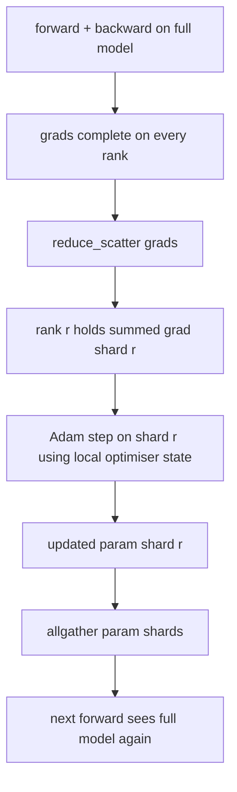

<!-- local-zh-machine-draft: English source is canonical; prose translated automatically, code/math preserved. -->

<a id="zero-optimizer-state-sharding"></a>

# ZeRO Optimizer 状态分片

> Adam 仓库每2分钟估计数 parameter都装在浮点32里parameter 模型带有56GB的优化状态。 ZeRO 第一阶段的碎片横跨 N 级; 每个级别拥有 1/N 的优化状态。 本地步骤之后更新 parameter 碎片向后传播,每个军阶都重建整个模型,下一步开始。胜利是训练堆放的最大一个分配线性内存下降。

**类型:** Build
**语言:** Python
**先修要求:** 第19阶段C轨道课程42-49
**时间:** ~90分钟

<a id="learning-objectives"></a>

## 学习目标

- 硬性优化状态( 第一秒, 第二秒, fp32 主副本) 横跨 N 级, 所以每个级别拥有 1/ N 级 。
- 使用减少_散开,送出每级,只送出其碎片 gradient 总计,然后全部收集到播放更新的 parameter 碎片还原
- 计算第1阶段第2阶段第3阶段的存储表,比方为香草DDP。
- 维护第1阶段与第2阶段与第3阶段的选题,

<a id="the-problem"></a>

## 问题

香草 DDP 复制一切: parameters, gradients,而乐观的状态是 完全在每一个级别。 对于7B -parameter Fp16 中的模型, 表示14GB parameters14GB , 14GB , 14GB , 14GB , 14GB gradients,以及28GB的优化等级。优化等级是最大的术语,最容易被扭曲,因为它只是在步骤期间,而不是在前方或后方被触及。

ZeRO 1 级将优化状态夷为平地。 Adam 片刻,后退,而不是全部减少 gradient 和踏足当地,ZeRO减少_散开,每个军阶只得到它的碎片的总结 gradient。该等级将优化的步态应用到其主的碎片上 parameters更新 parameter 碎片然后将所有级别都往后拉, 所以每个级别都有下一个前行的完整模型。 优化的内存会掉下 N。 每步的电线流量和 DDP 相同: 一排缩小_散开加上一个全加热等于带宽减一。内存赢,通过量保持不变。

<a id="the-concept"></a>

## 概念



<a id="stages-of-zero"></a>

### 零星级

| 舞台 | 什么东西被剥了 | 每个级别内存 | 每步通讯 |
|-------|----------------|------------------|---------------|
| DDP | nothing | params + grads + optim | 1x 减法 |
| ZeRO-1 | 优化状态 | params + grads + optim/N | 减少1个_散开+ 1x 全部加载 |
| ZeRO-2 | optim + grads | params + grads/N + optim/N | 减少1个_散开+ 1x 全部加载 |
| ZeRO-3 | optim + grads + params | params/N + grads/N + optim/N | 每层层层层层层层层积1x减少1x_每层散开 |

第一阶段是最便宜的,因为乐观国家主导着预算。 gradient3阶段(FSDP)为每个前向和后向支付每层的通讯,获得 parameter失忆,课上完全执行第1阶段

<a id="the-memory-math-real-numbers"></a>

### 记忆数学,真实数字

给P的模特儿 parameters 培训 Adam 在 mixed precision:

| 术语 | Vanilla | ZeRO-1 | 为什么 |
|------|---------|--------|-----|
| fp16 参数 | 2P字节 | 2P字节 | 需要的 |
| fp16 格数 | 2P字节 | 2P字节 | 后向需要的 |
| fp32 主副本 | 4P 字节 | 4P/N bytes | 最美的就是这个 |
| 第一次fp32 | 4P 字节 | 4P/N bytes | 最美的就是这个 |
| 秒数 fp32 | 4P 字节 | 4P/N bytes | 最美的就是这个 |
| 总计 | 16P字节 | 4P + 12P/N bytes |   |

N=8:香草16P,ZeRO-1 5.5P,下降65%。N=64:香草16P,ZeRO-1 4.19P,下降74%。

<a id="why-reduce_scatter-beats-allreduce-then-shard"></a>

### 为何要减少_散开时会减速

降幅让每个军阶都得到完整的总结 gradient。如果您只需要 shad r,则需要 gradient 被削减的 浪费在军衔r。_散射会完全传达每个排行的碎片; 位元数与降幅相同( 因为降幅会减少)_散居+ 全部加起来),但后半部分被 parameter网线和DDP完全相同,内存被分割。

```figure
cd-zero-shard
```

<a id="build-it"></a>

## 动手实现

`code/main.py` implements:

- `flatten_params(module)` 和 `unflatten_into(module, flat)` 装一个模特儿 parameters 相连为一 tensor 并拆包。平板布局是使碎片按一个简单的片段排列的原因。
- `ZeroOptimizer(model, world_size, rank, lr)` 拥有军衔的碎片 主人副本 Adam moments.
- `step()` 运行减少_散到公寓里去 gradient,应用 Adam 升到军阶的碎片, 并集中起来更新 parameters back.
- 演示,用20步训练三层MLP 并打印每步记忆预算 与香草 DDP基线。

运行：

```bash
python3 code/main.py
```

输出: 每步丢失, 显示 ZeRO-1 的内存表在每个级别上持有 1/ N 的优化状态, 与 DDP 的完整副本 。

<a id="production-patterns-in-the-wild"></a>

## 野生生物的生产模式

三个模式都硬化了ZeRO 足以运载。

**被隔离的检查站很重要** ZeRO-1的乐观状态 被分成了不同的军阶; checkpoint 80课是用来制造碎片的 checkpoint 显示恢复一个以相同世界大小运行的 ZeRO 。 没有它, 保存状态在重新启动时无法读取 。

**Mixed precision 关键在于** ZeRO是一种混合精度技术;fp32 主副本是被碎片的。 mixed precision 支付Fp32 硕士的内存税, 而不给相应的 fp16 前赢。 生产总是对 ZeRO 进行自动播放或 bf16 。 weights.

**第一阶段是几乎无损的胜利。** 通信与 DDP 按带宽计算相同。 N 的内存节约是线性。 唯一的成本是优化器碎片的簿记。 除非 parameter 碎片内存也是一个问题;然后第2或3阶段将通信交换为内存。

<a id="use-it"></a>

## 实际应用

生产模式:

- **深血斑马** 参考执行。 `deepspeed_config.json` 选择第1/2/3阶段和分区大小。
- **PyTorch FSDP.** 该 PyTorch- 与本地相当 `ShardingStrategy.SHARD_GRAD_OP` ZeRO-2; `FULL_SHARD` 齐罗3号
- **抱脸加速** 将深色和FSDP都用统一的配置包起来。

<a id="ship-it"></a>

## 交付成果

79课(管道平行)是正弦斜曲轴:不是在同一模型上截断优化状态,而是在阶梯上截断。81课是端到端演示时的 DDP + ZeRO 。

<a id="exercises"></a>

## 练习

1. 以割裂法延伸至ZeRO-2 gradients:每个级别只储存 gradient 因为它的碎片,通过零 出非硬部分后后。
2. 添加一个内存配置程序, 以打印 0 级与公式预测的实际 fp32 字节使用量 。
3. 测量香草 DDP 与 ZeRO 1 的每步倒数时钟, 并分解成前向后向通信 。
4. Implement gradient clipping 在ZeRO-1下:L2规范必须通过地方规范平方的冲销在所有碎片中计算。
5. 实施“耐用ZeRO”, 减少而不是减少_散开,测量线时差。_随数字分散选择

<a id="key-terms"></a>

## 关键术语

| 术语 | 人们怎么说 | 它实际上意味着什么 |
|------|----------------|------------------------|
| ZeRO-1 | 击败乐观派 | 每个军阶都持有 FF32 硕士 + Adam moments |
| ZeRO-2 | 硬格也一样 | 每一军阶也让非坚硬的军阶下降 gradients 减_scatter |
| ZeRO-3 | "硬参数" | 每个级别持有 1/N fp16 参数; 前面每层相加 |
| 主机副本 | "fp32 weights" | 高精度 parameter 复制优化更新 |
| Reduce_scatter | 抛开总和 | 送出每级,只用其碎片的总结 gradient |

<a id="further-reading"></a>

## 进一步阅读

- [Rajbhandari等人,ZeRO:对培训三亿多人的记忆优化 Parameter 模型](https://arxiv.org/abs/1910.02054)
- [深层 ZeRO 文档](https://www.deepspeed.ai/tutorials/zero/)
- [PyTorch 金融服务发展方案文件](https://pytorch.org/docs/stable/fsdp.html)
- 第19阶段 课程76 -- -- 减少_散开并集中这一课
- 第19阶段 80课 - 零星州必须使用被切断的检查站
