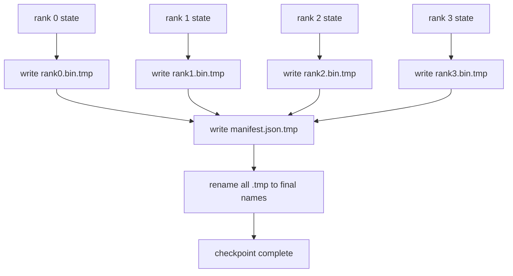

<!-- local-zh-machine-draft: English source is canonical; prose translated automatically, code/math preserved. -->

<a id="sharded-checkpoint-and-atomic-resume"></a>

# 分片 Checkpoint 与原子恢复

> 70B号parameter 训练工作每几个小时就因节点故障而暂停。 checkpoint 格式决定您是否损失 30 分钟还是 30 小时。 checkpoint 将每个军阶的碎片平行写成,并将所有权记录在一份货单上。 从自己的文件中重新装载每军阶的碎片,以同样的世界规模重建国家,而乐观的步伐就像没有发生一样。 原子写作保持半成。 checkpoint 下一份履历中中毒的

**类型：** 构建
**语言:** Python
**先修要求:** 第19阶段C轨道课程42-49
**时间:** ~90分钟

<a id="learning-objectives"></a>

## 学习目标

- 保存多级 checkpoint 是一个每层的碎片文件 加上一个清单 记录哪一排拥有什么。
- 使用原子写法模式( 写入临时路径, 然后重命名) , 崩溃的中写法不会产生半成品 checkpoint.
- 从舱单中恢复, 核实两个 fp16 的字节等同状态 parameters 和ZeRO的乐观状态 在每一级。
- 保护明确的计划 对抗三种失败模式: 世界规模的改变, 碎片数不匹配, 和部分写作。

<a id="the-problem"></a>

## 问题

香草药 checkpoint 读取全部 parameters 并写入优化状态为 0 级, 收集并写入一个文件。 对于一个70B 模式, 即通过一个级别网络端口的状态 1. 1 TB 。 写时将每个其它级别都屏蔽, 因为它们闲置等待集合 。 IO 带宽是最慢的单行 GPU网络链接, 不是总线。 在真实的集群中, 收集- 时间写字步骤可能比前一个培训小时要长, 这意味着工作船舶少于一个 checkpoint 培训日。

Sharded checkpoints 翻转模式: 每个级别都平行地将自己的碎片写成自己的文件。 将自己的碎片排成不同的列表记录, 从而将碎片重新排成一个完整的带宽缩放, 并用集来写。 A 1 TB checkpoint 单级需要4小时, 单级需要4分钟。 此外, 舱单还给您提供了一份不兼容的简历合同: 世界规模的变化是可检测的, 部分写作是可检测的, 装载路径会使用老化的数据而大打折扣 。

<a id="the-concept"></a>

## 概念



<a id="manifest-schema"></a>

### 明显模式

```json
{
  "world_size": 4,
  "step": 1234,
  "wall_clock_seconds": 4521,
  "shards": [
    {"rank": 0, "path": "rank0.bin", "sha256": "...", "param_shard_offset": 0, "param_shard_numel": 65536},
    {"rank": 1, "path": "rank1.bin", "sha256": "...", "param_shard_offset": 65536, "param_shard_numel": 65536}
  ],
  "schema_version": 1
}
```

三个字段是载荷的。 `world_size` 使一个不同的大小的复发 响亮失败而不是沉默腐蚀。 `sha256` 每一片碎片都捕捉部分或损坏的文字。 `param_shard_offset` 和 `param_shard_numel` 倒计时器重建公寓 parameter tensor 位置正确 。

<a id="atomic-write"></a>

### 原子写作

标准模式: 将每块碎片写到 `<name>.tmp`,将清单写到 `manifest.json.tmp`, fsync 中各有,然后重命名。POSIX 在同一文件系统中的重命名是原子;要么新文件完全存在,要么旧文件全部存在。在最后重命名离开前一个文件之前发生崩溃 checkpoint 以一个活体。没有原子写作,坠机会留下部分碎片, 显示点出点数, 而负载会腐蚀恢复的乐观状态。

<a id="three-failure-modes-the-schema-must-defend-against"></a>

### 三种失败模式 预案必须防御

| Failure | 症状 | Defence |
|---------|---------|---------|
| 世界规模的变化 | N=8号继续,有N=4的舱单 | world_显示大小不匹配, 大写失败 |
| 硬数不匹配 | 恢复显示级别更少*.bin 文件的页码 | 列举碎片,确认每个存在 |
| 部分写入 | 碎页文件已短略中淡 | 正在装入的 sha256 验证 |

每一个被告都拒绝早期的错误; 另一种办法是沉默的腐败, 等到损失到来时,它就会出现100个步骤 NaN.

<a id="why-per-rank-files-not-one-big-file"></a>

### 为什么每层文件, 一个大文件

通过文件同时写入 `O_APPEND` 用于 POSIX 的字节校正写, 但实际上, 一个碎片区域中的偏移在MB大小和锁定中占据主导位置。 根基文件系统平行时, 文件没有争议, 并受益于条纹( Lustre, GPFS) 。 为此原因, 生产堆叠( 深层版、 FSDP、 NeMo) 全部使用每排的文件 。

```figure
ci-sharded-checkpoint
```

<a id="build-it"></a>

## 动手实现

`code/main.py` implements:

- `ShardManifest` 数据类,上面的图案加 `to_json`/`from_json`.
- `save_sharded(state_dict_per_rank, dir, step)` 使用原子临时改名模式 将每个军阶的二进制状态写入自己的文件 然后写出清单
- `load_sharded(dir, expected_world_size)` 并返回每级州立法令。
- 圆轨测试: 建立每级状态, 保存, 装载, 声明字节等值 。

运行：

```bash
python3 code/main.py
```

输出: 4 个散装文件加上已写成的列表, 然后重新装入等量的验证 。

<a id="production-patterns-in-the-wild"></a>

## 野生生物的生产模式

三个模式加固 checkpoint 足够装船了

**亚辛克写。** 制作堆叠发行 checkpoint 将您写入一个单独的线索或进程, 以便继续训练。 屏障在下一个 checkpoint:在完成前一段之前,不要开始下一个保存。 `async_io` 旗帜就是这样。 课程保持写作同步, 使步骤可见 。

**先是本地快盘, 然后是自动上传 。** 写入本地 NVMe( 快速) , 然后同步加载到 S3 或 GSS 。 两层模式保持分组内 checkpoint 快速恢复, 并同时将耐久副本从组中发送到归档。 清单包含本地路径; 上传清单包含远程路径 。

**轮调很重要** 生产运行保持最后 K checkpoints 磁盘不旋转,就会填充中跑和下跑 checkpoint 失败。 旋转后, 下一个保存会先删除最老的, 释放预算 。

<a id="use-it"></a>

## 实际应用

生产模式:

- **深血检查** `deepspeed.save_checkpoint(tag=step)` 撰写每层文件 `latest` 文件指向活动标记 。
- **PyTorch 金融开发局检查站。** `torch.distributed.checkpoint` 以 a 保存已断开状态 `Planner` 来决定每级的布局
- **NeMo.** 穿制服的深色和FSDP `save_to_checkpoint` API 添加元数据。

<a id="ship-it"></a>

## 交付成果

81课省了一块碎片 checkpoint 以同样的世界规模重新装载 来证明合同的恢复

<a id="exercises"></a>

## 练习

1. 添加 Async 写入: 将保存在线索中启动, 并让训练继续。 屏蔽下一个保存直到上一个完成 。
2. 添加a `last_5_steps` 旋转: 保留最近 5 个 checkpoints,在保存新数据之前删除最老的数据。
3. 添加一个只允许 CRC 的内环再装入快速校验路径( 旋转滚动 a) checkpoint 成为新的活动之一 没有完整的sha256。
4. 添加一个跨世界的负载:读取舱单、连接和重新加固,使N=4再平衡到N=8。
5. 添加上传到假 S3 (第二个目录) 并写入上传列表。 捍卫双层存储策略 。

<a id="key-terms"></a>

## 关键术语

| 术语 | 人们怎么说 | 它实际上意味着什么 |
|------|----------------|------------------------|
| Sharded checkpoint | 毕 | 每个军阶都平行写自己的散乱文件 |
| Manifest | "Index" | JSON 记录碎裂路径、 偏移和 sha256 的文件 |
| 原子写作 | "tmp 然后重命名" | 写入. tmp 然后 POSIX 重命名, 崩溃会让上一个文件实时离开 |
| 部分写入 | 被剪断的碎片 | 写作时的崩溃产生腐败碎片; sha256 抓取它 |
| 旋转 | "保留最后的K" | 删除最老的 checkpoint 在写入新磁盘使用前 |

<a id="further-reading"></a>

## 进一步阅读

- [深层检查](https://deepspeed.readthedocs.io/en/latest/model-checkpointing.html)
- [PyTorch torch.distributed.checkpoint](https://pytorch.org/docs/stable/distributed.checkpoint.html)
- [POSIX 重命名原子](https://pubs.opengroup.org/onlinepubs/9699919799/functions/rename.html)
- 第19阶段 78课 - ZeRO说 checkpoint 形状用于保存
- 第19阶段 第81课 - 端到端演示回转
