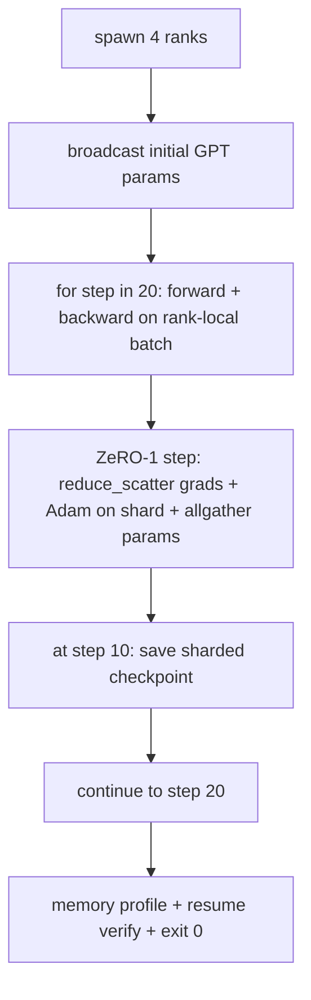

<!-- local-zh-machine-draft: English source is canonical; prose translated automatically, code/math preserved. -->

<a id="end-to-end-distributed-training"></a>

# 端到端分布式训练

> 76到80个课,每个课都做了一块。这是一个集合:一个小的 GPT 4名学员在DDP中接受了培训, gradient 同步,ZeRO-1 优化国家碎片,和碎片 checkpoint 中间点。演示运行20步,自我终结,打印一个丢失曲线加上一个内存配置,并写一个可修复的 checkpoint.

**类型：** 构建
**语言:** Python
**先修要求:** 第19阶段C轨道课程42-49
**时间:** ~90分钟

<a id="learning-objectives"></a>

## 学习目标

- 合成DDP(第77项)加上ZeRO-1(第78项)加上碎片 checkpoints 进入一个训练圈
- 训练一个双层 transformer 语言模型,一个小型合成体, 分布在4级模拟的20步。
- 打印每步丢失表、每级存储配置和 checkpoint 以相同的世界规模恢复字面相等
- 捍卫组成:每件东西都可以在早期的教训中独立测试,这一教训证明它们都是成文的。

<a id="the-problem"></a>

## 问题

综合项目是这些碎片合在一起的证据。 第76课执行集体制。 第77课将它们包成DDP。 第78课以减速方式将优化状态压缩_散射。 79课分析管道。 80课节省了一条碎片 checkpoint。每个课目都通过自己的测试而单独存在。真正的训练跑一次使用每一个原始的训练;如果构成错误,损失就会不同。 checkpoint 拒绝恢复, 或者每级记忆增加 当它应该缩小。

课程通过端到端演示,并核实四个变量:(a) 浮标噪音中20个步骤的损失单调减少;(b) 每个等级都相同 parameter 标准,(c) 一级优化内存等于ZeRO-1 公式 12P/N字节,以及(d) checkpoint 显示自终结: 20 个步骤, 单命令, 退出 0 。

<a id="the-concept"></a>

## 概念



<a id="the-mini-gpt"></a>

### 迷你车 GPT

模型特意小:2 transformer 区块, 嵌入暗点 32, 4 attention 头, vocab 64, 序列长度16, 第4批. 几千 parameters。大到足以进行每一项电线决定(多头) attention 运行标准遮蔽路径; LayerNorm 具有 weights 同步; LM 头是返回 vocab 的单线投影。 小到 20 步 4 CPU 排队数秒后结束

<a id="the-composition-rules"></a>

### 组成规则

| 课程 | 拥有的东西 | 是什么留给循环 |
|--------------|--------------|----------------------------|
| DDP 广播 | Initial parameter sync | 建造时间一个呼叫 |
| ZeRO-1 级 | Gradient 同步,主复制更新, parameter broadcast | 每步一个呼叫 取代乐观。 |
| Sharded checkpoint | 永久性的每级状态, 以 sha256 计 | 调用通过所有加热收集的状态 |
| 训练循环 | 前进,后向,损失记录 | 要求上述三个机构进行 |

循环不知道如何缩小_分散或集合文件。 checkpoint 模块会暴露环形所构造的狭窄界面。

<a id="why-a-tiny-gpt-and-not-just-an-mlp"></a>

### 为何小 GPT 不只是MLP

课程77的多功能化程序足以证实 gradient 同步,一个小 GPT 加上三件事:在阴道上另设一个LM头(在这个课中,为明晰而设;完整); GPT 通常将头部与 token embedding), softmax+cross-entropy 与损失(数字边缘数多于 MSE)和不对称前方(embeddings 然后 attention 然后按层 MSLP 键。 粘贴综合项目的 MLP 将会隐藏组成是否要处理 LayerNorm 或该 embedding 层的梯度形状正确 。

<a id="self-terminating-means-exit-0"></a>

### 自封意味着退出0

环运行固定的 20 步和退出。 `while True`, 人类不能干预, 外部状态不能恢复。 综合项目可以无人看管, 当它完成时找到完整的木头, 就能证明系统是被正确连接的。 如果任何一块块陷入僵局, 演示就永远不返回, 测试设备就会抓住它 。

```figure
ci-distributed-assembly
```

<a id="build-it"></a>

## 动手实现

`code/main.py` implements:

- `MiniGPT`: 2 层 transformer 带有蒙面 self-attention 和另一个LM头。
- `make_corpus(seed, total_tokens)`:决定论下一个token- 预测数据
- `_train_worker`:每个军阶的产卵;广播在栏杆上,运行循环,调用ZeRO步,写入碎片 checkpoint 10步处
- `verify_resume`:主运行后, 重新装入第10步 checkpoint 并声称保存的主碎片与模拟快照的字节相对应。
- `main`: 绘制整个演示、打印丢失表、内存配置和验证结果。

运行：

```bash
python3 code/main.py
```

输出: 20行丢失表, 每公里4行存储器配置 checkpoint 和"报复弗利弗"的成功路线

<a id="production-patterns-in-the-wild"></a>

## 野生生物的生产模式

三种模式完成实际运行的构成。

**Checkpoint 每一K分钟,不是每K步。** 步数随后奏长度和微批量数而变化。 checkpoint 弹簧的计算方法相同,无论模型大小。 课时使用基于步态的简单化; 制作时用基于墙的时钟。

**及早发现差异** 生产运行量增加a NaN 后向和损失检测仪后卫;如果损失一跃超过2x,则返回前一步 checkpoint 而不是让乐观派步入堕落状态。 课程的流失曲线是平滑的,所以警卫没有使用,但钩子会留下。

**将记忆分布汇总到各个级别。** 逐级的内存在实际运行中有所不同( 最大管道阶段的排位会有更多激活)。 生产记录在每列最多加上平均值; 每排的课程指纹显示公式匹配 。

<a id="use-it"></a>

## 实际应用

生产模式:

- **DeepSpeed.** 结合DDP+ZeRO+管道+ activation checkpointing 在一个配置下。 课程的构成是微小的深精细形状。
- **PyTorch FSDP.** 本地的等同物。 `FullyShardedDataParallel` 与 `ShardingStrategy.SHARD_GRAD_OP` 泽罗二号
- **尼莫和威震天** Add tensor 与最大模型平行;否则构成是相同的形状。

<a id="ship-it"></a>

## 交付成果

整个轨道到此结束。 6个课程是:一个真正的团队在采用深血球之前将建立的分布式培训子系统;抽象化已被证明与格鲁相匹配,失败模式已经运行。 阶段17(基础设施和生产)是将其变成真正集群的地方。

<a id="exercises"></a>

## 练习

1. 添加a tensor- 平行分割 attention 头部和校验损失与单级基线一致。 attention 输出.
2. Add gradient accumulation 横穿4个小坑,证明 gradient 等于 gradient 一大批货
3. 加上一条从第10步开始的恢复路径,该路径实际上继续培训到第20步,并产生与最初运行相同的最后损失。
4. 添加一个计量导出( 损失、 毕业规范、 步数) JSONL 这样就可以在事后看到比赛
5. 添加a NaN 回到上一个 checkpoint 并强制用一步长程机来进行 rollback.

<a id="key-terms"></a>

## 关键术语

| 术语 | 人们怎么说 | 它实际上意味着什么 |
|------|----------------|------------------------|
| End-to-end | "全部闪电" | 一次运行将每个片段组成, 不是每片的单位测试 |
| 内存配置 | "一等一等" | 每个级别都保留字节, 参数、 梯度、 优化状态 |
| 续签合同 | 保存和装载 | 州级字节等同 checkpoint round-trip |
| Self-terminating | "奔跑" , 转身 | 固定的步数,完成后退出0,循环中没有人 |

<a id="further-reading"></a>

## 进一步阅读

- [深频端对端培训辅导](https://www.deepspeed.ai/getting-started/)
- [PyTorch FSDP 高级辅导](https://pytorch.org/tutorials/intermediate/FSDP_advanced_tutorial.html)
- [威震天- LM 培训脚本参考](https://github.com/NVIDIA/Megatron-LM)
- 第19阶段 76-80课 - 每课都写着
- 第17阶段 - 将组成移到真正的组群
