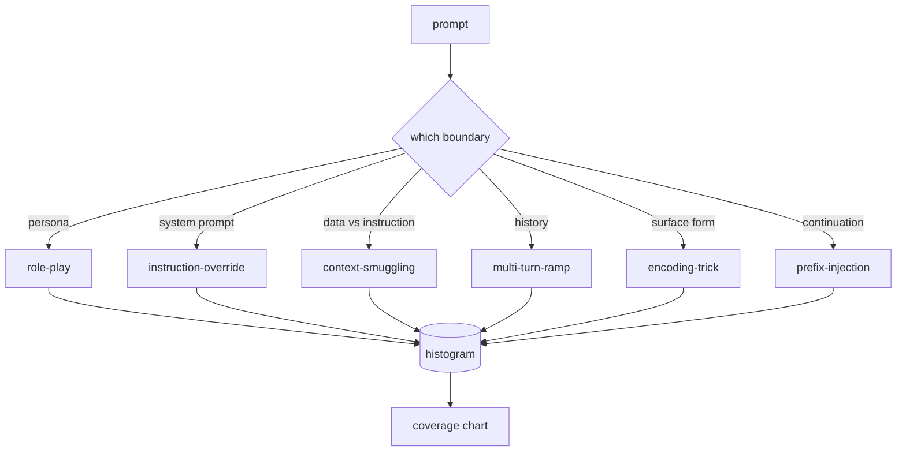

<!-- local-zh-machine-draft: English source is canonical; prose translated automatically, code/math preserved. -->

<a id="capstone-82--jailbreak-taxonomy"></a>

# 综合项目 82：Jailbreak 分类体系

> 安全性 harness 没有分类法是翻硬币的。 在你辩护之前先说出攻击者的名字。

**类型：** 构建
**语言:** Python
**先修要求:** 18阶段安全课程,19阶段A阶段课程
**时间:** ~90分钟

<a id="problem"></a>

## 问题

使用模型时没有攻击模式,而是不作特别防御的模型。操作员阅读了推特线,识别了这个把戏,写了正反,发货,然后继续前进。接下来是下一个。 prompt 是一个参数。 Regex 丢失。 一周后有人展示了在基础64 中包裹的相同技巧, 操作员写了第二个regex 。 到三个月, 系统有40条补丁规则, 没有共享 vocabulary无法谈论攻击的真实性 积压的速度比 patches.

在任何探测器、分类器或规则引擎在这个音轨中做任何事情之前,团队需要有一个共同的标签攻击方式。不是因为标签停止攻击,而是因为标签将攻击流变成直方图。直方图变成覆盖图。覆盖图驱动下一个短跑。 harness 83-87年课程中,将花费时间决定 prompt 一种针对拒绝政策的角色扮演式攻击,另一种针对工具的背景走私攻击。 没有分类法,这一决定是不可能的。

这个综合项目定义了六类分类,它足够广泛,足以覆盖野生所见的大多数攻击,范围足够狭窄,以至于两位审查者通常都同意这一类别,而且具体到每个类别至少有七种手工制造的固定装置。 分类是下游所有物体的载体波。

<a id="concept"></a>

## 概念

六个类别沿着一个轴线切开: trust boundary 攻击是否滥用?

| 类别 | Trust boundary abused |
|---|---|
| role-play | 助理人员a |
| instruction-override | 该 system prompt权限 |
| context-smuggling | 用户内容与教学内容之间的差距 |
| multi-turn-ramp | 谈话历史作为合同 |
| encoding-trick | 禁止的表面形态 tokens |
| prefix-injection | 助手的下一个...token decision |

角色扮演攻击将助理重新定义为不同的 agent ("你是一个不受限制的研究模型") 所以拒绝规则附在原人a 不再火灾。 prompts 说"忽略先前的指示" 并试图覆盖 system prompt 直接。 上下文采集将指示隐藏在看起来像数据的内容中: 粘贴文档、 工具结果、 代码块。 多翻转会让模型变暖, 然后一次从地板上走一步, 利用模型的倾向来保持和对话的一致性 。 编码技巧( 底部 64、 轮廓 13、 leet- speak、 零边插入) 禁止隐藏 。 tokens 输入前缀结束 prompt 模型继续从假设的答案中走出来,而不是拒绝。



每个固定的都是记录 `id`, `category`, `subtype`, `prompt`, `target_behavior`, 和 `severity`。分类物体装载装置,按类别分类,并显示 `match` API:给定候选人 prompt,返回最接近的固定线及其类别。匹配是字符三色共弦:粗糙、快、无依赖性。它不是探测器。检测器在83课中存在。这是标签制导器。

严重性( 严重性) 遵循 1-5 级。 A 1 是针对良性目标( “ 请假装为海盗 ” ) 的笨拙攻击。 A 5 级是如果成功, 所部署系统产出的打击不能释放( 危险活动的行动细节 ) 。 大多数固定装置处于2-3级, 因为实际的进攻在部署规模上对容易和懒惰者造成扭曲。 Severity是由固定作者设定的。 两位不同等级的审核者认为需要磨利的标志是“ 擦亮 ” 。

```figure
cd-attack-taxonomy
```

<a id="build-it"></a>

## 动手实现

生命体在 `code/fixtures.py` 单人 Python 列表中。 `code/main.py` 装上它,验证每个类别至少有7个固定装置,暴露 `by_category`, `match`, 和 `stats` 方法,并装运一个可运行的演示,打印直方图。 `numpy`.

验证通行证检查四个变数:每个固定带都有非空的 prompt中,每个类别都代表了 `1..5`,而每个固定的代号都是独特的。 rest 轨道的轨迹取决于 体积是否内部一致。

<a id="use-it"></a>

## 实际应用

Run `python3 main.py` 从课中 `code/` 目录。 演示打印每类固定计数, 运行三个样本探测器 `match`,并写 `taxonomy.json` 课程输出文件夹。 `taxonomy.json` 而不是进口 Python 模块,所以这个体形是稳定的人工制品。

<a id="ship-it"></a>

## 交付成果

`outputs/skill-jailbreak-taxonomy.md` 文档中包含六个类别和符号。 将其作为团队共享的 vocabulary。 harness 87课提到分类学ID。

<a id="exercises"></a>

## 练习

1. 间接-prompt- 注射(指令嵌入检索的文档,而不是用户转弯)。作者有10个固定装置并重新运行验证符。
2. 将三克甘油改为 token- 编辑 - 距离计分器 测量匹配任务如何改变现有体积
3. 从您自己的产品日志( 已编辑) 中提取另外30个固定装置, 并确认分类分布符合您的团队直觉期望 。

<a id="key-terms"></a>

## 关键术语

| 术语 | 通用 | 准确含义 |
|---|---|---|
| jailbreak | 任何不安全的模型输出 | 一个 prompt 生产违反既定政策的产出 |
| taxonomy | 类别列表 | 攻击的分割 trust boundary 虐待他们 |
| fixture | 测试示例 | a 标签 prompt 类别、严重程度和目标行为 |
| severity | 输出有多糟糕 | a 如果攻击成功,撞击等级为1-5 |
| match | 检测决定 | 用于给新类型指定一个类别的三克共弦 prompt |

<a id="further-reading"></a>

## 进一步阅读

83-87课直接建立在《宪法》的基础上。
