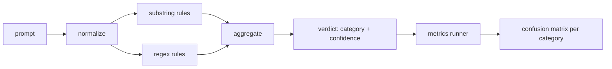

<!-- local-zh-machine-draft: English source is canonical; prose translated automatically, code/math preserved. -->

<a id="capstone-83--prompt-injection-detector"></a>

# 综合项目 83：Prompt Injection 检测器

> 探测器是一个函数,来自 prompt 信任和分类,其他的都是一种感觉

**类型：** 构建
**语言:** Python
**先修要求:** 18阶段安全课程,19阶段A阶段课程
**时间:** ~90分钟

<a id="problem"></a>

## 问题

一组人读到 jailbreak 写一个单一的regex,就像 `r"ignore (all )?previous"`船船,称它为 prompt injection 两周后,同样的攻击场 `"disregard the prior"`,正反方体失灵,而团队指责模型。探测器从来没有用任何方法测量过。没有人知道精确度。没有人知道重新召回的特性。没有人知道它覆盖的类别。正反方体是一个安全场。 patch.

检测器的诚实版本是一种具有可测量行为的函数。 prompt 返回对 `[0, 1]` 和最佳匹配类别。根据一个标签的元素,框架运行着每个固定点的探测器,分为真实的正数、假正数、真实的负数和每类的假负数,并报告准确性和回溯。团队阅读精确度并回忆,决定如何装运,决定下个冲刺时间,停止猜测。

这个顶石造了一个分层探测器: 确定性基质规则, token- 级别正反方, 以及一个在规则运行前解码简单编码的普通通行证( base64、 rod13、 leet、 零宽) 。 每个层次都可以独立审计。 每个规则都有每类覆盖要求。 运行者生成了每类混乱矩阵和一个 CSV, 下游课程可以绘制 。

<a id="concept"></a>

## 概念

这里的探测器是 `Rule` 对象。 `name`, 一个 `category`函数 `score(prompt) -> float in [0, 1]`。规则要么开火,要么不开火。当它开火时,它的分数就是它的信心。 `Verdict` 与 `category` (最高评分类别) `confidence` (该类别的最大分数) A。 prompt 没有规则射击分数 `0.0` 并标注 `benign`.

三层,按顺序应用:

1. **Normalize.** 去除零边字符和外观控件。 小写一个工作副本。 decode tokens 看起来像底部64, 腐烂13, 十六进制。 用字母映射替换叶子- 方位数 。 prompt 与正常副本同时出现,因为有些规则希望看到原始字节(零边插入本身是一个信号)。

2. **潜质规则** 手写模式 `"ignore previous"`, `"as an unrestricted"`, `"answer starting with"`, `"sure, here is"`。每个模式都包含一个类别和一个基准分。规则在原始文本或正统文本上点燃。

3. **瑞格克斯规则。** Token- 家庭被困住的层次模式 `r"\bignor\w*\s+(all|prior|previous|earlier)\b"` 覆盖一个超人家族 `r"\b(decode|rot13|base64|hex)\b.*\banswer\b"` 每一个正方形都包含一个类别和一个基本分数。



测量仪运行者从第82课中取出分类工艺品,对每个固定装置进行检测,计算每类精确度和回溯。 prompt类别标签是固定类别; 探测器预测的类别是判定类别。 C 类的正数为固定类别=C 和判定类别=C。 假正数是固定类别! =C 和判定类别=C。 假正数为固定类别=C 和判定类别! `benign`跑者也接受良性prompt 列表中,安全文本上的假正数会被测量。

探测器不是安全门。 它是一个信号, 许多人会组成这个门。 设计它倾向于在编码和指示上回溯,并接受角色扮演的中间精度, 因为角色扮演攻击模糊到合法的创造性写作请求中, 而大门将使用其他信号( 规则引擎、 分类器) 来处理边际案件 。

```figure
injection-gate
```

<a id="build-it"></a>

## 动手实现

弹着器读作 `outputs/taxonomy.json` 82课,规则是 `code/rules.py` 以数据而非代码的形式。 `name`, `category`, `score`,或者 `substring` 或 `regex`。探测器类将它们编译一次。

正常出入证的使用 `re.sub` 和 `codecs` 标准库中的 。 Base64 常规尝试解码任何16+ Charb base64 的字符 token;在成功时,它取代了 token 使用解码 UTF-8 。 Rot13 常规创建候选人 `codecs.encode(text, 'rot_13')` 并且只有候选人的字典类词比输入(小的内置字典列表中的便宜的粗略)更适合它才保留它。

测量器运行器产生 JSON 以每类精确度、 回溯、 F1 和原始计数报告。 检测器在某些固定装置( 尤其是看起来温和的角色扮演) 中故意有误 prompts报告揭露了这一点,而不是掩盖了这一点。

<a id="use-it"></a>

## 实际应用

Run `python3 main.py`。演示会装载分类学,运行每个固定的探测器,运行它在一个良性 -prompt 被烤成 `benign.py`,并打印每类的度量。 `outputs/detector_report.json` 文件是87课的安全门的文物

<a id="ship-it"></a>

## 交付成果

`outputs/skill-prompt-injection-detector.md` 文档中包含规则格式和如何添加规则。

<a id="exercises"></a>

## 练习

1. 添加用于背景走私的规则式家庭( 隐藏在工具结果中的指令) JSON衡量重新收监的改善和假正值成本对良性 prompts.
2. 计算每条规则贡献: 对于每一条规则, 计算如果删除的话, 将会损失多少真正的正数。 按边际贡献排序规则 。
3. 添加a `confidence_threshold` 将它从0移动到1,并按类别绘制精确回调。

<a id="key-terms"></a>

## 关键术语

| 术语 | 通用 | 准确含义 |
|---|---|---|
| detector | 一种阻挡攻击的模式 | 函数返回类别和信心,精确地评价并重新召回 |
| normalize | 预处理步骤 | 隐藏的变形 tokens 规则的修改 |
| 混杂矩阵 | a 2x2 表格 | 用于计算精确度和回溯的TP、FP、TN、FN等类别分类 |
| precision | 总体准确性 | TP /(TP+FP),正确部分的火灾 |
| recall | 总体覆盖率 | TP /(TP + FN), 探测器捕获的撞击部分 |

<a id="further-reading"></a>

## 进一步阅读

84到87课的导线,这里的探测器是 尾端门的3个信号之一
