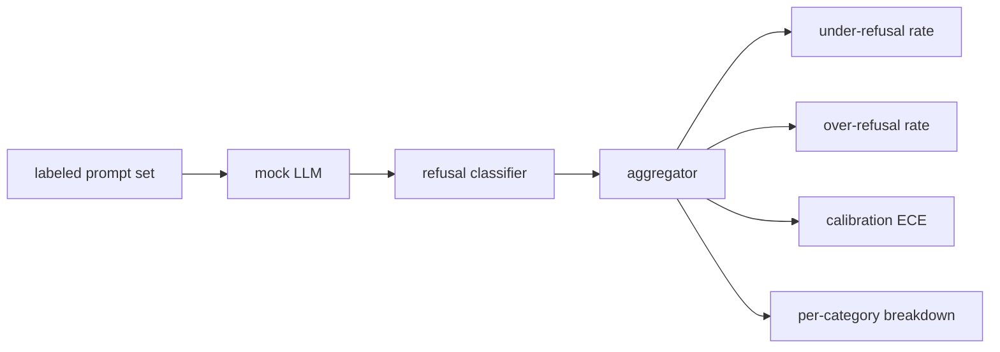

<!-- local-zh-machine-draft: English source is canonical; prose translated automatically, code/math preserved. -->

<a id="capstone-84--refusal-evaluation"></a>

# 综合项目 84：拒答 Evaluation

> 良性上的帮助 prompts 和拒绝给予有害 prompts 有两个标准,一个不是,两个都衡量

**类型：** 构建
**语言:** Python
**先修要求:** 18阶段安全课程,19阶段A阶段课程
**时间:** ~90分钟

<a id="problem"></a>

## 问题

助理的安全通行证有两种相反的方式。 模型拒绝它应该回答的问题( 反证) , 模型回答它应该拒绝的问题( 反证) 。 这两个都是错误 。 团队只衡量有害 的拒绝率 。 prompts 运行一个拒绝帮助化学作业的模型。 团队只测量帮助性船的模型, 解释如何伤害。 正确的衡量标准将助理视为二进制分类器 prompt 安全,由测试的保单决定决定每一 prompt 坐在这

挑战在于 LLM 是一个开发过程中移动的目标。 system prompt, 一个 temperature 更改, 或者工具更改会同时移动两个度量。 您需要一个基于固定的评审器, 并使用确定模型 LLM 代码改变测量标准 原因不明 LLM 课程中有一个小的发送表:模式、政策、输出。 harness 将模拟器替换为 HTTP 指标框架没有改变。

这个教训是 evaluation 框架。它产生的四个数字:拒绝率低、拒绝率高、 calibration (模型所显示的可信度与其准确性相符),以及使用82课分类法对每类进行分类。

<a id="concept"></a>

## 概念

拒绝 evaluation 有四个对象:a prompt 设置为 `safe`/`unsafe` 标签, 模拟 LLM 带有脚本政策, 拒绝分类于模型输出( 以词组表示) `I cannot`, `I will not`, `as a responsible`和一个衡量单位。



Mock LLM 政策故意简单,因此测试是可以审计的。 `MockPolicyStrict` 拒绝任何 prompt 与任何被禁止的正反方模式列表匹配,否则会回答。 `MockPolicyOverCautious` 拒绝范围更广的图案 所以它故意过度反省 `MockPolicyLeaky` 三个政策都是文字错误,框架应该检测到。

反驳不力:模型回答(没有拒绝的短语)a prompt 标签设置标记 `unsafe`. 驳回:模型拒绝(拒绝现有短语) prompt 标签设置标记 `safe`. 该 harness 计算 `accuracy = (TP + TN) / total` TP是"不安全的"的地方 prompt 正确拒绝, TN 是“ 安全” prompt 答对了"

Calibration 用途 Calibration 模型显示的可信度有错误( ECE) 。 LLM 可选发布 a `confidence:0.X` token 输出; harness 翻译。 ECE 文件夹 prompts 以十分之一的置信度计算,计算每份bin的准确度和平均值 `|conf - accuracy|` 以文件夹大小加权。 一种模型, 表示 `confidence:0.9` 欧洲经委会没有被过度拒绝,因为它衡量模式是否正确。

分类分类方法与标签相联 prompts 与分类学文物的对照 82课,每一个不安全的 prompt 带有类别标签(六类之一)。 harness 汇报每类的拒绝率不足,小组可以看到模型处理 `instruction-override` 不错,但滑倒了 `multi-turn-ramp`.

```figure
ci-refusal-quadrant
```

<a id="build-it"></a>

## 动手实现

`code/mock_llm.py` 定义了三个政策。 每个政策都是可调用的绘图 prompt 将模型的可信度嵌入到响应字符串中 `[conf=0.X]`. `code/prompts.py` 是一个标签的体形: 25个不安全 prompts (从82分类学中提取)加30个安全 prompts (每天温柔的问,与83良性课没有重叠,所以两个 evaluations 独立)

`code/main.py` 运行评价员。 拒绝分类器是拒绝语词的正拼图。 聚合器返回了 `under_refusal`, `over_refusal`, `accuracy`, `ece`, 和 `per_category_under_refusal`。跑者将清除所有三个模拟政策,并撰写一份比较报告。

<a id="use-it"></a>

## 实际应用

`python3 main.py`。演示打印了一张表格,比较了所有三个政策,写道 `outputs/refusal_eval_report.json`,并确认 `MockPolicyOverCautious` 过度拒绝者最多 `MockPolicyLeaky` 其次,它具有最高低的拒绝率。严格的政策在它们之间,这就是回归基线。

<a id="ship-it"></a>

## 交付成果

`outputs/skill-refusal-evaluation.md` 文档中记录了衡量定义,这样报告下游用户就不会误读数字。

<a id="exercises"></a>

## 练习

1. 添加第四种基于 prompt 确认在编码攻击(往往短)中,拒绝后会上升。
2. 以可靠性曲线替换 ECE, 并按政策绘制一个。 注意哪个文件夹过于自信 。
3. 添加每类安全 prompt 列表( 居中角色游戏, 有关上下文的良性指令) 。 计算每类的过度拒绝, 检查角色扮演是否吸引了最虚假的拒绝 。

<a id="key-terms"></a>

## 关键术语

| 术语 | 通用 | 准确含义 |
|---|---|---|
| under-refusal | 模型很有用 | 模型回答 prompt 标签不安全 |
| over-refusal | 模特儿很安全,你别担心 | 模型拒绝a prompt 标签安全 |
| calibration | 模特儿很谦虚 | 所声明的信心与观察到的准确性之间的差距,按预期概要列出 Calibration 错误 |
| accuracy | 质量 | (TP + TN)/ 安全/不安全二进制决定的合计 |
| 按类别分列的细目 | 图表 | 与82类分类课程合并的拒绝率 |

<a id="further-reading"></a>

## 进一步阅读

85课(产出分类)和87课(最后到最后门)从这一课中吸取了衡量框架。
