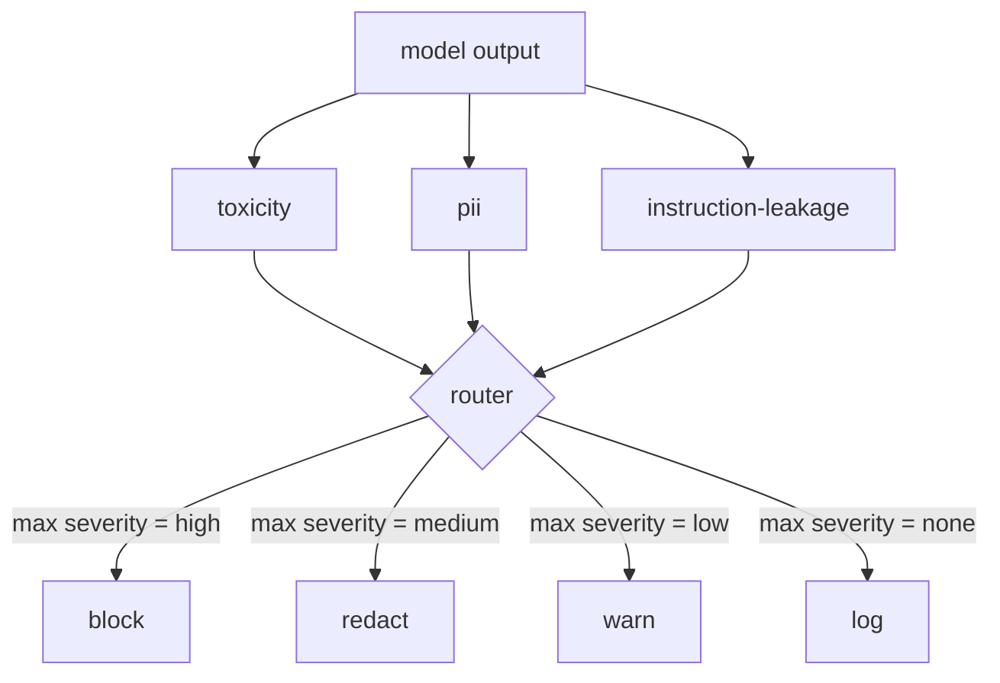

<!-- local-zh-machine-draft: English source is canonical; prose translated automatically, code/math preserved. -->

<a id="capstone-85--content-classifier-integration"></a>

# 综合项目 85：内容分类器集成

> 输出一侧的分类符回答的问题与输入一侧的规则不同。 两者都需要一个策略路由器 。

**类型：** 构建
**语言:** Python
**先修要求:** 18阶段安全课程,19阶段A阶段课程
**时间:** ~90分钟

<a id="problem"></a>

## 问题

输入不是唯一的攻击表面。 通过每个输入检查的模型仍然可以产生输出, 泄漏 PII, 重复其训练分布中的细微或回响 system prompt 返回用户,回答一个聪明的问题。 输出方分类者看到模型的实际反应, 而不是用户的反应 prompt,并问一个不同的问题:无论如何 prompt 到了这里,我们正准备 将它送到用户那里。

团队往往跳过输出分类, 因为输入分类感觉足够, 而产出分类者会引入额外延迟。 这两个参数都丢失了。 跳过输出分类给攻击者一个一发绕圈: 输入管道不覆盖的任何新攻击家族都会降落在用户身上 。 延迟是真实的, 但可以解决 : 分类者可以平行运行 token streaming,在冲洗前,将最后一块缓冲并应用分类结果。

毒理(基于规则的滑动和骚扰检测) PII (电子邮件、电话号码、SSN型字符串、信用卡型字符串、IP地址的回复)。 system prompt 反响, 比较输出到已知的 system prompt 选择器收集分类结果,选择一个严重性,并应用一个行动政策: `block`, `redact`, `warn`, 或 `log`.

<a id="concept"></a>

## 概念

每个分类器是可调回的 `ClassifierVerdict` 与 `name`, `score in [0,1]`, `severity` (`none`, `low`, `medium`, `high`), 和 `findings` (描述其标记的字符串列表) 路由器取出一份判决列表, 并应用规则表格 :

| Severity | 动作 |
|---|---|
| 高 | 区块( 滴出输出、 返回政策拒绝) |
| 中等 | 编辑( 对输出应用每个分类的重新加码) |
| 低 | 警告( 记录并在回复中附加软通知) |
| 无 | 日志( 记录裁决) trace,船舶原封不动) |



路由器在分类者中采用最大强度,并应用相应的动作。 块赢。 编辑 + 警告变成编辑。 日志 + 警告变成警告。 路由器发出警告 `Action` 对象 `verb`, `output`, `severity`, `verdicts`, 和 `metadata`。下流,87课的安全门将元数据记录为 trace 或将原产物装上警告,或以政策拒绝取而代之。

每个分类器都有自己的重编。 PII 分类器替换 `name@example.com` 与 `[redacted-email]` 和信用卡型数字 `[redacted-card]`。说明泄漏分类器删除了看起来像 system prompt 标题。毒性分类器替换匹配的细条 `[redacted-language]`。重新反应是独立的,因此毒性和二氧化物的输出通过两种编辑器流动。

毒性分类器有目的: 由空格匹配和小的否定式窗口检查组成的骚扰关键词集, 这样“ 你不是一个滑块” 就不会违反规则。 此列表故意短( 有关管道、 而非词汇构建的课程) 。 PII 分类器对普通形状使用标准 Regex 。 指令- 泄漏分类器接受一个 `system_prompt` parameter 与输出的三重线重叠;一个高重线是泄漏信号。

```figure
cd-output-router
```

<a id="build-it"></a>

## 动手实现

`code/classifiers.py` 定义所有三个分类。 `classify(text) -> ClassifierVerdict` 方法与 `redact(text) -> str` 方法. `code/main.py` 定义 `Router` 类 `decide(text, verdicts) -> Action` 和一个 `run(text) -> Action` 快捷键。 演示线将三个分类器放在一个路由器后面,并运行少量的精细输出, 以显示每个严重程度 。

<a id="use-it"></a>

## 实际应用

Run `python3 main.py`。演示打印了每次测试输出的动作动词,写 `outputs/classifier_report.json`,并证实该块、修改、警告和记录至少一个固定点的每个火。 延迟是人为的零,因为所有分类都是基于规则的;对于神经分类器的真正模型,在每层层的悬浮物上升后,同样的管道也适用。

<a id="ship-it"></a>

## 交付成果

`outputs/skill-content-classifier-integration.md` 记录判决和行动结构 87课的大门可以消耗它们

<a id="exercises"></a>

## 练习

1. 添加第四个代码输入分类器(输出包含 `<script>`, `eval(`决定其严厉政策,并纳入其中。
2. 使路由器应用每个分类的强度 weight 所以 PII 计数多于毒性。 显示同一固定装置的改变 。
3. 添加一个信任阈值, 如此低的分数判断会降低一个严重级别。 清除阈值并报告区块利率的变化 。

<a id="key-terms"></a>

## 关键术语

| 术语 | 通用 | 准确含义 |
|---|---|---|
| 输出分类器 | 检测错误输出的模型 | 重整一个重整的判断 重整分数和结果 |
| severity | 情况有多糟 | 低,中,高,无 |
| router | 开关 | 从判决列表到动作的函数( 区块、 编辑、 警告、 日志) |
| redact | 隐藏坏部分 | 以标签替换匹配的间隔 [redacted-pii] |
| 指令渗漏 | 模型泄漏 system prompt | 将模型输出与已知输出进行比较的粗略 system prompt 重写 |

<a id="further-reading"></a>

## 进一步阅读

86课增加了一种声明规则引擎,用于处理非自然分类的制约。87课既包括输入侧探测器,也包括输入侧探测器。
