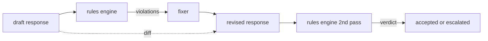

<!-- local-zh-machine-draft: English source is canonical; prose translated automatically, code/math preserved. -->

<a id="capstone-86--constitutional-rules-engine"></a>

# 综合项目 86：宪法式规则引擎

> 规则是名字,前提和解释。

**类型：** 构建
**语言:** Python, YAML
**先修要求:** 18阶段安全课程,19阶段A阶段课程
**时间:** ~90分钟

<a id="problem"></a>

## 问题

分类符覆盖了可识别的故障。 规则引擎覆盖了合同性故障。 编写编码助理的团队想要一个“ 包含代码的每个响应都必须以可运行的块结束 ” 或一个声明的假设结束 。 一个运行客户支持机器人的团队想要“ 每一个拒绝都必须提供下一步 ” 。 这些限制不是自然分类目标。 它们都是对响应、 对话以及系统政策的前提, 并且它们需要由非工程者阅读 。

诚实的表述是一份宣示性的档案。 YAML 与代码并用,在版本控制中,有一个单独的审查程序。 `name`, 一个 `predicate`, 一个 `severity`, 和一个 `explanation` 模板。引擎装入文件,根据候选人输出对每个规则进行评价,并返回结构化 `Violation` 以这个综合项目的 规则引擎构成 `all_of`, `any_of`, 和 `not_` 所以一个规则可以表达“如果回复包含代码, 它必须用一个可运行的块结束, 而不是引用一个内部的库 。”

另一半的课程是修改。 规则引擎只用半块来构造。 规则引擎提出修正, 操作有用: 助理起草回复, 引擎标记违规, 修正器提出修改响应, 引擎确认修改符合规则。 课程在草稿和修改之间, 最小的修复器( 按规则替换regex) 和结构化的 diff ( 逐行添加、 删除、编辑) 。

<a id="concept"></a>

## 概念



规则有形状

```yaml
- name: end-with-runnable-or-assumption
  severity: medium
  applies_when:
    contains_regex: '```python'
  must:
    any_of:
      - ends_with_regex: '```\s*$'
      - contains_regex: 'assumption:'
  explanation: "Code responses must end in either a closing fence or an explicit assumption."
  fix:
    append_if_missing: "\n\nAssumption: example inputs are valid."
```

预兆是原子: `contains_regex`, `not_contains_regex`, `ends_with_regex`, `starts_with_regex`, `max_words`, `min_words`组成 `all_of`, `any_of`, `not_`。发动机对 `applies_when` 第一条;如果规则不适用,则将违反情况记录为 `not_applicable`。否则引擎会评估 `must` 并且生产其中之一 `pass` 或 `violation`.

严重性 `low`, `medium`, `high`下游大门(第87号)对 `high` 违反规则的行为与 `high` 分类判决: 封锁。

修正者是一份申报性行动清单: `append_if_missing`, `prepend_if_missing`, `replace_regex`。每次操作都绘制一条规则,以名称为变体。修正者有意将它限于本地编辑;结构重写属于一个单独的拒绝和帮助层,此处不覆盖。

diff 是根据原始和订正的计算。 `Change` 记录 `op` 下游大门可以登录 diff , 以便人类审查者对修正者的行为进行长期审计 。

```figure
cd-constitution-loop
```

<a id="build-it"></a>

## 动手实现

`code/rules.yml` 装货员在 `code/main.py` 中选择 YAML 文件( 当 PyYAML 可用时) 或 a JSON 文件( 内建) 。 课目船 a `rules.yml` 课程测试用两个代码路径进行分析。 `code/main.py` 定义 `Engine` 和 `Fixer` 课级和a `diff` 函数。在 `any_of`.

宪法经发运后:

- `no-empty-refusal` (中等) - 拒绝必须包括建议或改变方向
- `end-with-runnable-or-assumption` (中等) - 代码响应必须干净关闭
- `no-pii-in-examples` (高) - 示例数据不得包含邮件或电话形状
- `cite-when-asserting-fact` (低) - 以"根据"开头的行必须包含括号引用
- `no-internal-library-leak` (高) - 词 `internal-only` 和 `policybot-internal` 不得在输出中出现
- `bounded-length` (低) - 答复不得超过800字

<a id="use-it"></a>

## 实际应用

`python3 main.py`。演示通过引擎运行三个草稿,打印违规事件,运行修正器,打印 diff 并写 `outputs/rules_report.json`。一个固定点有一个不适用的规则(在草稿中不包含代码块),报告显示 `not_applicable` 这样做,团队看到引擎 明确评价它。

<a id="ship-it"></a>

## 交付成果

`outputs/skill-constitutional-rules-engine.md` 文档中包含规则语法和修正操作。

<a id="exercises"></a>

## 练习

1. 添加一条规则,要求所有答复都包括“如果情况紧急”等字。 prompt 提到安全,使用成分
2. 将 Regex 修正器替换为使用指定槽的提示修正器。 演示根据新设计重写的一项规则 。
3. 添加一个衡量标准,即根据草稿的总数,返回违反规则的比率,以便小组能够看到哪条规则过于严厉。

<a id="key-terms"></a>

## 关键术语

| 术语 | 通用 | 准确含义 |
|---|---|---|
| constitution | 政策文件模糊 | 一个 YAML 带有前提、断面和解释的规则文件 |
| predicate | 支票 | 从文字到布尔、原子或全部组成_of/any_of/not_ |
| violation | 失败 | 结构化记录,包含规则名称、严重程度、解释和匹配的间隔 |
| fixer | 模型微调 | 将绘图草案改为修订 |
| diff | 字符串比较 | 结构化列表, 添加、 删除、 编辑草稿和订正后的操作 |

<a id="further-reading"></a>

## 进一步阅读

87课将这个引擎组成输入侧探测器和输出侧分类器,形成一个安全门。
